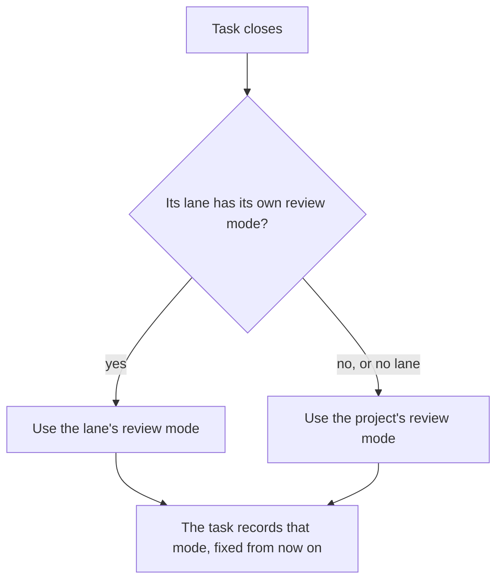
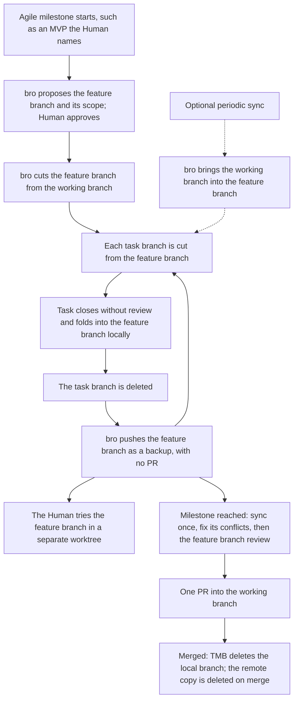
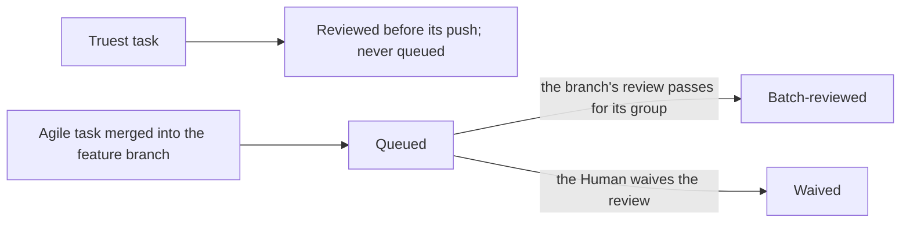
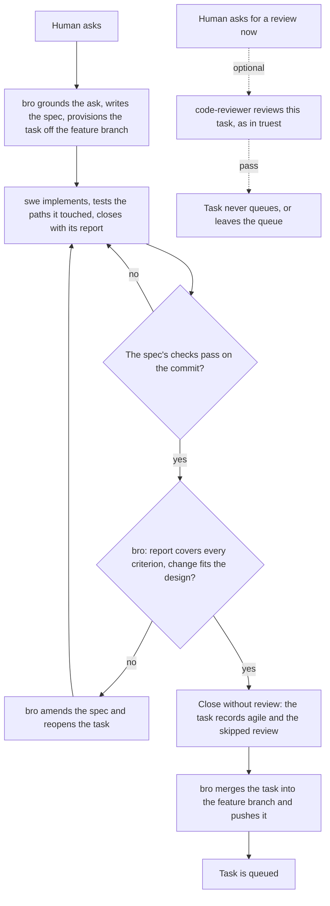
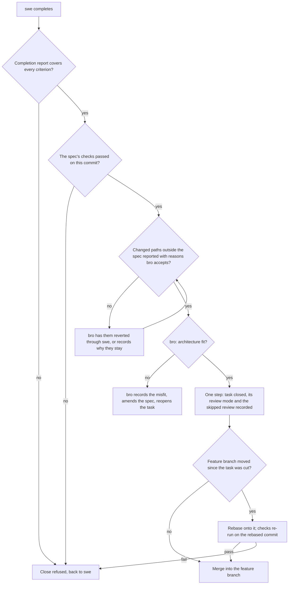
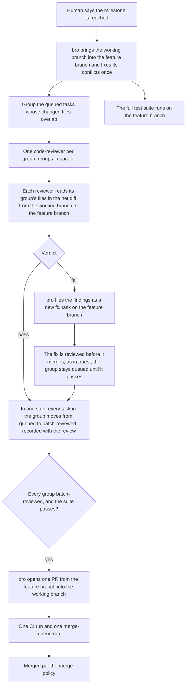
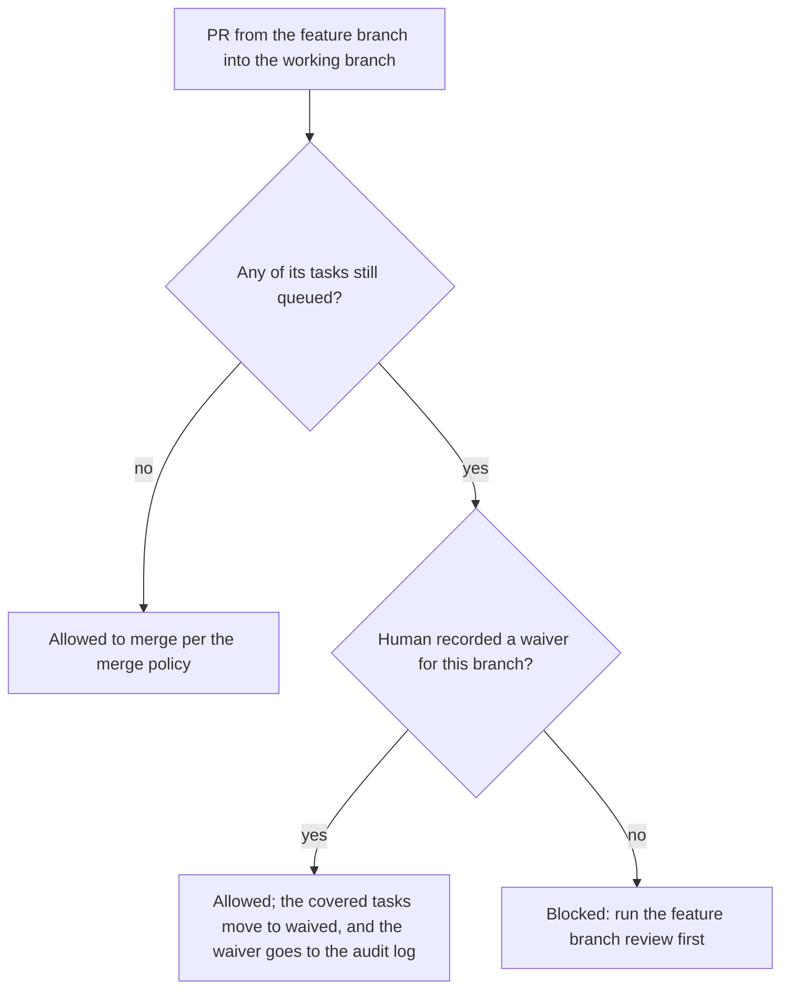
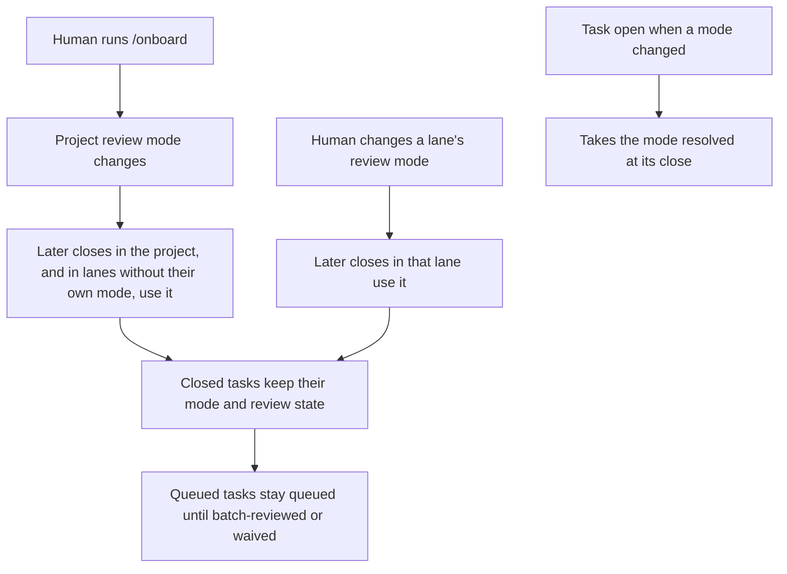

# Agile review mode

Every case of flow 3.9 in [FLOWS.md](FLOWS.md): how agile work builds up on a long-lived feature branch, how its tasks close without a per-task review, how the branch is reviewed once before it merges, and how the review mode is set and changed.

The review mode decides who reviews a task and when. It is separate from the merge policy, which decides who merges.

Project-level agile mode has partly shipped: /onboard sets the project's review mode, agile tasks close without a per-task review and fold into a feature branch, each queued for review, and the feature branch's PR into the working branch is gated on that review or an audited Human waiver. Planned (GH 2225, GH 3025): the feature branch review, so until it ships the waiver is the only way through the gate; grouping the queue by the files each task changed; the agent prompts for agile mode; and lane review modes. [Shipped and planned](#shipped-and-planned) marks each piece.

## Why a feature branch

- **Truest**, the default, reviews every task before its push, and each task becomes its own PR into the working branch, such as dev. Nothing reaches the working branch unreviewed.
- **Agile** is for building a feature in many small tasks and judging it as a whole: an MVP the Human wants to try once it works end to end, or an idea that may be dropped. Merging ten tasks into dev one by one, each with its own review and CI run, delays that test and spends ten CI runs on work no one can judge yet.

So agile work builds up on one long-lived feature branch per milestone, such as an MVP. Each task closes without a code-reviewer pass and folds into the feature branch locally, with no PR and no CI run of its own. The Human can try the feature branch at any time. At the milestone, code-reviewer reviews the whole branch, and only then does it go to the working branch as one PR with one CI run.

Agile is opt-in, and only the Human turns it on.

## Where the review mode is set

- **Project.** /onboard sets the project-wide review mode. Truest is the default.
- **Lane.** Each lane of a parallel run takes its own review mode when it starts, recorded on the lane's record, and it overrides the project's ([LANES.md](LANES.md)). bro recommends a mode per lane and the Human approves the set. Planned: GH 3025 records it on the lane; GH 2225 adds the lane lookup to the close.
- **TMB keeps it.** The review mode lives in TMB's own records, never in GitHub labels, which a user without triage access cannot apply.

## The feature branch

- **One feature branch per milestone.** It is long-lived and spans every task of the milestone, such as an MVP. bro proposes it for the milestone the Human names, and the Human approves its scope and name. An agile lane owns one for its own work (planned, GH 3025).
- **Tasks fold into it.** Each task branch is cut from the feature branch's tip and folds back into it locally once the task closes, so the next task builds on the last. The fold opens no PR, and the task branch is then deleted.
- **Its tasks are checked against it.** An agile task's freshness, merge-base and scope checks use its feature branch as the base. The working branch is the base only for the milestone PR.
- **Pushed only as a backup.** bro pushes the feature branch so the work is on origin. TMB opens no PR for it before the milestone, so no CI or review runs on it.
- **Tried in its own worktree.** The Human tries the work by opening the feature branch in a separate worktree, never by switching the shared checkout, which every lane reads on the working branch.
- **Synced at the milestone.** At the milestone, bro brings the working branch into the feature branch and fixes its conflicts once. An optional periodic sync before then keeps that fix small.
- **Cleaned up after the merge.** Once the milestone PR merges, TMB deletes the local feature branch, and the remote copy is deleted on merge.

## Review state

The review mode on a task is history: it is fixed at the close and never changes. What changes afterwards is the task's review state.

- **Queued** means merged into the feature branch and waiting for review.
- **Batch-reviewed** means the feature branch's review passed for the task's group. The move is recorded with the review that cleared it.
- **Waived** means the Human let the feature branch merge without that review. The waiver names the branch, and the audit log keeps it.

## Task flow

- **swe tests the patch.** It runs the checks for the paths it touched, and the spec's checks run once more on its commit before the completion counts. These local checks replace the per-task CI run.
- **bro tests the design.** It judges whether the report covers every success criterion and whether the change fits the architecture. It reviews no diff line by line.
- **bro merges into the feature branch.** The merge policy covers PRs into the working branch. A task's merge into its feature branch is bro's, because it is local work no one else has seen yet.
- **code-reviewer is on call.** The Human can ask for a review of any task at any time, and a passing review keeps that task out of the queue.

## Safe close

Dropping the per-task review removes one gate and nothing else. A task closes when every remaining gate holds:

- **What stays on.** swe's completion report, the spec's checks, the git and write guards, and the close as one step.
- **What the close records.** The task's review mode is resolved once, at the close, from its lane and then the project, and stored on the task. Everything later reads that stored mode, never the current setting.
- **Recovery.** A close that fails partway leaves the task as it was. bro fixes the cause and closes again.

## Feature branch review

Planned (GH 2225).

- **The Human decides when.** The review runs when the Human says the milestone is reached, such as when an MVP works end to end, not after each task. It is one batch review of the milestone, split into groups that run in parallel.
- **Groups form after the fact.** Which files a task will touch is hard to know before it is planned, so tasks are not grouped up front. The groups come from the files each task actually changed, and tasks that share a file are reviewed together, so a reviewer sees their combined effect.
- **Net diff.** The review reads what the feature branch adds to the working branch, not each task's patch. Churn a later task undid is never reviewed, and a conflict resolved on the branch is reviewed as resolved.
- **The suite covers the gaps.** A reviewer reads its group's files and their dependents. The full suite on the feature branch catches what crosses two groups.
- **A pass updates the whole group.** Every task in the group becomes batch-reviewed at once, recorded with the review that cleared it. Each task still records agile as its review mode.
- **Failures.** A fail becomes a fix task on the feature branch, and that task is reviewed before it merges, like any truest task. Once it passes, the group is batch-reviewed.
- **Visibility.** TMB's health check reports agile tasks closed more than a day ago, by default, with neither a passing review nor a waiver, so the queue never hides (shipped).

## Merge gate

The feature branch reaches the working branch only through one gated PR.

- **Scope.** Task merges into the feature branch are not gated by the queue. Only the merge into the working branch is.
- **Waivers.** Only the Human records a waiver. It names the feature branch it covers, and the audit log keeps it with the list of tasks that merged unreviewed.
- **Until the review ships.** The feature branch review is planned, so a Human waiver is today the only way through the gate.
- **Dropped work.** A feature branch the Human abandons never merges, so its queued tasks need no review. bro records them as dropped and deletes the branch only when the Human says so.

## Switching review modes

- **Only the Human switches.** The project's mode changes through /onboard. A lane's mode is set when the lane starts and changes later only through the lane change path in [LANES.md](LANES.md) (planned: GH 3025, with the approval gate in GH 3028). bro or another agent never switches a mode.
- **The close decides.** A task opened under one mode and closed under the other follows the mode resolved at its close.
- **Switching to truest keeps the branch.** Later tasks are reviewed before they merge into the feature branch, and the branch still needs its review, or a waiver, before it merges into the working branch.
- **Switching to agile starts a branch.** bro proposes a feature branch for the work still ahead, as in [The feature branch](#the-feature-branch).

## Shipped and planned

| Piece | State |
|---|---|
| Project review mode setting, truest by default | Shipped, read by the close gate |
| Review mode recorded on each task at its close | Shipped, project mode only |
| Health-check report of agile tasks closed without a review or waiver | Shipped |
| Queue listing: closed agile tasks not yet reviewed, grouped by the files their specs named | Shipped |
| /onboard question for the project review mode | Shipped |
| Feature branch per milestone: tasks cut from it and folded into it locally, with no per-task PR, and checked against it as their base | Shipped, project mode only |
| Close without a per-task review | Shipped, project mode only |
| Review states queued, batch-reviewed and waived | Shipped |
| Queue of a feature branch's tasks, grouped by the files each task changed | Planned (GH 2225) |
| Feature branch review: one batch review on its net diff | Planned (GH 2225) |
| Merge gate on the feature branch PR, and audited waiver | Shipped; the waiver is the only way through until the feature branch review ships |
| Lane review mode and lane feature branch, set at the lane's start, and the lane lookup at the close | Planned (GH 3025, GH 2225) |
| Agent prompts for agile review mode | Planned (GH 2225) |
