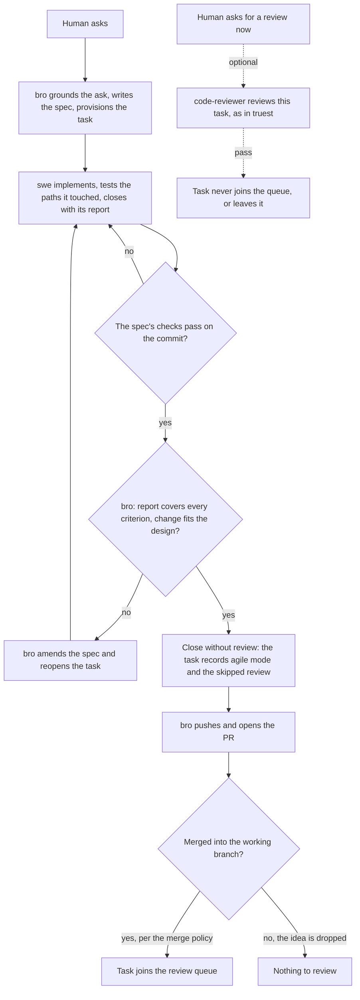
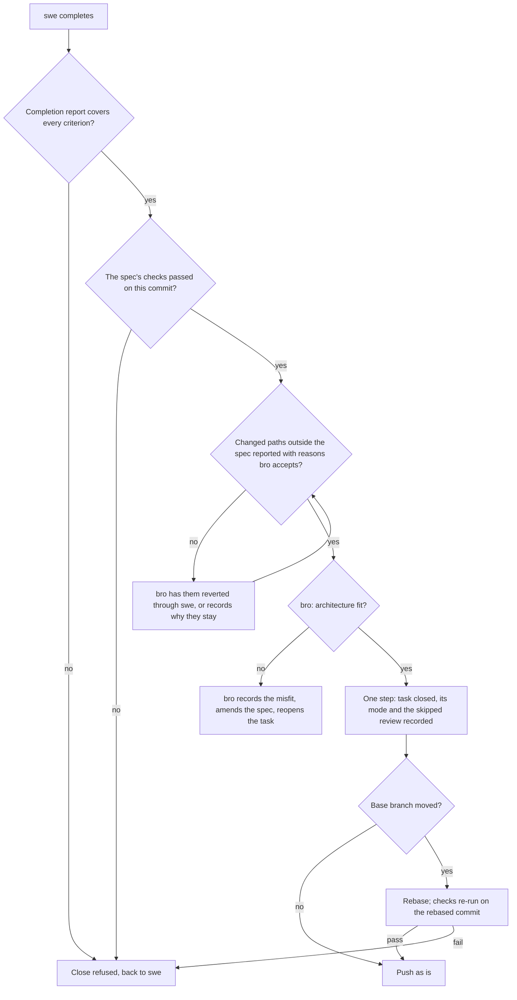
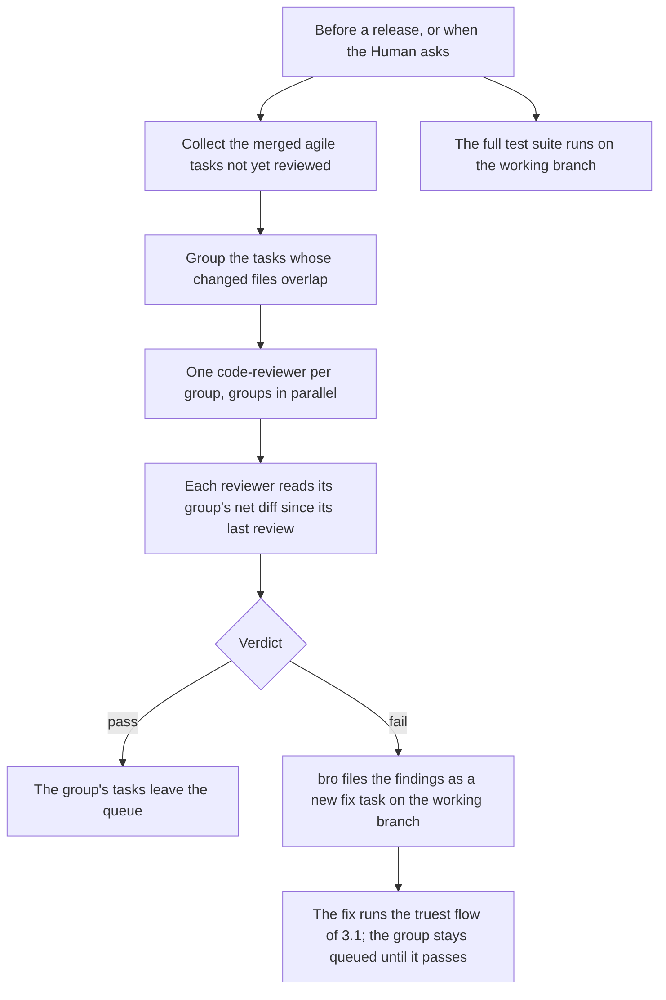
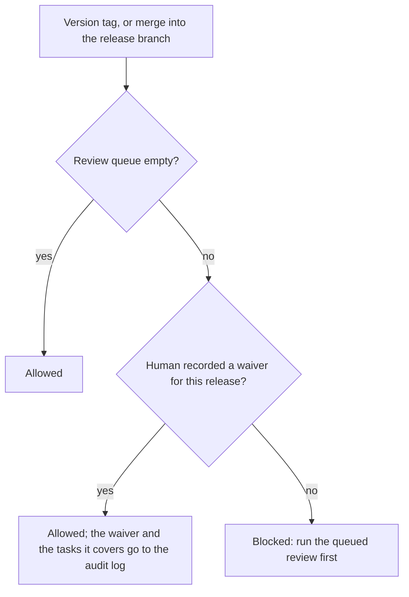
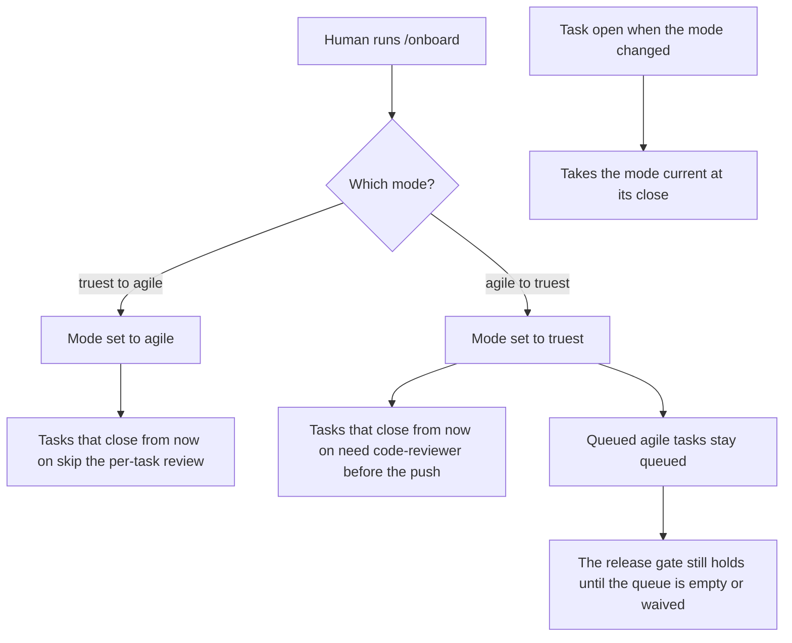

# Agile mode

Every case of flow 3.9 in [FLOWS.md](FLOWS.md): how a project in agile mode closes tasks, which work joins the review queue, how the queue is reviewed, how a release waits for it, and what changes when the mode switches.

Planned (GH 2225) unless marked shipped. Today each task already records the project's mode when it closes, and TMB's health check reports agile tasks left unreviewed, but no gate reads the mode yet. Every project still runs the truest flow of 3.1.

## Why two modes

- **Truest**, the default, reviews every task before its push. code-reviewer is the push gate, and nothing ships unreviewed.
- **Agile** trades that per-task review for speed. bro closes and pushes a task without a code-reviewer pass, and the review happens later, once per group of merged tasks rather than once per task. The release gate makes sure it happens before anything ships.

Agile is opt-in, and only the Human turns it on. It suits two kinds of work: trying an idea that may be dropped, where a review would be wasted, and shipping fast while still wanting a review, where the review moves to one deeper pass before the release.

## Task flow

- **swe tests the patch.** It runs the checks for the paths it touched, and the spec's checks run once more on its commit before the completion counts.
- **bro tests the design.** It judges whether the report covers every success criterion and whether the change fits the architecture. It reviews no diff line by line.
- **Merging follows the merge policy.** Agile mode changes who reviews, not who merges: the Human merges, unless the project's merge policy delegates it.
- **Only merged work queues.** A PR that is closed unmerged, such as an idea the Human tried and dropped, needs no review, so it never joins the queue.
- **code-reviewer is on call.** The Human can ask for a review of any task at any time, and a passing review keeps that task out of the queue.

## Safe close

Dropping the per-task review removes one gate and nothing else. A task closes when every remaining gate holds:

- **What stays on.** swe's completion report, the spec's checks, the git and write guards, and the close as one step.
- **What the close records.** The task's mode is read once, at the close, and stored on the task. Everything later, from the push to the queue and the release gate, reads that stored mode, never the project's current one.
- **Recovery.** A close that fails partway leaves the task as it was. bro fixes the cause and closes again.

## Queued review

- **Groups form after the fact.** Which files a task will touch is hard to know before it is planned, so tasks are not grouped up front. The groups come from the files each merged task actually changed, and tasks that share a file are reviewed together, so a reviewer sees their combined effect.
- **Net diff.** Each group is reviewed as one diff, from where its last review left off to the working branch now. Churn a later task undid is never reviewed, and a conflict fixed at merge is reviewed as merged.
- **The suite covers the gaps.** A reviewer reads its group's files and their dependents. The full suite on the working branch catches what crosses two groups.
- **Failures.** The merged tasks stay closed. A fail becomes a new fix task on the working branch, and that task is reviewed before its push like any truest task.
- **Visibility.** TMB's health check reports agile tasks closed more than a day ago, by default, with neither a passing review nor a waiver, so the queue never hides (shipped).

## Release gate

The release gate covers the two ways a release ships: creating a version tag, and merging into the release branch.

- **Scope.** Daily pushes, PRs and merges into the working branch are not gated by the queue. Only the release is.
- **Waivers.** Only the Human records a waiver. It names the release it covers, and the audit log keeps it with the list of tasks that shipped unreviewed.
- **Both modes.** The gate applies whatever the current mode is, because queued tasks keep their agile record.

## Switching modes

- **Only the Human switches.** The mode changes through /onboard, never through bro or another agent. bro points the Human there when they ask for a switch.
- **The close decides.** A task opened under one mode and closed under the other follows the mode at its close.
- **Switching back keeps the debt.** Leaving agile clears nothing. The queued tasks still need their review, or a waiver, before a release.

## Out of scope

- **Long-lived feature branches.** The flows above assume every task branch merges into one working branch, such as dev, soon after it is done. A feature branch that collects many tasks for weeks before it merges, with its review at that merge, is a separate design and gets its own issue.

## Shipped and planned

| Piece | State |
|---|---|
| Mode setting, truest by default | Shipped, read by no gate yet |
| Mode recorded on each task at its close | Shipped |
| Health-check report of agile tasks closed without a review or waiver | Shipped |
| /onboard question for the mode | Planned (GH 2225) |
| Close and push without a per-task review | Planned (GH 2225) |
| Review queue of merged work, grouped net-diff review | Planned (GH 2225) |
| Release gate and audited waiver | Planned (GH 2225) |
| Agent prompts for agile mode | Planned (GH 2225) |
