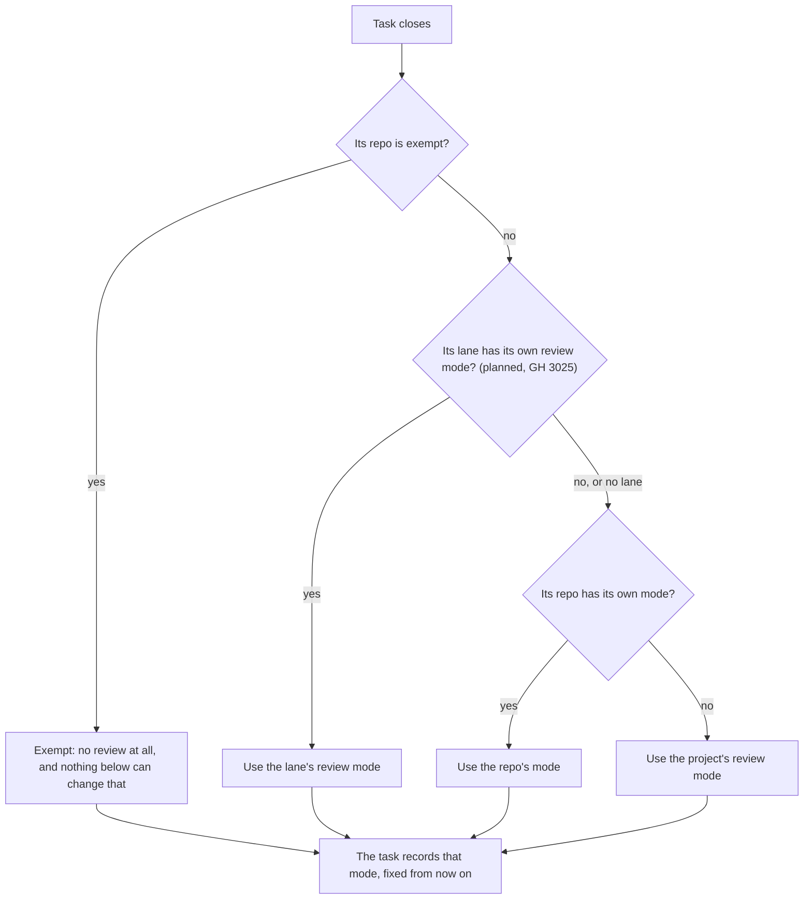
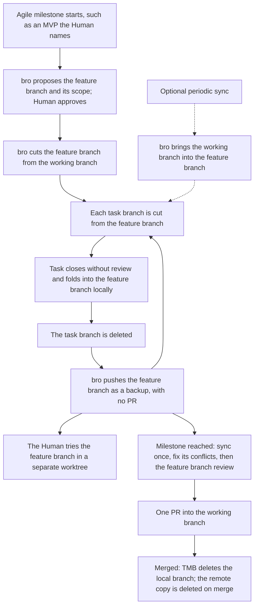
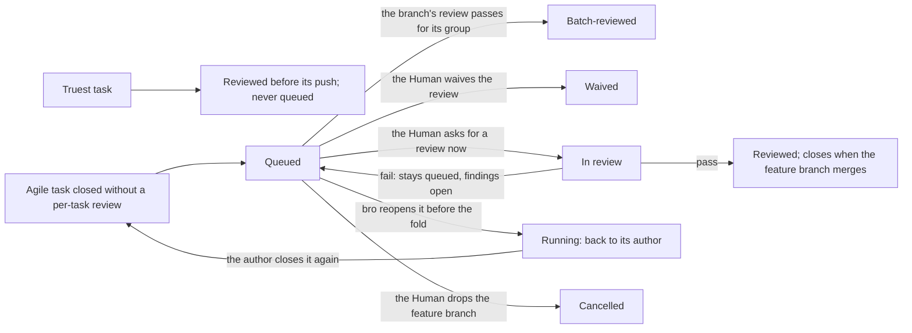
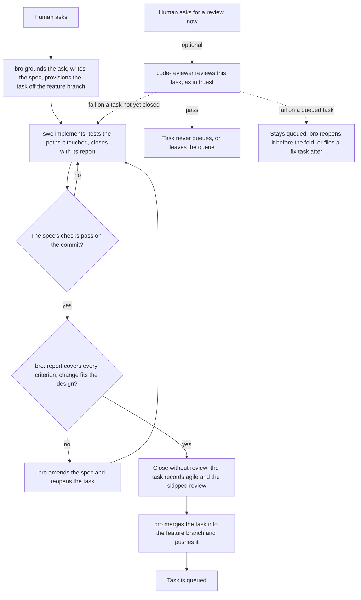
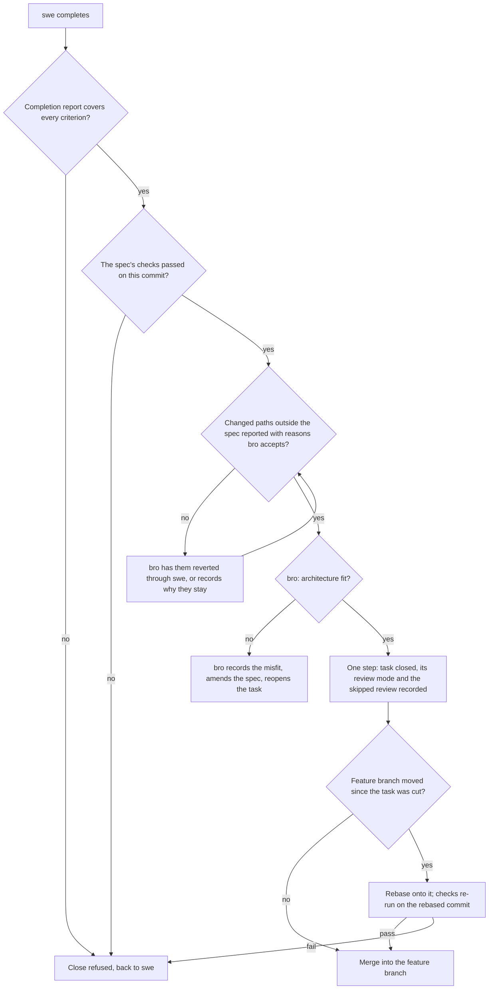
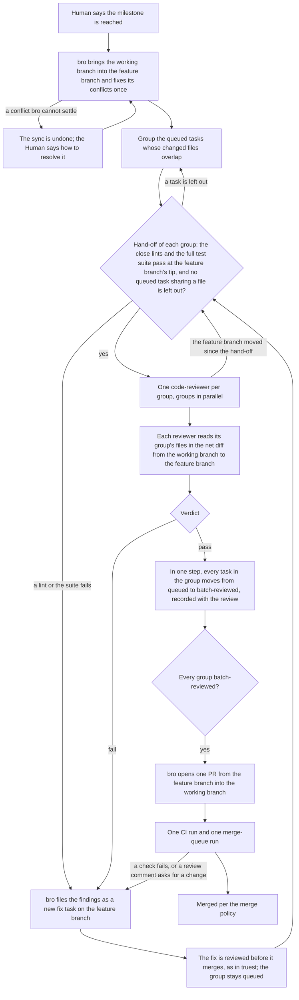
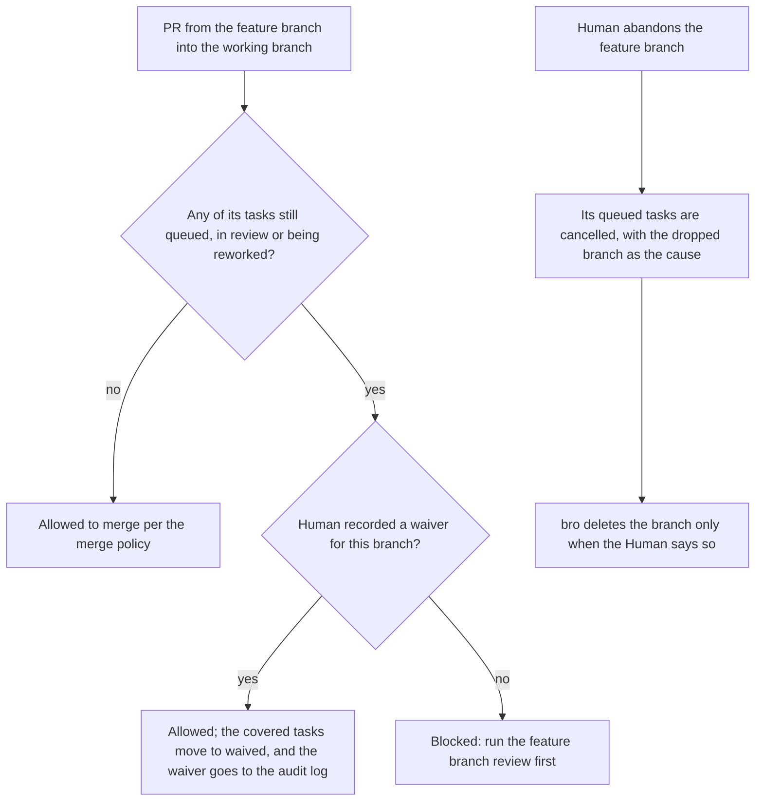
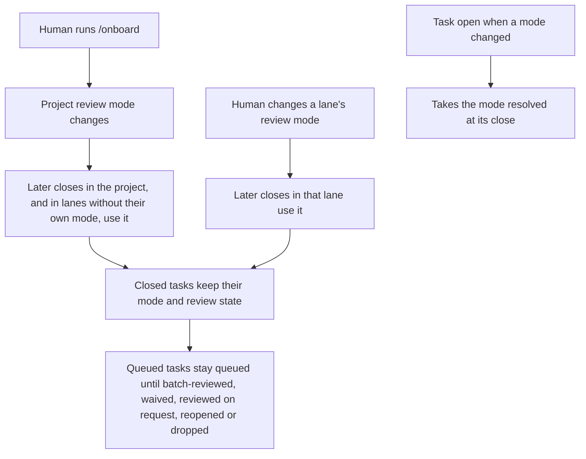

# Agile review mode

Every case of flow 3.9 in [FLOWS.md](FLOWS.md): how agile work builds up on a long-lived feature branch, how its tasks close without a per-task review, how the branch is reviewed once before it merges, and how the review mode is set and changed.

The review mode decides who reviews a task and when. It is separate from the merge policy, which decides who merges.

Project-level agile mode has shipped: /onboard asks for the project's review mode, agile tasks close without a per-task review and fold into a feature branch, each queued for review, code-reviewer reviews the queue in groups at the milestone, and the feature branch's PR into the working branch is gated on that review or an audited Human waiver; the agent prompts walk bro and code-reviewer through each step. Planned (GH 3025, GH 3224): lane review modes, and review states as lifecycle states. [Shipped and planned](#shipped-and-planned) marks each piece.

## Why a feature branch

Agility is agile mode's one core goal, and every agile design choice below serves it: the feature reaches a state the Human can try, change or drop sooner, with fewer reviews and CI runs on the way.

- **Truest** reviews every task before its push, and each task becomes its own PR into the working branch, such as dev. Nothing reaches the working branch unreviewed.
- **Agile** is for building a feature in many small tasks and judging it as a whole: an MVP the Human wants to try once it works end to end, or an idea that may be dropped. Merging ten tasks into dev one by one, each with its own review and CI run, delays that test and spends ten CI runs on work no one can judge yet.

So agile work builds up on one long-lived feature branch per milestone, such as an MVP. Each task closes without a code-reviewer pass and folds into the feature branch locally, with no PR and no CI run of its own. The Human can try the feature branch at any time. At the milestone, code-reviewer reviews the whole branch, and only then does it go to the working branch as one PR with one CI run.

Only the Human sets a mode. Today truest is the default and agile is opt-in. Planned (GH 3281): agile becomes the default, the mode that applies when none is stored, because TMB's first users are solo developers, and a review of every task is too heavy for demo and early work. bro still recommends a mode first, from what the project shows. Truest is for a repo where nothing may reach the working branch unreviewed.

## Where the review mode is set

- **Project.** /onboard sets the project-wide review mode. Truest is the default today: a mode that is missing or unreadable reads as truest. Planned (GH 3281): bro recommends a mode first, from what the project shows, and /onboard stores the Human's answer. Agile becomes the fallback: a mode that is missing or unreadable then reads as agile, a project that never stored a mode becomes agile at the upgrade, and bro says so once at its next session start. That change ships together with the rule for tasks already open at the upgrade: each one finishes under the mode it was opened in, and the upgrade stores the project's mode explicitly, so nothing later depends on the fallback. The mode already stored on a closed task is history and does not change.
- **Repo.** A repo's own mode decides before the project's, and an exempt repo decides before everything (shipped, GH 3281). Planned: /onboard asks one mode per repo, with bro's recommendation, and a repo left on the project's mode takes it ([GIT.md](GIT.md#multi-repo-workspaces)).
- **Lane.** Each lane of a parallel run takes its own review mode when it starts, recorded on the lane's record, and it overrides the project's ([LANES.md](LANES.md)). bro recommends a mode per lane and the Human approves the set. Planned: GH 3025 records it on the lane; GH 2225 adds the lane lookup to the close.
- **TMB keeps it.** The review mode lives in TMB's own records, never in GitHub labels, which a user without triage access cannot apply.

## The feature branch

- **One feature branch per milestone.** It is long-lived and spans every task of the milestone, such as an MVP. bro proposes it for the milestone the Human names, and the Human approves its scope and name. An agile lane owns one for its own work (planned, GH 3025). In a workspace of several repos, each repo the milestone touches gets its own feature branch, and each is reviewed, gated and merged on its own.
- **Tasks fold into it.** Each task branch is cut from the feature branch's tip and folds back into it locally once the task closes, so the next task builds on the last. The fold opens no PR, and the task branch is then deleted.
- **Its tasks are checked against it.** An agile task's freshness, merge-base and scope checks use its feature branch as the base. The working branch is the base only for the milestone PR.
- **Pushed only as a backup.** bro pushes the feature branch so the work is on origin. TMB opens no PR for it before the milestone, so no CI or review runs on it. A repo with no remote has no push and no PR: the branch stays local, and at the milestone the Human merges it into the working branch locally, behind the same merge gate.
- **Tried in its own worktree.** The Human tries the work by opening the feature branch in a separate worktree, never by switching the shared checkout, which every lane reads on the working branch.
- **Synced at the milestone.** At the milestone, bro brings the working branch into the feature branch and fixes its conflicts once. An optional periodic sync before then keeps that fix small. A conflict bro cannot settle from the two sides' intent goes to the Human, and the sync is undone until the Human answers.
- **Cleaned up after the merge.** Once the milestone PR merges, TMB deletes the local feature branch, and the remote copy is deleted on merge.

## Review state

The review mode on a task is history: it is fixed at the close and never changes. What changes afterwards is the task's review state.

- **Queued** means closed without a per-task review and waiting for one. The task is queued at its close, and it counts toward its feature branch's review and merge gate once it is folded into that branch.
- **Batch-reviewed** means the feature branch's review passed for the task's group. The move is recorded with the review that cleared it.
- **Waived** means the Human let the feature branch merge without that review. The waiver names the branch and its repo, and the audit log keeps it.
- **A queued task can leave the queue early.** A review the Human asks for moves it to in review. A pass leaves it reviewed, and it closes with the rest when the feature branch merges. A fail leaves it queued with its findings open: bro reopens it when it is not yet folded into the feature branch, and after rework it closes into the queue again; once it is folded, bro files the findings as a fix task on the feature branch. Dropping the feature branch cancels it.
- **Review states are lifecycle states.** Queued (named review-deferred in the lifecycle), batch-reviewed and waived are states of the task lifecycle in [TASKS.md](TASKS.md#task-lifecycle), and each move into one is a lifecycle event, not a separate record. A group review is recorded once, as a review batch. In the same transaction, every task in the group moves to batch-reviewed, and each move points at that batch. Planned, GH 3224.

## Task flow

- **swe tests the patch.** It runs the checks for the paths it touched, and the spec's checks run once more on its commit before the completion counts. These local checks replace the per-task CI run.
- **bro tests the design.** It judges whether the report covers every success criterion and whether the change fits the architecture. It reviews no diff line by line.
- **A non-code task takes the same path.** bro writes a docs or prompts task itself and self-checks it with the doc-review skill, as in truest. It closes without a code-reviewer pass and is queued like any other, and the feature branch review grades its files with the same doc-review checklist.
- **bro merges into the feature branch.** The merge policy covers PRs into the working branch. A task's merge into its feature branch is bro's, because it is local work no one else has seen yet.
- **code-reviewer is on call.** The Human can ask for a review of any task at any time, and a passing review keeps that task out of the queue. A fail on a task not yet closed reopens it at high effort, as in truest. A fail on a queued task leaves it queued and reopens nothing by itself: bro reopens it when it is not yet folded, and files a fix task on the feature branch when it is.

## Safe close

Dropping the per-task review removes one gate and nothing else. A task closes when every remaining gate holds:

- **What stays on.** swe's completion report, the spec's checks, the git and write guards, and the close as one step.
- **What the close records.** The task's review mode is fixed at the close and stored on the task. It is resolved in the order above: an exempt repo, then the repo's own mode, then the project's (shipped, GH 3281). The lane step between the exempt check and the repo's mode is planned (GH 3025). After the close, the queue, the merge gate and the health check read the stored mode. Before the close, every step that depends on the mode uses the mode in effect for the task at that moment, resolved the same way: the base its checks measure against, whether its close needs a pass, and which review it is handed to. So a mode per repo changes each of those steps, not only the close, and a mode per lane will too.
- **Recovery.** A close that fails partway leaves the task as it was. bro fixes the cause and closes again.

## Feature branch review

Shipped, project mode only.

- **The Human decides when.** The review runs when the Human says the milestone is reached, such as when an MVP works end to end, not after each task. It is one batch review of the milestone, split into groups that run in parallel.
- **Groups form after the fact.** Which files a task will touch is hard to know before it is planned, so tasks are not grouped up front. The groups come from the files each task actually changed, and tasks that share a file are reviewed together, so a reviewer sees their combined effect.
- **Net diff.** The review reads what the feature branch adds to the working branch, not each task's patch. Churn a later task undid is never reviewed, and a conflict resolved on the branch is reviewed as resolved.
- **The suite covers the gaps.** A reviewer reads its group's files and their dependents. The full suite runs at the feature branch's tip in each hand-off, and again in the milestone PR's CI run, and catches what crosses two groups.
- **A pass updates the whole group.** Every task in the group becomes batch-reviewed at once, recorded with the review that cleared it. Each task still records agile as its review mode.
- **The hand-off checks the group first.** A group goes to its reviewer only when the close lints and the full suite pass at the feature branch's tip and the group leaves out no queued task that shares one of its changed files. A missing task is added to the group. A failing lint or suite becomes a fix task. When the feature branch moves after a hand-off, the group is handed off again at the new tip.
- **Failures.** A fail becomes a fix task on the feature branch, and that task is reviewed before it merges, like any truest task. Once the fix has merged, the failed group is handed off and reviewed again on the new net diff, which now holds the fix. A fix task's own pass never batch-reviews the group.
- **Already-reviewed tasks stay out.** A task that passed a review on request is not queued, so no group includes it.
- **After the PR opens.** A failing check or a review comment on the milestone PR is fixed the same way: a new fix task on the feature branch, reviewed before it merges, which updates the PR. Batch-reviewed and waived tasks are not reopened.
- **Visibility.** TMB's health check reports agile tasks closed more than a day ago, by default, with neither a passing review nor a waiver, so the queue never hides (shipped).

## Merge gate

The feature branch reaches the working branch only through one gated PR.

- **Scope.** Task merges into the feature branch are not gated by the queue. Only the merge into the working branch is.
- **Waivers.** Only the Human records a waiver. bro asks one question that names the feature branch and its queued tasks, and records the Human's answer word for word. The waiver covers one repo: every task of that repo queued on the branch at that moment. When a milestone spans several repos, each repo's feature branch needs its own review or its own waiver, so the Human's call on one repo's unreviewed code never covers another's; a waiver that names no repo is refused when the queue holds more than one. The audit log keeps it with the list of tasks that merged unreviewed. A task queued after the waiver is not covered and needs the review or a new waiver.
- **A waiver covers queued tasks only.** A task in review or being reworked blocks the merge until its review passes or its rework closes back into the queue.
- **Dropped work.** A feature branch the Human abandons never merges, so its queued tasks need no review. They are cancelled with the dropped branch as the cause, which ends them without a retry (escalated, until the lifecycle schema of GH 3224 splits that state), and bro deletes the branch only when the Human says so.

## Switching review modes

- **Only the Human switches.** The project's mode changes through /onboard. A lane's mode is set when the lane starts and changes later only through the lane change path in [LANES.md](LANES.md) (planned: GH 3025, with the approval gate in GH 3028). bro or another agent never switches a mode.
- **The close decides.** A task opened under one mode and closed under the other follows the mode resolved at its close.
- **Switching a repo to exempt releases its queue.** Planned (GH 3281). The tasks of that repo still queued for review are released, each with a recorded cause that names the switch, and the merge gate stops holding the feature branch for them. The Human's switch is the decision, so it is recorded and never silent.
- **Switching to truest keeps the branch.** Later tasks are reviewed before they merge into the feature branch, and the branch still needs its review, or a waiver, before it merges into the working branch.
- **Switching to agile starts a branch.** bro proposes a feature branch for the work still ahead, as in [The feature branch](#the-feature-branch).

## Shipped and planned

| Piece | State |
|---|---|
| Project review mode setting, truest by default | Shipped, read by the close gate |
| Review mode recorded on each task at its close | Shipped, project mode only |
| Health-check report of agile tasks closed without a review or waiver | Shipped |
| /onboard question for the project review mode | Shipped |
| Agile as the default when no mode is stored, bro's recommendation for the project, and one mode per repo with bro's recommendation | Planned (GH 3281) |
| Feature branch per milestone: tasks cut from it and folded into it locally, with no per-task PR, and checked against it as their base | Shipped, project mode only |
| Close without a per-task review | Shipped, project mode only |
| Review states queued, batch-reviewed and waived | Shipped |
| Queue of a feature branch's tasks, grouped by the files each task changed | Shipped, project mode only. Today the queue proposes groups from the files each spec named, and the hand-off enforces the files each task changed by refusing a group that leaves out a queued task sharing one |
| Feature branch review: one batch review on its net diff | Shipped, project mode only |
| Merge gate on the feature branch PR, and audited waiver | Shipped |
| Lane review mode and lane feature branch, set at the lane's start, and the lane lookup at the close | Planned (GH 3025, GH 2225) |
| Agent prompts for agile review mode | Shipped, project mode only |
| Review states as lifecycle states, moved with the review batch | Planned (GH 3224) |
