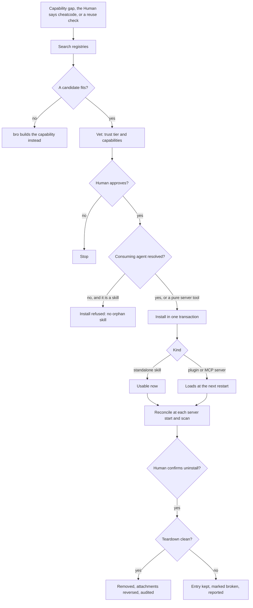

# Cheatcode integration

How bro acquires cheatcodes (published skills, MCP toolkits and plugins) on demand, and the trust and approval gates on the way. [FLOWS.md](./FLOWS.md) shows where acquiring a capability fits among TMB's other workflows; this page holds the design decisions behind it.

## Principle

The mechanical pipeline (search, record, vet, install, activate) is deterministic: tools and hooks, not a checklist in a prompt. Only three decisions stay with bro's judgment:

- **Do I lack a capability this task needs?** A classification.
- **Is this candidate trustworthy enough to install?** Weigh the signals and ask the Human.
- **Which agent consumes it?** The one the Human named, or one inferred from the domain.

Everything else is deterministic code; [DETERMINISTIC_LAYER.md](../prompt-engineering/DETERMINISTIC_LAYER.md) explains how TMB decides what a prompt judges and what code enforces.

## Lifecycle

Every case of flow 4.1 in [FLOWS.md](FLOWS.md).

| Stage | What it guarantees |
|---|---|
| Search | ranked candidates; when none fits, bro builds the capability instead |
| Vet | a trust tier and the candidate's capabilities; vetting never decides |
| Approve | the Human approves before anything installs |
| Target | the consuming agent: the one the Human named, one inferred from the domain, or the Human's answer when it is ambiguous; a pure server tool needs none |
| Install | one transaction: the registry entry, its attachments to the consuming agent, and the audit; idempotent on name and source |
| Activate | when the cheatcode becomes usable ([Hot-load](#hot-load)) |
| Reconcile | each server start and scan checks the registry against what is on disk and audits drift |
| Uninstall | Human-confirmed; reverses the install and its attachments ([Teardown](#teardown)) |

## Registries

Discovery queries real, reputable registries, never a self-built index. Each source carries a tier that doubles as its reputation signal, and official sources always outrank curated ones:

- **Tier 1, official:** the MCP registry and the Anthropic plugin marketplace.
- **Tier 2, curated:** PulseMCP.

Every registry is best-effort: a failing one contributes no candidates and the search goes on, so an environment without web access gets an empty result, never a crash.

A passive path keeps the registry honest too: each scan records capabilities already present in the project (local skills, enabled plugins, configured MCP servers) that TMB does not track yet.

## Safety invariants

- **Human-approved, never silent.** Approval is per candidate, and the install gate fails closed without it.
- **Marketplace path only.** Plugins install through the marketplace, never by copying files or loading a plugin directory.
- **Web posture respected.** Discovery honours any web deny, and sources are shown to the Human before install.
- **The user project only.** Materialization writes the user project's `.claude/`, never the plugin repo, and never bypasses the Human review of prompt files.

## Attachment

Installing loads a cheatcode; attachment decides which agent can use it, and depends on the kind:

| Kind | Attachment |
|---|---|
| Plugin contributing skills | The install loads its skills; an agent with a restricted skill list gets the name added. |
| Plugin contributing a tool | The tool is added to the consuming agent's allowed tools. |
| MCP toolkit | Registering the server is the attachment: any agent can call it. |
| Standalone skill | Added to the consuming agent's skills through a project-local copy of its prompt file; for bro, a reference in the project's `CLAUDE.md`. |

Plugin and MCP kinds are preferred. Every attachment is recorded so an uninstall reverses exactly what was wired, and a skill with no consuming agent is refused.

## Hot-load

Whether a cheatcode works in the current session is decided by its kind, not guessed: a standalone skill is usable at once, while plugins and MCP servers register at the next cold start, so their install reports that a restart is needed.

## Teardown

Acquisition must be reversible. An uninstall reverses each recorded attachment, removes the artifact through the marketplace or MCP uninstall path, and audits the removal, in one transaction. It is idempotent, and honest: when teardown fails, the entry stays, marked broken, and the result says so instead of claiming a clean removal.

Removal is safer than addition, so an uninstall is proposed by bro and confirmed by the Human rather than gated by a hook. When an open task depends on the cheatcode, bro says so before removing it.
