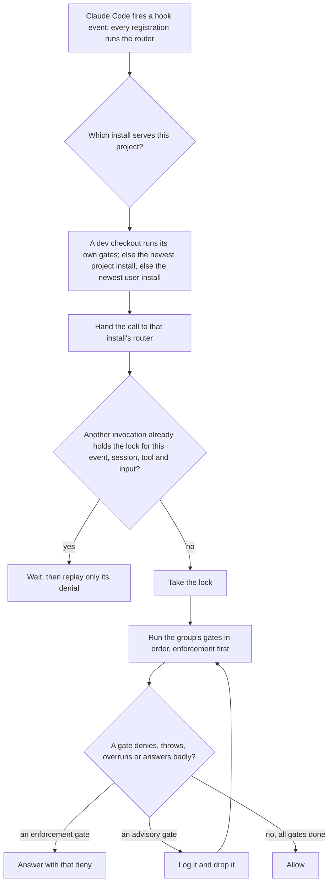
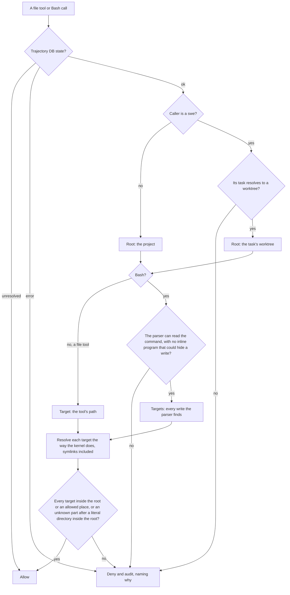

# Containment

TMB writes nothing outside the project it runs in, whatever scope it is installed at, and holds the agents it runs to the same boundary. This page states the boundaries, the layers that keep them, and why. For the code that enforces each one, ask the world model.

## The invariant

- **Writes stay in the project.** Nothing is created, changed or deleted under the user's home directory: no Claude Code config, no marker, no log, no lock. A project without TMB state gets nothing written at all; gates still run and allow.
- **Reads outside the project are read-only and named.** Hooks read Claude Code's plugin install registry, to find which install serves the project, and its user settings, to warn about duplicate copies and leftover hooks. They never write either.
- **A user project's `CLAUDE.md` is never written.** bro's persona reaches a session as injected context.
- **No context or effort settings.** TMB never changes Claude Code's context, model or effort settings. Token savings come from TMB's own design, not from changing how the user's Claude Code runs.

Three exceptions, each declared once:

| Exception | Why |
|---|---|
| The embedding model cache, shared with other Hugging Face tools and relocatable | A shared, re-downloadable cache; per-project copies would cost gigabytes. |
| The MCP server's runtime dependencies, installed once per plugin install in Claude Code's plugin data dir | The embedding library ships native builds per platform, so it stays outside the bundle, and a marketplace install runs no package install. The dependencies belong to the install, not to a project. |
| A Human-run repair command for Claude Code's MCP cache | Its job is fixing Claude Code's own plugin config. It is never a hook and never the server. |

## What TMB writes in the project

Everything sits in the project's state directory: the trajectory DB, logs, short-lived session markers and the locks that dedupe hook calls. Markers and locks are pruned on a timer. Outside that directory TMB writes only after the Human says yes during onboarding: the optional headless enforcement shim and the sandbox settings go into the project's local Claude Code settings, each entry stamped as TMB's, plus one ignore line so that file stays out of commits.

## Tests never touch the live DB

Every hook finds the DB through one resolver that walks up from the current directory, so a test run inside the project could reach the live DB. Under the test flags the resolver never walks: with no explicit DB or project dir the DB is unresolved, gates allow, and nothing is read or written. Test suites pin a fixture DB, and the integration runners refuse any direct call on the real one. Rows a past run left behind are reported by the doctor, never deleted by an agent: the Human decides.

## One install, one entry point, one execution

A hook can be registered several times for one event: a project install beside a user-scope one, two channels, the headless shim beside the plugin. Three rules keep a gate from running twice or at two versions:

1. **One install per project.** A dev checkout always runs its own gates. Otherwise a project-scope install wins over a user-scope one, and the newest of two project installs wins, with a notice naming both.
2. **One entry point.** Every hook registration, on every event, runs one router, and the router hands the call to the resolved install's router, so a stale or user-scope invocation executes the project's version.
3. **One execution per call.** The router keys each invocation on its event, session, tool and input and takes a lock on that key. A concurrent duplicate waits and replays only a denial, so context and banners appear once.

**Gates fail closed.** Every hook that can deny is registered to block when it fails, and the router itself denies when an enforcement gate throws, overruns or answers badly; an advisory gate's failure is logged and dropped. Because the router decides this, the headless shim behaves the same.

**Gates run in order.** Claude Code runs the hooks of one matcher in parallel, so a gate could act on a call another gate denies. Each event therefore has one router registration per group, and the router runs a group's gates in a fixed order, enforcement first, answering with the first deny.

One hook call through the router:

## Agents write only under their run's root

Every agent run has a root: the project for bro and code-reviewer, the task's worktree for swe. A write is judged against the root of the caller's own run, resolved from who the caller is, never from its working directory, because a swe starts with the main checkout as its working directory. A swe's run is bound to its task through the task id in its spawn prompt; until that task resolves to a worktree, the run has no root and every write is denied. Three layers hold the boundary:

| Tier | Layer | What it holds |
|---|---|---|
| 0 | Claude Code's Bash sandbox, enabled by `/onboard` on an explicit yes | OS-level: Bash, in the main loop and every subagent, writes only to the project, the sandbox temp dir and the model cache, and reaches only allowed hosts. It does not cover the file tools and allows the whole project, not one worktree. |
| 1 | Server tools | A tool that takes a path or installs something refuses a target outside the project, and a global install is refused in favour of a project-local one. |
| 2 | The containment guard hook, on the file tools and Bash | Denies a write outside the run's root, per swe worktree, and audits every denial. |

### The guard is an allowlist

The guard is a parser, not a jail, and its rule is simple: a write it cannot prove lands inside the root is denied. File tools are judged by their target path; Bash by every write target a shell parser finds in the command. Paths resolve the way the kernel does, symlinks included. A target with an unknown part is allowed only when the literal directory before the unknown part is inside the root; a command it cannot parse, or an inline program that could hide a write, is denied outright, and the deny names why. Reads are never judged. What the parser cannot follow, such as a variable set in an earlier call, Tier 0 covers for Bash.

Besides the run's root, the guard allows only places that store nothing outside the project or are the host's own scratch space: the device sinks, the model cache, the host's private temp dirs and the project's scratch dir. The main session may also write Claude Code's own state for the project, such as its memory and plans; subagents may not.

How the guard judges one call:

### The sandbox opt-in

Onboarding merges the sandbox block into the project's local settings only on an explicit yes: sandbox on, writes allowed to the project and the model cache, network allowed to GitHub, the package registries and the project's remote hosts, and package caches moved into the project so the write allowance never widens to the home directory. The merge keeps every existing setting, records what TMB added, and a later no removes exactly that.

The default answer comes from evidence: a recorded live probe per platform runs TMB's remote commands with and without the sandbox. A fresh onboard defaults to yes only when the platform has a clean record and no remote uses SSH, which bypasses the sandbox's proxy; otherwise it defaults to no. The release gate reruns the probe.

The guard still judges temp paths because a live probe showed the sandbox leaves its own temp dir writable by default.

### Planned: an OS sandbox instead of write prediction

(planned, GH 2098) Predicting what an arbitrary program will write cannot be done in general, so the parser both denies legitimate commands and misses real writes. The planned design stops predicting: the session sandbox becomes the hard boundary, with TMB's own state inside the project write-denied to agents; each swe Bash call runs inside a per-task OS sandbox profile that allows only its worktree; and hooks decide only what the literal input shows, never reading an arbitrary program. Deliberate evasion is out of the threat model, since agents make mistakes but do not attack TMB.

## Enforcement

Lints and tests hold each invariant: no home-directory writes from scripts or the server, no live-DB access under test, every deny-capable hook blocking on failure, no write outside a run's root, and the router answering with the first deny in order and running each call once.
