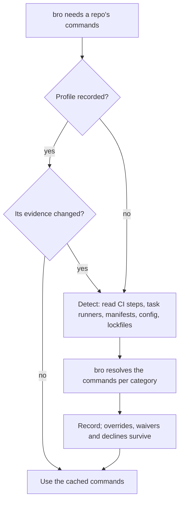

# Environment profile

Every case of flow 2.3 in [FLOWS.md](FLOWS.md): how bro learns a repo's install, test and lint commands without a hardcoded toolset.

- **Detect runs nothing.** It reads the repo's evidence and flags a recorded profile whose evidence changed.
- **Record keeps bro's call.** The resolved commands are stored per category, per machine; its overrides, waivers and declines survive a re-record.
- **The repo is the source of truth.** Teammates, CI and editors enforce the same rules without TMB, so the profile is only a cache, and first contact offers its commands as the repo's committed defaults.
