# Trajectory DB — Entity Relationship Diagram

SQLite schema (`mcp/trajectory-server/src/schema.sql`, `schema_version = 33`). Persistent at `<project-root>/.claude/<plugin-name>/trajectory.db` — project-local, per-user, gitignored; the server and hooks find it by one rule, [Where the trajectory DB lives](../reference/TRAJECTORY_DB_LOCATION.md). The `<plugin-name>` segment resolves from `CLAUDE_PLUGIN_ROOT/.claude-plugin/plugin.json`'s `name` field; today that's `tmb` for both stable and RC channels, so both write to `.claude/tmb/`. True channel isolation (`tmb/` vs `tmb-rc/`) is tracked in issue #1. Override with `TRAJECTORY_DB_PATH` for CI / ephemeral runs (`:memory:`, custom file).

## Overview

Every timestamp column holds one format: `YYYY-MM-DDTHH:MM:SS.sssZ` (24-char UTC ms-ISO), so `ORDER BY` and keyset cursors compare them as plain strings.

Tables fall in three groups (capability catalog unified into `cheatcodes` in #101; embedding cache from schema v8):

| Group | Tables | Keyed by |
|---|---|---|
| **Workflow** (per-issue) | `issues`, `tasks`, `audit`, `validation_attempts`, `discussions`, `roundtables`, `roundtable_votes` | `issue_id` (directly or transitively) |
| **Registries** (standalone) | `cheatcodes`, `cheatcode_attachments`, `agents`, `repos`, `milestones`, `plugin_config`, `plugin_meta`, `agent_runs`, `pr_review_runs`, `debug_trajectory`, `eval_results` | own primary keys; not tied to any issue |

The **world model** lives in a sibling kuzu graph database (`world-model.kuzu`), not in this SQLite file. See `docs/architecture/WORLD_MODEL.md`.

The `skills` table folded into `cheatcodes` (#101): builtin tmb_* skills are `origin='builtin'` rows in the unified `cheatcodes` registry, alongside the `origin='installed'` cheatcodes acquired via the install pipeline. Skill/plugin usage isn't recorded in the trajectory DB (#118) — verification lives in the stream-json session log.

The onboarded marker lives at `plugin_config('onboarded': true)`. Scan-side drift state rides in `audit(event_type='deep_scan_completed').content_json`; `scan_run` is the single scan-side surface.

`issues.milestone` (#83) is a nullable `TEXT` column that, since schema v23 (#155), is a foreign key into a real `milestones(name, repo, state)` table. Milestones are GitHub-style and **per-repo**: the table's primary key is the composite `(name, repo)`, so the same milestone name can exist independently under each repo. The FK is the composite `issues.(milestone, repo) → milestones.(name, repo)` (`ON DELETE RESTRICT`), nullable so an issue need not carry a milestone. Milestone rows come from three places: `scan_run` reconciles each repo's GitHub/GitLab milestones (with their open/closed state) when issue sync is on; a repo still without any row gets one open `v<next-patch>` seeded from its own version (`package.json`, `.claude-plugin/plugin.json`, `pyproject.toml`, `Cargo.toml`, else the highest `vX.Y.Z` tag); and an explicit milestone on `issue_create` upserts its row. A milestone closes via `milestone_close` or when the remote reports it closed on the next scan. An issue with a NULL milestone is untriaged.

`issues.labels` (#53, schema v28) is a nullable `TEXT` column holding the validated label set from `issue_create` as a JSON array string. `issue_sync_retry` replays it verbatim so a retried remote create carries the original labels rather than re-deriving them; a `NULL` value marks a pre-v28 row and falls back to the taxonomy-derived default label pair.

## Diagram

```mermaid
erDiagram
    issues ||--o{ tasks : "issue_id"
    issues ||--o{ audit : "issue_id"
    issues ||--o{ discussions : "issue_id"
    issues ||--o{ roundtables : "issue_id"

    tasks ||--o{ validation_attempts : "task_id (INTEGER FK)"
    tasks ||--o{ audit : "branch_id (soft ref)"
    tasks ||--o{ agent_runs : "task_id"

    roundtables ||--o{ roundtable_votes : "roundtable_id"

    repos ||--o{ milestones : "name"
    milestones ||--o{ issues : "(milestone, repo)"

    repos {
        TEXT  name PK "renamed only via repo_rename"
        TEXT  path
        INT   file_count
        TEXT  last_scanned_at
        TEXT  target_branch "integration branch, e.g. main/dev (sole source of truth, #980)"
        TEXT  branching_model "e.g. github-flow"
        TEXT  protected_branches "JSON array"
        TEXT  remotes "JSON array of {name,provider,url}; set by scan_run"
    }

    milestones {
        TEXT name PK "GitHub-style milestone label"
        TEXT repo PK "FK → repos.name; PK is composite (name, repo)"
        TEXT state "CHECK open|closed; default open"
    }

    %% World model — see WORLD_MODEL.md — lives in sibling kuzu graph DB, not here

    agents {
        INT  id PK
        TEXT name UK
        TEXT kind "backbone|consultant"
        TEXT file_path "plugin:<path>|project:<path>"
    }

    cheatcodes {
        INT  id PK
        TEXT name UK "UNIQUE (name, kind)"
        TEXT kind UK "skill|mcp|plugin"
        TEXT origin "builtin|installed"
        TEXT description
        TEXT source_url "NULL for builtin"
        TEXT file_path "set for skill kind"
        TEXT version
        TEXT trust_tier
        TEXT scope "global|template|project-local"
        TEXT status "installed|active|broken"
    }

    cheatcode_attachments {
        INT  id PK
        INT  cheatcode_id FK "→ cheatcodes.id CASCADE"
        TEXT target
        TEXT artifact
    }

    plugin_config {
        TEXT key PK
        TEXT value_json
    }

    plugin_meta {
        INT  id PK
        INT  schema_version
        TEXT plugin_version
    }

    issues {
        INT  id PK
        TEXT objective
        TEXT description
        TEXT status "CHECK open|closed"
        TEXT remote_kind
        INT  gh_iid
        INT  gl_iid
        TEXT milestone "nullable FK → milestones.name (composite with repo); #83/#155"
        TEXT labels "nullable JSON array of the validated create labels; replayed by issue_sync_retry; #53"
    }

    tasks {
        INT  id PK
        INT  issue_id FK
        TEXT branch_id "git branch: feat/x, fix/y, …"
        TEXT parent_branch_id "branch this one was cut from"
        TEXT title
        TEXT description
        TEXT status "CHECK pending|running|needs_validation|completed|closed|failed|escalated"
        TEXT spec_body
        TEXT commit_sha
        TEXT repo "multi-repo workspace inner-repo path"
        TEXT completed_at
    }

    validation_attempts {
        INT  id PK
        INT  task_id FK
        INT  attempt_n
        TEXT agent
        TEXT verdict "CHECK pass|fail|escalate"
        TEXT feedback
        INT  mcp_available "NOT NULL, no default; 0 = MCP-down fallback"
        TEXT subagent_session_id
        TEXT repo "FK → repos.name; task repo, else issue repo, at write time"
    }

    audit {
        INT  id PK
        INT  issue_id FK
        TEXT branch_id
        TEXT from_node
        TEXT event_type
        TEXT summary
        TEXT content_json
        TEXT repo "FK → repos.name; issue repo at write time (NULL for issue -1)"
    }

    discussions {
        INT  id PK
        INT  issue_id FK
        TEXT author
        TEXT kind "CHECK intent|question|answer|decision|note|analysis"
        TEXT body
        TEXT remote_comment_id "UNIQUE when non-NULL; PR/MR comment dedupe key"
        TEXT repo "FK → repos.name; issue repo at write time (NULL for issue -1)"
    }

    roundtables {
        INT  id PK
        INT  issue_id FK
        TEXT topic
        TEXT state "collecting|awaiting_human|closed|skipped"
        INT  expected_participants
    }

    roundtable_votes {
        INT  id PK
        INT  roundtable_id FK
        TEXT participant
        TEXT vote
        TEXT rationale
    }

    agent_runs {
        INT  id PK
        INT  task_id FK
        INT  issue_id FK
        TEXT agent_type
        INT  tokens_in "NULL = unmeasured"
        INT  tokens_out "NULL = unmeasured"
        INT  cache_read_tokens "NULL = unmeasured"
        INT  cache_creation_tokens "NULL = unmeasured"
        INT  tool_uses
        INT  duration_ms
        TEXT started_at "window start"
        TEXT completed_at "window end; NULL while open"
        TEXT spawn_id "UNIQUE (task_id, spawn_id) when non-NULL"
        TEXT session_id
        TEXT usage_source "CHECK transcript|subagent_stop|unmeasured|backfill"
        TEXT repo "FK → repos.name; task repo at write time"
        TEXT root_dir "where the run may write"
        TEXT model "dominant message.model"
        TEXT host "CHECK claude|codex"
        TEXT exit_reason "CHECK completed|failed|escalated|swept_orphan|swept_stale|issue_closed"
    }

    pr_review_runs {
        INT      id PK
        INT      pr_number "CHECK > 0; UNIQUE (pr_number, repo)"
        TEXT     repo "CHECK non-empty"
        DATETIME last_fetched_at
        TEXT     last_comment_id
        INT      task_id FK
    }

    debug_trajectory {
        INT  id PK
        TEXT session_id
        INT  step_n
        TEXT kind "mcp_call|tool_use|agent_thinking"
        TEXT agent
        TEXT tool_or_mcp_name
        TEXT args_json
        TEXT result_json
    }

    eval_results {
        INT  id PK
        TEXT run_id
        TEXT flow_name
        TEXT scorer_name
        INT  pass
        TEXT value
        TEXT explanation
        TEXT arm
        TEXT scenario
    }

    discussions_embeddings {
        INT  discussion_id PK "FK → discussions.id CASCADE"
        BLOB embedding
        TEXT model_id
        TEXT embedded_at
    }

    audit_embeddings {
        INT  audit_id PK "FK → audit.id CASCADE"
        BLOB embedding
        TEXT model_id
        TEXT embedded_at
    }
```



## Relationships (foreign keys declared in schema)

| From | Column | → To | Semantics |
|---|---|---|---|
| `tasks` | `issue_id` | `issues.id` | every task belongs to one issue |
| `audit` | `issue_id` | `issues.id` | every event row scoped to an issue (use system issue id=-1 for project-level events) |
| `discussions` | `issue_id` | `issues.id` | bro ↔ human ↔ consultants conversation per issue, plus the PR/MR comments `pr_monitor_comments_get` persists |
| `roundtables` | `issue_id` | `issues.id` | a multi-agent debate belongs to an issue |
| `roundtable_votes` | `roundtable_id` | `roundtables.id` | one vote row per agent per roundtable |
| `validation_attempts` | `task_id` | `tasks.id` | every validation attempt belongs to one task |
| `agent_runs` | `task_id` | `tasks.id` | resource tracking per SWE spawn |
| `agent_runs` | `issue_id` | `issues.id` | resource tracking scoped to issue |
| `audit`, `discussions` | `repo` | `repos.name` | populated at write time from the parent issue's repo (explicit `repo` wins); NULL for the system issue `-1` |
| `validation_attempts` | `repo` | `repos.name` | populated at write time from the task's repo, else its issue's repo |
| `agent_runs` | `repo` | `repos.name` | populated at write time from the task's repo |
| `cheatcode_attachments` | `cheatcode_id` | `cheatcodes.id` | what an install wired, for exact uninstall (ON DELETE CASCADE) |
| `milestones` | `repo` | `repos.name` | each milestone belongs to one repo (ON DELETE RESTRICT) |
| `issues` | `(milestone, repo)` | `milestones.(name, repo)` | nullable composite FK — an issue's milestone is scoped to its repo (ON DELETE RESTRICT) |

## Soft references (no FK, by convention)

`branch_id` is the **git-convention working branch name** (e.g. `feat/user-login`, `fix/null-crash`), enforced via `validateBranchId` in `tools/tasks.ts`. It doubles as the actual git branch SWE creates the worktree on. Tasks are uniquely keyed by `(issue_id, branch_id)` — see the `idx_tasks_issue_branch` UNIQUE INDEX below — so the same `feat/user-login` could in principle exist under two different issues without collision.

| From | Column | → To | Why no FK |
|---|---|---|---|
| `audit` | `branch_id` | `tasks.branch_id` | `branch_id` alone isn't unique in `tasks` — the UNIQUE constraint is composite `(issue_id, branch_id)`. A composite FK `(issue_id, branch_id)` would work in principle, but `audit.branch_id` is nullable (some events are issue-scoped, not task-scoped), and nullable composite FKs are awkward. Kept as a soft ref scoped by `audit.issue_id`. |
| `tasks` | `parent_branch_id` | `tasks.branch_id` (same issue) | Self-reference within an issue. A composite self-FK `(issue_id, parent_branch_id) → (issue_id, branch_id)` is feasible but adds insert-order brittleness; kept soft. |

## Registries (no relationships to workflow tables)

| Table | Purpose |
|---|---|
| `cheatcodes` | Unified capability registry (#101). One row per capability, split by `origin`: `'builtin'` = plugin-shipped tmb_* skills (was the `skills` table; `source_url` NULL, `file_path` set); `'installed'` = cheatcodes acquired via the discover → vet → install pipeline (`source_url` set). `kind` is `skill|mcp|plugin`; `scope` is the placement enum `global|template|project-local`. CHECKs enforce the shape (skill rows carry `file_path`, installed rows carry `source_url`, builtin rows do not). The natural key is `UNIQUE (name, kind)` (schema v32): a plugin and the MCP server it bundles share a name (`linear` plugin → `linear` server), and both rows coexist. A plugin-bundled server discovered by `/scan` carries `source_url = 'mcp:<plugin>/<server>'`. |
| `agents` | Agent registry: one row per backbone agent or consultant. `file_path` names the root the prompt file ships from — `plugin:` (relative to the installed plugin root: the backbone `agents/*.md` and the consultant `templates/agents/*.md` seeds) or `project:` (relative to the workspace root: `.claude/agents/<name>.md`) — enforced by a CHECK since schema v34, which dropped the old `scope` column. The backbone agents `swe` and `pr-reviewer` must be `plugin:`: a `project:` file of the same name would shadow the backbone, so `agent_register` refuses it. Registering a `project:` path for a `plugin:` consultant promotes the row. `agent_list` (filter `root`), `agent_register` and `agent_resolve` return each row's absolute `resolved_path`. |
| `cheatcode_attachments` | One row per artifact an install wired (plugin manifest, MCP registration, proposed skill-frontmatter PR). FK to `cheatcodes.id` ON DELETE CASCADE so `cheatcode_uninstall` reverses exactly what was installed. |
| `repos` | One row per discovered git repo under the session dir. Written by `scan_run` (the `/scan` slash command's MCP backend). Workspace-pattern projects (multiple inner repos under a non-git workspace dir) are first-class. `name` is the primary key seven tables reference `ON DELETE RESTRICT` — `milestones`, `issues`, `tasks`, `audit`, `validation_attempts`, `discussions`, `agent_runs` — and the world model keys every `Directory` node on it; `pr_review_runs.repo` holds the remote's host slug, not a name. The name changes only through `repo_rename` (bro), which moves the row, all seven children, the `pr_review_runs` slug and the kuzu nodes in one transaction checked by `foreign_key_check` and records `repo_renamed`. `scan_run` never renames: a discovered repo whose canonical path or primary remote URL matches a row it did not rediscover is returned in `rename_candidates` with a `repo_rename_detected` audit row, and no second row is inserted. Carries per-repo policy (`target_branch`, `branching_model`, `protected_branches`, `remotes`) — this row is the **sole source of truth** (#980): guards resolve policy path-keyed from the matched `repos` row for the command's git toplevel, and unregistered repos are no-op'd. `repos.remotes` is kept in sync with each repo's actual git remotes by `scan_run` (#979). There is no global `plugin_config` fallback. See [`REPO_RESOLUTION.md`](./REPO_RESOLUTION.md). |
| `milestones` | One row per GitHub-style milestone, scoped per repo (schema v23, #155). Primary key is the composite `(name, repo)` and `repo` FKs `repos.name` (ON DELETE RESTRICT), so the same milestone name lives independently under each repo. `state` is `open`/`closed`. `issues.milestone` is a nullable composite FK `(milestone, repo) → (name, repo)`; rows are reconciled from the remote and seeded (`v<next-patch>`) by `scan_run`, upserted by an explicit `issue_create` milestone, and closed by `milestone_close` or the remote. |
| _(world model)_ | Lives in the sibling kuzu graph DB at `<project>/.claude/tmb/world-model.kuzu/`, not in this SQLite file. Directory nodes + CONTAINS edges, populated by `scan_run` via `src/graph-db.ts`. See `docs/architecture/WORLD_MODEL.md`. |
| `plugin_config` | KV for workspace-global plugin settings only: `issue_sync`, the issue label taxonomies, the `onboarded` marker, `pr_review_bots`, `model_prices` (USD per 1M tokens per model, for `task_stats.cost_estimate`), and the onboard answers `headless_enforcement` / `sandbox_enforcement` (with `sandbox_settings`, the record of what TMB wrote into the project's sandbox block). The repo-scoped policy fields (`target_branch`, `branching_model`, `protected_branches`, `remotes`) are NOT here — they live on the `repos` row (#980, see `repos` above / [`REPO_RESOLUTION.md`](./REPO_RESOLUTION.md)). See `mcp/trajectory-server/docs/CONFIG_KEYS.md` for the canonical key list. |
| `plugin_meta` | Schema + plugin version. Current `schema_version=34`. `plugin_version` is seeded as `'0.0.0'` and synced dynamically from `CLAUDE_PLUGIN_ROOT/.claude-plugin/plugin.json` on every `TrajectoryDB` construction — so the row always reflects the running plugin version without a migration. |
| `agent_runs` | One row per metered run of an agent on a task, covering the time window `[started_at, completed_at)`. Bro rows open at task creation and are metered by the `bro-turn-usage.sh` Stop hook; swe rows open at the swe's `task_brief` and are metered by the `swe-atomic-close.sh` SubagentStop hook. The four token columns are NULL until measured; `usage_source` records where measured values came from (`transcript`, `subagent_stop`) or `unmeasured`. `spawn_id` identifies the measured spawn (one row per task + spawn); `session_id` ties the run to the CC session that owns it — stamped at open when bro passes `session_id` to `task_provision` / `task_create_batch` / `task_retry`, else claimed by the Stop hook (audited as `agent_runs_claimed`). The total is computed, not stored (`tokens_in + tokens_out + cache_read_tokens + cache_creation_tokens`). `bro_atomic_close` and a terminal `task_update_status` (`failed`, `escalated`, `closed`) close every open row of the task; `task_recover` closes rows left open on already-terminal tasks. Schema v33 adds four audit columns: `root_dir` (where the run may write — the project for bro rows, the task worktree for swe rows; read by the `containment-guard` hook), `model` (the dominant `message.model` of the run, written by the metering hooks), `host` (`claude`/`codex`) and `exit_reason` (stamped by whoever closes the row; see ENUMS). `task_stats` prices rows by `plugin_config.model_prices` (`{"<model>": {input, output, cache_read, cache_creation}}` USD per 1M tokens, seeded `{}`) into `cost_estimate`, with unpriced rows' tokens reported as `unpriced_tokens`. |
| `pr_review_runs` | Per-PR monitor incremental-polling cursor (`last_fetched_at`, `last_comment_id`) — cursor-only since v29. Used by `/monitor` flow — `pr_monitor_comments_get` reads the cursor on entry and upserts it on exit so the next call only fetches new comments; no cursor is kept when no repo slug resolves. Table-level `UNIQUE (pr_number, repo)` with `CHECK (pr_number > 0)` and `CHECK (repo <> '')`. `task_id` links the PR to its task, which is how `pr_monitor_comments_get` finds the issue that carries the PR's comments. |
| `debug_trajectory` | Deterministic-trajectory capture (only when `TMB_DEBUG_TRAJECTORY=1`). Used by L5 scoring. |
| `eval_results` | Per-scorer results for L5/A-B prompt-eval runs. One row per (run_id, flow_name, scorer_name). |
| `discussions_embeddings` | Embedding cache for `discussions` rows — one BLOB per discussion, keyed by `discussion_id` + `model_id`. Populated on write (`insertDiscussion`); rows written outside the server are embedded by the boot-time backfill and by a lazy tick (up to 50 rows) at the start of every `discussion_search`. Used by the `discussion_search` semantic path. |
| `audit_embeddings` | Embedding cache for `audit` rows — one BLOB per audit event. Populated on write (`insertAudit`, the single server audit write path); rows written outside the server are embedded by the boot-time backfill and by a lazy tick (up to 50 rows) at the start of every `audit_search`. Used by the `audit_search` semantic path. |

## Indexes

- `idx_tasks_issue_branch` — `UNIQUE(issue_id, branch_id)`. Each issue has one task per git branch name; this is also the lookup index for "does this task exist?" checks. Two issues may legitimately have the same `branch_id` (e.g. both have a `feat/user-login` task).
- `idx_tasks_status` — `(status)`. Status-filtered task scans (hooks, first-actionable).
- `idx_tasks_commit_sha` — `(commit_sha)`. Commit → task lookups.
- `idx_issues_status` — `(status)`. Open-issue scans.
- `idx_issues_gh_iid` — `(gh_iid)`. GitHub issue number → local issue lookups.
- `idx_discussions_issue_created` — `(issue_id, created_at)`. Feeds the chronological discussion view.
- `idx_discussions_remote_comment` — `UNIQUE(remote_comment_id) WHERE remote_comment_id IS NOT NULL`. One discussion per persisted PR/MR comment: `pr_monitor_comments_get` writes each fetched comment through `insertDiscussion` as a `note` on the issue of the task that owns the PR (`pr_review_runs.task_id`, else the task on the PR head branch), keyed `<provider>:<pr_number>:<comment_id>` (`github:12:IC_kwDO…`, `gitlab:7:4410`), so a re-fetch of the same comment inserts nothing.
- `validation_attempts` — `UNIQUE(task_id, attempt_n)`. One row per (task, attempt).
- `idx_agent_runs_task` — `(task_id)`. Fast per-task resource lookup.
- `idx_agent_runs_issue` — `(issue_id)`. Fast per-issue resource rollup.
- `idx_agent_runs_open` — `(agent_type) WHERE completed_at IS NULL`. Partial index over open runs.
- `idx_agent_runs_spawn` — `UNIQUE(task_id, spawn_id) WHERE spawn_id IS NOT NULL`. One row per measured spawn.
- `idx_agent_runs_session` — `(session_id) WHERE session_id IS NOT NULL`. Resolve a session's own run.
- `pr_review_runs` — `UNIQUE(pr_number, repo)`. One cursor per monitored PR.
- `idx_pr_review_runs_task` — `(task_id)`. PR cursor → task lookups.
- `idx_debug_trajectory_session` — `(session_id, step_n)`. Ordered trajectory replay.
- `idx_eval_results_run` — `(run_id, scorer_name)`. Per-run scorer aggregation.
- `idx_eval_results_flow` — `(flow_name, created_at)`. Historical pass-rate trend queries.

## How agents use this

- **bro** (planner + task gate, CLAUDE.md persona on main Claude) — full write access for the workflow side: `onboard_state_get`/`onboard_apply` (which write `plugin_config('onboarded')`), `config_get`/`set`/`list`, `issue_create`/`get`/`resume`/`close`, `discussion_append` (kind='intent'/'note'/'question'/'answer'/'decision'), `task_provision`, `task_update_status` (closes tasks after verifying SWE's return), `audit_append`, `scan_run` (writes `repos` SQLite + Directory nodes / CONTAINS edges in kuzu, `deep_scan_completed` audit), `repo_rename` (renames a repo across SQLite and kuzu). Reads the world model via `world_model_get` / `world_model_search` (kuzu queries) as the cold-start navigation surface. Also reads `validation_history` to drive the retry loop (flow 8).
- **swe** (executor, project-local subagent in worktree) — `task_get(id)` for spec → `audit_append` during work → `task_update_status('completed', commit_sha)` on success. Cannot write to `issues`, `validation_attempts`, or close tasks. Reads the world model when scoping unfamiliar parts of the codebase.
- **pr-reviewer** (push gate, project-local subagent) — `task_get(task_id)` for spec + commit → `validation_record(task_id, attempt_n, verdict, feedback, subagent_session_id)` to sign off. Only role permitted to write `validation_attempts`. Never writes to `tasks`; the close flip stays bro's call.
- **consultants** (architect, cto, ceo, pm, project-local domain agents) — read-only on workflow tables (`issue_get_with_discussions`, `task_get`, `validation_history`); may write `discussion_append(kind='analysis')` to record their position. Server-rejected on `task_provision`, `task_update_status`, `validation_record`, `issue_create` via `requireRoles`.

## Issue and task lifecycle

An issue never closes over live work, and a task never reaches `closed` without the trajectory saying whether it was reviewed:

- **Live** tasks are `pending`, `running`, `needs_validation` and `completed`; `closed`, `failed` and `escalated` are terminal. Progress counters (`issue_get_phase`, `issue_report_md`, `branch_report_md`) count only `closed` as done and show `completed` as awaiting close.
- **`issue_close`** refuses with `issue_has_open_tasks` (task ids + statuses) while a task is live. With `cascade: true` it escalates each live task (one `task_escalated_by_issue_close` audit row each, open `agent_runs` closed `issue_closed`) and closes the issue in the same transaction. It also refuses with `tasks_without_review` while a `closed` task has no passing verdict for its current commit and no recorded bypass/waiver, unless `waive_review: true` + `waive_review_reason` writes `review_gate_waived` per task. The remote twin closes after the local transaction commits.
- **`bro_atomic_close`** closes a task before pr-reviewer runs (the push gate follows it), so its payload carries `review_pending: true`. `close_issue_if_last_task` applies the `issue_close` rules: it closes the issue only when no task is live and every closed task carries a pass or a recorded bypass/waiver; otherwise `issue_left_open` names the live tasks (`issue_has_open_tasks`) or the unreviewed ones, this task included (`tasks_without_review`, `review_pending: true`), and the issue closes on merge or through `issue_close` after review. The sqlite3 fallback's issue close (MCP down) refuses with `issue_has_open_tasks: <ids>` while a task is live and never cascades.
- **Every other path to `closed`** — the `close-issue-on-merge` hook, `task_recover` with a commit, `task_update_status` — still closes, and writes `review_gate_bypassed` when no passing verdict exists — at most one bypass or waiver row per task and commit, whatever status hops come between; `task_recover` writes its own `bro_verification_pass` first and judges against it. A verdict passes when `validation_attempts.verdict = 'pass'` and its `created_at` is at or after the earliest `bro_verification_pass` audit row naming the task and its current `commit_sha`; with no such row there is no pass (`completed_at` is no anchor: nothing records which commit a completion carried). `validation_attempts` carries no commit, so time is the link. `lifecycle.ts` (`HAS_PASS_SQL`) and `close-issue-on-merge.sh` (`_CIM_HAS_PASS`) hold byte-identical copies of the rule, pinned equal by a unit test.
- **`close-issue-on-merge`** closes the merged branch's live tasks (open runs closed `completed`), closes each issue named by a closing-ref when no other task of it is live (else `issue_auto_close_deferred`), and closes the remote twin only while issue sync is on (else `issue_auto_close_remote_skipped`) — local writes in one transaction.
- **`task_reopen`** (bro) is the rework path: a `closed`, `failed`, `escalated` or `running` task goes back to `running` in one call (`completed_at` cleared), `files_add` / `verification_add` are appended to its fences, a `decision` discussion + `task_reopened` audit row record why, a bro `agent_runs` row opens for the rework (an open one is reused; optional `session_id`), and a missing worktree is recreated; it refuses a task whose issue is closed. The worktree survives `bro_atomic_close` — `cleanup-worktree-on-task-close` removes it once pr-reviewer passes the closed task's current commit (the same `HAS_PASS_SQL` rule, a third pinned copy `_CWC_HAS_PASS`), on a `task_update_status` close, or when the branch merges.
- **`task_update_spec`** (bro) replaces `files` / `verification` / `spec_body` of a live task with a `decision` discussion + `task_spec_amended` audit row (old→new summary); the scope fence and verification gate read the amended row on their next run.
- **`task_recover`** sweeps on every call: a `running` task with no open swe run and no update for `TMB_STALE_RUNNING_HOURS` (default 6) becomes `failed` (`task_stale_swept`, open runs `swept_stale`); a `pending` task older than 7 days is only reported.

The decision chain (Human → bro → SWE, with pr-reviewer as push gate) is structurally enforced by `requireRoles` middleware inside each `tools/*.ts` family (see `middleware/agent-scope.ts` for `requireRoles`, `AgentRole` type, and the role-by-tool matrix).

## Capture tables — `audit` vs `debug_trajectory`

| Table | Scope | When written | Read by |
|---|---|---|---|
| `audit` | per-issue | always; bro/SWE/pr-reviewer write event rows for lifecycle markers | `branch_report_md`, `issue_report_md`, audit trail rendering |
| `debug_trajectory` | per-session | only when `TMB_DEBUG_TRAJECTORY=1` (eval mode); MCP server wraps every tool dispatch and writes here | L5 eval pipeline, scorers |

`audit` is event-only — every row is a lifecycle event with `(event_type, summary, content_json)`. Tool-call records live in `debug_trajectory` (eval-mode only), whose schema is in `schema-eval.sql` and applied only when `TMB_EVAL_MODE=1` so production DBs don't carry it.

## Data contracts

The schema says what a row may hold; the data contracts say what the rows TMB writes over time must look like. One declarative list, `DATA_CONTRACTS` in `mcp/trajectory-server/src/data-contracts.ts`, drives three readers: the bro-only, read-only `trajectory_doctor` tool (`record: true` adds one `trajectory_doctor_run` audit row), the SessionStart prescan banner (`Trajectory DB: healthy` / `N contract violation(s) [ids] — run trajectory_doctor` / `unchecked (timeout)`, from the generated `scripts/hooks/lib/data-contracts.json`, never healthy on a timeout or read error), and the L5/L6 gate (`scripts/maintenance/trajectory-doctor.sh` against the run's DB; an error-severity violation fails the run). Each contract is one SELECT returning a number plus an expected comparison, and names the `min_schema` (`plugin_meta.schema_version`) of the columns it reads; a report is unhealthy when an `error` contract fails or cannot run. The doctor never migrates: the script opens the DB file on a query-only connection, and a contract whose `min_schema` is above the DB's version is reported `unchecked (schema vN < vM — start the trajectory server to migrate)` (script exit 2; `--record` refuses below the server's schema version).

| Contract id | Severity | Holds when |
|---|---|---|
| `fk_check_empty` | error | `PRAGMA foreign_key_check` returns no row |
| `event_type_documented` | error | every `audit.event_type` is in `AUDIT_EVENT_TYPES` (`mcp/trajectory-server/src/audit-events.ts`) |
| `swe_runs_metered` | error | no swe/pr-reviewer `agent_runs` row completed in the last 7 days, not `unmeasured`, has all four token columns 0 or NULL |
| `closed_tasks_reviewed` | error | every task closed in the last 30 days and more than `TMB_REVIEW_GRACE_HOURS` (default 24) ago has a passing `validation_attempts` row or a `review_gate_bypassed` / `review_gate_waived` audit row — `bro_atomic_close` closes before pr-reviewer runs, so the grace window covers the normal close → review gap (the close time is `tasks.updated_at`) |
| `issues_closed_no_live_tasks` | error | no closed issue has a `pending` / `running` / `needs_validation` / `completed` task |
| `no_stale_running` | warn | no `running` task has gone `TMB_STALE_RUNNING_HOURS` (default 6) without an update and without an open swe `agent_runs` row |
| `scan_fresh` | warn | some `repos.last_scanned_at` is within 7 days (passes with no repo row) |
| `waiver_not_duplicated` | warn | no `(task_id, commit_sha)` has two `verification_gate_waived` rows |
| `embeddings_not_degraded` | warn | no `embeddings_degraded` audit row from the last 24 hours lacks a later `embeddings_recovered` row (semantic search is on its FTS fallback) |
| `populated_agent_runs_session_id` | warn | NULL rate over rows started in the last 30 days ≤ 0.2 |
| `populated_agent_runs_usage_source` | warn | NULL rate over completed rows started in the last 30 days ≤ 0.05 |
| `populated_agent_runs_model` | warn | NULL rate over measured rows (`transcript` / `subagent_stop` / `backfill`) started in the last 30 days ≤ 0.1 |
| `populated_agent_runs_host` | warn | NULL rate over rows started in the last 30 days = 0 |
| `populated_agent_runs_root_dir` | warn | NULL rate over rows started in the last 30 days ≤ 0.05 |
| `populated_agent_runs_exit_reason` | warn | NULL rate over completed rows started in the last 30 days ≤ 0.05 |
| `populated_tasks_prompt_bearing` | warn | NULL rate over tasks created in the last 30 days = 0 |

Columns added in v29–v33 that stay NULL by design are declared in `NULLABLE_COLUMNS` with a reason and get no contract: `discussions.remote_comment_id` (set only on discussions ingested from a PR/MR comment) and `agent_runs.spawn_id` (swe rows only). A new contract is a new entry in `DATA_CONTRACTS` with a violating and a passing fixture in `src/test/trajectory-doctor.test.ts`; regenerate the hook copy with `node scripts/maintenance/emit-data-contracts.mjs` (the unit suite fails while it is stale).

## Schema migration policy

`schema.sql` is applied on open via `CREATE TABLE IF NOT EXISTS` and `INSERT OR IGNORE`. Forward migrations run automatically in `db.ts` via `runMigrations` — one `migrateVNtoVN+1` function per version step. A `.bak` snapshot is taken before migration. See `src/test/schema-upgrade.test.ts` for per-step round-trip tests.

## Capability catalog + per-agent cost

The `cheatcodes` table is the unified capability catalog (#101): a **portable catalog** that's analytics-only in the Claude Code plugin (the file system stays authoritative for loading) but **load-bearing** in the enterprise LangGraph runtime (the catalog drives execution). Same schema, two read paths.

### Catalog shape

| Column | Shape | Why |
|---|---|---|
| `cheatcodes.scope` | `TEXT NOT NULL DEFAULT 'project-local' CHECK (scope IN ('global','template','project-local'))` | Distinguish schema-seeded `tmb_*` skills (global) from `.claude/skills/<name>/SKILL.md` (project-local) and installed cheatcodes (project-local by default). |

### Bro as a first-class agent_run

`agent_runs` captures **SWE spawns** *and* bro itself — the main process — at **per-task granularity**: one bro row per task, parallel to the task's swe rows. Lets you compute total task cost = bro planning + SWE execution.

- **Bro rows** open at task creation (`task_create_batch`, `task_provision`, `task_retry`) with `started_at = now` and, when bro passes the optional `session_id` arg (8–64 chars of `[A-Za-z0-9_-]`, injected each turn by `activation-routine.sh`), that session's id. For rows opened without it the `bro-turn-usage.sh` Stop hook claims open rows with no `session_id` that started after its session's first transcript message and records one `agent_runs_claimed` audit row per claim. It then attributes each main-loop assistant message of the session transcript to the row whose window `[started_at − 2 s, completed_at)` contains it — on overlap (batch siblings open at one instant) the row whose task is running at the message's timestamp (status `running` set at or before it, or a swe row of the task open then), else the row whose task was most recently briefed before it (`swe_brief_fetched`), else the newest `started_at` — and writes the sums absolutely on every Stop — idempotent, correct for several open rows, and parallel sessions never share a row. Rows of the session closed within the last 24 h are recomputed too, so the turn in which `bro_atomic_close` closed a row is still captured.
- **Swe rows** open when the swe calls `task_brief` (one open row per task). The `swe-atomic-close.sh` SubagentStop hook binds the spawn to the task named by `task_id=<N>` in its spawn prompt, for any task status, and writes the spawn transcript's totals onto that row (`spawn_id` = the payload's `agent_id`), or inserts a complete row when none was opened. A spawn with no resolvable task id writes an `agent_runs_capture_skipped` audit row instead — the hook never guesses a task.
- **Closing.** `bro_atomic_close` and a terminal `task_update_status` (`failed`, `escalated`, `closed`) close every open row of the task; `task_recover` sweeps rows left open on tasks that are already terminal.

### How this serves both runtimes

| Runtime | What drives loading | What the DB is for |
|---|---|---|
| **Plugin (Claude Code)** | File system. CC reads `skills/<name>/SKILL.md`, `commands/<x>.md` directly. | Catalog of available capabilities; per-task cost analytics via `agent_runs`. |
| **Enterprise (LangGraph)** | The DB. LangGraph queries the catalog to discover + load capabilities at runtime. | Source of truth. The catalog IS the runtime. |

Same schema, two read paths. Designed so the enterprise runtime can adopt this without schema churn.

### Example queries this unlocks

```sql
-- "Total task cost = bro planning + SWE execution"
SELECT t.id, t.branch_id,
       SUM(CASE WHEN ar.agent_type = 'bro' THEN COALESCE(ar.tokens_in, 0) + COALESCE(ar.tokens_out, 0)
                + COALESCE(ar.cache_read_tokens, 0) + COALESCE(ar.cache_creation_tokens, 0) ELSE 0 END) AS bro_tokens,
       SUM(CASE WHEN ar.agent_type = 'swe' THEN COALESCE(ar.tokens_in, 0) + COALESCE(ar.tokens_out, 0)
                + COALESCE(ar.cache_read_tokens, 0) + COALESCE(ar.cache_creation_tokens, 0) ELSE 0 END) AS swe_tokens
FROM tasks t
LEFT JOIN agent_runs ar ON ar.task_id = t.id
GROUP BY t.id, t.branch_id;
```

### Implementation status

The catalog is unified into `cheatcodes` (#101). The bundled tmb_* skill seed (`origin='builtin'` rows in `cheatcodes`) is in `schema.sql` and created on DB open via `CREATE TABLE IF NOT EXISTS`. Skill/plugin usage verification lives in the stream-json session log (#118), not a DB junction table. Bro and swe `agent_runs` rows (opened at task creation and `task_brief`, closed with their task) track per-task token cost.
