# Trajectory DB — Entity Relationship Diagram

SQLite schema (`mcp/trajectory-server/src/schema.sql`, `schema_version = 41`). Persistent at `<project-root>/.claude/<plugin-name>/trajectory.db` — project-local, per-user, gitignored; the server and hooks find it by one rule, [Where the trajectory DB lives](../reference/TRAJECTORY_DB_LOCATION.md). The `<plugin-name>` segment resolves from `CLAUDE_PLUGIN_ROOT/.claude-plugin/plugin.json`'s `name` field; today that's `tmb` for both stable and RC channels, so both write to `.claude/tmb/`. True channel isolation (`tmb/` vs `tmb-rc/`) is tracked in issue #1. Override with `TRAJECTORY_DB_PATH` for CI / ephemeral runs (`:memory:`, custom file).

## Overview

Every timestamp column holds one format: `YYYY-MM-DDTHH:MM:SS.sssZ` (24-char UTC ms-ISO), so `ORDER BY` and keyset cursors compare them as plain strings.

Tables fall in four groups (capability catalog unified into `cheatcodes` in #101; embedding cache from the v3→v4 migration):

| Group | Tables | Keyed by |
|---|---|---|
| **Workflow** (per-issue) | `issues`, `tasks`, `audit`, `validation_attempts`, `discussions`, `roundtables`, `roundtable_votes`, `agent_runs`, `pr_review_runs`, `verification_runs`, `verification_run_commands` | `issue_id` or `task_id` (directly or transitively) |
| **Registries** (standalone) | `cheatcodes`, `cheatcode_attachments`, `agents`, `repos`, `milestones`, `plugin_config`, `plugin_meta` | own primary keys; not tied to any issue |
| **Search** | `discussions_embeddings`, `audit_embeddings`, and the FTS5 tables `discussions_fts`, `audit_fts` with their shadow tables | the source row's id |
| **Eval mode** (`schema-eval.sql`, only with `TMB_EVAL_MODE=1`) | `debug_trajectory`, `eval_results` | own primary keys |

The tables, columns, foreign keys, search indexes and indexes below are generated from `schema.sql` by `scripts/maintenance/gen-erd-doc.mjs`; `tests/l1-lint/erd-doc-fresh.sh` fails when they drift. The prose around them is hand-written.

The **world model** lives in a sibling kuzu graph database (`world-model.kuzu`), not in this SQLite file. See `docs/architecture/WORLD_MODEL.md`.

The `skills` table folded into `cheatcodes` (#101): builtin tmb_* skills are `origin='builtin'` rows in the unified `cheatcodes` registry, alongside the cheatcodes acquired via the install pipeline (`origin='marketplace'` from a registered marketplace ref, `origin='external'` from a raw repo URL). Skill/plugin usage isn't recorded in the trajectory DB (#118) — verification lives in the stream-json session log.

The onboarded marker lives at `plugin_config('onboarded': true)`. Scan-side drift state rides in `audit(event_type='deep_scan_completed').content_json`; `scan_run` is the single scan-side surface.

`issues.milestone` (#83) is a nullable `TEXT` column that, since schema v23 (#155), is a foreign key into a real `milestones(name, repo, state)` table. Milestones are GitHub-style and **per-repo**: the table's primary key is the composite `(name, repo)`, so the same milestone name can exist independently under each repo. The FK is the composite `issues.(milestone, repo) → milestones.(name, repo)` (`ON DELETE RESTRICT`), nullable so an issue need not carry a milestone. Milestone rows come from three places: `scan_run` reconciles each repo's GitHub/GitLab milestones (with their open/closed state) when issue sync is on; a repo still without any row gets one open `v<next-patch>` seeded from its own version (`package.json`, `.claude-plugin/plugin.json`, `pyproject.toml`, `Cargo.toml`, else the highest `vX.Y.Z` tag); and an explicit milestone on `issue_create` upserts its row. A milestone closes via `milestone_close` or when the remote reports it closed on the next scan. An issue with a NULL milestone is untriaged.

`issues.labels` (#53, schema v28) is a nullable `TEXT` column holding the validated label set from `issue_create` as a JSON array string. `issue_sync_retry` replays it verbatim so a retried remote create carries the original labels rather than re-deriving them; a `NULL` value marks a pre-v28 row and falls back to the taxonomy-derived default label pair.

<!-- erd:generated:start -->
_Generated from `mcp/trajectory-server/src/schema.sql` by `scripts/maintenance/gen-erd-doc.mjs` at `schema_version = 41`; edit the schema, then rerun the script._

## Diagram

```mermaid
erDiagram
    repos ||--o{ repo_remotes : "repo (CASCADE)"
    repos ||--o{ milestones : "repo (RESTRICT)"
    repos |o--o{ issues : "repo (RESTRICT)"
    milestones |o--o{ issues : "milestone, repo (RESTRICT)"
    issues ||--o{ tasks : "issue_id (NO ACTION)"
    repos |o--o{ tasks : "repo (RESTRICT)"
    issues ||--o{ audit : "issue_id (NO ACTION)"
    repos |o--o{ audit : "repo (RESTRICT)"
    tasks ||--o{ validation_attempts : "task_id (NO ACTION)"
    repos |o--o{ validation_attempts : "repo (RESTRICT)"
    tasks ||--o{ verification_runs : "task_id (CASCADE)"
    verification_runs ||--o{ verification_run_commands : "run_id (CASCADE)"
    issues ||--o{ roundtables : "issue_id (NO ACTION)"
    roundtables ||--o{ roundtable_votes : "roundtable_id (NO ACTION)"
    issues ||--o{ discussions : "issue_id (NO ACTION)"
    repos |o--o{ discussions : "repo (RESTRICT)"
    tasks |o--o{ agent_runs : "task_id (NO ACTION)"
    issues |o--o{ agent_runs : "issue_id (NO ACTION)"
    repos |o--o{ agent_runs : "repo (RESTRICT)"
    tasks |o--o{ pr_review_runs : "task_id (NO ACTION)"
    discussions ||--o| discussions_embeddings : "discussion_id (CASCADE)"
    audit ||--o| audit_embeddings : "audit_id (CASCADE)"
    cheatcodes ||--o{ cheatcode_attachments : "cheatcode_id (CASCADE)"

    repos {
        TEXT name PK
        TEXT path "NOT NULL"
        INTEGER file_count "NOT NULL"
        TEXT last_scanned_at "NOT NULL"
        TEXT target_branch
        TEXT branching_model
        TEXT protected_branches
        TEXT onboard_scan
    }

    repo_remotes {
        TEXT repo PK,FK "NOT NULL; → repos.name CASCADE"
        TEXT name PK "NOT NULL"
        TEXT provider "NOT NULL; CHECK github|gitlab|other"
        TEXT url "NOT NULL"
        INTEGER is_primary "NOT NULL; CHECK is_primary IN (0,1)"
        TEXT created_at "NOT NULL"
        INTEGER sync "NOT NULL; CHECK sync IN (0,1)"
    }

    milestones {
        TEXT name PK "NOT NULL"
        TEXT repo PK,FK "NOT NULL; → repos.name RESTRICT"
        TEXT state "NOT NULL; CHECK open|closed"
    }

    issues {
        INTEGER id PK "NOT NULL"
        TEXT objective "NOT NULL"
        TEXT description "NOT NULL"
        TEXT status "NOT NULL; CHECK open|closed"
        TEXT created_at "NOT NULL"
        TEXT updated_at "NOT NULL"
        TEXT closed_at
        TEXT remote_kind "CHECK github|gitlab"
        INTEGER gh_iid
        INTEGER gl_iid
        TEXT repo FK "→ repos.name RESTRICT; → milestones.repo RESTRICT"
        TEXT milestone FK "→ milestones.name RESTRICT"
        TEXT labels
    }

    tasks {
        INTEGER id PK "NOT NULL"
        INTEGER issue_id FK "NOT NULL; → issues.id NO ACTION"
        TEXT branch_id "NOT NULL"
        TEXT parent_branch_id
        TEXT title "NOT NULL"
        TEXT description "NOT NULL"
        TEXT status "NOT NULL; CHECK pending|running|needs_validation|completed|closed|failed|escalated"
        TEXT spec_body "NOT NULL"
        TEXT commit_sha
        TEXT repo FK "→ repos.name RESTRICT"
        INTEGER prompt_bearing "NOT NULL"
        TEXT files "NOT NULL"
        TEXT verification "NOT NULL"
        TEXT created_at "NOT NULL"
        TEXT updated_at "NOT NULL"
        TEXT completed_at
        TEXT effort "NOT NULL; CHECK low|medium|high"
    }

    audit {
        INTEGER id PK "NOT NULL"
        INTEGER issue_id FK "NOT NULL; → issues.id NO ACTION"
        TEXT branch_id
        TEXT from_node "NOT NULL"
        TEXT event_type "NOT NULL"
        TEXT summary "NOT NULL"
        TEXT content_json "NOT NULL"
        TEXT repo FK "→ repos.name RESTRICT"
        TEXT created_at "NOT NULL"
    }

    validation_attempts {
        INTEGER id PK "NOT NULL"
        INTEGER task_id FK "NOT NULL; → tasks.id NO ACTION"
        INTEGER attempt_n "NOT NULL"
        TEXT agent "NOT NULL"
        TEXT verdict "NOT NULL; CHECK pass|fail|escalate"
        TEXT feedback "NOT NULL"
        INTEGER mcp_available "NOT NULL"
        TEXT subagent_session_id
        TEXT repo FK "→ repos.name RESTRICT"
        TEXT created_at "NOT NULL"
        TEXT reviewer_agent_id
    }

    verification_runs {
        INTEGER id PK "NOT NULL"
        INTEGER task_id FK "NOT NULL; → tasks.id CASCADE"
        TEXT commit_sha "NOT NULL"
        TEXT source "NOT NULL; CHECK gate|manual"
        TEXT started_at "NOT NULL"
        TEXT finished_at
        INTEGER exit_code
        INTEGER budget_s "NOT NULL"
        INTEGER timed_out "NOT NULL; CHECK timed_out IN (0,1)"
        TEXT created_at "NOT NULL"
    }

    verification_run_commands {
        INTEGER run_id PK,FK "NOT NULL; → verification_runs.id CASCADE"
        INTEGER ordinal PK "NOT NULL"
        TEXT command "NOT NULL"
        INTEGER exit_code
        REAL elapsed_s
        TEXT output_tail
    }

    agents {
        INTEGER id PK "NOT NULL"
        TEXT name UK "NOT NULL"
        TEXT kind "NOT NULL; CHECK backbone|consultant"
        TEXT file_path "NOT NULL; CHECK file_path LIKE 'plugin:%' OR file_path LIKE 'project:%'"
        TEXT created_at "NOT NULL"
        TEXT updated_at "NOT NULL"
    }

    roundtables {
        INTEGER id PK "NOT NULL"
        INTEGER issue_id FK "NOT NULL; → issues.id NO ACTION"
        TEXT topic "NOT NULL"
        TEXT outcome "NOT NULL"
        TEXT created_at "NOT NULL"
        TEXT closed_at
        TEXT state "NOT NULL; CHECK collecting|awaiting_human|closed|skipped"
        INTEGER expected_participants
    }

    roundtable_votes {
        INTEGER id PK "NOT NULL"
        INTEGER roundtable_id FK "NOT NULL; → roundtables.id NO ACTION"
        TEXT participant "NOT NULL"
        TEXT vote "NOT NULL"
        TEXT rationale "NOT NULL"
        TEXT created_at "NOT NULL"
    }

    discussions {
        INTEGER id PK "NOT NULL"
        INTEGER issue_id FK "NOT NULL; → issues.id NO ACTION"
        TEXT author "NOT NULL"
        TEXT kind "NOT NULL; CHECK intent|question|answer|decision|note|analysis"
        TEXT body "NOT NULL"
        TEXT repo FK "→ repos.name RESTRICT"
        TEXT created_at "NOT NULL"
        TEXT remote_comment_id
    }

    plugin_meta {
        INTEGER id PK "NOT NULL"
        INTEGER schema_version "NOT NULL"
        TEXT plugin_version "NOT NULL"
    }

    plugin_config {
        TEXT key PK
        TEXT value_json "NOT NULL"
    }

    agent_runs {
        INTEGER id PK "NOT NULL"
        INTEGER task_id FK "→ tasks.id NO ACTION"
        INTEGER issue_id FK "→ issues.id NO ACTION"
        TEXT agent_type "NOT NULL"
        INTEGER tokens_in
        INTEGER tokens_out
        INTEGER cache_read_tokens
        INTEGER cache_creation_tokens
        INTEGER tool_uses "NOT NULL"
        INTEGER duration_ms "NOT NULL"
        TEXT started_at
        TEXT completed_at
        TEXT repo FK "→ repos.name RESTRICT"
        TEXT spawn_id
        TEXT session_id
        TEXT usage_source "CHECK transcript|subagent_stop|unmeasured|backfill"
        TEXT root_dir
        TEXT model
        TEXT host "CHECK claude|codex"
        TEXT exit_reason "CHECK completed|failed|escalated|swept_orphan|swept_stale|issue_closed"
        TEXT effort "CHECK low|medium|high"
    }

    pr_review_runs {
        INTEGER id PK "NOT NULL"
        INTEGER pr_number "NOT NULL; CHECK pr_number > 0"
        TEXT repo "NOT NULL; CHECK repo <> ''"
        DATETIME last_fetched_at "NOT NULL"
        TEXT last_comment_id
        INTEGER task_id FK "→ tasks.id NO ACTION"
    }

    discussions_embeddings {
        INTEGER discussion_id PK,FK "NOT NULL; → discussions.id CASCADE"
        BLOB embedding "NOT NULL"
        TEXT model_id "NOT NULL"
        TEXT embedded_at "NOT NULL"
    }

    audit_embeddings {
        INTEGER audit_id PK,FK "NOT NULL; → audit.id CASCADE"
        BLOB embedding "NOT NULL"
        TEXT model_id "NOT NULL"
        TEXT embedded_at "NOT NULL"
    }

    cheatcodes {
        INTEGER id PK "NOT NULL"
        TEXT name "NOT NULL"
        TEXT kind "NOT NULL; CHECK skill|mcp|plugin"
        TEXT origin "NOT NULL; CHECK builtin|marketplace|external"
        TEXT description "NOT NULL"
        TEXT source_url
        TEXT file_path
        TEXT version
        TEXT trust_tier
        TEXT scope "NOT NULL; CHECK global|template|project-local"
        TEXT status "NOT NULL"
        TEXT installed_at "NOT NULL"
        TEXT created_at "NOT NULL"
        TEXT updated_at "NOT NULL"
    }

    cheatcode_attachments {
        INTEGER id PK "NOT NULL"
        INTEGER cheatcode_id FK "NOT NULL; → cheatcodes.id CASCADE"
        TEXT target "NOT NULL"
        TEXT artifact "NOT NULL"
        TEXT created_at "NOT NULL"
    }
```



## Tables

### `repos`

| Column | Type | Null | Default | Constraints |
|---|---|---|---|---|
| `name` | TEXT | nullable |  | PK |
| `path` | TEXT | NOT NULL |  |  |
| `file_count` | INTEGER | NOT NULL | `0` |  |
| `last_scanned_at` | TEXT | NOT NULL | `(strftime('%Y-%m-%dT%H:%M:%fZ','now'))` |  |
| `target_branch` | TEXT | nullable |  |  |
| `branching_model` | TEXT | nullable |  |  |
| `protected_branches` | TEXT | nullable |  |  |
| `onboard_scan` | TEXT | nullable |  |  |

### `repo_remotes`

| Column | Type | Null | Default | Constraints |
|---|---|---|---|---|
| `repo` | TEXT | NOT NULL |  | FK → `repos.name` ON DELETE CASCADE |
| `name` | TEXT | NOT NULL |  |  |
| `provider` | TEXT | NOT NULL |  | CHECK `provider IN ('github','gitlab','other')` |
| `url` | TEXT | NOT NULL |  |  |
| `is_primary` | INTEGER | NOT NULL | `0` | CHECK `is_primary IN (0,1)` |
| `created_at` | TEXT | NOT NULL | `(strftime('%Y-%m-%dT%H:%M:%fZ','now'))` |  |
| `sync` | INTEGER | NOT NULL | `0` | CHECK `sync IN (0,1)` |

Table constraints:

- PRIMARY KEY `(repo, name)`

### `milestones`

| Column | Type | Null | Default | Constraints |
|---|---|---|---|---|
| `name` | TEXT | NOT NULL |  |  |
| `repo` | TEXT | NOT NULL |  | FK → `repos.name` ON DELETE RESTRICT |
| `state` | TEXT | NOT NULL | `'open'` | CHECK `state IN ('open','closed')` |

Table constraints:

- PRIMARY KEY `(name, repo)`

### `issues`

| Column | Type | Null | Default | Constraints |
|---|---|---|---|---|
| `id` | INTEGER | NOT NULL |  | PK AUTOINCREMENT |
| `objective` | TEXT | NOT NULL |  |  |
| `description` | TEXT | NOT NULL | `''` |  |
| `status` | TEXT | NOT NULL | `'open'` | CHECK `status IN ('open','closed')` |
| `created_at` | TEXT | NOT NULL |  |  |
| `updated_at` | TEXT | NOT NULL |  |  |
| `closed_at` | TEXT | nullable |  |  |
| `remote_kind` | TEXT | nullable |  | CHECK `remote_kind IN ('github','gitlab')` |
| `gh_iid` | INTEGER | nullable |  |  |
| `gl_iid` | INTEGER | nullable |  |  |
| `repo` | TEXT | nullable |  | FK → `repos.name` ON DELETE RESTRICT |
| `milestone` | TEXT | nullable |  |  |
| `labels` | TEXT | nullable |  |  |

Table constraints:

- FOREIGN KEY `(milestone, repo)` → `milestones(name, repo)` ON DELETE RESTRICT

### `tasks`

| Column | Type | Null | Default | Constraints |
|---|---|---|---|---|
| `id` | INTEGER | NOT NULL |  | PK AUTOINCREMENT |
| `issue_id` | INTEGER | NOT NULL |  | FK → `issues.id` ON DELETE NO ACTION |
| `branch_id` | TEXT | NOT NULL |  |  |
| `parent_branch_id` | TEXT | nullable |  |  |
| `title` | TEXT | NOT NULL | `''` |  |
| `description` | TEXT | NOT NULL |  |  |
| `status` | TEXT | NOT NULL | `'pending'` | CHECK `status IN ('pending','running','needs_validation','completed','closed','failed','escalated')` |
| `spec_body` | TEXT | NOT NULL | `''` |  |
| `commit_sha` | TEXT | nullable |  |  |
| `repo` | TEXT | nullable |  | FK → `repos.name` ON DELETE RESTRICT |
| `prompt_bearing` | INTEGER | NOT NULL | `0` |  |
| `files` | TEXT | NOT NULL | `'[]'` |  |
| `verification` | TEXT | NOT NULL | `'[]'` |  |
| `created_at` | TEXT | NOT NULL |  |  |
| `updated_at` | TEXT | NOT NULL |  |  |
| `completed_at` | TEXT | nullable |  |  |
| `effort` | TEXT | NOT NULL | `'medium'` | CHECK `effort IN ('low','medium','high')` |

### `audit`

| Column | Type | Null | Default | Constraints |
|---|---|---|---|---|
| `id` | INTEGER | NOT NULL |  | PK AUTOINCREMENT |
| `issue_id` | INTEGER | NOT NULL |  | FK → `issues.id` ON DELETE NO ACTION |
| `branch_id` | TEXT | nullable |  |  |
| `from_node` | TEXT | NOT NULL | `'executor'` |  |
| `event_type` | TEXT | NOT NULL |  |  |
| `summary` | TEXT | NOT NULL |  |  |
| `content_json` | TEXT | NOT NULL | `'{}'` |  |
| `repo` | TEXT | nullable |  | FK → `repos.name` ON DELETE RESTRICT |
| `created_at` | TEXT | NOT NULL |  |  |

### `validation_attempts`

| Column | Type | Null | Default | Constraints |
|---|---|---|---|---|
| `id` | INTEGER | NOT NULL |  | PK AUTOINCREMENT |
| `task_id` | INTEGER | NOT NULL |  | FK → `tasks.id` ON DELETE NO ACTION |
| `attempt_n` | INTEGER | NOT NULL |  |  |
| `agent` | TEXT | NOT NULL | `''` |  |
| `verdict` | TEXT | NOT NULL |  | CHECK `verdict IN ('pass','fail','escalate')` |
| `feedback` | TEXT | NOT NULL | `''` |  |
| `mcp_available` | INTEGER | NOT NULL |  |  |
| `subagent_session_id` | TEXT | nullable |  |  |
| `repo` | TEXT | nullable |  | FK → `repos.name` ON DELETE RESTRICT |
| `created_at` | TEXT | NOT NULL |  |  |
| `reviewer_agent_id` | TEXT | nullable |  |  |

Table constraints:

- UNIQUE `(task_id, attempt_n)`

### `verification_runs`

| Column | Type | Null | Default | Constraints |
|---|---|---|---|---|
| `id` | INTEGER | NOT NULL |  | PK |
| `task_id` | INTEGER | NOT NULL |  | FK → `tasks.id` ON DELETE CASCADE |
| `commit_sha` | TEXT | NOT NULL |  |  |
| `source` | TEXT | NOT NULL |  | CHECK `source IN ('gate','manual')` |
| `started_at` | TEXT | NOT NULL |  |  |
| `finished_at` | TEXT | nullable |  |  |
| `exit_code` | INTEGER | nullable |  |  |
| `budget_s` | INTEGER | NOT NULL |  |  |
| `timed_out` | INTEGER | NOT NULL | `0` | CHECK `timed_out IN (0,1)` |
| `created_at` | TEXT | NOT NULL | `(strftime('%Y-%m-%dT%H:%M:%fZ','now'))` |  |

### `verification_run_commands`

| Column | Type | Null | Default | Constraints |
|---|---|---|---|---|
| `run_id` | INTEGER | NOT NULL |  | FK → `verification_runs.id` ON DELETE CASCADE |
| `ordinal` | INTEGER | NOT NULL |  |  |
| `command` | TEXT | NOT NULL |  |  |
| `exit_code` | INTEGER | nullable |  |  |
| `elapsed_s` | REAL | nullable |  |  |
| `output_tail` | TEXT | nullable |  |  |

Table constraints:

- PRIMARY KEY `(run_id, ordinal)`

### `agents`

| Column | Type | Null | Default | Constraints |
|---|---|---|---|---|
| `id` | INTEGER | NOT NULL |  | PK AUTOINCREMENT |
| `name` | TEXT | NOT NULL |  | UNIQUE |
| `kind` | TEXT | NOT NULL |  | CHECK `kind IN ('backbone','consultant')` |
| `file_path` | TEXT | NOT NULL |  | CHECK `file_path LIKE 'plugin:%' OR file_path LIKE 'project:%'` |
| `created_at` | TEXT | NOT NULL | `(strftime('%Y-%m-%dT%H:%M:%fZ','now'))` |  |
| `updated_at` | TEXT | NOT NULL | `(strftime('%Y-%m-%dT%H:%M:%fZ','now'))` |  |

### `roundtables`

| Column | Type | Null | Default | Constraints |
|---|---|---|---|---|
| `id` | INTEGER | NOT NULL |  | PK AUTOINCREMENT |
| `issue_id` | INTEGER | NOT NULL |  | FK → `issues.id` ON DELETE NO ACTION |
| `topic` | TEXT | NOT NULL |  |  |
| `outcome` | TEXT | NOT NULL | `''` |  |
| `created_at` | TEXT | NOT NULL |  |  |
| `closed_at` | TEXT | nullable |  |  |
| `state` | TEXT | NOT NULL | `'collecting'` | CHECK `state IN ('collecting','awaiting_human','closed','skipped')` |
| `expected_participants` | INTEGER | nullable |  |  |

### `roundtable_votes`

| Column | Type | Null | Default | Constraints |
|---|---|---|---|---|
| `id` | INTEGER | NOT NULL |  | PK AUTOINCREMENT |
| `roundtable_id` | INTEGER | NOT NULL |  | FK → `roundtables.id` ON DELETE NO ACTION |
| `participant` | TEXT | NOT NULL |  |  |
| `vote` | TEXT | NOT NULL |  |  |
| `rationale` | TEXT | NOT NULL | `''` |  |
| `created_at` | TEXT | NOT NULL |  |  |

### `discussions`

| Column | Type | Null | Default | Constraints |
|---|---|---|---|---|
| `id` | INTEGER | NOT NULL |  | PK AUTOINCREMENT |
| `issue_id` | INTEGER | NOT NULL |  | FK → `issues.id` ON DELETE NO ACTION |
| `author` | TEXT | NOT NULL |  |  |
| `kind` | TEXT | NOT NULL | `'note'` | CHECK `kind IN ('intent','question','answer','decision','note','analysis')` |
| `body` | TEXT | NOT NULL |  |  |
| `repo` | TEXT | nullable |  | FK → `repos.name` ON DELETE RESTRICT |
| `created_at` | TEXT | NOT NULL |  |  |
| `remote_comment_id` | TEXT | nullable |  |  |

### `plugin_meta`

| Column | Type | Null | Default | Constraints |
|---|---|---|---|---|
| `id` | INTEGER | NOT NULL |  | PK AUTOINCREMENT |
| `schema_version` | INTEGER | NOT NULL |  |  |
| `plugin_version` | TEXT | NOT NULL |  |  |

### `plugin_config`

| Column | Type | Null | Default | Constraints |
|---|---|---|---|---|
| `key` | TEXT | nullable |  | PK |
| `value_json` | TEXT | NOT NULL |  |  |

### `agent_runs`

| Column | Type | Null | Default | Constraints |
|---|---|---|---|---|
| `id` | INTEGER | NOT NULL |  | PK AUTOINCREMENT |
| `task_id` | INTEGER | nullable |  | FK → `tasks.id` ON DELETE NO ACTION |
| `issue_id` | INTEGER | nullable |  | FK → `issues.id` ON DELETE NO ACTION |
| `agent_type` | TEXT | NOT NULL |  |  |
| `tokens_in` | INTEGER | nullable |  |  |
| `tokens_out` | INTEGER | nullable |  |  |
| `cache_read_tokens` | INTEGER | nullable |  |  |
| `cache_creation_tokens` | INTEGER | nullable |  |  |
| `tool_uses` | INTEGER | NOT NULL | `0` |  |
| `duration_ms` | INTEGER | NOT NULL | `0` |  |
| `started_at` | TEXT | nullable |  |  |
| `completed_at` | TEXT | nullable |  |  |
| `repo` | TEXT | nullable |  | FK → `repos.name` ON DELETE RESTRICT |
| `spawn_id` | TEXT | nullable |  |  |
| `session_id` | TEXT | nullable |  |  |
| `usage_source` | TEXT | nullable |  | CHECK `usage_source IN ('transcript','subagent_stop','unmeasured','backfill')` |
| `root_dir` | TEXT | nullable |  |  |
| `model` | TEXT | nullable |  |  |
| `host` | TEXT | nullable |  | CHECK `host IN ('claude','codex')` |
| `exit_reason` | TEXT | nullable |  | CHECK `exit_reason IN ('completed','failed','escalated','swept_orphan','swept_stale','issue_closed')` |
| `effort` | TEXT | nullable |  | CHECK `effort IN ('low','medium','high')` |

### `pr_review_runs`

| Column | Type | Null | Default | Constraints |
|---|---|---|---|---|
| `id` | INTEGER | NOT NULL |  | PK AUTOINCREMENT |
| `pr_number` | INTEGER | NOT NULL |  | CHECK `pr_number > 0` |
| `repo` | TEXT | NOT NULL |  | CHECK `repo <> ''` |
| `last_fetched_at` | DATETIME | NOT NULL |  |  |
| `last_comment_id` | TEXT | nullable |  |  |
| `task_id` | INTEGER | nullable |  | FK → `tasks.id` ON DELETE NO ACTION |

Table constraints:

- UNIQUE `(pr_number, repo)`

### `discussions_embeddings`

| Column | Type | Null | Default | Constraints |
|---|---|---|---|---|
| `discussion_id` | INTEGER | NOT NULL |  | PK; FK → `discussions.id` ON DELETE CASCADE |
| `embedding` | BLOB | NOT NULL |  |  |
| `model_id` | TEXT | NOT NULL |  |  |
| `embedded_at` | TEXT | NOT NULL |  |  |

### `audit_embeddings`

| Column | Type | Null | Default | Constraints |
|---|---|---|---|---|
| `audit_id` | INTEGER | NOT NULL |  | PK; FK → `audit.id` ON DELETE CASCADE |
| `embedding` | BLOB | NOT NULL |  |  |
| `model_id` | TEXT | NOT NULL |  |  |
| `embedded_at` | TEXT | NOT NULL |  |  |

### `cheatcodes`

| Column | Type | Null | Default | Constraints |
|---|---|---|---|---|
| `id` | INTEGER | NOT NULL |  | PK AUTOINCREMENT |
| `name` | TEXT | NOT NULL |  |  |
| `kind` | TEXT | NOT NULL |  | CHECK `kind IN ('skill','mcp','plugin')` |
| `origin` | TEXT | NOT NULL | `'external'` | CHECK `origin IN ('builtin','marketplace','external')` |
| `description` | TEXT | NOT NULL | `''` |  |
| `source_url` | TEXT | nullable |  |  |
| `file_path` | TEXT | nullable |  |  |
| `version` | TEXT | nullable |  |  |
| `trust_tier` | TEXT | nullable |  |  |
| `scope` | TEXT | NOT NULL | `'project-local'` | CHECK `scope IN ('global','template','project-local')` |
| `status` | TEXT | NOT NULL | `'installed'` |  |
| `installed_at` | TEXT | NOT NULL |  |  |
| `created_at` | TEXT | NOT NULL | `(strftime('%Y-%m-%dT%H:%M:%fZ','now'))` |  |
| `updated_at` | TEXT | NOT NULL | `(strftime('%Y-%m-%dT%H:%M:%fZ','now'))` |  |

Table constraints:

- UNIQUE `(name, kind)`
- CHECK `kind != 'skill' OR file_path IS NOT NULL`
- CHECK `origin = 'builtin' OR source_url IS NOT NULL`
- CHECK `origin != 'builtin' OR source_url IS NULL`

### `cheatcode_attachments`

| Column | Type | Null | Default | Constraints |
|---|---|---|---|---|
| `id` | INTEGER | NOT NULL |  | PK AUTOINCREMENT |
| `cheatcode_id` | INTEGER | NOT NULL |  | FK → `cheatcodes.id` ON DELETE CASCADE |
| `target` | TEXT | NOT NULL |  |  |
| `artifact` | TEXT | NOT NULL |  |  |
| `created_at` | TEXT | NOT NULL |  |  |

## Foreign keys

SQLite enforces every one (`PRAGMA foreign_keys = ON`); `NO ACTION` is SQLite's default when the schema names no action, and like `RESTRICT` it refuses to delete a parent that still has children.

| From | Column(s) | → To | ON DELETE |
|---|---|---|---|
| `repo_remotes` | `repo` | `repos(name)` | CASCADE |
| `milestones` | `repo` | `repos(name)` | RESTRICT |
| `issues` | `repo` | `repos(name)` | RESTRICT |
| `issues` | `milestone, repo` | `milestones(name, repo)` | RESTRICT |
| `tasks` | `issue_id` | `issues(id)` | NO ACTION |
| `tasks` | `repo` | `repos(name)` | RESTRICT |
| `audit` | `issue_id` | `issues(id)` | NO ACTION |
| `audit` | `repo` | `repos(name)` | RESTRICT |
| `validation_attempts` | `task_id` | `tasks(id)` | NO ACTION |
| `validation_attempts` | `repo` | `repos(name)` | RESTRICT |
| `verification_runs` | `task_id` | `tasks(id)` | CASCADE |
| `verification_run_commands` | `run_id` | `verification_runs(id)` | CASCADE |
| `roundtables` | `issue_id` | `issues(id)` | NO ACTION |
| `roundtable_votes` | `roundtable_id` | `roundtables(id)` | NO ACTION |
| `discussions` | `issue_id` | `issues(id)` | NO ACTION |
| `discussions` | `repo` | `repos(name)` | RESTRICT |
| `agent_runs` | `task_id` | `tasks(id)` | NO ACTION |
| `agent_runs` | `issue_id` | `issues(id)` | NO ACTION |
| `agent_runs` | `repo` | `repos(name)` | RESTRICT |
| `pr_review_runs` | `task_id` | `tasks(id)` | NO ACTION |
| `discussions_embeddings` | `discussion_id` | `discussions(id)` | CASCADE |
| `audit_embeddings` | `audit_id` | `audit(id)` | CASCADE |
| `cheatcode_attachments` | `cheatcode_id` | `cheatcodes(id)` | CASCADE |

## Search indexes

FTS5 virtual tables over a content table. SQLite creates and maintains each one's shadow tables; the triggers keep the index in step with its content table.

| FTS table | Content table | Indexed columns | Tokenizer | Shadow tables | Sync triggers |
|---|---|---|---|---|---|
| `discussions_fts` | `discussions.id` | `body` | `porter unicode61` | `discussions_fts_config`, `discussions_fts_data`, `discussions_fts_docsize`, `discussions_fts_idx` | `discussions_ai` (AFTER INSERT), `discussions_ad` (AFTER DELETE), `discussions_au` (AFTER UPDATE) |
| `audit_fts` | `audit.id` | `summary`, `content_json` | `porter unicode61` | `audit_fts_config`, `audit_fts_data`, `audit_fts_docsize`, `audit_fts_idx` | `audit_ai` (AFTER INSERT), `audit_ad` (AFTER DELETE), `audit_au` (AFTER UPDATE) |

## Indexes

| Index | Table | Columns | Unique | Where |
|---|---|---|---|---|
| `idx_repo_remotes_primary` | `repo_remotes` | `repo, is_primary` |  |  |
| `idx_issues_status` | `issues` | `status` |  |  |
| `idx_issues_gh_iid` | `issues` | `gh_iid` |  |  |
| `idx_tasks_issue_branch` | `tasks` | `issue_id, branch_id` | yes |  |
| `idx_tasks_status` | `tasks` | `status` |  |  |
| `idx_tasks_commit_sha` | `tasks` | `commit_sha` |  |  |
| `idx_verification_runs_task_commit` | `verification_runs` | `task_id, commit_sha, finished_at` |  |  |
| `idx_discussions_issue_created` | `discussions` | `issue_id, created_at` |  |  |
| `idx_discussions_remote_comment` | `discussions` | `remote_comment_id` | yes | `remote_comment_id IS NOT NULL` |
| `idx_agent_runs_task` | `agent_runs` | `task_id` |  |  |
| `idx_agent_runs_issue` | `agent_runs` | `issue_id` |  |  |
| `idx_agent_runs_open` | `agent_runs` | `agent_type` |  | `completed_at IS NULL` |
| `idx_agent_runs_spawn` | `agent_runs` | `task_id, spawn_id` | yes | `spawn_id IS NOT NULL` |
| `idx_agent_runs_session` | `agent_runs` | `session_id` |  | `session_id IS NOT NULL` |
| `idx_audit_event_type` | `audit` | `event_type` |  |  |
| `idx_audit_issue_branch` | `audit` | `issue_id, branch_id` |  |  |
| `idx_pr_review_runs_task` | `pr_review_runs` | `task_id` |  |  |
| `idx_discussions_embeddings_model` | `discussions_embeddings` | `model_id` |  |  |
| `idx_audit_embeddings_model` | `audit_embeddings` | `model_id` |  |  |
| `idx_cheatcode_attachments_cheatcode` | `cheatcode_attachments` | `cheatcode_id` |  |  |
| _UNIQUE constraint_ | `validation_attempts` | `task_id, attempt_n` | yes | |
| _UNIQUE constraint_ | `agents` | `name` | yes | |
| _UNIQUE constraint_ | `pr_review_runs` | `pr_number, repo` | yes | |
| _UNIQUE constraint_ | `cheatcodes` | `name, kind` | yes | |

## Eval mode

Applied from `mcp/trajectory-server/src/schema-eval.sql` only when `TMB_EVAL_MODE=1`; production DBs do not carry these tables.

#### `debug_trajectory`

| Column | Type | Null | Default | Constraints |
|---|---|---|---|---|
| `id` | INTEGER | NOT NULL |  | PK AUTOINCREMENT |
| `session_id` | TEXT | NOT NULL |  |  |
| `step_n` | INTEGER | NOT NULL |  |  |
| `kind` | TEXT | NOT NULL |  |  |
| `agent` | TEXT | nullable |  |  |
| `tool_or_mcp_name` | TEXT | NOT NULL |  |  |
| `args_json` | TEXT | NOT NULL | `'{}'` |  |
| `result_json` | TEXT | NOT NULL | `'{}'` |  |
| `is_error` | INTEGER | NOT NULL | `0` |  |
| `tokens_in` | INTEGER | NOT NULL | `0` |  |
| `tokens_out` | INTEGER | NOT NULL | `0` |  |
| `latency_ms` | INTEGER | NOT NULL | `0` |  |
| `created_at` | TEXT | NOT NULL | `(strftime('%Y-%m-%dT%H:%M:%fZ','now'))` |  |

#### `eval_results`

| Column | Type | Null | Default | Constraints |
|---|---|---|---|---|
| `id` | INTEGER | NOT NULL |  | PK AUTOINCREMENT |
| `run_id` | TEXT | NOT NULL |  |  |
| `flow_name` | TEXT | NOT NULL |  |  |
| `scorer_name` | TEXT | NOT NULL |  |  |
| `pass` | INTEGER | NOT NULL |  |  |
| `value` | TEXT | nullable |  |  |
| `explanation` | TEXT | nullable |  |  |
| `metadata_json` | TEXT | NOT NULL | `'{}'` |  |
| `arm` | TEXT | NOT NULL | `'control'` |  |
| `scenario` | TEXT | nullable |  |  |
| `created_at` | TEXT | NOT NULL | `(strftime('%Y-%m-%dT%H:%M:%fZ','now'))` |  |

#### Eval-mode indexes

| Index | Table | Columns | Unique | Where |
|---|---|---|---|---|
| `idx_debug_trajectory_session` | `debug_trajectory` | `session_id, step_n` |  |  |
| `idx_eval_results_run` | `eval_results` | `run_id, scorer_name` |  |  |
| `idx_eval_results_flow` | `eval_results` | `flow_name, created_at` |  |  |
<!-- erd:generated:end -->

## What the relationships mean

- `tasks`, `audit`, `discussions`, `roundtables` → `issues.id`: every row belongs to one issue. Project-level audit and discussion rows use the schema-seeded system issue `-1`; a task never does (`task_provision` / `task_create_batch` refuse it with `system_issue_reserved`).
- `discussions.remote_comment_id` (unique when non-NULL, `idx_discussions_remote_comment`) holds one discussion per persisted PR/MR comment: `pr_monitor_comments_get` writes each fetched comment through `insertDiscussion` as a `note` on the issue of the task that owns the PR (`pr_review_runs.task_id`, else the most recently updated task on the PR head branch; failed and escalated tasks are skipped, closed ones are not), keyed `<provider>:<pr_number>:<comment_id>` (`github:12:IC_kwDO…`, `gitlab:7:4410`), so a re-fetch of the same comment inserts nothing.
- `roundtable_votes` → `roundtables.id`: one vote row per participant per roundtable.
- `validation_attempts` → `tasks.id`: every pr-reviewer verdict belongs to one task.
- `agent_runs` → `tasks.id` / `issues.id`: per-task and per-issue resource tracking.
- `verification_runs` → `tasks.id` and `verification_run_commands` → `verification_runs.id` (`ON DELETE CASCADE`): a task's recorded verification runs, and each run's commands, go with it.
- `repo` on `issues`, `tasks`, `audit`, `discussions`, `validation_attempts`, `agent_runs` → `repos.name` (`ON DELETE RESTRICT`): populated at write time — `audit` and `discussions` from the parent issue's repo (an explicit `repo` wins; NULL for the system issue `-1`), `validation_attempts` from the task's repo else its issue's, `agent_runs` from the task's repo. `pr_review_runs.repo` holds the remote's host slug, not a `repos.name`, and carries no FK.
- `milestones.repo` → `repos.name` and `issues.(milestone, repo)` → `milestones.(name, repo)` (`ON DELETE RESTRICT`): a milestone belongs to one repo, and an issue's milestone is scoped to the issue's repo; the composite FK is nullable, so an issue need not carry a milestone.
- `repo_remotes.repo` → `repos.name` (`ON DELETE CASCADE ON UPDATE CASCADE`): a repo's git remotes go with the repo, and follow a rename.
- `cheatcode_attachments.cheatcode_id` → `cheatcodes.id` (`ON DELETE CASCADE`): what an install wired, so `cheatcode_uninstall` reverses exactly it.
- `discussions_embeddings` / `audit_embeddings` → `discussions.id` / `audit.id` (`ON DELETE CASCADE`): one embedding per source row.

## Soft references (no declared FK)

`branch_id` is the **git-convention working branch name** (e.g. `feat/user-login`, `fix/null-crash`), enforced via `validateBranchId` in `tools/tasks.ts`. It doubles as the actual git branch SWE creates the worktree on. Tasks are uniquely keyed by `(issue_id, branch_id)` — see the `idx_tasks_issue_branch` UNIQUE index under Indexes above — so the same `feat/user-login` could in principle exist under two different issues without collision.

| From | Column | → To | Why no FK |
|---|---|---|---|
| `audit` | `branch_id` | `tasks.branch_id` | `branch_id` alone isn't unique in `tasks` — the UNIQUE constraint is composite `(issue_id, branch_id)`. A composite FK `(issue_id, branch_id)` would work in principle, but `audit.branch_id` is nullable (some events are issue-scoped, not task-scoped), and nullable composite FKs are awkward. Kept as a soft ref scoped by `audit.issue_id`. |
| `tasks` | `parent_branch_id` | `tasks.branch_id` (same issue) | Self-reference within an issue. A composite self-FK `(issue_id, parent_branch_id) → (issue_id, branch_id)` is feasible but adds insert-order brittleness; kept soft. |

## Table purposes

| Table | Purpose |
|---|---|
| `cheatcodes` | Unified capability registry (#101). One row per capability, split by `origin`: `'builtin'` = plugin-shipped tmb_* skills (`source_url` NULL, `file_path` set); `'marketplace'` = acquired from a registered Claude Code marketplace ref and `'external'` = acquired from a raw external repo URL, both through the discover → vet → install pipeline (`source_url` set). `kind` is `skill|mcp|plugin`; `scope` is the placement enum `global|template|project-local`. CHECKs enforce the shape (skill rows carry `file_path`, acquired rows carry `source_url`, builtin rows do not). `status` has no CHECK: builtin skills move `draft` → `pending_review` → `active` → `deprecated` through `skill_register` / `skill_promote`, installs move between `installed`, `active` and `broken` (see ENUMS). The natural key is `UNIQUE (name, kind)` (schema v32): a plugin and the MCP server it bundles share a name (`linear` plugin → `linear` server), and both rows coexist. A plugin-bundled server discovered by `/scan` carries `source_url = 'mcp:<plugin>/<server>'`. |
| `agents` | Agent registry: one row per backbone agent or consultant. `file_path` names the root the prompt file ships from — `plugin:` (relative to the installed plugin root: the backbone `agents/*.md` and the consultant `templates/agents/*.md` seeds) or `project:` (relative to the workspace root: `.claude/agents/<name>.md`) — the schema CHECK (`file_path LIKE 'plugin:%' OR file_path LIKE 'project:%'`, schema v34) only tests the prefix, and SQLite's `LIKE` ignores case. The tools are the strict layer: `agent_register` / `agent_resolve` accept only a lower-case `plugin:` or `project:` marker followed by a non-empty path and refuse anything else with `invalid_file_path`. The backbone agents `swe` and `pr-reviewer` must be `plugin:`: a `project:` file of the same name would shadow the backbone, so `agent_register` refuses it. Registering a `project:` path for a `plugin:` consultant promotes the row. `agent_list` (filter `root`), `agent_register` and `agent_resolve` return each row's absolute `resolved_path`. |
| `cheatcode_attachments` | One row per artifact an install wired (plugin manifest, MCP registration, proposed skill-frontmatter PR). FK to `cheatcodes.id` ON DELETE CASCADE so `cheatcode_uninstall` reverses exactly what was installed. |
| `repos` | One row per discovered git repo under the session dir. Written by `scan_run` (the `/scan` slash command's MCP backend). Workspace-pattern projects (multiple inner repos under a non-git workspace dir) are first-class. `name` is the primary key seven tables reference `ON DELETE RESTRICT` — `milestones`, `issues`, `tasks`, `audit`, `validation_attempts`, `discussions`, `agent_runs` — plus `repo_remotes` `ON DELETE CASCADE`, and the world model keys every `Directory` node on it; `pr_review_runs.repo` holds the remote's host slug, not a name. The name changes only through `repo_rename` (bro), which moves the row, all seven children and its `repo_remotes` rows, the `pr_review_runs` slug and the kuzu nodes in one transaction checked by `foreign_key_check` and records `repo_renamed`. `scan_run` never renames: a discovered repo whose canonical path or primary remote URL matches a row it did not rediscover is returned in `rename_candidates` with a `repo_rename_detected` audit row, and no second row is inserted. Carries per-repo policy (`target_branch`, `branching_model`, `protected_branches`; the remotes are its `repo_remotes` rows) — this row is the **sole source of truth** (#980): guards resolve policy path-keyed from the matched `repos` row for the command's git toplevel, and unregistered repos are no-op'd. `repo_remotes` is kept in sync with each repo's actual git remotes by `scan_run` (#979). There is no global `plugin_config` fallback. See [`REPO_RESOLUTION.md`](./REPO_RESOLUTION.md). |
| `repo_remotes` | A repo's git remotes, one row per `(repo, name)` (schema v35, GH 1225). `scan_run` and `onboard_apply` write them through `upsertRepoRemotes` (`src/repos/remotes.ts`), which replaces the set: vanished remotes go, the rest keep their `created_at`. `provider` comes from the URL host (`github`, `gitlab`, else `other`); `is_primary` marks `origin`, else the first remote. Every reader goes through one accessor per language — `repoRemotes` / `primaryRemote` in TS (issue sync, milestone sync, `pr_monitor`, `repo_rename`, `onboard_state_get`), `tmb_repo_remotes` in `scripts/hooks/lib/resolve-repo.sh` for hooks — and tool results still expose the list as `[{name, provider, url}]`, primary first. |
| `milestones` | One row per GitHub-style milestone, scoped per repo (schema v23, #155). Primary key is the composite `(name, repo)` and `repo` FKs `repos.name` (ON DELETE RESTRICT), so the same milestone name lives independently under each repo. `state` is `open`/`closed`. `issues.milestone` is a nullable composite FK `(milestone, repo) → (name, repo)`; rows are reconciled from the remote and seeded (`v<next-patch>`) by `scan_run`, upserted by an explicit `issue_create` milestone, and closed by `milestone_close` or the remote. |
| _(world model)_ | Lives in the sibling kuzu graph DB at `<project>/.claude/tmb/world-model.kuzu/`, not in this SQLite file. Directory nodes + CONTAINS edges, populated by `scan_run` via `src/graph-db.ts`. See `docs/architecture/WORLD_MODEL.md`. |
| `plugin_config` | KV for workspace-global plugin settings only: `issue_sync`, the issue label taxonomies, the `onboarded` marker, `pr_review_bots`, `model_prices` (USD per 1M tokens per model, for `task_stats.cost_estimate`), and the onboard answers `headless_enforcement` / `sandbox_enforcement` (with `sandbox_settings`, the record of what TMB wrote into the project's sandbox block). The repo-scoped policy (`target_branch`, `branching_model`, `protected_branches` on the `repos` row, and the repo's `repo_remotes` rows) is NOT here (#980, see `repos` above / [`REPO_RESOLUTION.md`](./REPO_RESOLUTION.md)). See [`CONFIG_KEYS.md`](../reference/CONFIG_KEYS.md) for the canonical key list. |
| `plugin_meta` | Schema + plugin version; `schema_version` is the version at the top of this page. `plugin_version` is seeded as `'0.0.0'` and synced dynamically from `CLAUDE_PLUGIN_ROOT/.claude-plugin/plugin.json` on every `TrajectoryDB` construction — so the row always reflects the running plugin version without a migration. |
| `agent_runs` | One row per metered run of an agent, covering the time window `[started_at, completed_at)`. Bro has one row per CC session (`task_id` and `issue_id` NULL), written and metered by the `bro-turn-usage.sh` Stop hook; per-task bro rows opened by older versions stay as history. Swe rows open at the Agent spawn (`record-swe-spawn.sh`, `spawn_id` = `tool_use:<tool_use_id>`, with `session_id` and `effort`), are bound to the subagent's `agent_id` at its first `task_brief` (`swe-brief-gate.sh`; `task_brief` opens one itself when the spawn left none) and are metered by the `swe-atomic-close.sh` SubagentStop hook, whose latest stop sets `exit_reason`. The four token columns are NULL until measured; `usage_source` records where measured values came from (`transcript`, `subagent_stop`) or `unmeasured`. `spawn_id` identifies the measured spawn (one row per task + spawn); `session_id` ties the run to the CC session that owns it (the key of a bro row). The total is computed, not stored (`tokens_in + tokens_out + cache_read_tokens + cache_creation_tokens`). `bro_atomic_close` and a terminal `task_update_status` (`failed`, `escalated`, `closed`) close every open row of the task; `task_recover` closes rows left open on already-terminal tasks. Schema v33 adds four audit columns: `root_dir` (where the run may write — the project for bro rows, the task worktree for swe rows; read by the `containment-guard` hook), `model` (the dominant `message.model` of the run, written by the metering hooks), `host` (`claude`/`codex`) and `exit_reason` (stamped by whoever closes the row; see ENUMS). `task_stats` counts a task's swe and pr-reviewer rows and prices them by `plugin_config.model_prices` (`{"<model>": {input, output, cache_read, cache_creation}}` USD per 1M tokens, seeded `{}`) into `cost_estimate`, with unpriced rows' tokens reported as `unpriced_tokens`. |
| `pr_review_runs` | Per-PR monitor incremental-polling cursor (`last_fetched_at`, `last_comment_id`) — cursor-only since v29. Used by `/monitor` flow — `pr_monitor_comments_get` reads the cursor on entry and upserts it on exit so the next call only fetches new comments; no cursor is kept when no repo slug resolves. Table-level `UNIQUE (pr_number, repo)` with `CHECK (pr_number > 0)` and `CHECK (repo <> '')`. `task_id` links the PR to its task, which is how `pr_monitor_comments_get` finds the issue that carries the PR's comments. |
| `verification_runs` | One row per run of a task's typed `verification[]` (schema v36, GH 1294). The writer is `swe-verification-gate.sh` (`source = 'gate'`; `manual` is reserved, nothing writes it yet) through `scripts/hooks/lib/verification-runs.sh`: the row when the run starts (`commit_sha` = the worktree HEAD, `budget_s`), then `finished_at`, `exit_code` and `timed_out` when it ends — each its own transaction, so a run killed mid-way keeps its partial record; `finished_at` and `exit_code` are NULL only while a run is in progress. The gate allows a close without running anything when a passing run for the same task and worktree HEAD finished within the hour (`idx_verification_runs_task_commit`). `task_brief.verification_run` returns a task's latest run and `validation_history` attaches the latest run started by each attempt, so bro and pr-reviewer read the result instead of re-running it. |
| `verification_run_commands` | One row per command of a verification run, in `verification[]` order (`ordinal` from 1), written after the command ends: `exit_code` (124 on the command the budget ran out on), `elapsed_s`, and `output_tail` (the last 20 lines, capped at 4000 characters). |
| `debug_trajectory` | Deterministic-trajectory capture (only when `TMB_DEBUG_TRAJECTORY=1`). Used by L5 scoring. |
| `eval_results` | Per-scorer results for L5/A-B prompt-eval runs. One row per (run_id, flow_name, scorer_name). |
| `discussions_embeddings` | Embedding cache for `discussions` rows — one BLOB per discussion, keyed by `discussion_id` + `model_id`. Populated on write (`insertDiscussion`); rows written outside the server are embedded by the boot-time backfill and by a lazy tick (up to 50 rows) at the start of every `discussion_search`. Used by the `discussion_search` semantic path. |
| `audit_embeddings` | Embedding cache for `audit` rows — one BLOB per audit event. Populated on write (`insertAudit`, the single server audit write path); rows written outside the server are embedded by the boot-time backfill and by a lazy tick (up to 50 rows) at the start of every `audit_search`. Used by the `audit_search` semantic path. |

## How agents use this

- **bro** (planner + task gate, CLAUDE.md persona on main Claude) — full write access for the workflow side: `onboard_state_get`/`onboard_apply` (which write `plugin_config('onboarded')`), `config_get`/`set`/`list`, `issue_create`/`get`/`resume`/`close`, `discussion_append` (kind='intent'/'note'/'question'/'answer'/'decision'), `task_provision`, `task_update_status` (closes tasks after verifying SWE's return), `audit_append`, `scan_run` (writes `repos` SQLite + Directory nodes / CONTAINS edges in kuzu, `deep_scan_completed` audit), `repo_rename` (renames a repo across SQLite and kuzu). Reads the world model via `world_model_get` / `world_model_search` (kuzu queries) as the cold-start navigation surface. Also reads `validation_history` to drive the retry loop (flow 8).
- **swe** (executor, project-local subagent in worktree) — `task_get(id)` for spec → `audit_append` during work → `task_update_status('completed', commit_sha)` on success. Cannot write to `issues`, `validation_attempts`, or close tasks. Reads the world model when scoping unfamiliar parts of the codebase.
- **pr-reviewer** (push gate, project-local subagent) — `task_get(task_id)` for spec + commit → `validation_record(task_id, attempt_n, verdict, feedback, mcp_available)` to sign off. Only role permitted to write `validation_attempts`. Never writes to `tasks`; the close flip stays bro's call. The server decides who the reviewer was: the `reviewer-identity-observe` hook records the calling subagent's `session_id` and `agent_id` (`reviewer_identity_observed`), and `validation_record` stamps `subagent_session_id` and `reviewer_agent_id` from the newest unconsumed row for `(task_id, attempt_n)` observed within the last 600 s, ignoring caller values; an older row is never consumed (`subagent_session_unavailable` with the row's age); consuming a row marks every older unconsumed row for the same `(task_id, attempt_n)` superseded (`superseded`, `superseded_by`, `superseded_at`). Independence rule: the verdict is refused (`reviewer_not_independent`) when no `agent_id` was observed (the main loop, i.e. bro) or the `agent_id` is a swe `agent_runs.spawn_id` of the same task; with no observed row it is refused (`subagent_session_unavailable`) unless `mcp_available: false` (honor-system), which keeps the caller's session id, leaves `reviewer_agent_id` NULL and audits `validation_session_unverified`; it never overwrites a verified (`mcp_available = 1`) verdict (`verified_verdict_exists`).
- **consultants** (architect, cto, ceo, pm, project-local domain agents) — read-only on workflow tables (`issue_get_with_discussions`, `task_get`, `validation_history`); may write `discussion_append(kind='analysis')` to record their position. Server-rejected on `task_provision`, `task_update_status`, `validation_record`, `issue_create` via `requireRoles`.

## Issue and task lifecycle

An issue never closes over live work, and a task never reaches `closed` without the trajectory saying whether it was reviewed:

- **Live** tasks are `pending`, `running`, `needs_validation` and `completed`; `closed`, `failed` and `escalated` are terminal. Progress counters (`issue_get_phase`, `issue_report_md`, `branch_report_md`) count only `closed` as done and show `completed` as awaiting close.
- **`issue_close`** refuses with `issue_has_open_tasks` (task ids + statuses) while a task is live. With `cascade: true` it escalates each live task (one `task_escalated_by_issue_close` audit row each, open `agent_runs` closed `issue_closed`) and closes the issue in the same transaction. It also refuses with `tasks_without_review` while a `closed` task has no passing verdict for its current commit and no recorded bypass/waiver, unless `waive_review: true` + `waive_review_reason` writes `review_gate_waived` per task. The remote twin closes after the local transaction commits.
- **`bro_atomic_close`** closes a task before pr-reviewer runs (the push gate follows it), so its payload carries `review_pending: true`. `close_issue_if_last_task` applies the `issue_close` rules: it closes the issue only when no task is live and every closed task carries a pass or a recorded bypass/waiver; otherwise `issue_left_open` names the live tasks (`issue_has_open_tasks`) or the unreviewed ones, this task included (`tasks_without_review`, `review_pending: true`), and the issue closes on merge or through `issue_close` after review. The sqlite3 fallback's issue close (MCP down) refuses with `issue_has_open_tasks: <ids>` while a task is live and never cascades.
- **Every other path to `closed`** — the `close-issue-on-merge` hook, `task_recover` with a commit, `task_update_status` — still closes, and writes `review_gate_bypassed` when no passing verdict exists — at most one bypass or waiver row per task and commit, whatever status hops come between; `task_recover` writes its own `bro_verification_pass` first and judges against it. A verdict passes when `validation_attempts.verdict = 'pass'` and its `created_at` is at or after the earliest `bro_verification_pass` audit row naming the task and its current `commit_sha`; with no such row there is no pass (`completed_at` is no anchor: nothing records which commit a completion carried). `validation_attempts` carries no commit, so time is the link. `lifecycle.ts` (`HAS_PASS_SQL`) and `close-issue-on-merge.sh` (`_CIM_HAS_PASS`) hold byte-identical copies of the rule, pinned equal by a unit test.
- **`close-issue-on-merge`** closes the merged branch's live tasks (open runs closed `completed`), closes each issue named by a closing-ref when no other task of it is live (else `issue_auto_close_deferred`), and closes the remote twin only while issue sync is on (else `issue_auto_close_remote_skipped`) — local writes in one transaction.
- **`task_reopen`** (bro) is the rework path: a `pending`, `closed`, `failed`, `escalated` or `running` task goes to `running` in one call (`completed_at` cleared), `files_add` / `verification_add` are appended to its fences, a `decision` discussion + `task_reopened` audit row record why, and a missing worktree is recreated; it refuses a task whose issue is closed. The worktree survives `bro_atomic_close` — `cleanup-worktree-on-task-close` removes it once pr-reviewer passes the closed task's current commit (the same `HAS_PASS_SQL` rule, a third pinned copy `_CWC_HAS_PASS`), on a `task_update_status` close, or when the branch merges.
- **`task_update_spec`** (bro) replaces `files` / `verification` / `spec_body` of a live task with a `decision` discussion + `task_spec_amended` audit row (old→new summary); the scope fence and verification gate read the amended row on their next run.
- **`task_recover`** sweeps on every call: a `running` task with no open swe run and no update for `TMB_STALE_RUNNING_HOURS` (default 6) becomes `failed` (`task_stale_swept`, open runs `swept_stale`); a `pending` task older than 7 days is only reported.

The decision chain (Human → bro → SWE, with pr-reviewer as push gate) is structurally enforced by `requireRoles` middleware inside each `tools/*.ts` family (see `middleware/agent-scope.ts` for `requireRoles`, `AgentRole` type, and the role-by-tool matrix).

## Capture tables — `audit` vs `debug_trajectory`

| Table | Scope | When written | Read by |
|---|---|---|---|
| `audit` | per-issue | always; bro/SWE/pr-reviewer write event rows for lifecycle markers | `branch_report_md`, `issue_report_md`, audit trail rendering |
| `debug_trajectory` | per-session | only when `TMB_DEBUG_TRAJECTORY=1` (eval mode); MCP server wraps every tool dispatch and writes here | L5 eval pipeline, scorers |

`audit` is event-only — every row is a lifecycle event with `(event_type, summary, content_json)`. Tool-call records live in `debug_trajectory` (eval-mode only), whose schema is in `schema-eval.sql` and applied only when `TMB_EVAL_MODE=1` so production DBs don't carry it.

## Data contracts

The schema says what a row may hold; the data contracts say what the rows TMB writes over time must look like. One declarative list, `DATA_CONTRACTS` in `mcp/trajectory-server/src/data-contracts.ts`, drives three readers: the bro-only, read-only `trajectory_doctor` tool (`record: true` adds one `trajectory_doctor_run` audit row), the SessionStart prescan banner (`Trajectory DB: healthy` / `N contract violation(s) [ids] — run trajectory_doctor` / `unchecked (timeout)` / `unchecked (schema vN < vM — start the trajectory server to migrate)`, from the generated `scripts/hooks/lib/data-contracts.json`, never healthy on a timeout, a read error, or a stored `schema_version` below the contracts' version), and the L5/L6 gate (`scripts/maintenance/trajectory-doctor.sh` against the run's DB; an error-severity violation fails the run). Each DB contract is one SELECT returning a number plus an expected comparison, and names the `min_schema` (`plugin_meta.schema_version`) of the columns it reads; a report is unhealthy when an `error` contract fails or cannot run. A file contract (`source: 'files'`, today only `single_tmb_plugin_enabled`) reads Claude Code's config files instead of the DB; it runs in `trajectory_doctor` and the gate script but not in the hook copy (the prescan reports the same condition on its own `Plugin:` line), and when its inputs are unavailable it is skipped with the reason and leaves the report healthy. A DB contract may name a `skip_when` SELECT; when it returns non-zero (the contract's reference point does not exist yet) the contract is skipped with that reason and the report stays healthy — the hook copy runs only the contract's own SELECT, which counts 0 in that case. The doctor never migrates: the script opens the DB file on a query-only connection, and a contract whose `min_schema` is above the DB's version is reported `unchecked (schema vN < vM — start the trajectory server to migrate)` (script exit 2; `--record` refuses below the server's schema version).

| Contract id | Severity | Holds when |
|---|---|---|
| `fk_check_empty` | error | `PRAGMA foreign_key_check` returns no row |
| `event_type_documented` | error | every `audit.event_type` is in `AUDIT_EVENT_TYPES` (`mcp/trajectory-server/src/audit-events.ts`) |
| `swe_runs_metered` | error | no swe/pr-reviewer `agent_runs` row completed in the last 7 days, not `unmeasured`, has all four token columns 0 or NULL |
| `bro_session_runs_metered` | error | every bro session row (`task_id` NULL) started in the last 7 days carries `session_id`, `model`, a non-zero `tokens_out` and `usage_source` (min_schema 33) |
| `closed_tasks_reviewed` | error | every task closed in the last 30 days and more than `TMB_REVIEW_GRACE_HOURS` (default 24) ago has a passing `validation_attempts` row, a `review_gate_waived` audit row written by `bro`, or a `review_gate_bypassed` row written by `bro` or `hook:close-issue-on-merge` (the authors `GATE_SKIP_RECORDED_SQL` trusts) — `bro_atomic_close` closes before pr-reviewer runs, so the grace window covers the normal close → review gap (the close time is `tasks.updated_at`) |
| `issues_closed_no_live_tasks` | error | no closed issue has a `pending` / `running` / `needs_validation` / `completed` task |
| `single_tmb_plugin_enabled` | error | file contract: at most one enabled copy of the plugin applies to `CLAUDE_PROJECT_DIR`, read from `installed_plugins.json` and the `enabledPlugins` maps (rules in `src/utils/plugin-installs.ts`, mirrored by `tmb_duplicate_installs`); skipped when `CLAUDE_PROJECT_DIR` is unset or `installed_plugins.json` is unreadable |
| `no_stale_running` | warn | no `running` task has gone `TMB_STALE_RUNNING_HOURS` (default 6) without an update and without an open swe `agent_runs` row |
| `scan_fresh` | warn | some `repos.last_scanned_at` is within 7 days (passes with no repo row) |
| `waiver_not_duplicated` | warn | no `(task_id, commit_sha)` has two `verification_gate_waived` rows (the v39 migration re-typed the legacy swe-written duplicates as `legacy_event`) |
| `spec_shape_waived_rows_name_a_task` | warn | every `spec_shape_gate_waived` audit row names an existing task: `content_json.task_id` is a positive integer (or its decimal string) matching a `tasks` row and `content_json.gate` is `spec_shape` — the shape `require-task-spec` reads; batch-level rows written before the per-task writer are reported, not backfilled |
| `no_unconsumed_reviewer_observations` | warn | no `reviewer_identity_observed` audit row older than 1 hour is still unconsumed and unsuperseded (a pr-reviewer `validation_record` call that never recorded a verdict; `validation_record` never consumes a row past its 600 s freshness window, and a row left by a retried call is superseded when the retry's row is consumed) |
| `verification_recorded_for_closed_tasks` | warn | every task closed in the last 7 days, and not before the first recorded run (`MIN(verification_runs.started_at)`: the v36 migration keeps no applied-at timestamp), with a `commit_sha`, a non-empty `verification[]` and no `verification_gate_waived` row has a `verification_runs` row for that commit (a run's full sha matches a short `tasks.commit_sha` by prefix; min_schema 36); skipped as `no_v36_timestamp` while no run is recorded |
| `no_unfinished_verification_runs` | warn | no `verification_runs` row started more than 2 hours ago still has `finished_at` NULL — the gate was killed, or its finish write failed after its retries (min_schema 36) |
| `no_fixture_rows_in_inventory` | warn | no `plugin` / `mcp` `cheatcodes` row carries a scan test-fixture name (`alpha`, `beta`, `alpha-server`, `fixture-*`, `test-plugin*`, or a `<name>@tmb-test-market` ref) — such a row means a test's `scan.sh` run reached this DB; report only: agents never delete these rows, the Human decides |
| `embeddings_not_degraded` | warn | no `embeddings_degraded` audit row from the last 24 hours lacks a later `embeddings_recovered` row (semantic search is on its FTS fallback) |
| `populated_agent_runs_session_id` | warn | NULL rate over rows started in the last 30 days, and not before the first run carrying a `root_dir` (plugin_meta keeps no applied-at timestamp; earlier rows predate the writers; min_schema 33) ≤ 0.2 |
| `populated_agent_runs_usage_source` | warn | NULL rate over completed rows started in the last 30 days ≤ 0.05 |
| `populated_agent_runs_model` | warn | NULL rate over measured rows (`transcript` / `subagent_stop` / `backfill`) started in the last 30 days, and not before the first run carrying a `root_dir` (plugin_meta keeps no applied-at timestamp; earlier rows predate the writers; min_schema 33) ≤ 0.1 |
| `populated_agent_runs_host` | warn | NULL rate over rows started in the last 30 days = 0 |
| `populated_agent_runs_root_dir` | warn | NULL rate over rows started in the last 30 days, and not before the first run carrying a `root_dir` (plugin_meta keeps no applied-at timestamp; earlier rows predate the writers; min_schema 33) ≤ 0.05 |
| `populated_agent_runs_exit_reason` | warn | NULL rate over completed rows started in the last 30 days ≤ 0.05 |
| `populated_tasks_prompt_bearing` | warn | NULL rate over tasks created in the last 30 days = 0 |

The `populated_agent_runs_*` contracts skip per-task bro rows (`agent_type = 'bro' AND task_id IS NOT NULL`): older versions opened them, bro is now metered per session, and nothing fills them. Columns added in v29–v33 that stay NULL by design are declared in `NULLABLE_COLUMNS` with a reason and get no contract: `discussions.remote_comment_id` (set only on discussions ingested from a PR/MR comment) and `agent_runs.spawn_id` (swe rows only). A new DB contract is a new entry in `DATA_CONTRACTS` with a violating and a passing fixture in `src/test/trajectory-doctor.test.ts`; `npm run build` in `mcp/trajectory-server/` regenerates the hook copy through `scripts/maintenance/emit-data-contracts.mjs` (the unit suite fails while it is stale).

## Schema migration policy

`schema.sql` is applied on open via `CREATE TABLE IF NOT EXISTS` and `INSERT OR IGNORE`. Forward migrations run automatically in `db.ts` via `runMigrations` — one `migrateVNtoVN+1` function per version step. A `.bak` snapshot is taken before migration. See `src/test/schema-upgrade.test.ts` for per-step round-trip tests.

## Capability catalog + per-agent cost

The `cheatcodes` table is the unified capability catalog (#101): a **portable catalog** that's analytics-only in the Claude Code plugin (the file system stays authoritative for loading) but **load-bearing** in the enterprise LangGraph runtime (the catalog drives execution). Same schema, two read paths.

### Catalog shape

| Column | Shape | Why |
|---|---|---|
| `cheatcodes.scope` | `TEXT NOT NULL DEFAULT 'project-local' CHECK (scope IN ('global','template','project-local'))` | Distinguish schema-seeded `tmb_*` skills (global) from `.claude/skills/<name>/SKILL.md` (project-local) and installed cheatcodes (project-local by default). |

### Bro as a first-class agent_run

`agent_runs` captures **SWE spawns** per task *and* bro itself — the main process — **per session**: bro lives across tasks, so one bro row per CC session, and per-task cost is the task's swe + pr-reviewer rows.

- **Bro rows** are written by the `bro-turn-usage.sh` Stop hook, one per session: `agent_type = 'bro'`, `task_id` and `issue_id` NULL, `session_id` the payload's session, `usage_source = 'transcript'`, `host = 'claude'`, `exit_reason = 'completed'`, `started_at` / `completed_at` the first / last main-loop message of the session transcript, `model` the model with the most tokens, and `root_dir` the project holding the trajectory DB (NULL when the DB sits elsewhere). Every Stop rewrites the row with the absolute sums of the session's main-loop usage, or inserts it when absent — idempotent, and parallel sessions never share a row. The task tools open no bro row; `session_id` stays an accepted, validated argument. Per-task bro rows opened by older versions stay as history: the closing paths below still close them, and `task_stats` and the data contracts skip them.
- **Swe rows** open when the swe calls `task_brief` (one open row per task). The `swe-atomic-close.sh` SubagentStop hook binds the spawn to the task named by `task_id=<N>` in its spawn prompt, for any task status, and writes the spawn transcript's totals onto that row (`spawn_id` = the payload's `agent_id`), or inserts a complete row when none was opened. A spawn with no resolvable task id writes an `agent_runs_capture_skipped` audit row instead — the hook never guesses a task.
- **Closing.** `bro_atomic_close` and a terminal `task_update_status` (`failed`, `escalated`, `closed`) close every open row of the task; `task_recover` sweeps rows left open on tasks that are already terminal.

### How this serves both runtimes

| Runtime | What drives loading | What the DB is for |
|---|---|---|
| **Plugin (Claude Code)** | File system. CC reads `skills/<name>/SKILL.md`, `commands/<x>.md` directly. | Catalog of available capabilities; per-task cost analytics via `agent_runs`. |
| **Enterprise (LangGraph)** | The DB. LangGraph queries the catalog to discover + load capabilities at runtime. | Source of truth. The catalog IS the runtime. |

Same schema, two read paths. Designed so the enterprise runtime can adopt this without schema churn.

### Example queries this unlocks

```sql
-- "Task cost = swe + pr-reviewer runs"
SELECT t.id, t.branch_id,
       SUM(COALESCE(ar.tokens_in, 0) + COALESCE(ar.tokens_out, 0)
           + COALESCE(ar.cache_read_tokens, 0) + COALESCE(ar.cache_creation_tokens, 0)) AS task_tokens
FROM tasks t
LEFT JOIN agent_runs ar ON ar.task_id = t.id AND ar.agent_type IN ('swe', 'pr-reviewer')
GROUP BY t.id, t.branch_id;

-- "Bro cost per session"
SELECT session_id, model, started_at, completed_at,
       tokens_in + tokens_out + cache_read_tokens + cache_creation_tokens AS bro_tokens
FROM agent_runs
WHERE agent_type = 'bro' AND task_id IS NULL
ORDER BY started_at DESC;
```

### Implementation status

The catalog is unified into `cheatcodes` (#101). The bundled tmb_* skill seed (`origin='builtin'` rows in `cheatcodes`) is in `schema.sql` and created on DB open via `CREATE TABLE IF NOT EXISTS`. Skill/plugin usage verification lives in the stream-json session log (#118), not a DB junction table. Swe and pr-reviewer `agent_runs` rows (swe rows opened at `task_brief`, closed with their task) track per-task token cost; one bro row per session, written by the Stop hook, tracks bro's.
