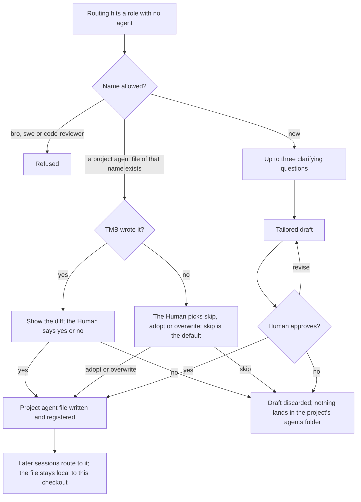
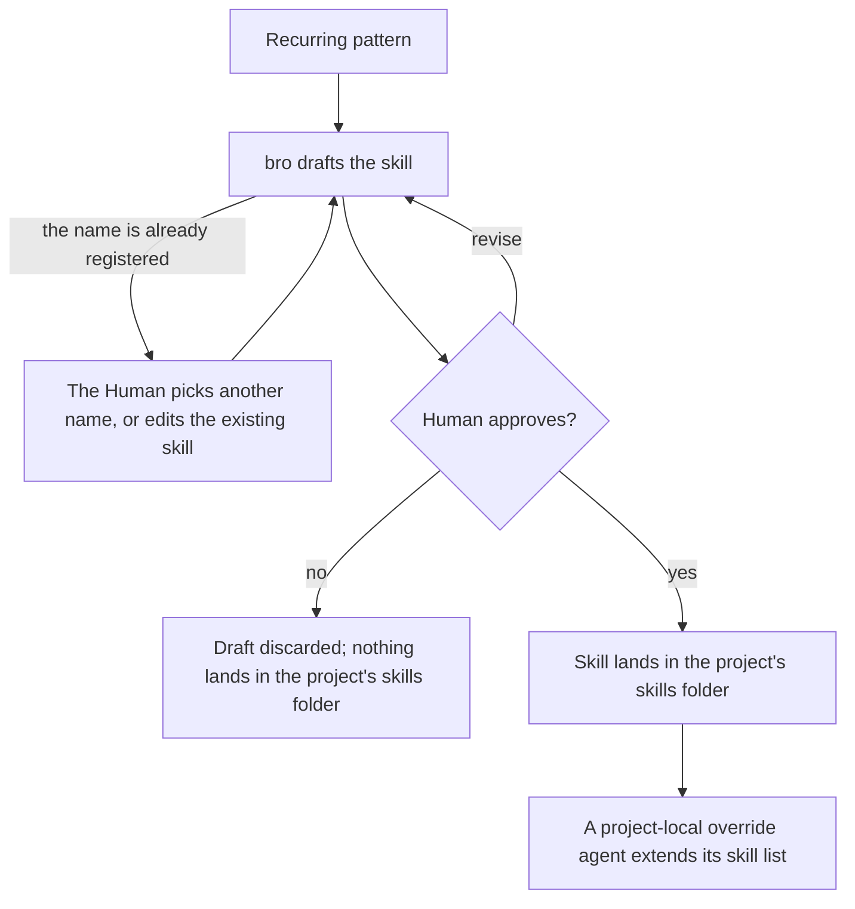
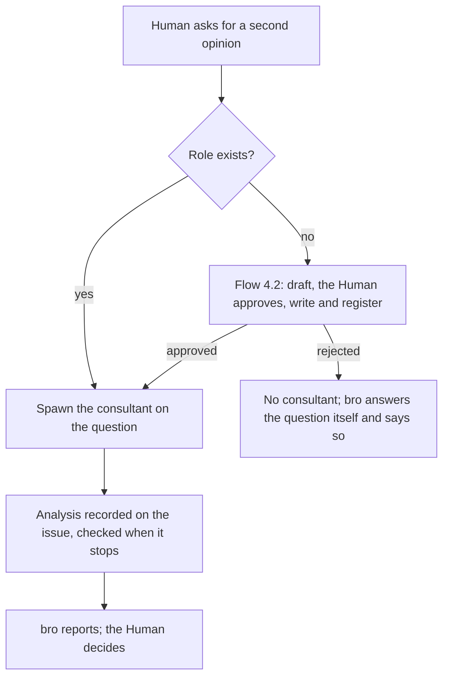
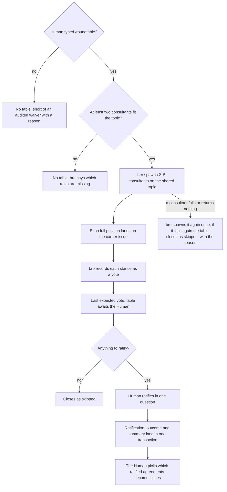

# Extending the team

Every case of flows 4.2 to 4.5 in [FLOWS.md](FLOWS.md): how a project gains agents, skills and second opinions, and what each path refuses. Acquiring a published capability (flow 4.1) is in [CHEATCODES.md](CHEATCODES.md); what each agent may do once it exists is in [RESPONSIBILITIES.md](RESPONSIBILITIES.md).

## 4.2 Agent creation

bro is a reserved name, and swe and code-reviewer are refused because a project copy would shadow the workflow backbone.

- **Every draft starts from one generic scaffold.** There is no per-role template; the clarifying questions tailor the draft.
- **An approval covers one file and lapses.** A draft approved but not written within a short window needs a new approval.
- **The file is not committed by default.** It lands in the project's Claude folder, which TMB keeps out of commits; the Human un-ignores it to share the agent with the team.
- **A backbone copy comes only from an attachment.** Attaching a skill or a cheatcode to swe or code-reviewer creates a project-local copy that differs from the shipped agent only in its skill and tool lists. Refreshing that copy's body after a plugin upgrade is planned (GH 3260); until then the copy keeps the body it was made from.

## 4.3 Skill creation

bro never edits an agent's body; attaching a skill only extends the agent's skill list, through a project-local override.

## 4.4 Consultant invocation

When a prompt matches a consultant's domain, a hint suggests routing it to that consultant; the hint is only advice. The consultant never decides and never writes workflow state.

## 4.5 Roundtable

Planned (GH 3360): the roundtable is cut; consultants stay.

- **The Human ratifies** agreements as a multi-select and each disagreement as a single choice.
- **A table never waits forever.** It awaits the Human only once every expected vote has landed, so a consultant that never answers is spawned again once and then ends the table as skipped.
- **A missing capture is reported, never blocked.** After the close, bro is told which records the table lacks and reports them to the Human; the close itself goes through.
