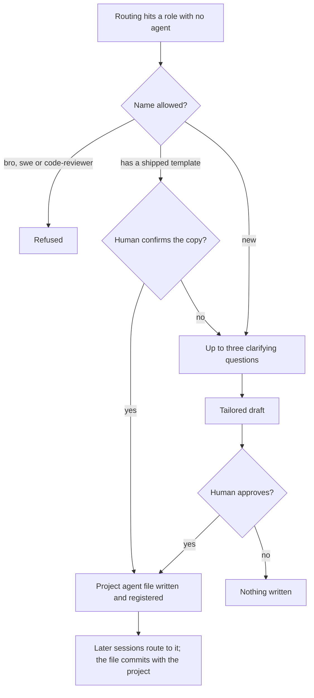
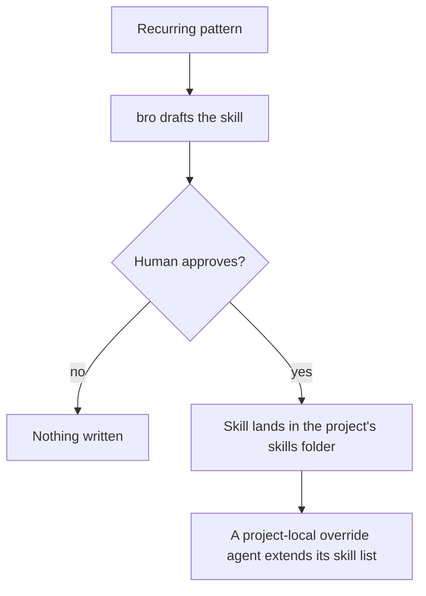
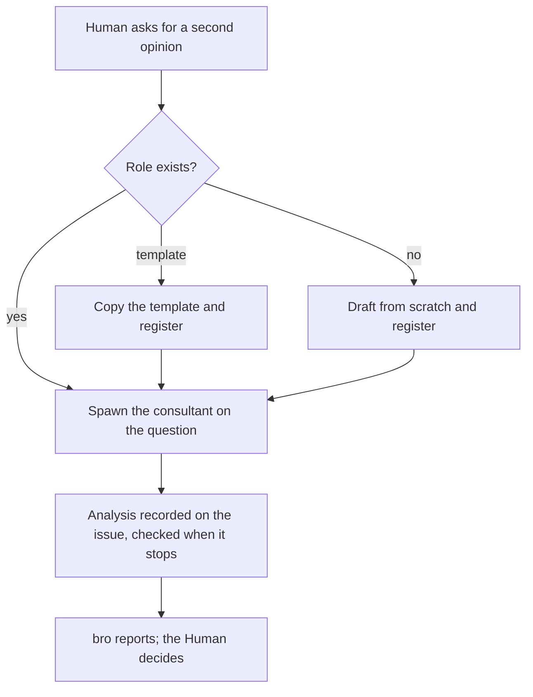
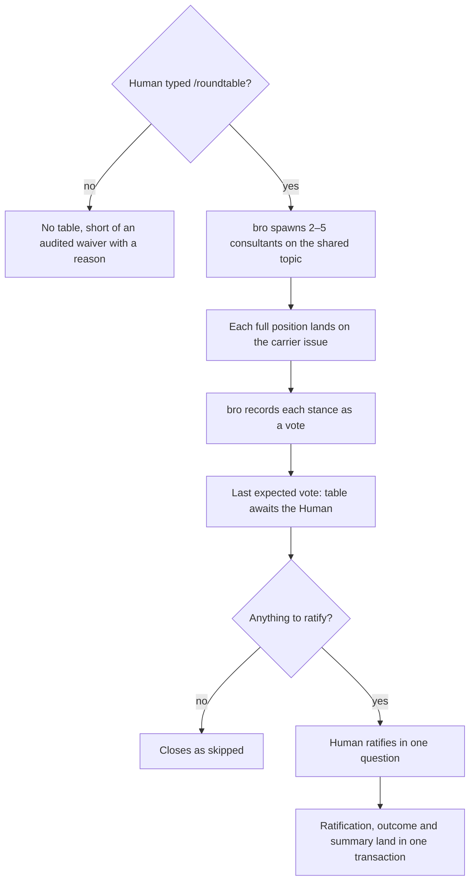

# Extending the team

Every case of flows 4.2 to 4.5 in [FLOWS.md](FLOWS.md): how a project gains agents, skills and second opinions, and what each path refuses. Acquiring a published capability (flow 4.1) is in [CHEATCODES.md](CHEATCODES.md); what each agent may do once it exists is in [RESPONSIBILITIES.md](RESPONSIBILITIES.md).

## 4.2 Agent creation

bro is a reserved name, and swe and code-reviewer are refused because a project copy would shadow the workflow backbone.

## 4.3 Skill creation

bro never edits an agent's body; attaching a skill only extends the agent's skill list, through a project-local override.

## 4.4 Consultant invocation

A prompt matching a consultant's domain gets an advisory routing hint. The consultant never decides and never writes workflow state.

## 4.5 Roundtable

- **The Human ratifies** agreements as a multi-select and each disagreement as a single choice.
- **A missing capture is reported, never blocked.**
