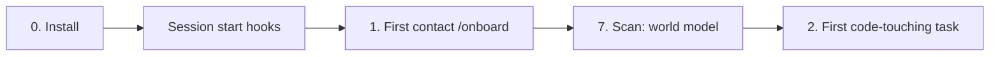
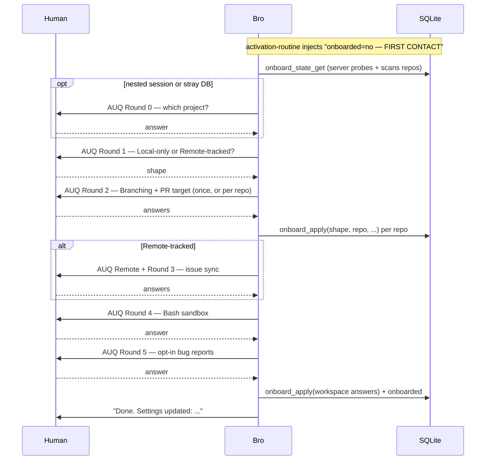
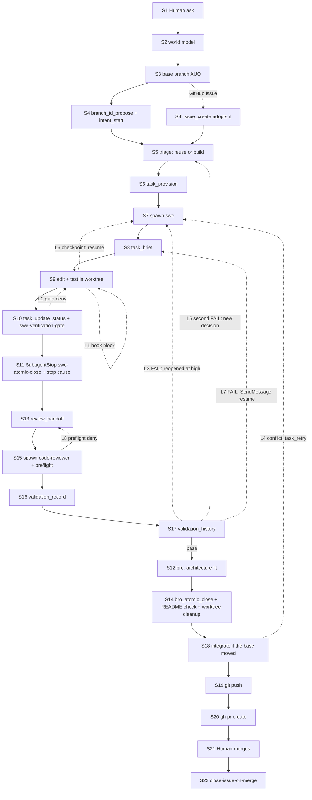
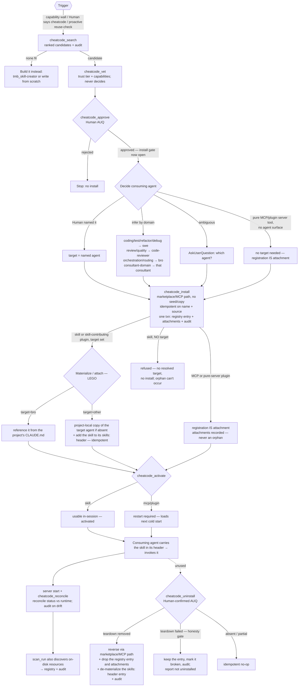
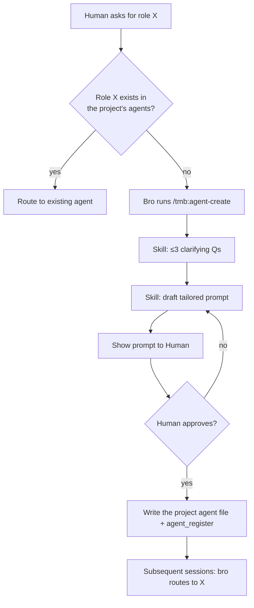

# TMB Workflows

The decision chain is **Human → bro → SWE** with two distinct gates:
- **bro is the task gate** — hands each returned task to review, judges its architecture fit after the pass, then closes it.
- **code-reviewer is the push gate** — reviews each completed task after bro's `review_handoff`, and bro's `bro_atomic_close` follows its pass; `git-push-guard` blocks a push whose task commits lack a passing review.

All consultants (architect, cto, ceo, pm, project-local) advise but never write workflow state. Roles live in [`RESPONSIBILITIES.md`](RESPONSIBILITIES.md); enforcement layers in [`ENFORCEMENT.md`](../prompt-engineering/ENFORCEMENT.md); schema in [`ERD.md`](ERD.md).

This file is the ground truth for the workflow, including the brand workflow hero and its animations. It describes only what ships; planned work lives in its GitHub issue. A PR that changes a flow updates its step, loop or guard row here in the same PR.

Every flow follows the memory model in [`MEMORY.md`](MEMORY.md). The brand workflow hero takes its memory story from there.

**What this file holds.** Who acts in each flow, what each step guarantees, which gate denies what and why, and what state the flow leaves. It names no code: what calls, reads or writes what is the world model's answer (`world_model_search` for where a gate or tool lives, `world_model_symbol` for its callers and tables), and the logic is the code's.

**Gates.** Every gate is a hook gate run through one router, which decides which gates each hook event runs and in what order. Gate lists below name the gates that matter to the step, not every gate the event runs.

**Layout.** [Quality layers](#quality-layers) sets the two axes every flow is built on. Flows are grouped by when they run: [Install](#part-i--install), [Cold start](#part-ii--cold-start), [Agent task handling](#part-iii--agent-task-handling), [Extending the team](#part-iv--extending-the-team) and [Reporting TMB bugs](#part-v--reporting-tmb-bugs). Grouping never renumbers a flow: flow numbers, letters and step ids stay stable wherever they sit.

## Quality layers

Every flow is built on two axes. The first is a responsibility boundary: each layer owns one level of quality and hands the next a ready state. The second is method: deterministic or judgment. bro, swe and code-reviewer never overlap in responsibility or work, because overlap wastes resources: each check has exactly one owner, and no layer redoes another layer's check.

| Layer, in handoff order | Owns | Method | Hands over (contract) |
|---|---|---|---|
| **Human** | intent. The Human is the outer layer and merges each PR, unless the project's merge policy delegates merging | judgment | a requirement |
| **bro (environment)** | a ready-to-work environment: a clean worktree cut from the latest base, a passing build, and a world model indexed at that base | deterministic | the worktree, the base commit and the world-model commit |
| **bro (spec)** | an actionable requirement: intent, files, checks and success criteria. bro's architecture judgment enters here | judgment | the spec |
| **swe** | functionality-level quality: every deterministic check in its scope passes (lint, word and size limits, type checks, unit tests, changelog fragment), and the world model shows no downstream caller breaks. It does not rebuild the environment bro handed over or rewrite the spec | deterministic | ready-to-review: a passing check run recorded on the commit, plus a report against every success criterion |
| **code-reviewer** | diff-level quality: whether the diff breaks other behavior, probed through the world model's dependents. It does not re-run swe's checks | deterministic | a recorded verdict with its findings and probes |
| **bro (architecture)** | architecture-level quality: whether the change fits the design and the spec's intent. It re-runs no checks and re-reviews no diff | judgment | a decision, then the push |

- **Gated handoffs.** Every handoff carries its typed contract, and a gate refuses the handoff when the artifact is missing.
- **Leaks point upstream.** When a later layer or CI catches a cheap check, the fix is to move that check into the layer that owns it, not to do more rework. The leak rate per layer is the health metric.
- **CI confirms; it does not discover.**
- **Failures return to their owner.** A failed check goes back to swe, a review finding goes back to swe at higher effort, and a design misfit goes back to bro's spec. None of these waits on the Human.

## Quick index

| # | Flow | Trigger | Agents | State it leaves | Distinguishing gates |
|---|---|---|---|---|---|
| | **Install** | | | | |
| 0 | Install and session start | Plugin install, then every session start | — (hooks) | per-session markers | the SessionStart gates, `session-start-persona`, `user-prompt-persona` |
| | **Cold start** | | | | |
| 1 | First contact | A project that is not yet onboarded | bro | project shape, repo and remote settings, the onboarded marker | `activation-routine` (auto-fire trigger) |
| 7 | Scan + world-model refresh | An empty world model, `/scan`, or the trajectory server connecting | bro (or the server's startup catch-up in background) | the world model and the discovered-capability registry | none (the startup catch-up is server code, not a hook) |
| **E** | Environment profile (ENV) | bro needs a repo's install, test and lint commands | bro | a per-machine cache of resolved commands | — |
| | **Agent task handling** | | | | |
| 2 | **Code-touching task** (canonical) | Code change ask | bro → swe (`task_provision` cuts branch + worktree); code-reviewer per task after `review_handoff`, then `bro_atomic_close` after its pass; the integrate command when the base moved | issue, decision, task, run, verification and review records; a reviewed, pushed branch and its PR | `agent-spawn-dispatch`, `containment-guard`, `swe-verification-gate`, `swe-atomic-close`, `code-reviewer-preflight`, `git-push-guard`, `close-issue-on-merge` |
| 3 | Architectural change | New boundary/module, schema, public API, external side effects | bro records a decision + blast-radius, then standard SWE flow | + a decision record | `task_provision`'s decision body (the universal decision gate) |
| 6 | Push gate / PR review | Each completed task after `review_handoff`; `git push` of a commit with no passing review | bro → code-reviewer (one per handed-off task, parallel), then `bro_atomic_close` on each pass | a verdict per reviewed commit, with its findings | `code-reviewer-after-atomic-close`, `code-reviewer-spawn-note`, `code-reviewer-preflight`, `git-push-guard` |
| 8 | SWE retry / escalation | An architecture misfit bro finds, a code-reviewer fail verdict, or an integrate conflict | bro ↔ swe (↔ code-reviewer per task) | further attempts and their findings, or a fresh task | `task_reopen` / `task_retry` composites, `rework-limit`, `swe-resume-gate` |
| **M** | Monitor PR comments | `/monitor <PR_number>` (invokes `tmb_comment-triage`) | bro → code-reviewer per actionable comment batch | stored comments, new issues and tasks, the run's resume point | — |
| 33 | Multi-repo path discipline | Inner repos registered; bro indexes them | bro | repo-relative world-model paths, scoped per repo | — |
| 13 | Bulk cleanup | Human pre-authorizes a bulk delete | bro (direct Bash, no SWE spawn) | — | — |
| | **Extending the team** | | | | |
| 10 | Cheatcode lifecycle | bro hits a capability wall, Human says "cheatcode", or a proactive reuse-check before building | bro (Human approves install) | the capability registry and its attachments | `cheatcode-install-approval`, `prompt-intent-hints` |
| 4 | Agent-creator | Routing hits a role the project has no agent for | bro | — (file-based outcome) | — |
| 5 | Skill creation | Recurring pattern needs encoding | bro | a registered skill | — |
| **C** | Consultant invocation | Human asks for second opinion | bro → consultant | the consultant's analysis or concern | `consultant-persistence-gate` |
| 9 | Roundtable | Multi-consultant deliberation with AUQ ratification | bro orchestrates 2–4 consultants | the table, its votes and the ratified decision | `roundtable-auq-shape`, `roundtable-cleanup-postcheck` |
| | **Reporting TMB bugs** | | | | |
| **B** | Bug report (opt-in) | bro hits a real TMB bug and the Human opted in | bro (Human previews and approves each report) | a record of each filed report | — |

---

## Part I — Install

### 0. Install and session start

Installing and restarting are the Human's actions; bro never runs them.

1. **Install** at project or local scope, never user scope ([INSTALL.md](../reference/INSTALL.md#recommended-scope-project-or-local) explains why):
   ```
   claude plugin marketplace add trustmybot/marketplace --scope project
   claude plugin install tmb@trustmybot --scope project
   ```
   The rc channel is `trustmybot/marketplace-rc` + `tmb@trustmybot-rc` with `--scope local`. Pick one channel per Claude Code install.
2. **What is active at once:** the `swe` and `code-reviewer` agents, the trajectory-server MCP tools, and the plugin's hooks. bro's persona lives in the plugin's `CLAUDE.md`, which Claude Code never loads for a plugin, so hooks deliver it.
3. **Every session start** runs the SessionStart gates (health checks, gitignore, session markers, persona, project inventory):
   - `plugin-hooks-marker` and `session-start-persona` mark the session as having the plugin's hooks and persona;
   - `session-start-persona` injects bro's persona on startup, resume, `/clear` and compaction, and after a compaction appends the state `session-handoff` (G8b) recorded before it;
   - `session-start-prescan` injects the project inventory and the trajectory DB's health line.
4. **The first prompt** runs `user-prompt-persona`, which injects the persona once when the session started before the plugin's hooks loaded. If TMB was installed mid-session, the Human fully quits and relaunches Claude Code. It also runs `activation-routine`, which starts flow 1 on a project that isn't onboarded.

Everything TMB writes stays under the project root; [INSTALL.md](../reference/INSTALL.md#what-tmb-writes-and-where) lists each path.

---

## Part II — Cold start

On a new project the flows run in this order. Each step runs once, and later sessions skip what is already done.



---

### 1. First contact (auto-fired `/onboard`)

On each prompt, `activation-routine` checks whether the project is onboarded. If it is not, the gate injects a first-contact directive; bro fires `/onboard` at once and runs its ceremony before any reply.

Each round starts from fresh evidence: the server re-probes the project (origin URL, whether gh/glab is installed and authed) and scans every registered repo offline. Every question carries the evidence behind its recommendation, which bro shows in chat before the AUQ; the recommended option comes first and is pre-selected.

| Round | Runs when | Asks | Persisted |
|---|---|---|---|
| 0 | The session is nested below the project, or another trajectory DB exists | Use the workspace project, make the session folder its own project, or cancel; remove each empty stray DB | the standalone choice, or the stray-DB removal on the final apply |
| 1 | Always | Project shape: Local-only or Remote-tracked (a Local-only answer that contradicts a GitHub/GitLab origin is re-asked once) | the shape, on every apply |
| 2 | Always | Branching model + PR target, once when every repo points the same way, else per repo; on remote shape, then the Remote question (multiSelect) for the workspace | each repo's branching model, PR target and protected branches; on remote shape each repo's remotes, re-read from git, with one remote per chosen provider marked for sync |
| 3 | Remote shape | Issue sync | the workspace issue-sync setting |
| 4 | Always | Bash sandbox | the sandbox setting; yes writes the sandbox block into the project's local Claude Code settings |
| 5 | Always | Opt-in TMB bug reports (flow B) | the bug-report consent (no by default) |

The final workspace-level `onboard_apply` writes the workspace answers and the onboarded marker in one transaction.



`/onboard` re-runs on demand for later changes — same flow with `Keep "<current>"` pre-selects. Identity is a pure onboarded marker (no name or other fields stored).

---

### 7. Scan + world-model refresh

`scan_run` is the single scan-side MCP tool. It walks each registered repo deterministically and builds the **world model**: one summary per tracked directory (taken from the directory's README when it has one, else a structural fallback) under its parent, file purposes, and the symbol index with its edges. The world-model tools read it; inner-repo path scoping is in [`REPO_RESOLUTION.md`](./REPO_RESOLUTION.md).

A scan runs when the Human types `/scan`, when bro finds the world model empty or rescans after an architectural change, and in the background when the trajectory-server connects. Reads and task spawns also reindex a repo to its target commit on their own. Each scan is audited with its source and whether the project's shape changed.

**Resource discovery.** The same scan also reconciles on-disk capabilities into the capability registry: project-local skills, enabled plugins and configured MCP servers. Each resource not already tracked (matched on name and kind) is added and audited, so a cheatcode added out-of-band still becomes visible to the lifecycle flow below.

---

### E. Environment profile (ENV)

Knowing how to install, test and lint a repo is bro's job, and **no toolset is hardcoded**: bro decides from the repo's own evidence.

- **Detect.** `env_detect` reads the repo's evidence (CI steps, task-runner targets, manifests, config files, lockfiles) and runs nothing. It reports a recorded profile as drifted when the evidence changed since it was recorded.
- **Record.** bro resolves the commands per category and records them with `env_record`; bro's own overrides, waivers and declines survive a re-record.
- **Read.** `env_get` returns a repo's effective commands for planning and verification.
- **Propose verification defaults.** When a repo's PR target has no verification-defaults file, `/onboard` offers the root profile's lint, typecheck and test commands as its defaults and writes the chosen ones to the working tree for the Human to commit; until then task provision, task retry and scan return a non-blocking hint.

**Where the ENV lives.** The repo is the source of truth: tool choices live in the repo's own standard files, so teammates, CI and editors enforce the same rules without TMB. The recorded profile is a derived per-machine cache of the resolved commands, their sources and a hash of the evidence.

---

## Part III — Agent task handling

### 2. Code-touching task (canonical chain)

This section is the standard for the code-touching workflow. Other docs and the brand workflow hero cite its step ids (`S1`..`S22`, `S4′`), loop ids (`L1`..`L8`) and guard ids (`G1`..`G16`), each anchored as `FLOWS.md#<id>`; a change to the flow updates these tables first. Ids are never renumbered: a new step takes a primed id (`S4′`) and a new loop or guard the next number.

Bro is both planner AND task gate, and the handoff order is swe → code-reviewer → bro: when SWE returns, bro hands its commit to code-reviewer (S13) while the task stays completed, and only after code-reviewer's pass judges the architecture fit (S12) and closes the task (S14). `git-push-guard` holds any push whose task commits lack a passing review.

#### Steps

| Id | Actor | What happens | Guarantees / leaves |
|---|---|---|---|
| S1 | <a id="S1"></a>Human → bro | A chat message; the prompt-time gates inject bro's persona and the open issue, among them the overrun (G8) and liveness (G10) advisories | bro starts every turn knowing its role and the live work |
| S2 | <a id="S2"></a>bro | Reads the world model (`world_model_get`, `world_model_search`, `world_model_symbol`) | each read is audited |
| S3 | <a id="S3"></a>bro → Human | `AskUserQuestion`: which base branch; a lint gate bounds the question's length | the answer stays in the transcript |
| S4 | <a id="S4"></a>bro → Human | `branch_id_propose`, AUQ "Proceed with branch_id X?", then `intent_start` | the issue, the Human's intent and the planning note land in one transaction |
| S4′ | <a id="S4′"></a>bro (GitHub path) | `issue_create` adopts an existing GitHub issue in place of S4's `intent_start` | the local issue is linked to its GitHub issue |
| S5 | <a id="S5"></a>bro | Triage: is it actionable, reuse or build; the call rides in `task_provision`'s decision body | the decision is written at S6, with the task |
| S6 | <a id="S6"></a>bro | `task_provision` records the decision and the task in one call, then cuts the task branch and its worktree. The task carries a spec with numbered success criteria, its typed file list, its verification commands and an effort; a spec whose commit subject G16 would deny is refused (GH 2667), and a spec too large for one swe run is split into linked tasks. A bro session already in a linked worktree adopts it instead of getting a new one (G12). A provision with no world-model read before it is nudged (G13), and the verification commands may name only test files that exist (G15). Each worktree runs the repo's opt-in setup commands ([worktree setup](../../mcp/trajectory-server/README.md#worktree-setup)). Before any row is written, an environment gate (also run by `task_reopen` and `task_retry`) fetches the base from origin, cuts the branch and worktree, runs setup and reindexes the world model at the base commit; a failed stage refuses with `env_gate_failed`, writes nothing and removes what the call created | a decision, a pending task with its base and world-model commits, its branch and its worktree; nothing is written when the spec or the environment is refused |
| S7 | <a id="S7"></a>bro → swe | `Agent(subagent_type=swe, effort, prompt "task_id=<N>")`; `agent-spawn-dispatch` runs the spawn gates in order (the task has a spec and an effort, the branch is live, the rework limit holds; the code-reviewer gates are S15's), then records the spawn and makes sure the worktree exists; after the call it binds the run to its spawn, or undoes the record when the spawn fails | the task is running and the run is metered from its first call |
| S8 | <a id="S8"></a>swe | `task_brief(task_id)`; `swe-brief-gate` denies edits and every other trajectory tool until it is fetched. The brief resolves the files and symbols the spec names to line ranges, so swe reads ranges instead of whole files. A brief carrying a checkpoint is a resume (L6), and it says why the previous run stopped | swe never acts before it has the spec, the open findings and the latest verification run |
| S9 | <a id="S9"></a>swe | Edits, tests and commits in the worktree. Tests run through the test runner wrapper, which returns a short summary and keeps the full output in a log; a full suite waits for a machine-wide suite slot so parallel worktrees don't overload the machine. Guards G1–G4 fire on each call, and G16 on each commit; a deny is L1 | commits on the task branch; each deny is audited |
| S10 | <a id="S10"></a>swe | `task_update_status(completed, commit_sha, report)`; the typed report gives every success criterion a status with evidence and lists the edits outside the file list, the findings fixed and the bug classes swept. `swe-verification-gate` first checks the worktree HEAD against its merge base with the PR target for a changelog fragment and for deleted paths or dropped tool names still cited in docs, where the changelog directory, the doc files and the tool sources come from the project's own config and a check the project leaves unconfigured is skipped with a note (no waiver skips these), then runs the verification commands and every blocking finding's probe in the worktree (L2) | a recorded verification run, the closing commit and the report on the task |
| S11 | <a id="S11"></a>hook | `swe-atomic-close` at SubagentStop: auto-completes a still-running task whose commits carry a passing verification run for HEAD (unless the run wrote a checkpoint, L6); with no such run the task stays open and bro is told to resume the swe so it closes through the gate. It also meters the run and its tool-output sizes, and records why the run stopped (a checkpoint handback or a hook block), telling bro to resume or to name the block in the rework note | the run is closed with its tokens, duration and stop cause |
| S12 | <a id="S12"></a>bro | After S17 reads a pass: judges whether the change fits the design and the spec's intent, and whether it accepts the swe's extras. It re-runs no checks and re-reviews no diff | nothing on a fit; a misfit is recorded (`bro_verification_fail_record`) and goes back to the spec: `task_update_spec`, then `task_reopen` for a swe rework (back to S7), or, for a redesign, the task moved to escalated and `task_retry` |
| S13 | <a id="S13"></a>bro | `review_handoff` refuses a handoff the report does not cover, or with no passing run for the task's commit; it records the review anchor with the swe's extras and their reasons, assigns the reviewer effort and leaves the task completed. Its short spawn note is the only prose the reviewer gets beyond its anchors, and the result can carry the ready-made S15 spawn call | the commit is handed to review and the handoff audited |
| S14 | <a id="S14"></a>bro + hooks | After S17 reads a pass: `bro_atomic_close` refuses without a passing verdict after the handoff of the task's current commit, keeps the scope gate on the extras, then closes the task; `post-atomic-close-readme` and `cleanup-worktree-on-task-close` fire after it | the task is closed and the pass audited; README drift is surfaced and the worktree removed |
| S15 | <a id="S15"></a>bro → code-reviewer | `Agent(subagent_type=code-reviewer)`, the prompt carrying `name=value` anchors and the spawn note only; the code-reviewer spawn gates require a completed task handed off at its commit (or a closed one), cap the prose and run the machine preflight (L8) | a reviewer starts only on a commit a machine can already vouch for |
| S16 | <a id="S16"></a>code-reviewer | Reads the brief and the commit, probes in a review worktree, then records a verdict with `validation_record`: a fail needs a blocking finding, and a pass may carry nits and pre-existing ones. A hook stamps the reviewer's identity on the record | a verdict for the commit, with its findings |
| S17 | <a id="S17"></a>bro | `validation_history`: the verdict comes from the record, never from the reply text | — |
| S18 | <a id="S18"></a>bro | Base moved → the integrate command rebases the reviewed commit in a temporary worktree and reruns the verification commands; a clean rebase carries the reviewed commit's pass to the new SHA, which bro pushes, and a conflict is L4. An unmoved base skips this step | a verification run on the rebased SHA and the task branch moved to it |
| S19 | <a id="S19"></a>bro | `git push`; `git-push-guard` allows it only when each pushed task commit has a passing review recorded for that commit | the remote branch |
| S20 | <a id="S20"></a>bro | `gh pr create --base <pr_target>` (`glab mr create` on GitLab); `attribution-footer` checks the PR body's attribution | the PR |
| S21 | <a id="S21"></a>Human | Merges the PR, unless the project's merge policy delegates merging; once it reports merged, bro runs the post-merge cleanup | the merged PR |
| S22 | <a id="S22"></a>hook | After a successful in-session `gh pr merge` / `glab mr merge`: `close-issue-on-merge` closes the branch's live tasks and each issue the PR closes by an explicit closing-ref; `clean-merged-branch` removes the merged local branch and its worktree. A merge made on GitHub fires neither. | tasks and issues closed; a task closed with no passing review is audited as a bypass |

#### Loops

| Id | Loop | Trigger | What happens |
|---|---|---|---|
| L1 | <a id="L1"></a>Hook block → rerun | A gate denies a swe call, e.g. `containment-guard` on a write outside the worktree | swe reruns in the form the deny names and carries on. When the deny names none or says it is policy, swe closes failed with no report and quotes the hook. A run that stops on the deny without reporting is recorded as stopped on a hook block (S11), and bro names the block in the rework spawn note. Returns to S9. |
| L2 | <a id="L2"></a>Gate deny → fix | swe reports completed but the changelog fragment is missing, a doc still cites a removed path or tool, or a verification command or an open finding's probe fails | `swe-verification-gate` denies the call, naming the failing check's expected and actual value, or the command and its timing; swe fixes it and calls again. Returns to S9. |
| L3 | <a id="L3"></a>Review FAIL → rework → re-review | code-reviewer records a fail with numbered findings | The same transaction that records the FAIL reopens the task: a completed, needs_validation or closed task of an open issue moves back to running at high effort with a spawn note naming the blocking finding ids, and a running one is raised to high. bro surfaces the FAIL, holds the push and spawns swe at high with no Human question; the spawn gates hold a task with a FAIL since its last pass at high, and deny it while its worktree is missing until `task_reopen` recreates it. swe fixes each finding, commits its probe as a test, the gate re-runs every probe, and code-reviewer reviews the next attempt. A disputed FAIL needs no new commit: with no swe run live, a passing run for the unchanged commit and a `re_review` rework analysis dated after the FAIL, `review_handoff` restores the task to completed and hands the same commit to a new code-reviewer. Returns to S7 (or L7 when bro resumes the same swe). |
| L4 | <a id="L4"></a>Integrate conflict → retry | The base moved and the integrate command reports a conflict or patch drift | bro records the failure (`bro_verification_fail_record`) and moves the closed task to escalated, then `task_retry` cuts a fresh task, branch and worktree from the current base with a spec that points at the reviewed commit; it goes through verify and review again. A verification failure on the rebased commit reworks as L3. Returns to S7. |
| L5 | <a id="L5"></a>Rework limit | Two review FAILs on the task since its last passing review, or a design-drift analysis of the task | The `rework-limit` spawn gate (and `swe-resume-gate` for a resume) denies a further swe run on the task. bro debugs the root cause, the inputs first (spec, world model, reviewer, environment), then swe's execution, records it with `task_rework_analysis` and makes the change it names; an analysis newer than the latest FAIL whose change a later row proves (a spec amendment, an effort raise or a world-model fix) admits the next run; a task the FAIL already raised to high has no effort raise left, and the raise dated at the FAIL is no proof, while a split or `task_retry` starts a new task. No swe-run, issue-wide FAIL or retry count denies. A design-drift analysis, whose change is a split or `task_retry` (after bro moves the task to escalated), ends the task's swe runs at any FAIL count: bro redesigns the work as a new task with its own spec, and no row lifts the deny. Nothing waits on the Human. Returns to S5. |
| L6 | <a id="L6"></a>Checkpoint → resume | The work left won't fit in the swe run's turns | Before its turn budget ends the run, swe commits the work in progress and hands back a checkpoint (what is done, what is left, the files in play, the commit) with no report. S11 keeps the task running and records a budget stop; bro spawns swe again, and the brief's checkpoint tells it to start from what is left and not redo what is done. A move to completed clears the checkpoint. Returns to S7. |
| L7 | <a id="L7"></a>Resume the same swe | bro reworks a task by `SendMessage` to the swe that wrote the commit, instead of a fresh spawn | `swe-resume-gate` judges the message like a fresh spawn: it denies under the rework limit (L5), and when the swe ran at an effort other than the task's current one. The resumed swe's next `task_brief` opens its own metered run, linked to the one it resumes. Returns to S8. |
| L8 | <a id="L8"></a>Reviewer preflight deny → fix | A code-reviewer spawn (S15) fails a machine check | `code-reviewer-preflight` denies with the expected and actual value of the first failing check: the branch tip is not the closing commit, no passing verification run, or the branch conflicts with the PR target. The changelog and stale-doc checks run earlier, at swe's close (L2). bro fixes the cause (re-close or the integrate command) before any reviewer runs. Returns to S15, or to S7 through L3. |

#### Guards and advisories

Gates that fire across many steps rather than at one.

| Id | Gate | When | What it does |
|---|---|---|---|
| G1 | <a id="G1"></a>`containment-guard` | Before a write or Bash call | Denies a write outside the caller's worktree or project, judging every value a shell variable can take |
| G2 | <a id="G2"></a>`swe-boundary`, `no-source-edit-from-main` | Before a write or Bash call | Deny a swe write to prompt surfaces or `CLAUDE.md`, and bro edits to registered repo source from the main checkout |
| G3 | <a id="G3"></a>`swe-scope-fence` | Before a write | Never denies: tells swe once per path that it edited outside the file list and must list it in the report's extras |
| G4 | <a id="G4"></a>`naming-lint`, `code-quality-lint` | Before a write | Lint the written content |
| G5 | <a id="G5"></a>Bash git guards | Before a Bash call | `git-guards`, `no-worktree-branch-create`, `stay-on-base-guard`, `branch-up-to-date-with-remote`, `commit-msg-lint`, `no-remote-auth-guard`, `remote-id-guard` |
| G6 | <a id="G6"></a>`cleanup-worktree-on-task-close` | After a task status move, `bro_atomic_close` or a verdict | Removes a closed task's worktree when nothing else needs it |
| G7 | <a id="G7"></a>`bro-turn-usage` | When bro's turn stops | Meters bro's own turn into its session run and records bro's tool-output sizes. Runs async and does not block the turn; a lost run is recovered by the next, whose total always covers the whole transcript. Each run reads only what the transcript gained since the last, from a per-session cursor beside the DB; a missing, corrupt or mismatched cursor falls back to a full read. |
| G8 | <a id="G8"></a>`task-overrun-alert` | On each prompt and after each trajectory tool call | Tells bro once per task when a running task passes its overrun threshold (an hour by default), with its attempts and current blocker, and once per spawn when a live swe run of its session passes that threshold while its task is not running |
| G8b | <a id="G8b"></a>`session-handoff` | Before compaction, and at the SessionStart that follows | Before each compaction of a bro session, records a handoff for the session, re-arming one an earlier compaction consumed. The same session's post-compaction start takes it and appends the issue, its live tasks and the issue's newest decision, read from the DB then. Startup, clear and resume take nothing. Never blocks and never prints |
| G9 | <a id="G9"></a>`debug-trajectory` | Before Bash, Read, Write, Edit, Agent and Skill calls | Records the call trajectory when debugging is on |
| G10 | <a id="G10"></a>`liveness-alert`, `liveness-sentinel` | On each prompt and after each trajectory tool call; when idle | Reports a subagent run silent past its threshold (half an hour by default, scaled by load) or a hung `tail -f` watcher to bro, once per finding: during a turn as context, while idle by waking an attended session. Reports only: kills, closes and fails nothing |
| G11 | <a id="G11"></a>`no-prose-in-scratch` | Before a write or Bash call | Denies every agent a prose file in the plugin's scratch folder, and in the system temp folders outside a git worktree, and a `gh issue\|pr create\|edit\|comment` reading its body from a file; the deny names the trajectory DB tools. An explicit opt-out lifts it |
| G12 | <a id="G12"></a>`worktree-adopt-guard` | Before `task_provision`, `task_reopen`, `task_retry` | An allowlist on worktree adoption: a session in a linked worktree must adopt exactly that worktree, and any other session must not adopt one; the deny names the worktree that may be adopted, if any |
| G13 | <a id="G13"></a>`wm-read-before-provision` | Before `task_provision` | Denies unless the session made a recent world-model read covering the spec's files, and audits the deny. A repo with no world model yet is allowed with a nudge |
| G15 | <a id="G15"></a>Verification path check (server-side, not a hook) | `task_provision`, `task_retry`, `task_reopen`, `task_update_spec` (S6, L3, L4) | Two refusals before anything is written. First, an entry that is a prose sentence, not a command (its command word is a capitalized English word that resolves to no executable, builtin or path), is refused, so the close gate never runs a sentence as shell (GH 2955). Second, an allowlist on the test files the verification commands hand a test runner: each must exist at the task's base or branch tip, or be in the file list, or the call is refused. Each call also suggests existing tests that import a listed module, without blocking |
| G16 | <a id="G16"></a>`commit-msg-lint` | Before a Bash call, at swe's commit in S9 | An allowlist on the commit subject: denies a commit message whose first line is not an emoji Conventional Commits subject of bounded length, naming the rule broken and the expected form |

**Gate timing:** the router times each gate against a measured budget, and a timed-out gate is not retried: an enforcement gate denies, an advisory gate is skipped.

#### Metering

Every agent run is recorded (tokens, duration, why it stopped, what it resumed), and every hook block and tool output is metered. `task_stats` reads them back per task or over every run since a date: spawns, reworks, review fails, hook blocks and their token cost.



**Notes**
- A swe spawn needs a task with a spec; a spec that adds a column, field, tool, table or migration also names who writes it and when it is populated, unless bro waives the check.
- Only `task_provision` creates task branches and worktrees; a manual branch create in a worktree is denied.
- The verification gate runs the task's verification commands in its worktree and records the run; a recent passing run for the same commit is reused, and a rework carries forward the commands whose inputs it did not touch. It never fails open: an unresolved worktree denies. A task with no verification commands skips it with a warning, and a stated reason waives it with an audit record.
- `review_handoff` refuses a handoff with no passing run (or recorded waiver) for the task's commit. This covers closes the gate never saw, such as a spec change after the run.

---

### 3. Architectural change (Δ vs flow 2)

Same chain as flow 2, plus: in `task_provision`'s decision body (S6), bro records a decision and applies the blast-radius checklist. The universal decision gate requires a recorded decision regardless of flow.

- Skills: `tmb_planning` triggers the architectural ceremony when the change introduces a new boundary/module, touches schema or public API, or has external side effects (see its "Architectural changes" section).
- For human-driven deliberation, the user enters Claude Code's native plan mode (Shift+Tab) — bro doesn't run a bespoke Q+A loop. The decision record captures the outcome.
- Bro's architecture judgment after the review pass (S12) is unchanged — never skipped, even for architectural changes.

---

### 6. Push gate / PR review

```mermaid
sequenceDiagram
    participant H as Human
    participant B as Bro
    participant P as code-reviewer (subagents — parallel)
    participant DB as SQLite

    Note over B,DB: flow 2 S13: review_handoff hands the completed task's commit to review (short spawn note)
    par one code-reviewer per handed-off task (S15)
        B->>P: Agent(code-reviewer, anchors only: task_id= commit_sha= …)
        Note over B,P: agent-spawn-dispatch: spawn-note cap, then preflight (L8 on deny)
        P->>DB: task_brief(task_id=N) — spec, completion report, spawn note, open findings
        P->>P: git show <sha>; probes in a review worktree
        P->>DB: validation_record(verdict pass or fail, findings)
    end
    B->>DB: validation_history — read each verdict off its record (S17)

    alt all pass
        B->>DB: bro_atomic_close — close each passed task (S14)
        B->>B: integrate <task_id> <base> when the base moved (S18)
        B->>B: git push (git-push-guard allows the reviewed SHAs, S19)
        B-->>H: gh pr create → PR URL (S20)
    else any fail
        Note over B,DB: the FAIL already reopened the task at high (flow 2 L3)
        B-->>H: surface failures verbatim, hold the push
        B->>B: spawn SWE at high to fix (flow 2 L3), no Human question
    end
```

A push made before review (by bro or the Human) hits `git-push-guard`, which denies it unless each pushed task commit's newest verdict is a pass for that commit; a pass for an earlier commit of the task, or one under a newer fail, does not count.

Each verdict records whether the review ran with MCP access or through the honor-system CLI fallback, and the reviewer's identity comes from a hook observation of the call, never from the reviewer's own claim. Verdicts and findings are append-only: a repeated attempt is stored as a new one, and the push gate and the close paths go by the task's newest verdict.

---

### 8. SWE retry / escalation

Triggered when bro's architecture judgment finds a misfit (flow 2 S12), code-reviewer records a fail (L3), `code-reviewer-preflight` denies (L8), or the integrate command hits a conflict (L4). A code-reviewer fail has already moved the task back to running at high (L3). Other work on the same task goes through `task_reopen`, which moves it back to running and recreates its worktree when missing; bro then spawns a fresh swe, or resumes the swe that wrote the commit by `SendMessage` (L7). A wrong approach or an integrate conflict goes through the `task_retry` composite, which takes only a failed or escalated task, so bro first moves the task to escalated — it cuts the new branch and worktree through `task_provision`'s environment gate, then one transaction appends the retry rationale, creates a new task, carries the failed task's open review findings onto it, and audits the retry. Then bro spawns SWE on it.

Two FAILs on a task since its last passing review trip the rework limit (L5); bro's analysis plus its proven change admits the next run. A design-drift analysis ends the task's swe runs, and bro redesigns the work through `task_retry` (on the task moved to escalated) or a split. A swe that runs out of turns hands back a checkpoint instead of failing (L6). A task still running after an hour raises the overrun advisory (G8).

---

### M. Monitor PR comments

`/monitor <PR_number>` slash command. Bro fetches the PR's review comments via `pr_monitor_comments_get`, triages actionable ones, files them as new issues and tasks, and dispatches SWE per ratified comment batch. Each PR's run keeps its resume point, so a re-run of the same PR starts from the last fetched comment. The server stores every fetched comment as a note on the issue of the task that owns the PR, deduplicated by the comment's remote id; the result counts new and already-stored comments.

---

### 33. Multi-repo path discipline

When a workspace has multiple inner git repos (siblings or submodules), each is identified by its registration: an operation matches its path against the registered repo paths, or a task names its repo. World-model paths are stored repo-relative: a scan never prepends the inner repo's directory. See [`REPO_RESOLUTION.md`](./REPO_RESOLUTION.md).

Registration also scopes the `no-source-edit-from-main` guard: it protects only registered repo subtrees, so edits to unregistered sibling repos are allowed.

---

### 13. Bulk cleanup (pre-authorized destructive ops)

When the Human's prompt names what to delete (branches, temp files, etc.), bro executes in one Bash call with no AUQ and no re-confirmation. Defensive checks (which files match? any active worktrees?) belong *before* the Human authorizes. Re-asking treats a standing directive as a question — wastes time and ignores intent.

---

## Part IV — Extending the team

### 10. Cheatcode lifecycle

Bro acquires a capability (skill, MCP toolkit, or plugin) on demand instead of grinding it out by hand. The mechanical pipeline is deterministic tools + hooks; only the judgments stay prose — "do I lack a capability this task needs?", "is this candidate trustworthy?", and "which agent consumes it?". Architecture-of-record: [`CHEATCODES.md`](./CHEATCODES.md). This is the full lifecycle.



What each stage does, the registries, the attachment rules by kind and the teardown guarantees are in [`CHEATCODES.md`](./CHEATCODES.md). Two rules hold across the diagram: a skill install with no resolved consuming agent is refused, so no orphan skill can land, and an uninstall removes the `skills:` entry it added, so no dangling reference remains.

---

### 4. Agent-creator



Reserved names — `bro`, `architect`, `swe`, `code-reviewer` — are refused. New agent files commit to the project; every dev gets it on next pull.

---

### 5. Skill creation

Same shape as flow 4 — bro drafts via `tmb_skill-creator`, Human approves, and the skill lands in the project's own skills folder. Bro never edits agent body files; instead it writes a project-local override agent file that extends `skills:`.

---

### C. Consultant invocation

Human types `/tmb:agent-create <ask>` OR a naturalistic question matching `/tmb:agent-create`'s description. Either path loads the skill, which calls `agent_resolve` to classify the role (collision, template-copy or from-scratch) and registers a newly written consultant with `agent_register`, then spawns the consultant via `Agent`. The consultant writes its analysis with `discussion_append`; `consultant-persistence-gate` checks at SubagentStop that it did. Bro reports to Human; **the Human decides** — never the consultant.

`prompt-intent-hints` detects domain-keyword prompts and injects a routing hint (advisory; bro decides whether to spawn).

---

### 9. Roundtable

Multi-consultant deliberation. Bro orchestrates 2–4 consultants on a topic, then renders an AUQ for Human ratification.

- `roundtable_create` opens the table.
- Bro spawns each consultant via `Agent` with the shared topic; each writes its analysis or concern with `discussion_append`.
- Each consultant votes with `roundtable_vote`, giving its role, vote and rationale.
- `roundtable_close` moves the table to awaiting the Human and records its summary as a decision.
- `roundtable-auq-shape` validates the ratification AUQ structure.
- After Human picks: `roundtable_finalize_decisions` + `roundtable_summarize`.
- `roundtable-cleanup-postcheck` verifies the capture surface (audit and discussion records) actually landed.

---

## Part V — Reporting TMB bugs

### B. Bug report (opt-in)

Off by default; the Human opts in at `/onboard` Round 5.

1. bro hits a real TMB bug; the `tmb_recovery` skill says when to offer a report.
2. `bug_report_draft` builds a redacted draft with a signature, and says when an earlier report already carries that signature. It is refused without the Human's consent or explicit ask, and it never files anything.
3. bro shows the Human the full draft; the Human's read is the final redaction check.
4. Only on the Human's yes, bro files it to `trustmybot/plugin` and audits the filing.
