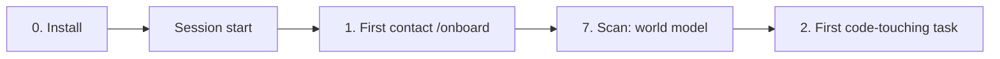

# TMB Workflows

The decision chain is **Human → bro → swe** with two distinct gates:
- **bro is the task gate** — writes each task's spec, hands the returned work to review, and judges its fit to the design at task close.
- **code-reviewer is the push gate** — reviews each completed task before bro closes it; no task commit reaches the remote without a passing review.

Consultants are project-local consultants, created with `/tmb:agent-create`; they advise but never write workflow state. Roles live in [`RESPONSIBILITIES.md`](RESPONSIBILITIES.md); enforcement layers in [`ENFORCEMENT.md`](../prompt-engineering/ENFORCEMENT.md); schema in [`ERD.md`](ERD.md); the memory model every flow follows, which the brand workflow hero takes its memory story from, in [`MEMORY.md`](MEMORY.md).

This file is the ground truth for the workflow, including the brand workflow hero and its animations. It describes what ships and marks unshipped behaviour as planned, with its GitHub issue. A PR that changes a flow updates its section here in the same PR.

**What this file holds.** Who acts in each flow, what each step guarantees, and what state the flow leaves, at design level. It names no hook, gate, tool or symbol: what enforces a step, and what calls, reads or writes what, is the world model's answer, and the logic is the code's.

**Layout.** [Quality layers](#quality-layers) sets the two axes every flow is built on. Flows are grouped by when they run: [Install](#part-i--install), [Cold start](#part-ii--cold-start), [Agent task handling](#part-iii--agent-task-handling), [Extending the team](#part-iv--extending-the-team) and [Reporting TMB bugs](#part-v--reporting-tmb-bugs). Grouping never renumbers a flow: flow numbers and letters stay stable wherever they sit.

## Quality layers

Every flow is built on two axes. The first is a responsibility boundary: each layer owns one level of quality and hands the next a ready state. The second is method: deterministic or judgment. bro, swe and code-reviewer never overlap in responsibility or work, because overlap wastes resources: each check has exactly one owner, and no layer redoes another layer's check.

| Layer, in handoff order | Owns | Method | Hands over (contract) |
|---|---|---|---|
| **Human** | intent. The Human is the outer layer and merges each PR, unless the project's merge policy delegates merging | judgment | a requirement |
| **bro (environment)** | a ready-to-work environment: a clean worktree cut from the latest base, a passing build, and a world model indexed at that base | deterministic | the worktree, the base commit and the world-model commit |
| **bro (spec)** | an actionable requirement: intent, files, checks and success criteria. bro's architecture judgment enters here | judgment | the spec |
| **swe** | functionality-level quality: every deterministic check in its scope passes (lint, word and size limits, type checks, unit tests, changelog fragment), and the world model shows no downstream caller breaks (planned, GH 3069). It does not rebuild the environment bro handed over or rewrite the spec | deterministic | ready-to-review: a passing check run recorded on the commit, plus a report against every success criterion |
| **code-reviewer (probes)** | diff-level quality: whether the diff breaks other behavior, probed through the world model's dependents of the diff (diff-level reviewer prompt planned, GH 3059). It does not re-run swe's checks | deterministic | the probes and their results |
| **code-reviewer (verdict)** | whether a behavior change the probes show is a bug | judgment | a recorded verdict with its findings and probes |
| **bro (architecture)** | architecture-level quality: whether the change fits the design and the spec's intent, judged at task close. It re-runs no checks and re-reviews no diff | judgment | a decision, then the push |

- **Gated handoffs.** Every handoff carries its typed contract, and a gate refuses the handoff when the artifact is missing.
- **Leaks point upstream.** When a later layer or CI catches a cheap check, the fix is to move that check into the layer that owns it, not to do more rework. The leak rate per layer is the health metric (planned, GH 3053).
- **CI confirms; it does not discover.**
- **Failures return to their owner.** A failed check goes back to swe, a review finding goes back to swe at higher effort, and a design misfit goes back to bro's spec. None of these waits on the Human.

## Quick index

| # | Flow | Trigger | Agents | State it leaves |
|---|---|---|---|---|
| | **Install** | | | |
| 0 | Install and session start | Plugin install, then every session start | — (the plugin itself) | per-session markers |
| | **Cold start** | | | |
| 1 | First contact | A project that is not yet onboarded | bro | project shape, repo and remote settings, the onboarded marker |
| 7 | Scan + world-model refresh | An empty world model, `/scan`, or the trajectory server connecting | bro (or the server, in background) | the world model and the discovered-capability registry |
| **E** | Environment profile (ENV) | bro needs a repo's install, test and lint commands | bro | a per-machine cache of resolved commands |
| | **Agent task handling** | | | |
| 2 | **Code-touching task** (canonical) | Code change ask | bro → swe; code-reviewer per task; bro closes after its pass | issue, decision, task, run, verification and review records; a reviewed, pushed branch and its PR |
| 3 | Architectural change | New boundary/module, schema, public API, external side effects | bro records a decision + blast radius, then flow 2 | + a decision record |
| 6 | Push gate / PR review | Each completed task bro hands to review; any push | bro → code-reviewer (one per task, parallel) | a verdict per reviewed commit, with its findings |
| 8 | SWE retry / escalation | A design misfit, a review fail, or an integrate conflict | bro ↔ swe (↔ code-reviewer per task) | further attempts and their findings, or a fresh task |
| **M** | Monitor PR comments | `/monitor <PR_number>` | bro → swe per ratified comment group | stored comments, new tasks on the PR's issue, a fetch cursor |
| 33 | Multi-repo path discipline | Inner repos registered; bro indexes them | bro | repo-relative world-model paths, scoped per repo |
| 13 | Bulk cleanup | Human pre-authorizes a bulk delete | bro (direct, no swe) | — |
| | **Extending the team** | | | |
| 10 | Cheatcode lifecycle | A capability wall, the Human says "cheatcode", or a reuse check before building | bro (Human approves install) | the capability registry and its attachments |
| 4 | Agent-creator | Routing hits a role the project has no agent for | bro | a project agent file |
| 5 | Skill creation | Recurring pattern needs encoding | bro | a registered skill |
| **C** | Consultant invocation | Human asks for a second opinion | bro → consultant | the consultant's analysis |
| 9 | Roundtable | The Human types `/roundtable <topic>` | bro orchestrates 2–5 consultants | the table, its votes and the ratified decision |
| | **Reporting TMB bugs** | | | |
| **B** | Bug report (opt-in) | bro hits a real TMB bug and the Human opted in | bro (Human approves each report) | a record of each filed report |

## Part I — Install

### 0. Install and session start

1. **Install** at project or local scope, never user scope; [INSTALL.md](../reference/INSTALL.md#recommended-scope-project-or-local) gives the commands, the channels and why. Installing and restarting are the Human's actions, and everything TMB writes stays under the project root.
2. **One plugin loads together:** the swe and code-reviewer agents, the trajectory server and the hooks. Claude Code doesn't load a plugin's CLAUDE.md, so the hooks deliver bro's persona.
3. **Session start marks the session and runs advisory checks** (health, required tools, upgrade leftovers, project inventory) that never block the session; when something is broken, a degraded banner names it.
4. **The first prompt** starts onboarding (flow 1) on a project that isn't onboarded. A mid-session install needs a full restart of Claude Code.

## Part II — Cold start

On a new project the flows run in this order. Each step runs once, and later sessions skip what is already done.

### 1. First contact (auto-fired `/onboard`)

The first bro turn on a project that isn't onboarded runs `/onboard` before any reply; the Human can re-run it any time. bro asks in rounds, the Human answers, and the answers land in one transaction with the onboarded marker.

| Round | Runs when | Asks | Leaves |
|---|---|---|---|
| 0 | The session is nested, or a stray trajectory DB exists | Which project to use; whether to remove empty stray DBs | the standalone choice, the stray DBs removed |
| 1 | Always | Project shape: Local-only or Remote-tracked | the shape |
| 2 | Remote shape, or a re-onboard | Branching model and PR target (once, or per repo when they differ); then remotes | each repo's branching, PR target and remotes |
| 3 | Remote shape | Issue sync | the issue-sync setting |
| 4 | Always | Bash sandbox | the sandbox setting |
| 5 | Always | Opt-in TMB bug reports (flow B) | the consent, no by default |

- **Fresh evidence each round.** The project is re-probed (origin, forge CLI installed and authed, an offline scan of every repo), and each question shows the evidence behind its recommended option, listed first.
- **Re-runs keep what stands.** A re-run pre-selects the current values; identity is the onboarded marker alone.
- **No server, no work.** With no trajectory server running, bro dispatches nothing and follows its recovery procedure.

### 7. Scan + world-model refresh

The Human's `/scan`, an empty world model, an architectural change, or the trajectory server connecting starts a scan, run by bro or by the server in background. It leaves the world model and the capability registry.

- **Deterministic map.** The scan builds a summary per directory (its README, else a structural one), file purposes, and the symbol index with its edges, all repo-relative ([`REPO_RESOLUTION.md`](./REPO_RESOLUTION.md)).
- **Kept current.** Reads and task spawns reindex a repo to its target commit on their own; each scan is audited with its source and whether the project's shape changed.
- **Resource discovery.** The same scan reconciles on-disk skills, plugins and MCP servers into the capability registry, so one added out of band is visible to flow 10.

### E. Environment profile (ENV)

When bro needs a repo's install, test and lint commands, it works them out from the repo's own evidence; **no toolset is hardcoded**. It leaves a per-machine cache of the resolved commands.

- **Detect** reads CI steps, task-runner targets, manifests, config and lockfiles, runs nothing, and flags a recorded profile whose evidence changed.
- **Record** keeps bro's resolved commands per category; its overrides, waivers and declines survive a re-record.
- **Propose defaults:** with no verification-defaults file at the PR target, `/onboard` offers the profile's lint, typecheck and test commands for the Human to commit.
- **The repo is the source of truth**, so teammates, CI and editors enforce the same rules without TMB; the profile is only a cache.

## Part III — Agent task handling

### 2. Code-touching task (canonical chain)

A code change ask runs this chain: bro plans and gates, swe implements, code-reviewer reviews, and the Human merges. It leaves a reviewed, pushed branch, its PR, and the issue, decision, task, run, verification and review records behind them.

| Step | Actor | What it guarantees |
|---|---|---|
| Ask and ground | Human → bro | bro starts each turn knowing its role and the open issue, and reads the world model before planning |
| Intent | bro ↔ Human | the Human confirms the base branch and branch name; the issue, its intent and the reuse-or-build call are recorded before any branch exists |
| Provision | bro | one step records the decision and a task with a spec (numbered success criteria, file list, verification commands, effort), then fetches the base, cuts the branch and worktree, runs setup and indexes the world model there; any failure writes nothing. A spec too large for one swe run is split into linked tasks |
| Implement | swe | swe acts only after reading its brief, writes only in its worktree, and has each edit and commit checked as it lands |
| Close | swe | the task completes only when the changelog, stale-doc and leak checks, the verification commands (the repo's standing checks among them), every open finding's probe and the repo's close lints pass on the commit, with a report against every success criterion |
| Hand off | bro | the commit goes to review only with a passing run and a report that covers it, plus the list of edits outside the file list |
| Review | code-reviewer | flow 6: a recorded verdict for the commit, never read from reply text |
| Close task | bro | on a pass, bro judges fit to the design, accepts or refuses out-of-scope edits, and closes the task; the task worktree is removed at task close, before the merge |
| Integrate and push | bro | a moved base is rebased and re-verified before the push; a push needs a passing review for every task commit; bro opens the PR |
| Merge | Human | the PR merges, unless the project's merge policy delegates it; an in-session merge closes the branch's tasks and the issues the PR closes |

- **A deny is a fix, not a stop.** It names the allowed form or what failed, and swe fixes it in the same run; a policy deny ends the run failed, quoting the deny.
- **Verification never fails open**, and only provisioning creates task branches and worktrees.
- **Every run is metered** (tokens, duration, why it stopped, what it resumed), and so is every deny and tool output. Overrun and silent-run advisories inform bro and stop nothing.

### 3. Architectural change (Δ vs flow 2)

A new boundary or module, a schema or public API change, or an external side effect runs flow 2 plus a decision with its blast radius, recorded when bro provisions the task. The Human deliberates in Claude Code's plan mode, and bro's design judgment at task close still applies.

### 6. Push gate / PR review

Each completed task bro hands to review gets its own code-reviewer, in parallel; any push also meets this gate. It leaves a verdict per reviewed commit, with its findings.

| Step | Actor | What it guarantees |
|---|---|---|
| Spawn | bro → code-reviewer | the reviewer gets anchors and a short note only, and starts only on a commit machines already vouch for: the right tip, a passing run, a current lint record, no base conflict |
| Probe | code-reviewer | deterministic: reads the brief and the commit and probes the diff's dependents through the world model in a review worktree; it runs no lints, since the spawn already proved swe's lint record |
| Verdict | code-reviewer | judgment: a fail carries a blocking finding, a pass may carry nits and pre-existing findings; the reviewer's identity is observed, never claimed |
| Pass | bro | bro reads the verdict from its record and closes the task (its worktree removed at task close, before the merge), integrates it if the base moved, pushes and opens the PR |
| Fail | bro → swe | the fail has already reopened the task at high effort; bro surfaces it, holds the push and respawns swe without asking the Human |

- **No push before review.** A push is denied unless each pushed task commit's newest verdict is a pass for that commit; a pass for an earlier commit, or one under a newer fail, does not count.
- **Append-only record.** Verdicts and findings are never rewritten; a repeated attempt is a new one, and the newest verdict decides.

### 8. SWE retry / escalation

A design misfit at task close, a review fail, a refused reviewer spawn or an integrate conflict sends the task back. bro and swe act, with code-reviewer on each new attempt; the flow leaves further attempts and their findings, or a fresh task.

| Cause | Path |
|---|---|
| Review fail | the task is already running at high effort; bro spawns a fresh swe or resumes the one that wrote the commit |
| Design misfit or other rework | bro amends the spec and reopens the task, recreating its worktree when missing |
| Wrong approach or integrate conflict | bro escalates the task and retries it as a fresh task, branch and worktree from the current base, carrying its open findings |
| Refused reviewer spawn | bro fixes the cause before any reviewer runs |

- **Rework is bounded.** Two fails since the last pass stop further swe runs until bro records a root-cause analysis and makes the change it names; no run count denies on its own. Design drift ends the task, and bro redesigns it as a new one. Nothing waits on the Human.
- **Long work hands back.** A swe out of turns commits and hands back a checkpoint instead of failing, and the next run resumes from what is left.

### M. Monitor PR comments

`/monitor <PR_number>` (default: the current branch's PR) fetches the PR's review comments and stores each once on the PR's linked issue. bro groups the task-worthy ones, the Human ratifies a subset, and each group becomes a task on that issue through flow 2. A per-PR cursor means a re-run returns only newer comments.

### 33. Multi-repo path discipline

A workspace's inner repos are identified by registration, and world-model paths are stored repo-relative ([`REPO_RESOLUTION.md`](./REPO_RESOLUTION.md)). Registration also scopes source protection: bro may not edit a registered repo from the main checkout, while unregistered siblings stay editable.

### 13. Bulk cleanup (pre-authorized destructive ops)

When the Human's prompt names what to delete, bro does it in one step with no re-confirmation. Defensive checks belong before the Human authorizes; re-asking treats a standing directive as a question.

## Part IV — Extending the team

### 10. Cheatcode lifecycle

A capability wall, the Human saying "cheatcode", or a reuse check before building leads bro to acquire a skill, MCP toolkit or plugin instead of grinding it out by hand; the Human approves each install. It leaves the capability registry and its attachments. The pipeline is deterministic; bro judges only whether a capability is missing, whether a candidate is trustworthy, and which agent consumes it. Detail: [`CHEATCODES.md`](./CHEATCODES.md).

| Stage | What it guarantees |
|---|---|
| Search | ranked candidates; when none fits, bro builds the capability instead |
| Vet | a trust tier and the candidate's capabilities; vetting never decides |
| Approve | the Human approves before anything installs |
| Target | the consuming agent: the one the Human named, one inferred from the domain, or the Human's answer when it is ambiguous; a pure server tool needs none |
| Install | one transaction: the registry entry, its attachments to the consuming agent, and the audit; idempotent on name and source |
| Activate | a skill is usable in-session; an MCP server or plugin loads at the next restart |
| Reconcile | each server start and scan checks the registry against what is on disk and audits drift |
| Uninstall | Human-confirmed; reverses the install and its attachments, or keeps the entry marked broken when teardown fails |

- **No orphans.** A skill install with no resolved consuming agent is refused, so no orphan skill can land.
- **No dangling references.** An uninstall removes the attachment it added, and reports honestly when it could not.

### 4. Agent-creator

When routing hits a role the project has no agent for, bro runs `/tmb:agent-create`: at most three clarifying questions, a tailored draft, and the Human's approval before the project agent file is written and registered. Later sessions route to it, and the file commits with the project. bro is a reserved name, and swe and code-reviewer are refused because a project copy would shadow the backbone; a name with a shipped template copies it after the Human confirms.

### 5. Skill creation

Same shape as flow 4: bro drafts, the Human approves, and the skill lands in the project's own skills folder. bro never edits agent bodies; it writes a project-local override agent that extends its skill list.

### C. Consultant invocation

The Human runs `/tmb:agent-create <name> [question]` or asks a question matching it. The command classifies the role (existing, template copy or from scratch), registers a new consultant, and spawns it on the question. The consultant records its analysis on the issue, checked when it stops; bro reports, and **the Human decides**, never the consultant. A domain-keyword prompt gets an advisory routing hint.

### 9. Roundtable

Multi-consultant deliberation, Human-triggered only: the Human types `/roundtable <topic>`, and bro orchestrates 2–5 consultants. It leaves the table, its votes and the ratified decision.

- **Only the Human opens a table.** A typed `/roundtable` opens one; a phrase in chat cannot, short of an explicit, audited waiver with a reason.
- **Every position is captured.** bro spawns each consultant on the shared topic, each full position lands on the carrier issue, and bro records each stance as a vote; the last expected vote moves the table to awaiting the Human.
- **The Human ratifies** through one question: agreements as a multi-select, each disagreement as a single choice.
- **Closing is atomic.** The ratification, the outcome and a summary land in one transaction; a table with nothing to ratify closes as skipped. A missing capture is reported, never blocked.

## Part V — Reporting TMB bugs

### B. Bug report (opt-in)

Off by default; the Human opts in at `/onboard` Round 5. bro acts, the Human approves each report, and each filing is recorded.

1. bro hits a real TMB bug; its recovery procedure says when to offer a report.
2. bro builds a redacted draft with a signature, flagging an earlier report with the same signature. The draft needs the Human's consent or explicit ask, and it files nothing.
3. bro shows the Human the full draft; the Human's read is the final redaction check.
4. Only on the Human's yes does bro file it to the plugin's repo and audit the filing.
