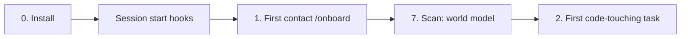
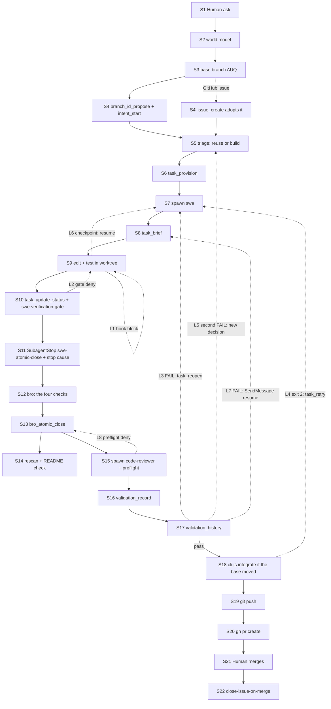
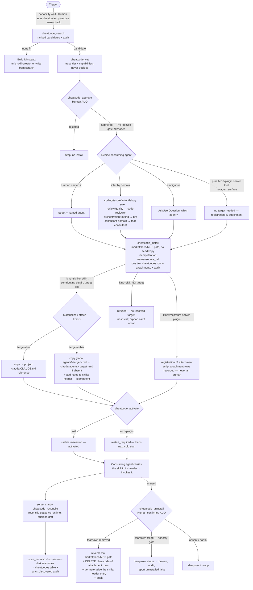
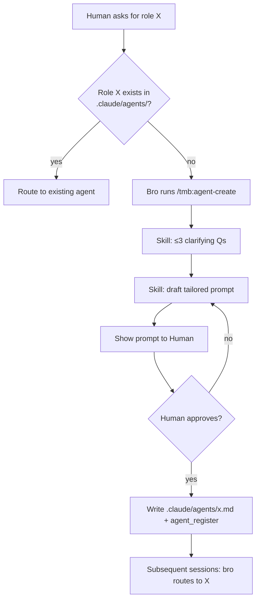

# TMB Workflows

The decision chain is **Human → bro → SWE** with two distinct gates:
- **bro is the task gate** — closes after SWE returns + verifies.
- **code-reviewer is the push gate** — reviews each task after `bro_atomic_close`; `git-push-guard` blocks a push whose task commits lack a passing review.

All consultants (architect, cto, ceo, pm, project-local) advise but never write workflow state. Roles live in [`RESPONSIBILITIES.md`](RESPONSIBILITIES.md); enforcement layers in [`ENFORCEMENT.md`](../prompt-engineering/ENFORCEMENT.md); schema in [`ERD.md`](ERD.md).

This file is the ground truth for the workflow, including the brand workflow hero and its animations. It describes only what ships; planned work lives in its GitHub issue. A PR that changes a flow updates its step, loop or guard row here in the same PR.

Every flow follows the memory model in [`MEMORY.md`](MEMORY.md). The brand workflow hero takes its memory story from there.

**Hook citations.** Every gate is TypeScript in `mcp/trajectory-server/src/hooks/<gate>.ts`, run through one router; which gates each hook event runs, and in what order, is `ROUTER_GROUPS` in `src/hooks/registry.ts`, registered by `hooks/hooks.json`. Below, `src/hooks/` means `mcp/trajectory-server/src/hooks/`, and gate lists name the gates that matter to the step, not every gate the event runs.

**Layout.** Flows are grouped by when they run: [Install](#part-i--install), [Cold start](#part-ii--cold-start), [Agent task handling](#part-iii--agent-task-handling), [Extending the team](#part-iv--extending-the-team) and [Reporting TMB bugs](#part-v--reporting-tmb-bugs). Grouping never renumbers a flow: flow numbers, letters and step ids stay stable wherever they sit.

## Quick index

| # | Flow | Trigger | Agents | DB tables touched | Distinguishing hooks |
|---|---|---|---|---|---|
| | **Install** | | | | |
| 0 | Install and session start | `claude plugin install`, then every session start | — (hooks) | session markers under `.claude/tmb/sessions/` | the SessionStart gates, `session-start-persona`, `user-prompt-persona` |
| | **Cold start** | | | | |
| 1 | First contact | `onboard_state_get().first_run === true` (i.e. `plugin_config('onboarded')` absent) | bro | `plugin_config`, `repos`, `repo_remotes`, `audit` | `activation-routine` (auto-fire trigger) |
| 7 | Scan + world-model refresh An empty world model, `/scan`, or the trajectory server connecting | bro (or the server's startup catch-up in background) | `repos`, the `wm_*` tables, `cheatcodes` (on-disk resources), `audit` | none (the startup catch-up is server code, not a hook) |
| **E** | Environment profile (ENV) | bro needs a repo's install, test and lint commands | bro | `repo_env` | — |
| | **Agent task handling** | | | | |
| 2 | **Code-touching task** (canonical) | Code change ask | bro → swe (`task_provision` cuts branch + worktree); code-reviewer per task after `bro_atomic_close`; `cli.js integrate` when the base moved | `issues`, `tasks`, `discussions`, `audit`, `agent_runs`, `verification_runs`, `validation_attempts`, `review_findings` | `agent-spawn-dispatch`, `containment-guard`, `swe-verification-gate`, `swe-atomic-close`, `code-reviewer-preflight`, `git-push-guard`, `close-issue-on-merge` |
| 3 | Architectural change | New boundary/module, schema, public API, external side effects | bro records a `kind=decision` discussion + blast-radius, then standard SWE flow | + `discussions(kind='decision')` | `task_provision`'s `decision_body` (universal `decision_gate` on `task_create_batch`) |
| 6 | Push gate / PR review | Each task after `bro_atomic_close`; `git push` of a commit with no passing review | bro → code-reviewer (one per closed task, parallel) | `validation_attempts`, `review_findings` | `code-reviewer-after-atomic-close`, `code-reviewer-spawn-note`, `code-reviewer-preflight`, `git-push-guard` |
| 8 | SWE retry / escalation | A failed check of bro's four, a code-reviewer verdict='fail', or `cli.js integrate` exit 2 | bro ↔ swe (↔ code-reviewer per task) | `validation_attempts` (multiple), `review_findings`, `discussions` | `task_reopen` / `task_retry` composites, `rework-limit`, `swe-resume-gate` |
| **M** | Monitor PR comments | `/monitor <PR_number>` (invokes `tmb_comment-triage`) | bro → code-reviewer per actionable comment batch | `pr_review_runs`, `issues`, `tasks`, `audit` | — |
| 33 | Multi-repo path discipline | Inner repos registered in `repos`; bro indexes them | bro | `wm_directories` rows (repo-relative paths; `repo` column scopes to the right inner git repo) | — |
| 13 | Bulk cleanup | Human pre-authorizes a bulk delete | bro (direct Bash, no SWE spawn) | — | — |
| | **Extending the team** | | | | |
| 10 | Cheatcode lifecycle | bro hits a capability wall, Human says "cheatcode", or a proactive reuse-check before building | bro (Human approves install) | `cheatcodes`, `audit` | `cheatcode-install-approval`, `prompt-intent-hints` |
| 4 | Agent-creator | Routing hits role not in `.claude/agents/` | bro | — (file-based outcome) | — |
| 5 | Skill creation | Recurring pattern needs encoding | bro | `cheatcodes` (skill row via `skill_register`) | — |
| **C** | Consultant invocation | Human asks for second opinion | bro → consultant | `discussions(kind='analysis'/'concern')` | `consultant-persistence-gate` |
| 9 | Roundtable | Multi-consultant deliberation with AUQ ratification | bro orchestrates 2–4 consultants | `roundtables`, `roundtable_votes`, `discussions`, `audit` | `roundtable-auq-shape`, `roundtable-cleanup-postcheck` |
| | **Reporting TMB bugs** | | | | |
| **B** | Bug report (opt-in) | bro hits a real TMB bug and `bug_report_consent` is `yes` | bro (Human previews and approves each report) | `plugin_config`, `audit` | — |

---

## Part I — Install

### 0. Install and session start

Installing and restarting are the Human's actions; bro never runs them.

1. **Install** at project or local scope, never user scope ([INSTALL.md](../reference/INSTALL.md#recommended-scope-project-or-local) explains why):
   ```
   claude plugin marketplace add trustmybot/marketplace --scope project
   claude plugin install tmb@trustmybot --scope project
   ```
   The rc channel is `trustmybot/marketplace-rc` + `tmb@trustmybot-rc` with `--scope local`. Pick one channel per Claude Code install.
2. **What is active at once:** the `swe` and `code-reviewer` agents (shipped in `agents/`), the trajectory-server MCP tools, and the hooks in `hooks/hooks.json`. bro's persona lives in the plugin's `CLAUDE.md`, which Claude Code never loads for a plugin, so hooks deliver it.
3. **Every session start** runs the SessionStart gates (health checks, gitignore, session markers, persona, project inventory):
   - `plugin-hooks-marker` and `session-start-persona` write the session's `.plugin-hooks` and `.persona` markers;
   - `session-start-persona` injects bro's persona on startup, resume, `/clear` and compaction, and after a compaction appends the state `session-handoff` (G8b) recorded before it;
   - `session-start-prescan` injects the project inventory and the trajectory DB's health line.
4. **The first prompt** runs `user-prompt-persona`, which injects the persona once when the session started before the plugin's hooks loaded. If TMB was installed mid-session, the Human fully quits and relaunches Claude Code. It also runs `activation-routine`, which starts flow 1 on a project that isn't onboarded.

Everything TMB writes stays under the project root; [INSTALL.md](../reference/INSTALL.md#what-tmb-writes-and-where) lists each path.

---

## Part II — Cold start

On a new project the flows run in this order. Each step runs once, and later sessions skip what is already done.



---

### 1. First contact (auto-fired `/onboard`)

Bro's `activation-routine` UserPromptSubmit hook (`src/hooks/activation-routine.ts`) reads `plugin_config('onboarded')`. If the key is absent (or `value_json != 'true'`) it injects a `FIRST CONTACT` directive. Bro reads the directive, fires `/onboard` immediately, and runs the slash command's ceremony before any reply.

`onboard_state_get` returns `{ first_run, current, probe, nesting, scan }`; the server re-probes (origin URL, gh/glab installed and authed) and runs an offline scan of every registered repo on each call. Each question from `onboard_get_questions` carries `evidence` lines and a `recommended_reason`, which bro shows in chat before the AUQ; the recommended option comes first and is pre-selected.

| Round | Runs when | Asks | Persisted |
|---|---|---|---|
| 0 | The session is nested below the project, or another trajectory DB exists | Use the workspace project, make the session folder its own project, or cancel; remove each empty stray DB | `standalone` marker, or `remove_stray_dbs` on the final apply |
| 1 | Always | Project shape: Local-only or Remote-tracked (a Local-only answer that contradicts a GitHub/GitLab origin is re-asked once) | `shape` on every apply |
| 2 | Always | Branching model + PR target, once when every repo points the same way, else per repo; on remote shape, then the Remote question (multiSelect) for the workspace | each `repos` row: `branching_model`, `target_branch`, `protected_branches`; on remote shape each repo's `repo_remotes` rows replaced from its git remotes, one remote per chosen provider marked `sync` |
| 3 | Remote shape | Issue sync | global `issue_sync` |
| 4 | Always | Bash sandbox | `sandbox_enforcement`; `yes` writes the sandbox block into `<project>/.claude/settings.local.json` |
| 5 | Always | Opt-in TMB bug reports (flow B) | `plugin_config.bug_report_consent` (`no` default) |

The final workspace-level `onboard_apply` writes the workspace answers and the `onboarded` marker in one transaction.


`/onboard` re-runs on demand for later changes — same flow with `Keep "<current>"` pre-selects. Identity is a pure onboarded marker (no name or other fields stored).

---

### 7. Scan + world-model refresh

`scan_run` is the single scan-side MCP tool. It walks each registered repo deterministically and writes the **world model** tables: one row per tracked directory (summary preferentially from `<dir>/README.md`, else a structural fallback) under its parent, file purposes, and the symbol index with its edges. The world-model tools read them; inner-repo path scoping is in [`REPO_RESOLUTION.md`](./REPO_RESOLUTION.md).

A scan runs when the Human types `/scan`, when bro finds the world model empty or rescans after an architectural change, and in the background when the trajectory-server connects. Reads and task spawns also reindex a repo to its target commit on their own. Each scan records its source and whether the project's shape changed in a `deep_scan_completed` audit row; the accepted sources are in `scan_run`'s schema (`mcp/trajectory-server/src/tools/scan.ts`).

**Resource discovery.** The same scan also reconciles on-disk capabilities into the `cheatcodes` table: project-local skills, enabled plugins and configured MCP servers. Each resource not already tracked (matched on name and kind) is inserted with a `scan_discovered` audit row, so a cheatcode added out-of-band still becomes visible to the lifecycle flow below.

---

### E. Environment profile (ENV)

Knowing how to install, test and lint a repo is bro's job, and **no toolset is hardcoded**: bro decides from the repo's own evidence.

- **Detect.** `env_detect` reads the repo's evidence (CI steps, task-runner targets, manifests, config files, lockfiles) and runs nothing. It reports a recorded profile as drifted when the evidence changed since it was recorded.
- **Record.** bro resolves the commands per category and records them with `env_record`; bro's own overrides, waivers and declines survive a re-record.
- **Read.** `env_get` returns a repo's effective commands for planning and verification.

**Where the ENV lives.** The repo is the source of truth: tool choices live in the repo's own standard files, so teammates, CI and editors enforce the same rules without TMB. `repo_env` is a derived per-machine cache of the resolved commands, their sources and the evidence hash.

---

## Part III — Agent task handling

### 2. Code-touching task (canonical chain)

This section is the standard for the code-touching workflow. Other docs and the brand workflow hero cite its step ids (`S1`..`S22`, `S4′`), loop ids (`L1`..`L8`) and guard ids (`G1`..`G16`), each anchored as `FLOWS.md#<id>`; a change to the flow updates these tables first. Ids are never renumbered: a new step takes a primed id (`S4′`) and a new loop or guard the next number.

Bro is both planner AND task gate: a task closes as soon as SWE returns and bro verifies it. code-reviewer then reviews each closed task, and `git-push-guard` holds any push whose task commits lack a passing review. `composites.ts`, `issues.ts`, `tasks.ts`, `validation.ts` and `scan.ts` below live in `mcp/trajectory-server/src/tools/`.

#### Steps

| Id | Actor | Tool or hook | Reads → writes | Source |
|---|---|---|---|---|
| S1 | <a id="S1"></a>Human → bro | Chat message, then the `UserPromptSubmit` hooks (the group in `src/hooks/registry.ts`), among them the overrun (G8) and liveness (G10) advisories | `plugin_config`, the open issue → none (the hooks inject bro's persona and the open issue) | `hooks/hooks.json` (UserPromptSubmit); `src/hooks/user-prompt-persona.ts`; `src/hooks/activation-routine.ts` |
| S2 | <a id="S2"></a>bro | Reads the world model (`world_model_get`, `world_model_search`, `world_model_symbol`); each call writes one `wm_tool_called` audit row | `wm_*` tables → audit `wm_tool_called` | `skills/tmb_planning/SKILL.md` |
| S3 | <a id="S3"></a>bro → Human | `AskUserQuestion`: which base branch; PreToolUse `askuserquestion-length-lint` | none → none (the answer stays in the transcript) | `skills/tmb_planning/SKILL.md`; `src/hooks/askuserquestion-length-lint.ts` |
| S4 | <a id="S4"></a>bro → Human | `branch_id_propose`, AUQ "Proceed with branch_id X?", then `intent_start` | the Human's intent → `issues` row, `discussions` kind=intent and the planning note in one transaction; audit `branch_id_proposed` | `skills/tmb_planning/SKILL.md`; `composites.ts` |
| S4′ | <a id="S4′"></a>bro (GitHub path) | `issue_create` adopts an existing GitHub issue in place of S4's `intent_start` | the GitHub issue → `issues` row with `gh_iid`; audit `issue_adopted` | `issues.ts` |
| S5 | <a id="S5"></a>bro | Triage: is it actionable, reuse or build; the call rides in `task_provision`'s `decision_body` | world model → `discussions` kind=decision (written at S6) | `skills/tmb_planning/SKILL.md` |
| S6 | <a id="S6"></a>bro | `task_provision` records the decision and the task in one call, then cuts the task branch and its worktree. The task carries a spec with `SC<n>` success criteria, typed `files[]`, `verification[]` and an effort; a spec whose `## Commit` subject G16 would deny is refused (GH 2667), and a spec too large for one swe run is split into linked tasks. A bro session already in a linked worktree adopts it instead of getting a new one (G12). A provision with no world-model read before it is nudged (G13), and `verification[]` may name only test files that exist (G15). Each worktree runs the repo's opt-in setup commands ([worktree setup](../../mcp/trajectory-server/README.md#worktree-setup)) | `issues`, the base branch → `discussions` kind=decision, `tasks` row, git branch and worktree; audit `planning_complete` | `skills/tmb_planning/SKILL.md`; `composites.ts` |
| S7 | <a id="S7"></a>bro → swe | `Agent(subagent_type=swe, effort, prompt "task_id=<N>")`; PreToolUse `agent-spawn-dispatch` runs the spawn gates in order (the task has a spec and an effort, the branch is live, the rework limit holds; the code-reviewer gates are S15's), then records the spawn and makes sure the worktree exists; PostToolUse binds the run to its spawn, or undoes the record when the spawn fails | `tasks` → task pending → running; `agent_runs` row opened | `skills/tmb_planning/SKILL.md`; `src/hooks/agent-spawn-dispatch.ts` (the gate chain) |
| S8 | <a id="S8"></a>swe | `task_brief(task_id)`; `swe-brief-gate` denies edits and every other trajectory tool until it is fetched. The brief resolves the files and symbols the spec names to line ranges, so swe reads ranges instead of whole files. A brief carrying a checkpoint is a resume (L6), and it says why the previous run stopped | `tasks`, `discussions`, `review_findings`, `verification_runs`, `wm_*` → audit `swe_brief_fetched` | `agents/swe.md`; `src/hooks/swe-brief-gate.ts`; `composites.ts` |
| S9 | <a id="S9"></a>swe | Edits, tests and commits in the worktree. Tests run through the test runner wrapper, which returns a short summary and keeps the full output in a log; a full suite waits for a machine-wide suite slot so parallel worktrees don't overload the machine. Guards G1–G4 fire on each call, and G16 on each commit; a deny is L1 | worktree files → commits on the task branch; audit rows on a deny | `agents/swe.md`; `mcp/trajectory-server/src/test-run.ts`; `mcp/trajectory-server/src/suite-lock.ts` |
| S10 | <a id="S10"></a>swe | `task_update_status(completed, commit_sha, report)`; the typed report gives every `SC<n>` a status with evidence and lists the edits outside `files[]`, the findings fixed and the bug classes swept. PreToolUse `swe-verification-gate` runs `verification[]` and every blocking finding's probe in the worktree (L2) | `tasks.verification`, `review_findings` → `verification_runs`, `tasks.commit_sha`, `tasks.completion_report` | `tasks.ts`; `src/hooks/swe-verification-gate.ts` |
| S11 | <a id="S11"></a>hook | `SubagentStop` → `swe-atomic-close`: auto-completes a still-running task that has commits (unless the run wrote a checkpoint, L6), meters the run and its tool-output sizes, and records why the run stopped (a checkpoint handback or a hook block), telling bro to resume or to name the block in the rework note | the swe transcript → `agent_runs` completed (tokens, duration, stop cause) | `src/hooks/swe-atomic-close.ts`; `src/hooks/swe-stop-cause.ts` |
| S12 | <a id="S12"></a>bro | Verify: `task_brief` + `git diff` of the commit, judged on the four checks: scope vs `files[]`, `verification_run` exit 0, the report covers every `SC<n>`, `world_model_get` on the changed directory | `tasks`, `verification_runs`, world model → none (`bro_verification_fail_record` on a failed check) | `skills/tmb_planning/SKILL.md` |
| S13 | <a id="S13"></a>bro | `bro_atomic_close` refuses a close the report does not cover, or with no passing run for the closing commit. Its short spawn note is the only prose the reviewer gets beyond its anchors, and the result can carry the ready-made S15 spawn call | `tasks`, `verification_runs` → task closed; audit `bro_verification_pass` | `composites.ts`; `skills/tmb_planning/SKILL.md` |
| S14 | <a id="S14"></a>hook | PostToolUse `bro_atomic_close` → `post-atomic-close-readme` | the closed task's README drift → audit `readme_staleness_surfaced` | `src/hooks/post-atomic-close-readme.ts` |
| S15 | <a id="S15"></a>bro → code-reviewer | `Agent(subagent_type=code-reviewer)`, the prompt carrying `name=value` anchors and the spawn note only; the code-reviewer spawn gates require a closed task, cap the prose and run the machine preflight (L8) | `tasks`, `verification_runs`, git → `agent_runs` row opened | `skills/tmb_push-gate/SKILL.md`; `src/hooks/agent-spawn-dispatch.ts`; `src/hooks/code-reviewer-preflight.ts` |
| S16 | <a id="S16"></a>code-reviewer | Reads the brief and the commit, probes in a review worktree, then records a verdict with `validation_record`: a `fail` needs a blocking finding, and a `pass` may carry nits and pre-existing ones. A hook stamps the reviewer's identity on the record | spec, diff → `validation_attempts` (+ `review_findings`) | `agents/code-reviewer.md`; `skills/tmb_review/SKILL.md`; `validation.ts` |
| S17 | <a id="S17"></a>bro | `validation_history`: the verdict comes from the row, never from the reply text | `validation_attempts` → none | `skills/tmb_push-gate/SKILL.md` |
| S18 | <a id="S18"></a>bro | Base moved → `cli.js integrate` rebases the reviewed commit in a temporary worktree and reruns `verification[]`; a clean rebase carries the reviewed commit's pass to the new SHA, which bro pushes, and a conflict is L4. An unmoved base skips this step | `tasks`, `validation_attempts` → a verification run on the rebased SHA; the task branch moved to it; audit `task_integrated` | `skills/tmb_planning/SKILL.md`; `mcp/trajectory-server/src/cli/integrate.ts` |
| S19 | <a id="S19"></a>bro | `git push`; PreToolUse `git-push-guard` allows it only when each pushed task commit has a passing review recorded for that commit | `validation_attempts`, `audit`, `verification_runs` → the remote branch | `skills/tmb_push-gate/SKILL.md`; `src/hooks/git-push-guard.ts` |
| S20 | <a id="S20"></a>bro | `gh pr create --base <pr_target>` (`glab mr create` on GitLab); PostToolUse `attribution-footer` checks the PR body's attribution | none → the PR | `skills/tmb_push-gate/SKILL.md` |
| S21 | <a id="S21"></a>Human | Merges the PR; once it reports `MERGED`, bro runs the post-merge cleanup | GitHub → the merged PR | `skills/tmb_push-gate/SKILL.md` |
| S22 | <a id="S22"></a>hook | PostToolUse Bash after a successful in-session `gh pr merge` / `glab mr merge`: `close-issue-on-merge` closes the branch's live tasks and each issue the PR closes by an explicit closing-ref; `clean-merged-branch` removes the merged local branch and its worktree. A merge made on GitHub fires neither. | `tasks`, `validation_attempts` → tasks and issue closed; audit `issue_auto_closed_on_merge` (+ `review_gate_bypassed` for a task with no passing review) | `hooks/hooks.json` (PostToolUse Bash); `src/hooks/close-issue-on-merge.ts`; `src/hooks/clean-merged-branch.ts` |

#### Loops

| Id | Loop | Trigger | What happens | Source |
|---|---|---|---|---|
| L1 | <a id="L1"></a>Hook block → rerun | A PreToolUse hook denies a swe call, e.g. `containment-guard` on a write outside the worktree | swe reruns in the form the deny names and carries on. When the deny names none or says it is policy, swe closes `failed` with no report and quotes the hook. A run that stops on the deny without reporting is recorded `stop_cause = hook_block` (S11), and bro names the block in the rework `spawn_note`. Returns to S9. | `agents/swe.md`; `src/hooks/containment-guard.ts`; `src/hooks/swe-stop-cause.ts` |
| L2 | <a id="L2"></a>Gate deny → fix | swe calls `task_update_status(completed)` but a `verification[]` command or an open finding's probe fails | `swe-verification-gate` denies the call, naming the command and its timing; swe fixes it and calls again. Returns to S9. | `src/hooks/swe-verification-gate.ts` |
| L3 | <a id="L3"></a>Review FAIL → rework → re-review | code-reviewer records `fail` with findings `F<task>-<n>` | bro surfaces the FAIL and holds the push, then `task_reopen(task_id, reason, effort='high', spawn_note)` naming the finding ids; swe fixes each, commits its probe as a test, the gate re-runs every probe, and code-reviewer reviews the next attempt. Returns to S7 (or L7 when bro resumes the same swe). | `skills/tmb_planning/SKILL.md`; `skills/tmb_push-gate/SKILL.md`; `validation.ts` |
| L4 | <a id="L4"></a>Integrate conflict → retry | The base moved and `cli.js integrate` exits 2 (conflict or patch drift) | bro records the failure (`bro_verification_fail_record`), then `task_retry` cuts a fresh task, branch and worktree from the current base with a spec that points at the reviewed commit; it goes through verify and review again. Exit 1 (`verification[]` failed on the rebased commit) reworks as L3. Returns to S7. | `skills/tmb_planning/SKILL.md`; `composites.ts` |
| L5 | <a id="L5"></a>Rework limit | Two review FAILs on the task since its last pass, six swe runs of the task (budget handbacks aside), or four review FAILs across its issue's tasks with no later pass on the same task, each counted since the latest Human waiver (an author 'human', kind 'decision' row) on the task or its issue | The `rework-limit` spawn gate (and `swe-resume-gate` for a resume) denies a further swe run on the task, naming the limit, its count and `waive task <N>`. The issue limit also stops a `task_retry` or split task with no FAILs of its own. Only the Human lifts a limit, by typing `waive task <N>`; no agent-written row does. bro stops and reports to the Human with a proposed redesign or split; `task_retry` itself refuses a fourth retry in one lineage. Returns to S5. | `skills/tmb_planning/SKILL.md`; `src/hooks/rework-limit.ts`; `composites.ts` (`task_retry` retry cap) |
| L6 | <a id="L6"></a>Checkpoint → resume | The work left won't fit in the swe run's turns | Before `maxTurns` ends the run, swe commits the work in progress and calls `task_update_status(status='running', checkpoint={done, left, files, commit_sha})` with no report. S11 keeps the task `running` and records `stop_cause = budget`; bro spawns swe again, and the brief's `checkpoint` tells it to start from `left` and not redo `done`. A move to `completed` clears the checkpoint. Returns to S7. | `agents/swe.md`; `tasks.ts` (`checkpoint`); `src/hooks/swe-stop-cause.ts` |
| L7 | <a id="L7"></a>Resume the same swe | bro reworks a task by `SendMessage` to the swe that wrote the commit, instead of a fresh spawn | PreToolUse `swe-resume-gate` judges the message like a fresh spawn: it denies at any of the three rework limits until the Human types `waive task <N>` (L5), and when the swe ran at an effort other than the task's current one. The resumed swe's next `task_brief` opens its own `agent_runs` row linked by `resumed_from`. Returns to S8. | `src/hooks/swe-resume-gate.ts` |
| L8 | <a id="L8"></a>Reviewer preflight deny → fix | A code-reviewer spawn (S15) fails a machine check | `code-reviewer-preflight` denies with `{check, expected, actual}` for the first failing check: `sha_mismatch` (the branch tip is not `tasks.commit_sha`), `no_passing_run`, `base_conflict` (`git merge-tree` against the PR target; any conflicted path denies), `stale_doc_ref` (a deleted path or dropped tool name still cited in prompts or docs), `missing_changelog`. bro fixes the cause (re-close, `cli.js integrate`, or `task_reopen` for a doc or changelog fix) before any reviewer runs. Returns to S15, or to S7 through L3. | `src/hooks/code-reviewer-preflight.ts` |

#### Guards and advisories

Hooks that fire across many steps rather than at one.

| Id | Hook | Event | What it does | Source |
|---|---|---|---|---|
| G1 | <a id="G1"></a>`containment-guard` | PreToolUse Write/Edit/Bash | Denies a write outside the caller's worktree or project, judging every value a shell variable can take | `src/hooks/containment-guard.ts` |
| G2 | <a id="G2"></a>`swe-boundary`, `no-source-edit-from-main` | PreToolUse Edit/Write/Bash | Deny a swe write to prompt surfaces or `CLAUDE.md`, and bro edits to registered repo source from the main checkout | `src/hooks/swe-boundary.ts`; `src/hooks/no-source-edit-from-main.ts` |
| G3 | <a id="G3"></a>`swe-scope-fence` | PreToolUse Edit/Write | Never denies: tells swe once per path that it edited outside `files[]` and must list it in `report.extras` | `src/hooks/swe-scope-fence.ts` |
| G4 | <a id="G4"></a>`naming-lint`, `code-quality-lint` | PreToolUse Edit/Write | Lint the written content | `src/hooks/naming-lint.ts`; `src/hooks/code-quality-lint.ts` |
| G5 | <a id="G5"></a>Bash git guards | PreToolUse Bash | `git-guards`, `no-worktree-branch-create`, `stay-on-base-guard`, `branch-up-to-date-with-remote`, `commit-msg-lint`, `no-remote-auth-guard`, `remote-id-guard` | `src/hooks/git-guards.ts`; `src/hooks/commit-msg-lint.ts` |
| G6 | <a id="G6"></a>`cleanup-worktree-on-task-close` | PostToolUse `task_update_status`, `validation_record` | Removes a closed task's worktree when nothing else needs it | `src/hooks/cleanup-worktree-on-task-close.ts` |
| G7 | <a id="G7"></a>`bro-turn-usage` | Stop | Meters bro's own turn into its `agent_runs` session row and records bro's tool-output sizes. Runs async and does not block the turn; a lost run is recovered by the next, whose row always sums the whole transcript. Each run reads only the bytes appended since the last, from a per-session cursor beside the DB (`bro-turn-usage/<session_id>.json`); a missing, corrupt or mismatched cursor falls back to a full read. | `src/hooks/bro-turn-usage.ts` |
| G8 | <a id="G8"></a>`task-overrun-alert` | UserPromptSubmit, PostToolUse trajectory-server | Tells bro once per task when a `running` task passes `TMB_TASK_OVERRUN_MIN` minutes (default 60), with its attempts and current blocker, and once per spawn when a live swe run of its session passes it while its task is not `running` | `src/hooks/task-overrun-alert.ts` |
| G8b | <a id="G8b"></a>`session-handoff` | PreCompact, SessionStart persona | Before each compaction of a bro session, records the session's `session_handoffs` row, re-arming one an earlier compaction consumed. The same session's SessionStart with source `compact` takes it and appends the issue, its live tasks and the issue's newest decision, read from the DB then. Startup, clear and resume take nothing. Never blocks and never prints | `src/hooks/session-handoff.ts` |
| G9 | <a id="G9"></a>`debug-trajectory` | PreToolUse Bash/Read/Write/Edit/Agent/Skill | Records the call trajectory when debugging is on | `src/hooks/debug-trajectory.ts` |
| G10 | <a id="G10"></a>`liveness-alert`, `liveness-sentinel` | UserPromptSubmit, PostToolUse trajectory-server; Stop (`asyncRewake`) | Reports a subagent run silent past `TMB_RUN_SILENT_MIN` minutes (default 30, scaled by load) or a hung `tail -f` watcher to bro, once per finding (`liveness_finding_reported`): during a turn as context, while idle by waking an attended session. Reports only: kills, closes and fails nothing | `src/hooks/liveness-probe.ts`; `src/hooks/liveness-alert.ts`; `src/hooks/liveness-sentinel.ts` |
| G11 | <a id="G11"></a>`no-prose-in-scratch` | PreToolUse Write/Edit/MultiEdit/NotebookEdit/Bash | Denies every agent a prose file in `.claude/<plugin>/scratch/`, and in `/tmp` or `$TMPDIR` outside a git worktree, and a `gh issue\|pr create\|edit\|comment` reading its body from a file; the deny names the trajectory DB tools. `TMB_ALLOW_PROSE_SCRATCH=1` lifts it | `src/hooks/no-prose-in-scratch.ts` |
| G12 | <a id="G12"></a>`worktree-adopt-guard` | PreToolUse `task_provision`, `task_reopen`, `task_retry` | An allowlist on `adopt_worktree`: a session in a linked worktree must adopt exactly that worktree, and any other session must not adopt one; the deny names the worktree that may be adopted, if any | `src/hooks/worktree-adopt-guard.ts` |
| G13 | <a id="G13"></a>`wm-read-before-provision` | PreToolUse `task_provision` | Never denies. Nudges bro to read the world model first when the session made no recent world-model read, and writes a `wm_read_missing_before_provision` audit row | `src/hooks/wm-read-before-provision.ts` |
| G15 | <a id="G15"></a>Verification path check (server-side, not a hook) | `task_provision`, `task_retry`, `task_reopen`, `task_update_spec` (S6, L3, L4) | An allowlist on the test files `verification[]` hands a test runner: each must exist at the task's base or branch tip, or be listed in `files[]`, or the call is refused before anything is written. Each call also suggests existing tests that import a `files[]` module, without blocking | `src/tools/verification-paths.ts` |
| G16 | <a id="G16"></a>`commit-msg-lint` | PreToolUse Bash, at swe's commit in S9 | An allowlist on the commit subject: denies a commit message whose first line is not an emoji Conventional Commits subject of bounded length, naming the rule broken and the expected form | `src/hooks/commit-msg-lint.ts` |

**Gate timing:** the router times each gate against a measured budget (`src/hooks/router/budgets.json`), and a timed-out gate is not retried: an enforcement gate denies, an advisory gate is skipped.

#### Metering

Every agent run leaves an `agent_runs` row (tokens, duration, why it stopped, what it resumed), and every hook block and tool output is metered. `task_stats` reads them back per task or over every run since a date: spawns, reworks, review fails, hook blocks and their token cost.



**Notes**
- A swe spawn needs a task with a spec; a spec that adds a column, field, tool, table or migration also names who writes it and when it is populated, unless bro waives the check.
- Only `task_provision` creates task branches and worktrees; a manual branch create in a worktree is denied.
- The verification gate runs the task's `verification[]` in its worktree and records the run; a recent passing run for the same commit is reused, and a rework carries forward the commands whose inputs it did not touch. It never fails open: an unresolved worktree denies. An empty `verification[]` skips it with a warning, and a stated reason waives it with an audit row.
- `bro_atomic_close` refuses a close with no passing run (or recorded waiver) for the closing commit. This covers closes the gate never saw, such as an auto-complete at SubagentStop or a spec change after the run.

---

### 3. Architectural change (Δ vs flow 2)

Same chain as flow 2, plus: in `task_provision`'s `decision_body` (S6), bro records a `kind=decision` discussion and applies the blast-radius checklist. The universal decision gate requires a `kind='decision'` row regardless of flow.

- Skills: `tmb_planning` triggers the architectural ceremony when the change introduces a new boundary/module, touches schema or public API, or has external side effects (see SKILL.md §"Architectural changes").
- For human-driven deliberation, the user enters Claude Code's native plan mode (Shift+Tab) — bro doesn't run a bespoke Q+A loop. The `kind='decision'` row captures the outcome.
- Bro's four checks after SWE returns (S12) are unchanged — never skipped, even for architectural changes.

---

### 6. Push gate / PR review

```mermaid
sequenceDiagram
    participant H as Human
    participant B as Bro
    participant P as code-reviewer (subagents — parallel)
    participant DB as SQLite

    Note over B,DB: flow 2 S13: bro_atomic_close closes the task (spawn_note ≤ 300 chars)
    par one code-reviewer per closed task (S15)
        B->>P: Agent(code-reviewer, anchors only: task_id= commit_sha= …)
        Note over B,P: agent-spawn-dispatch: spawn-note cap, then preflight (L8 on deny)
        P->>DB: task_brief(task_id=N) — spec, completion report, spawn_note, open findings
        P->>P: git show <sha>; pr_monitor_worktree probes
        P->>DB: validation_record(verdict='pass'|'fail', findings[], mcp_available)
    end
    B->>DB: validation_history — read each verdict off its row (S17)

    alt all pass
        B->>B: cli.js integrate <task_id> <base> when the base moved (S18)
        B->>B: git push (git-push-guard allows the reviewed SHAs, S19)
        B-->>H: gh pr create → PR URL (S20)
    else any fail
        B-->>H: surface failures verbatim → AUQ: spawn SWE to fix (flow 2 L3) or abort the push
    end
```

A push made before review (by bro or the Human) hits `git-push-guard`, which denies it unless each pushed task commit's newest verdict is a `pass` for that commit; a pass for an earlier commit of the task, or one under a newer fail, does not count.

Each verdict records whether the review ran with MCP access or through the honor-system CLI fallback, and the reviewer's identity comes from a hook observation of the call, never from the reviewer's own claim. Verdicts and findings are append-only: a repeated attempt is stored as a new one, and the push gate and the close paths go by the task's newest verdict.

---

### 8. SWE retry / escalation

Triggered when one of bro's four checks fails (flow 2 S12), code-reviewer records verdict='fail' (L3), `code-reviewer-preflight` denies (L8), or `cli.js integrate` exits 2 (L4). More work on the same task goes through `task_reopen`, which moves it back to `running` and recreates its worktree when missing; bro then spawns a fresh swe, or resumes the swe that wrote the commit by `SendMessage` (L7). A wrong approach or an integrate conflict goes through the `task_retry` MCP composite — one transaction appends the retry rationale, creates a new `tasks` row, cuts its branch and worktree like `task_provision`, copies the failed task's open review findings onto it, and writes an `audit(event_type='task_retry_attempted')` row. Then bro spawns SWE on it.

Two FAILs on a task since its last pass, six swe runs of a task (budget handbacks aside), or four FAILs across an issue's tasks with no later pass on the same task trip the rework limit (L5), each counted since the Human's latest waiver; only the Human lifts it, by typing `waive task <N>`. `task_retry` refuses a fourth retry in one lineage (`retry limit reached (3) — escalate to Human`). A swe that runs out of turns hands back a checkpoint instead of failing (L6). A task still `running` after an hour raises the overrun advisory (G8).

---

### M. Monitor PR comments

`/monitor <PR_number>` slash command. Bro fetches the PR's review comments via `pr_monitor_comments_get`, triages actionable ones, files them as new `issues` + `tasks`, and dispatches SWE per ratified comment batch. Run state lives in `pr_review_runs` so re-runs of the same PR start from the last fetched comment ID. The server persists every fetched comment as a `note` discussion on the issue of the task that owns the PR, deduped by `discussions.remote_comment_id`; the result's `persisted` and `duplicates` count new and already-stored comments.

---

### 33. Multi-repo path discipline

When a workspace has multiple inner git repos (siblings or submodules), each is identified by its `repos` row (path-keyed resolution; an operation matches its path against `repos.path`, or a task names its repo via `tasks.repo`). World-model paths are stored repo-relative: a scan never prepends the inner repo's directory. See [`REPO_RESOLUTION.md`](./REPO_RESOLUTION.md).

Registration also scopes the `no-source-edit-from-main` guard: it protects only registered repo subtrees, so edits to unregistered sibling repos are allowed.

---

### 13. Bulk cleanup (pre-authorized destructive ops)

When the Human's prompt names what to delete (branches, temp files, etc.), bro executes in one Bash call with no AUQ and no re-confirmation. Defensive checks (which files match? any active worktrees?) belong *before* the Human authorizes. Re-asking treats a standing directive as a question — wastes time and ignores intent.

---

## Part IV — Extending the team

### 10. Cheatcode lifecycle

Bro acquires a capability (skill, MCP toolkit, or plugin) on demand instead of grinding it out by hand. The mechanical pipeline is deterministic tools + hooks; only the judgments stay prose — "do I lack a capability this task needs?", "is this candidate trustworthy?", and "which agent consumes it?". Architecture-of-record: [`CHEATCODES.md`](./CHEATCODES.md). This is the full lifecycle.



What each stage does, the registries, the attachment rules by kind and the teardown guarantees are in [`CHEATCODES.md`](./CHEATCODES.md). Two rules hold across the diagram: a skill install with no resolved consuming agent is refused, so no orphan skill can land, and an uninstall removes the `skills:` entry it added, so no dangling reference remains.

---

### 4. Agent-creator



Reserved names — `bro`, `architect`, `swe`, `code-reviewer` — are refused. New agent files commit to the project; every dev gets it on next pull.

---

### 5. Skill creation

Same shape as flow 4 — bro drafts via `tmb_skill-creator`, Human approves, file lands at `<project>/.claude/skills/<name>/SKILL.md`. Bro never edits agent body files; instead writes a project-local override agent file that extends `skills:`.

---

### C. Consultant invocation

Human types `/tmb:agent-create <ask>` OR a naturalistic question matching `/tmb:agent-create`'s description. Either path loads the skill, which calls `agent_resolve` to classify the role (collision, template-copy or from-scratch) and registers a newly written consultant with `agent_register`, then spawns the consultant via `Agent`. Consultant writes its analysis as `discussion_append(kind='analysis')`; the SubagentStop `consultant-persistence-gate` (`src/hooks/consultant-persistence-gate.ts`) checks that it did. Bro reports to Human; **the Human decides** — never the consultant.

`prompt-intent-hints` UserPromptSubmit hook detects domain-keyword prompts and injects a routing hint (advisory; bro decides whether to spawn).

---

### 9. Roundtable

Multi-consultant deliberation. Bro orchestrates 2–4 consultants on a topic, then renders an AUQ for Human ratification.

- `roundtable_create` opens the table.
- Bro spawns each consultant via `Agent` with the shared topic; consultants write `discussion_append(kind='analysis'|'concern')`.
- Each consultant `roundtable_vote(participant=<role>, vote, rationale)`.
- `roundtable_close` flips state to `awaiting_human` + emits a `discussion_append(kind='decision', body=summary)`.
- `roundtable-auq-shape` (`src/hooks/roundtable-auq-shape.ts`) validates the ratification AUQ structure.
- After Human picks: `roundtable_finalize_decisions` + `roundtable_summarize`.
- `roundtable-cleanup-postcheck` (`src/hooks/roundtable-cleanup-postcheck.ts`) verifies the capture surface (audit + discussion rows) actually landed.

---

## Part V — Reporting TMB bugs

### B. Bug report (opt-in)

Off by default; the Human opts in at `/onboard` Round 5.

1. bro hits a real TMB bug; the `tmb_recovery` skill says when to offer a report.
2. `bug_report_draft` builds a redacted draft with a signature, and says when an earlier report already carries that signature. It is refused without the Human's consent or explicit ask, and it never files anything.
3. bro shows the Human the full draft; the Human's read is the final redaction check.
4. Only on the Human's yes, bro files it to `trustmybot/plugin` and records a `bug_report_filed` audit row.
