# TMB Workflows

This file is the starting point for every flow: one chart each for its ideal case, a short description, and a link to the detail page that holds every other case, failures included, and how to debug them. A flow whose chart says everything has no detail page. Who owns each quality check, and how a task hands from one owner to the next, is in [TASKS.md](TASKS.md#quality-layers).

It is the ground truth for the workflow: it describes what ships and marks unshipped behaviour as planned, with its GitHub issue. A PR that changes a flow updates its chart here, and its detail page, in the same PR. Neither names a hook, gate, tool or symbol: what enforces a step is the world model's answer, and the logic is the code's.

Flows are grouped by when they run, and numbered within their group.

| Group | # | Flow | Trigger | Agents | State it leaves |
|---|---|---|---|---|---|
| 1. Install | 1.1 | [Install and session start](#11-install-and-session-start) | Plugin install, then every session start | — (the plugin itself) | per-session markers |
| 2. Cold start | 2.1 | [First contact](#21-first-contact) | A project that is not yet onboarded | bro | project shape, repo and remote settings, the onboarded marker |
| 2. Cold start | 2.2 | [Scan and world-model refresh](#22-scan-and-world-model-refresh) | An empty world model, `/scan`, or the trajectory server connecting | bro (or the server, in background) | the world model and the discovered-capability registry |
| 2. Cold start | 2.3 | [Environment profile](#23-environment-profile) | bro needs a repo's install, test and lint commands | bro | a per-machine cache of resolved commands |
| 3. Agent task handling | 3.1 | [Code task](#31-code-task) | An ask that changes code, architectural changes included | bro → swe; code-reviewer per task; bro closes after its pass | issue, decision, task, run, verification and review records; a reviewed, pushed branch and its PR |
| 3. Agent task handling | 3.2 | [Non-code task](#32-non-code-task) | An ask that changes only docs or prompts | bro writes it; code-reviewer grades it with the doc-review checklist | as 3.1, the task marked docs or prompts |
| 3. Agent task handling | 3.3 | [Push gate](#33-push-gate) | Each completed task bro hands to review; any push | bro → code-reviewer (one per task, parallel) | a verdict per reviewed commit, with its findings |
| 3. Agent task handling | 3.4 | [Retry and escalation](#34-retry-and-escalation) | A design misfit, a review fail, or an integrate conflict | bro ↔ the author (↔ code-reviewer per task) | further attempts and their findings, or a fresh task |
| 3. Agent task handling | 3.5 | [PR comment triage](#35-pr-comment-triage) | Review comments reach a PR bro owns | bro → swe, or bro itself, per task-worthy comment group | stored comments, reopened or new tasks on the PR's issue, a fetch cursor |
| 3. Agent task handling | 3.6 | [Multi-repo workspaces](#36-multi-repo-workspaces) | Inner repos registered; bro indexes them | bro | repo-relative world-model paths, scoped per repo |
| 3. Agent task handling | 3.7 | [Bulk cleanup](#37-bulk-cleanup) | Human pre-authorizes a bulk delete | bro (direct, no swe) | — |
| 4. Extending the team | 4.1 | [Cheatcode lifecycle](#41-cheatcode-lifecycle) | A capability wall, the Human says "cheatcode", or a reuse check before building | bro (Human approves install) | the capability registry and its attachments |
| 4. Extending the team | 4.2 | [Agent creation](#42-agent-creation) | Routing hits a role the project has no agent for | bro | a project agent file |
| 4. Extending the team | 4.3 | [Skill creation](#43-skill-creation) | Recurring pattern needs encoding | bro | a registered skill |
| 4. Extending the team | 4.4 | [Consultant invocation](#44-consultant-invocation) | Human asks for a second opinion | bro → consultant | the consultant's analysis |
| 4. Extending the team | 4.5 | [Roundtable](#45-roundtable) | The Human types `/roundtable <topic>` | bro orchestrates 2–5 consultants | the table, its votes and the ratified decision |
| 5. Reporting TMB bugs | 5.1 | [Bug report](#51-bug-report) | bro hits a real TMB bug and the Human opted in | bro (Human approves each report) | a record of each filed report |

## 1. Install

### 1.1 Install and session start

The Human installs TMB at project or local scope and restarts; from then on, every session start marks the session and runs advisory checks that never block it. [INSTALL.md](INSTALL.md) covers each case, including a broken install, and how to debug it.

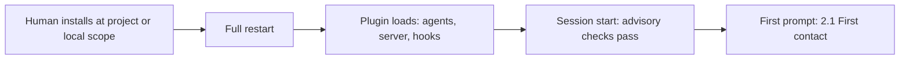

## 2. Cold start

On a new project these flows run once, in this order; later sessions skip what is already done.

### 2.1 First contact

The first bro turn on a project that isn't onboarded runs `/onboard` before any reply. bro asks in rounds, and the answers land in one transaction with the onboarded marker. [ONBOARD.md](ONBOARD.md) covers each round and when it runs.

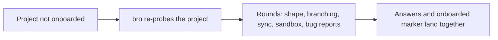

### 2.2 Scan and world-model refresh

A scan builds the project map bro reasons from and reconciles the capabilities already on disk. [WORLD_MODEL.md](WORLD_MODEL.md) covers what the map holds and how it stays current.

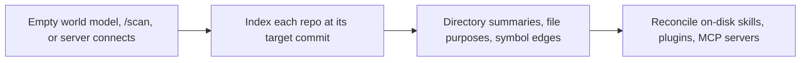

### 2.3 Environment profile

When bro needs a repo's install, test and lint commands, it works them out from the repo's own evidence; no toolset is hardcoded. [ENVIRONMENT.md](ENVIRONMENT.md) covers what it reads and what survives a re-record.

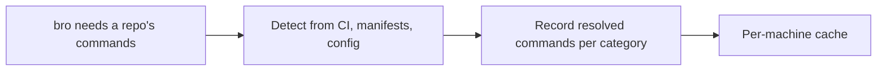

## 3. Agent task handling

[TASKS.md](TASKS.md) holds every case of flows 3.1 to 3.5: what each step guarantees, the failure paths and how to debug a stuck task.

### 3.1 Code task

The canonical chain: bro plans and gates, swe implements, code-reviewer reviews, and the Human merges. An architectural change also records a decision naming its blast radius at provision, and bro weighs the change against it at close.

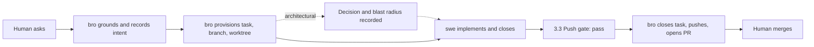

### 3.2 Non-code task

A docs or prompts change bro writes itself, in a task worktree marked with that kind; code-reviewer grades it with the doc-review skill, and bro's self-check with that skill before review is planned (GH 3073).

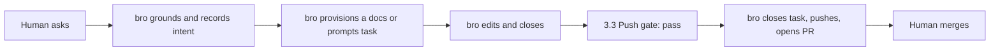

### 3.3 Push gate

Each completed task of either kind gets its own code-reviewer, in parallel, and no task commit is pushed without a passing verdict for that commit.

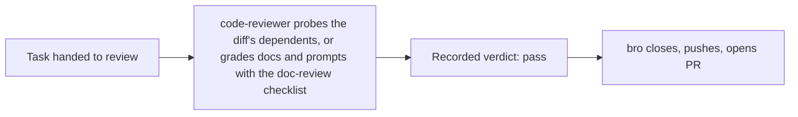

### 3.4 Retry and escalation

A review fail, a design misfit or an integrate conflict sends the task back to its owner without waiting on the Human.

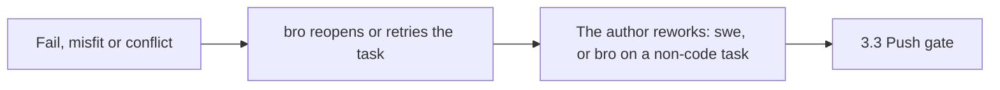

### 3.5 PR comment triage

Review comments on a PR bro owns become tasks through 3.1 or 3.2, on the PR's own issue.

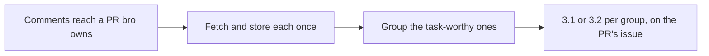

### 3.6 Multi-repo workspaces

A workspace's inner repos are identified by registration, which scopes both the world model's repo-relative paths and source protection. [GIT.md](GIT.md#multi-repo-workspaces) covers how each operation resolves to its repo.

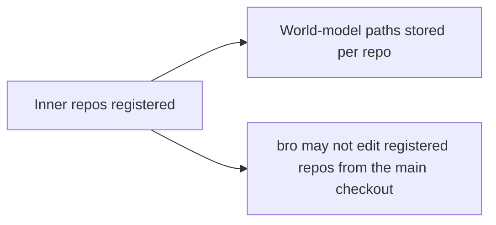

### 3.7 Bulk cleanup

When the Human's prompt names what to delete, bro does it in one step with no re-confirmation: defensive checks belong before the Human authorizes, and re-asking treats a standing directive as a question.

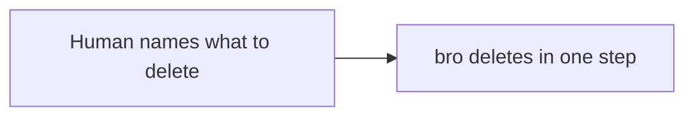

## 4. Extending the team

### 4.1 Cheatcode lifecycle

bro acquires a published skill, MCP toolkit or plugin instead of building a capability by hand, and the Human approves each install. [CHEATCODES.md](CHEATCODES.md) covers every stage, the trust design and teardown.

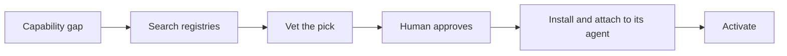

### 4.2 Agent creation

When routing hits a role the project has no agent for, bro drafts one and the Human approves it before the project agent file is written. [EXTENDING.md](EXTENDING.md) covers 4.2 to 4.5, including what each refuses.

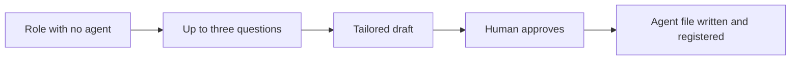

### 4.3 Skill creation

A recurring pattern becomes a project skill the same way: bro drafts, the Human approves.

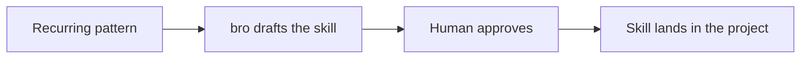

### 4.4 Consultant invocation

A consultant answers a second-opinion question; bro reports its analysis, and the Human decides.

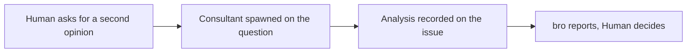

### 4.5 Roundtable

The Human opens a table on a topic, 2–5 consultants each take a position, and the Human ratifies the outcome.

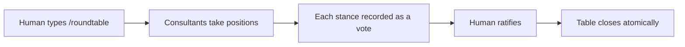

## 5. Reporting TMB bugs

### 5.1 Bug report

Off by default; the Human opts in during first contact. bro drafts a redacted report, flagging an earlier one with the same signature, and files nothing until the Human has read the full draft and said yes.

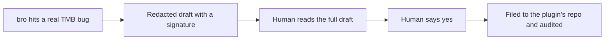
