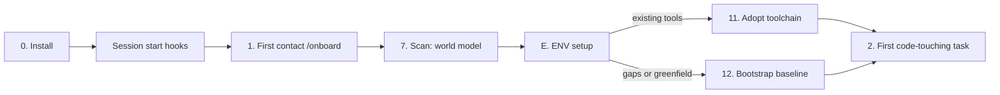
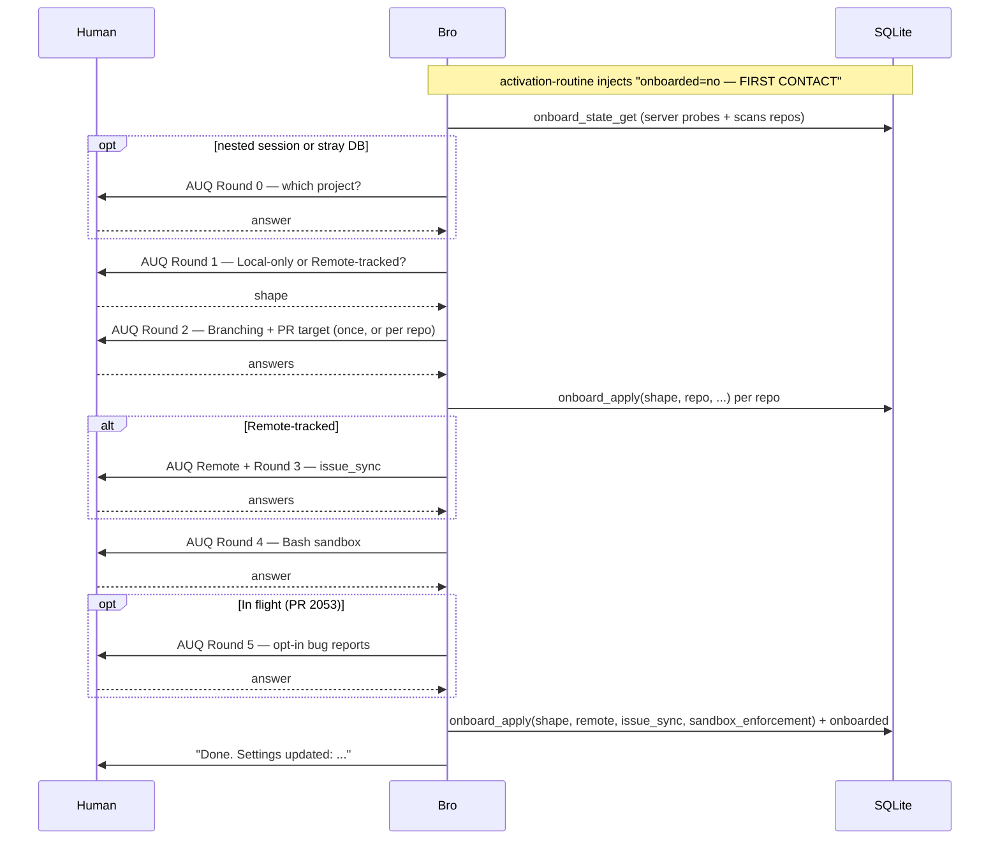
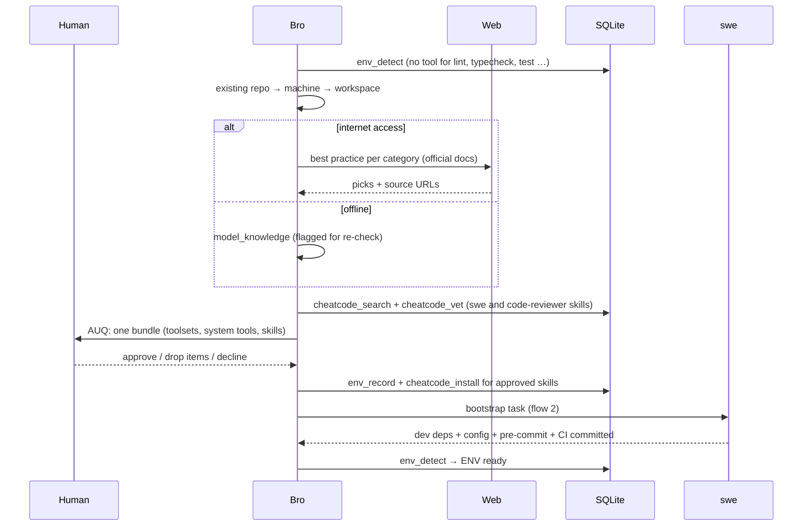
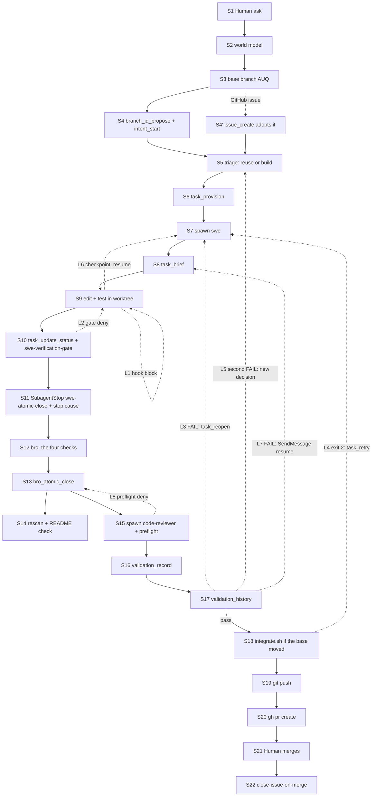
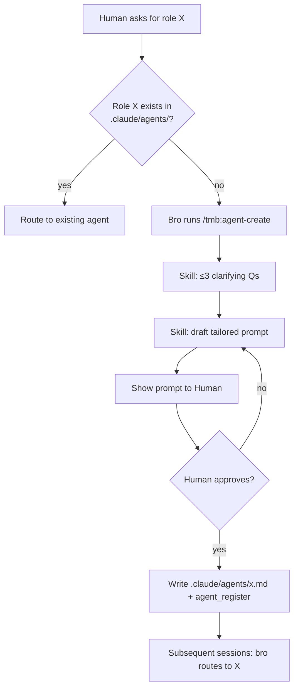

# TMB Workflows

The decision chain is **Human → bro → SWE** with two distinct gates:
- **bro is the task gate** — closes after SWE returns + verifies.
- **code-reviewer is the push gate** — reviews each task after `bro_atomic_close`; `git-push-guard` blocks a push whose task commits lack a passing review.

All consultants (architect, cto, ceo, pm, project-local) advise but never write workflow state. The full role × tool matrix lives in [`RESPONSIBILITIES.md`](RESPONSIBILITIES.md); enforcement layers in [`ENFORCEMENT.md`](../prompt-engineering/ENFORCEMENT.md); schema in [`ERD.md`](ERD.md).

This file is the ground truth for the workflow, including the brand workflow hero and its animations. It describes what ships on `dev`, and marks work that has not shipped:

| Marker | Meaning |
|---|---|
| none | Shipped on `dev` |
| **In flight (PR N)** / **In flight (GH N)** | Being built; an open PR or a running task |
| **Planned (GH N)** | Open issue, not started |

A PR that changes a flow updates its step, loop or roadmap row here in the same PR, and moves its marker when it ships. The [Roadmap](#roadmap) lists every unshipped item with the ids it changes.

**Hook citations.** A PreToolUse gate runs through the router (`node dist/hooks.js PreToolUse`, one `hooks/hooks.json` entry per tool group, gates listed in `dist/hooks-router.txt`); every other hook is registered as `scripts/hooks/dispatch.sh <gate>`. A gate ported to TypeScript runs from `mcp/trajectory-server/src/hooks/<gate>.ts` (built into `dist/hooks.js` and listed in `dist/hooks-gates.txt`); the rest run `scripts/hooks/<gate>.sh`. `TMB_HOOKS_IMPL=bash` forces the `.sh` of a ported gate that still has one. Below, `src/hooks/` means `mcp/trajectory-server/src/hooks/`, and the port to TypeScript is tracked in GH 1692.

**Layout.** Flows are grouped by when they run: [Install](#part-i--install), [Cold start](#part-ii--cold-start), [Fresh or existing project](#part-iii--fresh-or-existing-project), [Agent task handling](#part-iv--agent-task-handling), [Extending the team](#part-v--extending-the-team) and [Reporting TMB bugs](#part-vi--reporting-tmb-bugs). Grouping never renumbers a flow: flow numbers, letters and step ids stay stable wherever they sit.

## Quick index

| # | Flow | Trigger | Agents | DB tables touched | Distinguishing hooks |
|---|---|---|---|---|---|
| | **Install** | | | | |
| 0 | Install and session start | `claude plugin install`, then every session start | — (hooks) | session markers under `.claude/tmb/sessions/` | the nine SessionStart gates, `session-start-persona`, `user-prompt-persona` |
| | **Cold start** | | | | |
| 1 | First contact | `onboard_state_get().first_run === true` (i.e. `plugin_config('onboarded')` absent) | bro | `plugin_config`, `repos`, `repo_remotes`, `audit` | `activation-routine` (auto-fire trigger) |
| 7 | Scan + world-model refresh | First code-touching ask of session when the world model is EMPTY (`source='bro_auto_initial'`), `/scan` (`user_manual`), OR `post-task-close-rescan.sh` after `bro_atomic_close` (`bro_auto_post_close`) | bro (or hook in background) | `repos` (SQLite) + `wm_directories` / `wm_files` (summary preferentially from `<dir>/README.md`) + `cheatcodes` (on-disk resources, `source_url='scan_discovered'`), `audit(event_type='deep_scan_completed'\|'scan_discovered')` | `post-task-close-rescan` |
| **E** | Environment setup (ENV) — **In flight (GH 2066)** | After `scan_run`, on onboarding, a `stale` ENV, or an `env-ready` deny | bro (Human approves one bundle) | `repo_env`, `cheatcodes`, `audit` | `env-ready`, the `scan_run` PostToolUse nudge, `session-start-prescan` |
| | **Fresh or existing project** | | | | |
| 11 | Existing project: adopt its toolchain — **In flight (GH 2066)** | The repo already declares tools | bro | `repo_env` | — |
| 12 | Fresh project: bootstrap a baseline — **In flight (GH 2066)** | A category has no tool, or `files[]` has an extension no ENV covers | bro → swe (bootstrap task) | `repo_env`, `tasks` | `env-ready` |
| | **Agent task handling** | | | | |
| 2 | **Code-touching task** (canonical) | Code change ask | bro → swe (`task_provision` cuts branch + worktree); code-reviewer per task after `bro_atomic_close`; `integrate.sh` when the base moved | `issues`, `tasks`, `discussions`, `audit`, `agent_runs`, `verification_runs`, `validation_attempts`, `review_findings` | `agent-spawn-dispatch`, `containment-guard`, `swe-verification-gate`, `swe-atomic-close`, `code-reviewer-preflight`, `git-push-guard`, `close-issue-on-merge` |
| 3 | Architectural change | New boundary/module, schema, public API, external side effects | bro records a `kind=decision` discussion + blast-radius, then standard SWE flow | + `discussions(kind='decision')` | `task_provision`'s `decision_body` (universal `decision_gate` on `task_create_batch`) |
| 6 | Push gate / PR review | Each task after `bro_atomic_close`; `git push` of a commit with no passing review | bro → code-reviewer (one per closed task, parallel) | `validation_attempts`, `review_findings` | `code-reviewer-after-atomic-close`, `code-reviewer-spawn-note`, `code-reviewer-preflight`, `git-push-guard` |
| 8 | SWE retry / escalation | A failed check of bro's four, a code-reviewer verdict='fail', or `integrate.sh` exit 2 | bro ↔ swe (↔ code-reviewer per task) | `validation_attempts` (multiple), `review_findings`, `discussions` | `task_reopen` / `task_retry` composites, `rework-limit`, `swe-resume-gate` |
| **M** | Monitor PR comments | `/monitor <PR_number>` (invokes `tmb_comment-triage`) | bro → code-reviewer per actionable comment batch | `pr_review_runs`, `issues`, `tasks`, `audit` | — |
| 33 | Multi-repo path discipline | Inner repos registered in `repos`; bro indexes them | bro | `wm_directories` rows (repo-relative paths; `repo` column scopes to the right inner git repo) | — |
| 13 | Bulk cleanup | Human pre-authorizes a bulk delete | bro (direct Bash, no SWE spawn) | — | — |
| | **Extending the team** | | | | |
| 10 | Cheatcode lifecycle | bro hits a capability wall, Human says "cheatcode", a proactive reuse-check before building, OR flow E's skill search | bro (Human approves install) | `cheatcodes`, `audit` | `cheatcode-install-approval`, `prompt-intent-hints` |
| 4 | Agent-creator | Routing hits role not in `.claude/agents/` | bro | — (file-based outcome) | — |
| 5 | Skill creation | Recurring pattern needs encoding | bro | `cheatcodes` (skill row via `skill_register`) | — |
| **C** | Consultant invocation | Human asks for second opinion | bro → consultant | `discussions(kind='analysis'/'concern')` | `consultant-persistence-gate` |
| 9 | Roundtable | Multi-consultant deliberation with AUQ ratification | bro orchestrates 2–4 consultants | `roundtables`, `roundtable_votes`, `discussions`, `audit` | `roundtable-auq-shape`, `roundtable-cleanup-postcheck` |
| | **Reporting TMB bugs** | | | | |
| **B** | Bug report (opt-in) — **In flight (PR 2053)** | bro hits a real TMB bug and `bug_report_consent` is `yes` | bro (Human previews and approves each report) | `plugin_config`, `audit` | — |

---

## Part I — Install

### 0. Install and session start

Installing and restarting are the Human's actions; bro never runs them.

1. **Install** at project or local scope, never user scope ([INSTALL.md](../reference/INSTALL.md#recommended-scope-project-or-local) explains why):
   ```
   claude plugin marketplace add trustmybot/marketplace --scope project
   claude plugin install tmb@trustmybot --scope project
   ```
   The rc channel is `trustmybot/marketplace-rc` + `tmb@trustmybot-rc` with `--scope local`. Pick one channel per Claude Code install.
2. **What is active at once:** the `swe` and `code-reviewer` agents (shipped in `agents/`), the trajectory-server MCP tools, and the hooks in `hooks/hooks.json`. bro's persona lives in the plugin's `CLAUDE.md`, which Claude Code never loads for a plugin, so hooks deliver it.
3. **Every session start** runs the SessionStart gates in this order: `ensure-gitignore`, `mcp-health-check`, `deferred-tools-drift-warn`, `plugin-hooks-marker`, `session-start-persona`, `session-start-prescan`, `ensure-mcp-deps-installed`, `substrate-preflight`, `orphan-scan`.
   - `plugin-hooks-marker` and `session-start-persona` write the session's `.plugin-hooks` and `.persona` markers;
   - `session-start-persona` injects bro's persona on startup, resume, `/clear` and compaction;
   - `session-start-prescan` prints a stack label. **In flight (GH 2066):** it compares the ENV evidence hashes instead, marks drifted `repo_env` rows `stale` and nudges bro to run flow E.
4. **The first prompt** runs `user-prompt-persona`, which injects the persona once when the session started before the plugin's hooks loaded. If TMB was installed mid-session, the Human fully quits and relaunches Claude Code. It also runs `activation-routine`, which starts flow 1 on a project that isn't onboarded.

Everything TMB writes stays under the project root; [INSTALL.md](../reference/INSTALL.md#what-tmb-writes-and-where) lists each path.

---

## Part II — Cold start

On a new project the flows run in this order. Each step runs once, and later sessions skip what is already done.



Flow E and the branches to flows 11 and 12 are **In flight (GH 2066)**. Until they ship, the first task follows flow 7 straight into flow 2.

---

### 1. First contact (auto-fired `/onboard`)

Bro's `activation-routine` UserPromptSubmit hook (`src/hooks/activation-routine.ts`) reads `plugin_config('onboarded')`. If the key is absent (or `value_json != 'true'`) it injects a `FIRST CONTACT` directive. Bro reads the directive, fires `/onboard` immediately, and runs the slash command's ceremony before any reply.

`onboard_state_get` returns `{ first_run, current, probe, nesting, scan }`; the server re-probes (origin URL, gh/glab installed and authed) and runs an offline scan of every registered repo on each call. Each question from `onboard_get_questions` carries `evidence` lines and a `recommended_reason`, which bro shows in chat before the AUQ; the recommended option comes first and is pre-selected.

| Round | Runs when | Asks | Persisted |
|---|---|---|---|
| 0 | The session is nested below the project, or another trajectory DB exists | Use the workspace project, make the session folder its own project, or cancel; remove each empty stray DB | `standalone` marker, or `remove_stray_dbs` on the final apply |
| 1 | Always | Project shape: Local-only or Remote-tracked (a Local-only answer that contradicts a GitHub/GitLab origin is re-asked once) | `shape` on every apply |
| 2 | Always | Branching model + PR target, once when every repo points the same way, else per repo; on remote shape, then the Remote question (multiSelect) for the workspace | each `repos` row: `branching_model`, `target_branch`, `protected_branches`; on remote shape each repo's `repo_remotes` rows replaced from its git remotes, one remote per chosen provider marked `sync` |
| 3 | Remote shape | Issue sync | global `issue_sync` |
| 4 | Always | Bash sandbox | `sandbox_enforcement`; `yes` writes the sandbox block into `<project>/.claude/settings.local.json` |
| 5 | **In flight (PR 2053)** | Opt-in TMB bug reports (flow B) | `plugin_config.bug_report_consent` (`no` default) |

The final workspace-level `onboard_apply` writes `remote`, `issue_sync`, `sandbox_enforcement` and the `onboarded` marker in one transaction.



`/onboard` re-runs on demand for later changes — same flow with `Keep "<current>"` pre-selects. Identity is a pure onboarded marker (no name or other fields stored).

---

### 7. Scan + world-model refresh

`scan_run` is the single scan-side MCP tool. It forks the deterministic `scripts/scan.sh`, then writes the **world-model graph**: a `Directory` node per tracked directory (summary preferentially from `<dir>/README.md`, else a structural fallback over file/subdir names; plus a file count), linked to its parent by a `CONTAINS` edge. See [`WORLD_MODEL.md`](./WORLD_MODEL.md); inner-repo path scoping is in [`REPO_RESOLUTION.md`](./REPO_RESOLUTION.md).

Triggered five ways (the `source` value is verified against `scan.ts`):

| Trigger | `source` value | Who fires |
|---|---|---|
| First code-touching ask when the world model is EMPTY | `bro_auto_initial` | Default when no `source` is passed; bro hits the `world-model-empty` gate (`tmb_planning` §1) and remediates |
| User typed `/scan` | `user_manual` | The slash command body passes it |
| `post-task-close-rescan.sh` hook on `bro_atomic_close` | `bro_auto_post_close` | Hook runs `scripts/maintenance/run-scan.mjs` in background; it imports the bundled `mcp/trajectory-server/dist/run-scan.js`, which inlines web-tree-sitter, so symbols index in a plugin cache without devDependencies (GH 1878) |
| Bro decides to rescan mid-session | `bro_auto_post_change` | Bro passes it explicitly |
| trajectory-server connects (`startStartupCatchup`) | `startup_catchup` | The server runs `scripts/maintenance/run-scan.mjs` detached, with the source as its second argument |

`scan_run`'s `deep_scan_completed` audit row carries `content_json` with:

- `source` (one of the five values above)
- `structural_change` — true if the repos set OR top-level dir set differs from the previous scan
- `repos_seen[]`, `top_dirs[]` — current snapshot of the project shape

**Resource discovery (#124/#846).** The same scan ALSO reconciles on-disk capabilities into the `cheatcodes` table: project-local skills (`.claude/skills/<name>/SKILL.md`), enabled plugins (`claude plugin list`), and configured MCP servers (`claude mcp list`). Each resource not already tracked (matched on name+kind) is inserted as `origin='installed'`, `status='installed'`, `source_url='scan_discovered'` (distinguishing it from a pipeline install) and emits a `scan_discovered` audit row — so a cheatcode added out-of-band still becomes visible to the lifecycle flow below.

**Planned (GH 1988):** the world model becomes the codebase DAG — impact reaches every downstream consumer (table readers, prompts, hooks), with measured caller recall. GH 1989 (S5) and GH 1990 (S8) build on it.

---

### E. Environment setup (ENV) — In flight (GH 2066)

Getting the environment ready is bro's job. After a scan, TMB knows each repo's world model **and** its ENV:
- **swe** gets a ready-to-develop environment: dependencies installed, and the test, lint, format and typecheck commands with the runner prefix the repo uses;
- **code-reviewer** gets a ready-to-review environment: the same commands, with their tools confirmed available.

A skill makes the decisions (`tmb_env-setup`, bro); hooks only make sure it runs. **No toolset is hardcoded**, in the skill or in code: bro decides from the repo's evidence and from research.

| Id | Actor | Tool or hook | Reads → writes |
|---|---|---|---|
| E1 | <a id="E1"></a>hook | PostToolUse `scan_run`, and SessionStart `session-start-prescan`: a repo with no ENV row, or whose evidence hash changed, gets a nudge to load `tmb_env-setup`; drifted rows become `stale`. Onboarding loads it too | evidence files → `repo_env.status` |
| E2 | <a id="E2"></a>bro | `env_detect(repo)`: a read-only, tool-agnostic evidence collector. It returns CI `run:` steps, task-runner targets, manifest dev-dependency lists, root config files, lockfile names and file extensions. It runs no repo-defined command | the repo tree → none |
| E3 | <a id="E3"></a>bro | Resolves each category (install, test, lint, format_check, typecheck, pre-commit, CI): a category the repo already covers follows flow 11; a gap, or a fresh project, follows flow 12 | the E2 evidence → the proposal |
| E4 | <a id="E4"></a>bro | `tmb_cheatcode` (`cheatcode_search` → `cheatcode_vet`), per ecosystem: best-practice coding skills for **swe** and code-review skills for **code-reviewer**. Skills already attached or installed are reused | `cheatcodes` → the proposal |
| E5 | <a id="E5"></a>bro | Probes each chosen command: `<tool> --version`, then the command on one file | none → probe results |
| E6 | <a id="E6"></a>bro → Human | **One AUQ round** shows the profile and the **permission bundle**: toolsets (repo-local dev dependencies), system tools (the install command for the Human to run), and cheatcodes with the agent each attaches to. Each item shows why it was picked, its provenance and its vet result. The Human approves the bundle, drops single items, or declines it all | the proposal → the Human's answer |
| E7 | <a id="E7"></a>bro | `env_record(repo, profile)`. Approved skills go through `cheatcode_approve` / `cheatcode_install` and are attached to the agent's project-local `skills:` frontmatter, with the agent body unchanged. Declined and waived items are recorded with their reason. Accepted toolset categories become a bootstrap task (flow 12) | → `repo_env`, `cheatcodes`, `audit` |
| E8 | <a id="E8"></a>hook | Agent-spawn gate `env-ready`: denies spawning swe or code-reviewer for a task whose repo ENV isn't `ready`. The deny names the repo and points at `tmb_env-setup`. A recorded, Human-approved waiver passes | `repo_env` → allow / deny |

**Where the ENV lives.**
- **The repo is the source of truth:** tool choices and settings live in the repo's own standard files (the manifest's dev-dependency group and tool tables, linter and typechecker configs, `.pre-commit-config.yaml`, a CI workflow). Teammates, CI and editors then enforce the same rules without TMB.
- **`repo_env` is a derived cache, per machine:** resolved commands with their `file:line` source and confidence, probe results, provenance, the evidence hash, overrides, waivers and confirmations. A fresh clone with no DB gets the same profile back from `env_detect`. One row covers one (repo, package path, ecosystem).
- **Tools:** `env_detect(repo)` (read-only), `env_record(repo, profile)` (bro only), `env_get(repo?)`. `world_model_get` includes the ENV summary, and the activation banner shows one line of ENV status per repo.

---

## Part III — Fresh or existing project

Flow E sends each category to one of the two flows below. A repo can use both: flow 11 for the categories it already covers and flow 12 for its gaps.

### 11. Existing project: adopt its toolchain — In flight (GH 2066)

bro reads the E2 evidence, strongest signal first, and adopts what the team already enforces:
1. **CI workflows:** the commands the team actually runs.
2. **Task runners:** `package.json` `scripts`, Makefile, justfile or Taskfile targets, `[tool.*]` script tables, tox or nox sessions.
3. **Tool configs:** any config file at the repo root, or a config table inside a manifest.
4. **Manifests and lockfiles:** they reveal the package manager and runner prefix, e.g. `uv.lock` → `uv run`, `pnpm-lock.yaml` → `pnpm`.

These are examples of the evidence bro reasons over, not a lookup table in code.
- **Existing choices are kept.** A formatter the repo already uses stays unless the Human asks to switch.
- **User overrides** live in their own column, and a re-detect never overwrites them.
- **A missing system tool** (the package manager, a compiler) is the Human's install. bro gives the exact command, or a cheatcode where one exists, inside the E6 bundle.

### 12. Fresh project: bootstrap a baseline — In flight (GH 2066)

A new project has nothing to detect. So when a category has no tool, or a task's `files[]` has a source extension no ENV covers, bro proposes a baseline. Each category is resolved in this order, stopping at the first step that answers:
1. **What already exists:** tools the repo declares or configures, then tools installed on the machine, then the conventions of the other repos in this workspace.
2. **Current best practice from the web,** when there is internet access (WebSearch / WebFetch). bro prefers the ecosystem's official docs and the tools' own docs, and records each URL and the date it was fetched.
3. **bro's own knowledge, when offline.** The pick is marked `model_knowledge` and re-checked on the next run that has internet access.

Coding and review skills resolve in the same order: already attached or installed → `cheatcode_search` → bro's knowledge, which installs nothing and only adds notes to the task brief.

- **Provenance** is recorded per tool: `existing_repo` | `existing_machine` | `workspace` | `web` (URLs + fetch date) | `model_knowledge`. The E6 bundle shows it.
- **Versions** are never chosen by TMB. The package manager resolves them at bootstrap, and the lockfile pins them.
- **The bootstrap task** runs through flow 2 like any other task. It:
  - adds the accepted tools as repo-local dev dependencies through the repo's own package manager, never as global installs;
  - writes their config into the repo files;
  - adds a pre-commit config and a CI workflow that runs the same commands;
  - fixes or baselines what the new lint flags on existing code.

  Then `env_detect` finds the tools and the ENV is `ready`.
- **Waivers:** a waived category is recorded with its reason. `env-ready` passes it, and code-reviewer states the reduced verification in its validation record.
- **A brand-new project's first task** can't reach swe until its baseline is bootstrapped or waived, so quality tooling arrives with the first line of code.



---

## Part IV — Agent task handling

**In flight (GH 2066): the ENV in flow 2.**
- the worktree setup runs the ENV `install` command in swe's worktree;
- `task_provision` (S6) adds the matching ENV commands for each `files[]` entry to `verification[]`, deduplicated;
- `env-ready` (E8) joins the Agent-spawn gates (S7, S15);
- `task_brief` (S8) gives swe and code-reviewer the ENV commands for their files;
- `tmb_review` (S16) fails a task whose files an ENV command covers when the gate run for its commit didn't run that command.

### 2. Code-touching task (canonical chain)

This section is the standard for the code-touching workflow. Other docs and the brand workflow hero cite its step ids (`S1`..`S22`, `S4′`), loop ids (`L1`..`L8`) and guard ids (`G1`..`G9`), each anchored as `FLOWS.md#<id>`; a change to the flow updates these tables first. Ids are never renumbered: a new step takes a primed id (`S4′`) and a new loop or guard the next number.

Bro is both planner AND task gate: a task closes as soon as SWE returns and bro verifies it. code-reviewer then reviews each closed task, and `git-push-guard` holds any push whose task commits lack a passing review. `composites.ts`, `issues.ts`, `tasks.ts`, `validation.ts` and `scan.ts` below live in `mcp/trajectory-server/src/tools/`.

#### Steps

| Id | Actor | Tool or hook | Reads → writes | Source |
|---|---|---|---|---|
| S1 | <a id="S1"></a>Human → bro | Chat message, then the `UserPromptSubmit` hooks: `user-prompt-persona`, `activation-routine`, `session-log-capture`, `prompt-intent-hints`, `roundtable-slash-detect`, `task-overrun-alert` (G8) | `plugin_config`, the open issue → none (the hooks inject bro's persona and the open issue) | `hooks/hooks.json` (UserPromptSubmit); `src/hooks/user-prompt-persona.ts`; `src/hooks/activation-routine.ts` |
| S2 | <a id="S2"></a>bro | `world_model_get(depth=2)`, `world_model_search(query, mode='hybrid')`, `world_model_symbol`; each call writes one `wm_tool_called` audit row (tool, agent, task, result count, empty, latency). **In flight (PR 2010):** the row also logs the `impact` and `source` arguments (GH 1986). **Planned (GH 1988):** the world model becomes the codebase DAG, so impact reaches every downstream consumer (table readers, prompts, hooks). | `wm_directories`, `wm_files`, `wm_symbols` → audit `wm_tool_called` | `skills/tmb_planning/SKILL.md:11-13`; `docs/architecture/WORLD_MODEL.md` ("Measuring WM use") |
| S3 | <a id="S3"></a>bro → Human | `AskUserQuestion`: which base branch; PreToolUse `askuserquestion-length-lint` | none → none (the answer stays in the transcript) | `skills/tmb_planning/SKILL.md:36`; `src/hooks/askuserquestion-length-lint.ts` |
| S4 | <a id="S4"></a>bro → Human | `branch_id_propose`, AUQ "Proceed with branch_id X?", then `intent_start` | the Human's intent → `issues` row, `discussions` kind=intent and the planning note in one transaction; audit `branch_id_proposed` | `skills/tmb_planning/SKILL.md:38`; `composites.ts:746,813` |
| S4′ | <a id="S4′"></a>bro (GitHub path) | `issue_create` adopts an existing GitHub issue in place of S4's `intent_start` | the GitHub issue → `issues` row with `gh_iid`; audit `issue_adopted` | `issues.ts:614` |
| S5 | <a id="S5"></a>bro | Triage: is it actionable, reuse or build; the call rides in `task_provision`'s `decision_body`. **Planned (GH 1989):** `task_provision` / `task_create_batch` are gated until bro has run world-model impact on every code file in the task's scope. | world model → `discussions` kind=decision (written at S6) | `skills/tmb_planning/SKILL.md:30,84` |
| S6 | <a id="S6"></a>bro | `task_provision(issue_id, branch_id, decision_body, task, base?)`; the task carries `spec_body` (Description, Success Criteria `SC<n>`, Out of Scope, Commit), typed `files[]`, `verification[]` and `effort`. A spec without `SC<n>` ids is refused, and a spec past 8 `files[]`, 8 `verification[]` commands, 5 success criteria or about 5000 characters is split into linked tasks so each fits one swe run. PostToolUse `post-task-create-spawn-hint` follows a `task_create_batch`. **In flight (GH 2032):** `task_provision` / `task_reopen` take a `worktree_path` and adopt the session's own worktree when bro runs in a Claude Code worktree session. **Planned (GH 1983):** handoff fields in the spec (intent, decisions, typed scope, rabbit holes, exemplar, appetite, blocked). | `issues`, the base branch → `discussions` kind=decision, `tasks` row, git branch and worktree; audit `planning_complete` | `skills/tmb_planning/SKILL.md:100`; `composites.ts:975`; `scripts/hooks/post-task-create-spawn-hint.sh` |
| S7 | <a id="S7"></a>bro → swe | `Agent(subagent_type=swe, effort, prompt "task_id=<N>")`; PreToolUse `agent-spawn-dispatch` runs its nine gates in order (`require-task-spec`, `require-spawn-effort`, `require-feature-branch-active`, `code-reviewer-no-worktree`, `code-reviewer-spawn-prompt-shape`, `code-reviewer-after-atomic-close`, `code-reviewer-spawn-note`, `code-reviewer-preflight`, `rework-limit`), then the PREPARE steps `ensure-swe-worktree.sh` and `record-swe-spawn.sh`; PostToolUse `swe-spawn-bind` binds the run to its spawn id, `swe-spawn-rollback` undoes the spawn record when the spawn fails. All nine gates run from TypeScript; the six that still have a `.sh` (the three `require-*` gates and the three `code-reviewer-*` routing gates) fall back to it under `TMB_HOOKS_IMPL=bash`. | `tasks` → task pending → running; `agent_runs` row opened | `skills/tmb_planning/SKILL.md:104-111`; `hooks/hooks.json` (PreToolUse/PostToolUse Agent); `scripts/hooks/agent-spawn-dispatch.sh` |
| S8 | <a id="S8"></a>swe | `task_brief(task_id)`; `swe-brief-gate` denies Edit/Write and every other trajectory tool until it is fetched. The brief's `locations` gives each file the spec names its purpose and symbols with line ranges, and each named function its definition range and up to three callers and callees, so swe reads ranges instead of whole files. A brief carrying `checkpoint` is a resume (L6); `last_stop` says why the previous run stopped. **Planned (GH 1990):** swe and code-reviewer get the world-model tools, with hooks that push each edited symbol's downstream callers, behind an A/B. | `tasks`, `discussions`, `review_findings`, `verification_runs`, `wm_*` → audit `swe_brief_fetched` | `agents/swe.md:22-24`; `scripts/hooks/swe-brief-gate.sh`; `composites.ts:1122` |
| S9 | <a id="S9"></a>swe | Edits, tests and commits in the worktree; tests run through `node mcp/trajectory-server/dist/test-run.js -- '<command>'`, which prints one summary line plus capped failure excerpts and writes the full output to a log. Guards G1–G4 fire on each call; a deny is L1. | worktree files → commits on the task branch; audit `containment_denied` + `hook_denied` on a deny | `agents/swe.md`; `mcp/trajectory-server/src/test-run.ts` |
| S10 | <a id="S10"></a>swe | `task_update_status(completed, commit_sha, report)`, where `report.criteria` gives every `SC<n>` `met` / `not_met` / `not_applicable` with evidence, `report.extras` lists edits outside `files[]`, and `report.findings_fixed` names the fixed findings; PreToolUse `swe-verification-gate` runs `verification[]` and every open finding's probe in the worktree (L2), carrying forward a command whose declared inputs the rework did not touch. **Planned (GH 2001):** the gate checks the worktree is clean before it records or reuses a run. **Planned (GH 1959):** swe returns a short typed summary that points to the stored report. | `tasks.verification`, `review_findings` → `verification_runs` + `verification_run_commands`, `tasks.commit_sha`, `tasks.completion_report` | `tasks.ts:453`; `scripts/hooks/swe-verification-gate.sh`; `scripts/hooks/lib/registrations.sh` (trajectory-gates chain) |
| S11 | <a id="S11"></a>hook | `SubagentStop` → `swe-atomic-close.sh`: auto-completes a still-running task that has commits (unless the run wrote a checkpoint, L6), meters the run, then runs `swe-stop-cause`, which records `agent_runs.stop_cause` = `budget` (checkpoint handback) or `hook_block` (the run ended on a PreToolUse deny with no completion report; the deny text goes in `stop_detail`) and tells bro to resume or to name the block in the rework `spawn_note`. **In flight (PR 2047):** it also runs `tool-output-size`, recording each tool's returned characters and estimated tokens per run (GH 1957). | the swe transcript → `agent_runs` completed (tokens, duration, `stop_cause`, `stop_detail`) | `hooks/hooks.json` (SubagentStop); `scripts/hooks/swe-atomic-close.sh`; `src/hooks/swe-stop-cause.ts` |
| S12 | <a id="S12"></a>bro | Verify: `task_brief` + `git diff` of the commit, judged on the four checks: scope vs `files[]`, `verification_run` exit 0, the report covers every `SC<n>`, `world_model_get` on the changed directory | `tasks`, `verification_runs`, world model → none (`bro_verification_fail_record` on a failed check) | `skills/tmb_planning/SKILL.md:117-126` |
| S13 | <a id="S13"></a>bro | `bro_atomic_close(task_id, …, spawn_note?)`; refuses a close the report does not cover, or with no passing run for the closing commit. `spawn_note` (up to 300 characters) is the only prose the reviewer gets beyond its anchors. **Planned (GH 1983):** a downstream-consumer check at close. | `tasks`, `verification_runs` → task closed; audit `bro_verification_pass` | `composites.ts:895`; `skills/tmb_planning/SKILL.md:124` |
| S14 | <a id="S14"></a>hook | PostToolUse `bro_atomic_close` → `post-atomic-close-readme.sh` + `post-task-close-rescan.sh` (background `run-scan.mjs`) | the repo tree → `wm_*` rows upserted; audit `readme_staleness_surfaced`, `deep_scan_completed` | `scripts/hooks/post-atomic-close-readme.sh`; `scripts/hooks/post-task-close-rescan.sh`; `scan.ts:1003` |
| S15 | <a id="S15"></a>bro → code-reviewer | `Agent(subagent_type=code-reviewer, effort=reviewer_effort)`, the prompt carrying anchors only (`task_id= commit_sha= branch_id= repo= repo_path= attempt_n= subagent_session_id=`); the `agent-spawn-dispatch` gates include `code-reviewer-after-atomic-close` (the task must be closed), `code-reviewer-spawn-note` (at most `SPAWN_NOTE_MAX_CHARS` of prose beyond the anchors) and `code-reviewer-preflight` (five machine checks, L8) | `tasks`, `verification_runs`, git → `agent_runs` row opened | `skills/tmb_push-gate/SKILL.md:15-19,36`; `scripts/hooks/agent-spawn-dispatch.sh`; `src/hooks/code-reviewer-after-atomic-close.ts`; `src/hooks/code-reviewer-spawn-note.ts`; `src/hooks/code-reviewer-preflight.ts` |
| S16 | <a id="S16"></a>code-reviewer | `task_brief`, `git show <sha>`, `pr_monitor_worktree` probes, then `validation_record(verdict, findings[], mcp_available)`; PreToolUse `reviewer-identity-observe` stamps the reviewer. **Planned (GH 1955):** bug-class findings, severity tiers and risk-scaled reviewer effort, measured by a reviewer eval. **Planned (GH 1959):** a short typed return that points to the stored verdict. | spec, diff → `validation_attempts` (+ `review_findings` on FAIL) | `agents/code-reviewer.md`; `skills/tmb_review/SKILL.md`; `validation.ts:168`; `scripts/hooks/reviewer-identity-observe.sh` |
| S17 | <a id="S17"></a>bro | `validation_history`: the verdict comes from the row, never from the reply text | `validation_attempts` → none | `skills/tmb_push-gate/SKILL.md:38` |
| S18 | <a id="S18"></a>bro | Base moved → `integrate.sh <task_id> <base>` rebases in a temporary worktree and reruns `verification[]` (L4 on exit 2); an unmoved base skips this step | `tasks`, `validation_attempts` → `verification_runs` source=manual on the rebased SHA; the task branch moved to it | `skills/tmb_planning/SKILL.md:130-136`; `skills/tmb_planning/scripts/integrate.sh:284` |
| S19 | <a id="S19"></a>bro | `git push origin <feature>`; PreToolUse `git-push-guard` allows it only when each pushed task commit has a passing review (a rebased commit also needs a passing run for its exact SHA) | `validation_attempts`, `verification_runs` → the remote branch | `skills/tmb_push-gate/SKILL.md:46`; `src/hooks/git-push-guard.ts` |
| S20 | <a id="S20"></a>bro | `gh pr create --base <pr_target>` (`glab mr create` on GitLab); PostToolUse `attribution-footer` checks the PR body's attribution | none → the PR | `skills/tmb_push-gate/SKILL.md:46` |
| S21 | <a id="S21"></a>Human | Merges the PR; once it reports `MERGED`, bro runs the post-merge cleanup. **Planned (GH 2026):** when the PR is green, bro asks with an AUQ, merge by bro (CI and the local tests pass) or merge by the Human (the PR meets a human-review condition). | GitHub → the merged PR | `skills/tmb_push-gate/SKILL.md:50-52` |
| S22 | <a id="S22"></a>hook | PostToolUse Bash after a successful in-session `gh pr merge` / `glab mr merge`: `close-issue-on-merge.sh` closes the branch's live tasks and each issue the PR closes by an explicit closing-ref; `clean-merged-branch.sh` removes the merged branch and its worktree. A merge made on GitHub fires neither. | `tasks`, `validation_attempts` → tasks and issue closed; audit `issue_auto_closed_on_merge` (+ `review_gate_bypassed` for a task with no passing review) | `hooks/hooks.json` (PostToolUse Bash); `scripts/hooks/close-issue-on-merge.sh`; `scripts/hooks/clean-merged-branch.sh` |

#### Loops

| Id | Loop | Trigger | What happens | Source |
|---|---|---|---|---|
| L1 | <a id="L1"></a>Hook block → rerun | A PreToolUse hook denies a swe call, e.g. `containment-guard` on a write outside the worktree | swe reruns in the form the deny names and carries on. When the deny names none or says it is policy, swe closes `failed` with no report and quotes the hook. A run that stops on the deny without reporting is recorded `stop_cause = hook_block` (S11), and bro names the block in the rework `spawn_note`. Returns to S9. | `agents/swe.md:20`; `src/hooks/containment-guard.ts`; `src/hooks/swe-stop-cause.ts` |
| L2 | <a id="L2"></a>Gate deny → fix | swe calls `task_update_status(completed)` but a `verification[]` command or an open finding's probe fails | `swe-verification-gate` denies the call, naming the command and its timing; swe fixes it and calls again. Returns to S9. | `scripts/hooks/swe-verification-gate.sh` |
| L3 | <a id="L3"></a>Review FAIL → rework → re-review | code-reviewer records `fail` with findings `F<task>-<n>` | bro surfaces the FAIL and holds the push, then `task_reopen(task_id, reason, effort='high', spawn_note)` naming the finding ids; swe fixes each, commits its probe as a test, the gate re-runs every probe, and code-reviewer reviews the next attempt. Returns to S7 (or L7 when bro resumes the same swe). | `skills/tmb_planning/SKILL.md:64,140`; `skills/tmb_push-gate/SKILL.md:47`; `validation.ts:168` |
| L4 | <a id="L4"></a>Integrate conflict → retry | The base moved and `integrate.sh` exits 2 (conflict or patch drift) | bro records the failure (`bro_verification_fail_record`), then `task_retry` cuts a fresh task, branch and worktree from the current base with a spec that points at the reviewed commit; it goes through verify and review again. Exit 1 (`verification[]` failed on the rebased commit) reworks as L3. Returns to S7. | `skills/tmb_planning/SKILL.md:130-136`; `composites.ts:766,832` |
| L5 | <a id="L5"></a>Rework limit | Two review FAILs on the task since its last pass, six swe runs of the task (budget handbacks aside), or four review FAILs across its issue's tasks, each counted since the latest Human waiver (an author 'human', kind 'decision' row) on the task or its issue | The `rework-limit` spawn gate (and `swe-resume-gate` for a resume) denies a further swe run on the task, naming the limit, its count and `waive task <N>`. The issue limit also stops a `task_retry` or split task with no FAILs of its own. Only the Human lifts a limit, by typing `waive task <N>`; no agent-written row does. bro stops and reports to the Human with a proposed redesign or split; `task_retry` itself refuses a fourth retry in one lineage. Returns to S5. | `skills/tmb_planning/SKILL.md:141`; `src/hooks/rework-limit.ts`; `composites.ts` (`task_retry` retry cap) |
| L6 | <a id="L6"></a>Checkpoint → resume | The work left won't fit in the swe run's turns | Before `maxTurns` ends the run, swe commits the work in progress and calls `task_update_status(status='running', checkpoint={done, left, files, commit_sha})` with no report. S11 keeps the task `running` and records `stop_cause = budget`; bro spawns swe again, and the brief's `checkpoint` tells it to start from `left` and not redo `done`. A move to `completed` clears the checkpoint. Returns to S7. | `agents/swe.md:22`; `tasks.ts` (`checkpoint`); `src/hooks/swe-stop-cause.ts` |
| L7 | <a id="L7"></a>Resume the same swe | bro reworks a task by `SendMessage` to the swe that wrote the commit, instead of a fresh spawn | PreToolUse `swe-resume-gate` judges the message like a fresh spawn: it denies at any of the three rework limits until the Human types `waive task <N>` (L5), and when the swe ran at an effort other than the task's current one. The resumed swe's next `task_brief` opens its own `agent_runs` row linked by `resumed_from`. Returns to S8. | `src/hooks/swe-resume-gate.ts` |
| L8 | <a id="L8"></a>Reviewer preflight deny → fix | A code-reviewer spawn (S15) fails a machine check | `code-reviewer-preflight` denies with `{check, expected, actual}` for the first failing check: `sha_mismatch` (the branch tip is not `tasks.commit_sha`), `no_passing_run`, `base_conflict` (`git merge-tree` against the PR target, ignoring `merge=tmb-regen` paths), `stale_doc_ref` (a deleted path or dropped tool name still cited in prompts or docs), `missing_changelog`. bro fixes the cause (re-close, `integrate.sh`, or `task_reopen` for a doc or changelog fix) before any reviewer runs. Returns to S15, or to S7 through L3. | `src/hooks/code-reviewer-preflight.ts` |

#### Guards and advisories

Hooks that fire across many steps rather than at one.

| Id | Hook | Event | What it does | Source |
|---|---|---|---|---|
| G1 | <a id="G1"></a>`containment-guard` | PreToolUse Write/Edit/Bash | Denies a write outside the caller's worktree or project, judging every value a shell variable can take | `src/hooks/containment-guard.ts` |
| G2 | <a id="G2"></a>`swe-boundary`, `no-source-edit-from-main` | PreToolUse Edit/Write/Bash | Deny a swe write to prompt surfaces or `CLAUDE.md`, and bro edits to registered repo source from the main checkout | `src/hooks/swe-boundary.ts`; `scripts/hooks/no-source-edit-from-main.sh` |
| G3 | <a id="G3"></a>`swe-scope-fence` | PreToolUse Edit/Write | Never denies: tells swe once per path that it edited outside `files[]` and must list it in `report.extras` | `scripts/hooks/swe-scope-fence.sh` |
| G4 | <a id="G4"></a>`naming-lint`, `code-quality-lint` | PreToolUse Edit/Write | Lint the written content | `src/hooks/naming-lint.ts`; `src/hooks/code-quality-lint.ts` |
| G5 | <a id="G5"></a>Bash git guards | PreToolUse Bash | `git-guards`, `no-worktree-branch-create`, `stay-on-base-guard`, `branch-up-to-date-with-remote`, `commit-msg-lint`, `no-remote-auth-guard`, `remote-id-guard` | `src/hooks/git-guards.ts`; `src/hooks/commit-msg-lint.ts`; `scripts/hooks/<gate>.sh` |
| G6 | <a id="G6"></a>`cleanup-worktree-on-task-close` | PostToolUse `task_update_status`, `validation_record` | Removes a closed task's worktree when nothing else needs it | `scripts/hooks/cleanup-worktree-on-task-close.sh` |
| G7 | <a id="G7"></a>`bro-turn-usage` | Stop | Meters bro's own turn into its `agent_runs` session row. **In flight (PR 2047):** also records bro's tool-output sizes. | `src/hooks/bro-turn-usage.ts` |
| G8 | <a id="G8"></a>`task-overrun-alert` | UserPromptSubmit, PostToolUse trajectory-server | Tells bro once per task when a `running` task passes `TMB_TASK_OVERRUN_MIN` minutes (default 60), with its attempts and current blocker | `src/hooks/task-overrun-alert.ts` |
| G9 | <a id="G9"></a>`debug-trajectory` | PreToolUse Bash/Read/Write/Edit/Agent/Skill | Records the call trajectory when debugging is on | `src/hooks/debug-trajectory.ts` |

**Planned (GH 1861):** `dispatch.sh` records each gate's run time, sets timeouts from the p99, and retries a timed-out gate once.

#### Metering

What each run leaves behind for `task_stats`: `agent_runs` (tokens, duration, `stop_cause`, `stop_detail`, `resumed_from`), `wall_clock_ms`, `review_fail_count`, `swe_spawn_count`, `rework_count` and `reworks.fresh` / `reworks.resumed`, plus `hook_blocks` (`denials`, `gate_failures`, `by_reason`) per task and per spawn. `task_stats(since=<ISO date>)` without a task returns the same counts over every swe run since then. **In flight (PR 2047):** `tool_output` per agent type (GH 1957), the baseline for GH 1958.



**Notes**
- `require-task-spec.sh` blocks SWE spawn unless the `tasks` row is `pending`, or `running` with no open swe `agent_runs` row, AND has a non-empty `spec_body`. A spec that adds a column, field, tool, table or migration also needs `Writer:` + `Populated:` lines or a `Nullable:` line, unless a `spec_shape_gate_waived` row from `bro` names the task (`content_json.task_id`); `task_create_batch` / `task_provision` with `waive_spec_shape` write that row for each task they create, so no second write is needed.
- `no-worktree-branch-create.sh` blocks `-b/-B/--create-branch/--detach` — `task_provision` creates the branch and the worktree; the worktree attaches to the branch directly.
- `git-push-guard` blocks the eventual push if any pushed commit's task lacks a passing `validation_attempts` row.
- `swe-verification-gate.sh` fires on SWE's `task_update_status(completed)`: it runs the task's typed `verification[]` commands in the task worktree, records the run in `verification_runs` / `verification_run_commands`, and denies if any fail, naming the command and its timing. A passing run for the same task, worktree HEAD and `verification[]` recorded within the hour is reused instead of re-run, and on a rework commit a command whose declared inputs (`.config/tmb/verification-inputs.json`) the rework did not touch is recorded as carried from the last passing run (GH 1950); bro and code-reviewer read the latest run from `task_brief.verification_run`. When the task worktree does not resolve, it does NOT fail open — it denies, naming the expected `<repoRoot>/.claude/worktrees/<slug>` path (#156). An empty `verification[]` skips the gate with a warning; a `waive_verification_gate_reason` (≥10 chars) waives it with an audit row.
- `bro_atomic_close` refuses with `verification_run_missing` when the task has a non-empty `verification[]` and neither a passing `verification_runs` row for the closing commit whose commands match the current `verification[]` nor a `verification_gate_waived` row for that commit (GH 1672). This covers the closes the swe gate never saw: a `swe-atomic-close` SubagentStop auto-complete, and a `task_update_spec` that changed `verification[]` after the run. To get a run, the swe calls `task_update_status(completed)` again on the commit; to waive, it adds `waive_verification_gate_reason` to that call.

---

### 3. Architectural change (Δ vs flow 2)

Same chain as flow 2, plus: in `task_provision`'s `decision_body` (S6), bro records a `kind=decision` discussion and applies the blast-radius checklist. The universal decision gate requires a `kind='decision'` row regardless of flow.

- Skills: `tmb_planning` triggers the architectural ceremony when the change introduces a new boundary/module, touches schema or public API, or has external side effects (see SKILL.md §"Architectural changes").
- For human-driven deliberation, the user enters Claude Code's native plan mode (Shift+Tab) — bro doesn't run a bespoke Q+A loop. The `kind='decision'` row captures the outcome.
- Bro's four checks after SWE returns (S12) are unchanged — never skipped, even for architectural changes.

---

### 6. Push gate / PR review

```mermaid
sequenceDiagram
    participant H as Human
    participant B as Bro
    participant P as code-reviewer (subagents — parallel)
    participant DB as SQLite

    Note over B,DB: flow 2 S13: bro_atomic_close closes the task (spawn_note ≤ 300 chars)
    par one code-reviewer per closed task (S15)
        B->>P: Agent(code-reviewer, anchors only: task_id= commit_sha= …)
        Note over B,P: agent-spawn-dispatch: spawn-note cap, then preflight (L8 on deny)
        P->>DB: task_brief(task_id=N) — spec, completion report, spawn_note, open findings
        P->>P: git show <sha>; pr_monitor_worktree probes
        P->>DB: validation_record(verdict='pass'|'fail', findings[], mcp_available)
    end
    B->>DB: validation_history — read each verdict off its row (S17)

    alt all pass
        B->>B: integrate.sh <task_id> <base> when the base moved (S18)
        B->>B: git push (git-push-guard allows the reviewed SHAs, S19)
        B-->>H: gh pr create → PR URL (S20)
    else any fail
        B-->>H: surface failures verbatim → AUQ: spawn SWE to fix (flow 2 L3) or abort the push
    end
```

A push made before review (by bro or the Human) hits `git-push-guard`, which denies it while any pushed task commit lacks a passing `validation_attempts` row.

`validation_record` carries a typed `mcp_available` boolean (required for code-reviewer; written to the `validation_attempts.mcp_available` column). The push-gate reads it from the row — `1` = MCP-backed review, `0` = honor-system fallback (a subagent that lacks MCP access reviews via the sqlite3 fallback path and records `mcp_available: false`). `feedback` is free-prose rationale. The reviewer's identity comes from the newest unconsumed `reviewer_identity_observed` row for `(task_id, attempt_n)` (written by the `reviewer-identity-observe` hook with the call's `tool_use_id` and `observed_at`) observed within the last 600 s; an older row is never consumed — the call fails `subagent_session_unavailable` naming the row's age, and the reviewer calls again so the hook writes a fresh row. When a row is consumed, every older unconsumed row for the same `(task_id, attempt_n)` (left by a failed or retried call) is marked superseded with the consumed row's audit id, so a routine retry leaves no orphan for `trajectory_doctor` to warn on. An honor-system call (`mcp_available: false`) may only fill an attempt with no verified row: it never overwrites an `mcp_available = 1` verdict (`verified_verdict_exists`), while a verified call may still replace a verified row.

---

### 8. SWE retry / escalation

Triggered when one of bro's four checks fails (flow 2 S12), code-reviewer records verdict='fail' (L3), `code-reviewer-preflight` denies (L8), or `integrate.sh` exits 2 (L4). More work on the same task goes through `task_reopen`, which moves it back to `running` and recreates its worktree when missing; bro then spawns a fresh swe, or resumes the swe that wrote the commit by `SendMessage` (L7). A wrong approach or an integrate conflict goes through the `task_retry` MCP composite — one transaction appends the retry rationale, creates a new `tasks` row, cuts its branch and worktree like `task_provision`, copies the failed task's open review findings onto it, and writes an `audit(event_type='task_retry_attempted')` row. Then bro spawns SWE on it.

Two FAILs on a task since its last pass, six swe runs of a task (budget handbacks aside), or four FAILs across an issue's tasks trip the rework limit (L5), each counted since the Human's latest waiver; only the Human lifts it, by typing `waive task <N>`. `task_retry` refuses a fourth retry in one lineage (`retry limit reached (3) — escalate to Human`). A swe that runs out of turns hands back a checkpoint instead of failing (L6). A task still `running` after an hour raises the overrun advisory (G8).

---

### M. Monitor PR comments

`/monitor <PR_number>` slash command. Bro fetches the PR's review comments via `pr_monitor_comments_get`, triages actionable ones, files them as new `issues` + `tasks`, and dispatches SWE per ratified comment batch. Run state lives in `pr_review_runs` so re-runs of the same PR start from the last fetched comment ID. The server persists every fetched comment as a `note` discussion on the issue of the task that owns the PR, deduped by `discussions.remote_comment_id`; the result's `persisted` and `duplicates` count new and already-stored comments.

---

### 33. Multi-repo path discipline

When a workspace has multiple inner git repos (siblings or submodules), each is identified by its `repos` row (path-keyed resolution; an operation matches its path against `repos.path`, or a task names its repo via `tasks.repo`). Directory node `path` properties are stored repo-relative — `scan_run` does NOT prepend the inner repo directory when writing nodes. See [`REPO_RESOLUTION.md`](./REPO_RESOLUTION.md).

The L5 row `tests/l5-l6/rows/33-multirepo-commit/` catches regressions at the storage layer: a Cypher `MATCH (d:Directory) WHERE d.path STARTS WITH 'api/' OR d.path STARTS WITH 'app/'` returns ≥1 node only on a workspace-rooted path leak.

Registration also scopes the `no-source-edit-from-main.sh` guard: Rule 1 only protects registered repo subtrees, so absolute edits to unregistered sibling repos are allowed. See `docs/architecture/RESPONSIBILITIES.md` (#592).

---

### 13. Bulk cleanup (pre-authorized destructive ops)

When the Human's prompt names what to delete (branches, temp files, etc.), bro executes in one Bash call with no AUQ and no re-confirmation. Defensive checks (which files match? any active worktrees?) belong *before* the Human authorizes. Re-asking treats a standing directive as a question — wastes time and ignores intent.

---

## Part V — Extending the team

### 10. Cheatcode lifecycle

Bro acquires a capability (skill, MCP toolkit, or plugin) on demand instead of grinding it out by hand. The mechanical pipeline is deterministic tools + hooks; only the judgments stay prose — "do I lack a capability this task needs?", "is this candidate trustworthy?", and "which agent consumes it?". Architecture-of-record: [`CHEATCODES.md`](./CHEATCODES.md). This is the full lifecycle.

```mermaid
flowchart TD
  T{{Trigger}} -->|capability wall / Human says cheatcode / proactive reuse-check| SEARCH[cheatcode_search\nranked candidates + audit]
  SEARCH -->|none fit| BUILD[Build it instead:\ntmb_skill-creator or write from scratch]
  SEARCH -->|candidate| VET[cheatcode_vet\ntrust_tier + capabilities; never decides]
  VET --> APPROVE{cheatcode_approve\nHuman AUQ}
  APPROVE -->|rejected| STOP[Stop: no install]
  APPROVE -->|approved — PreToolUse gate now open| TARGET{Decide consuming agent}
  TARGET -->|Human named it| HAST[target = named agent]
  TARGET -->|infer by domain| INFER[coding/test/refactor/debug → swe\nreview/quality → code-reviewer\norchestration/routing → bro\nconsultant-domain → that consultant]
  TARGET -->|ambiguous| ASK[AskUserQuestion: which agent?]
  TARGET -->|pure MCP/plugin server tool,\nno agent surface| NOTGT[no target needed — registration IS attachment]
  HAST --> INSTALL
  INFER --> INSTALL
  ASK --> INSTALL
  NOTGT --> INSTALL
  INSTALL[cheatcode_install\nmarketplace/MCP path, no seed/copy\nidempotent on name+source_url\none txn: cheatcodes row + attachments + audit]
  INSTALL -->|kind=skill or skill-contributing plugin, target set| MAT{Materialize / attach — LEGO}
  INSTALL -->|kind=mcp/pure-server plugin| AUTOATT[registration IS attachment\nscript attachment rows recorded — never an orphan]
  INSTALL -->|kind=skill, NO target| UNATT[hard-rejected (#883) — no resolved target,\nno install; orphan can't occur]
  MAT -->|target=bro| CMD[copy → project .claude/CLAUDE.md reference]
  MAT -->|target=other| AMD[copy global agents/&lt;target&gt;.md → .claude/agents/&lt;target&gt;.md if absent\n+ add name to skills: header — idempotent]
  CMD --> ACT
  AMD --> ACT
  AUTOATT --> ACT
  ACT{cheatcode_activate}
  ACT -->|skill| LIVE[usable in-session — activated]
  ACT -->|mcp/plugin| RESTART[restart_required — loads next cold start]
  LIVE --> USE[Consuming agent carries the skill in its header → invokes it]
  RESTART --> USE
  USE --> HEALTH[server start + cheatcode_reconcile\nreconcile status vs runtime; audit on drift]
  HEALTH --> SCANP[scan_run also discovers on-disk resources\n→ cheatcodes table, source_url='scan_discovered']
  USE -.unused.-> UNINST{cheatcode_uninstall\nHuman-confirmed AUQ}
  UNINST -->|teardown removed| REV[reverse via marketplace/MCP path\n+ DELETE cheatcodes & attachment rows\n+ de-materialize the skills: header entry\n+ audit]
  UNINST -->|teardown failed — honesty gate #114| BROKEN[keep row, status → broken, audit;\nreport uninstalled:false]
  UNINST -->|absent / partial| NOOP[idempotent no-op]
```

**Phase by phase:**
- **Trigger** — bro hits a capability wall, the Human says "cheatcode" (`prompt-intent-hints.sh` nudges), or a proactive reuse-check before building from scratch.
- **Search** — `cheatcode_search` (forks `scripts/cheatcode-search.sh`) returns ranked candidates + an audit row. No candidate fits → build it (`tmb_skill-creator` or from scratch).
- **Vet** — `cheatcode_vet` gathers reputation/security signals + a deterministic `trust_tier` and `capabilities[]`; it reports, never decides.
- **Approve** — `cheatcode_approve` records the per-candidate Human approval; `cheatcode-install-approval.sh` (PreToolUse) fails closed without it. Rejected → stop.
- **Decide consuming agent** — `target` is optional as an *input* (the Human may not name one), but for a skill it is **mandatory as an output**: a skill install MUST end attached to ≥1 agent's markdown, or it is an **orphan** — installed but bound to nothing, hence unusable. So deciding the consuming agent is mandatory for skills: if the Human named the agent, use it; otherwise bro **resolves one before install** — infer from the cheatcode's domain (coding/test/refactor/debug → `swe`; code-review/quality → `code-reviewer`; orchestration/routing → `bro`; a consultant domain → that consultant), and ask via AskUserQuestion only when genuinely ambiguous. Exception: a kind=mcp server (or a pure-server plugin) needs no target — its `claude mcp add` registration **is** its attachment, its tools are callable by any agent, so it carries no `skills:` header entry and is **not** an orphan. The mandatory-output-attachment rule applies specifically to skills and skill-contributing plugins.
- **Install** — `cheatcode_install` installs via the marketplace/MCP path (no seed/copy), idempotent on (name, source_url); one transaction records the `cheatcodes` row + every `cheatcode_attachments` row + the `cheatcode_install`/`cheatcode_installed` audit rows. `scope` defaults to project-local. A live kind=mcp install fails closed: the candidate carries only `name` and `source_url`, and a source URL is not a run command, so it returns `installed:false` without calling `claude mcp add` (GH 1885; run-command resolution is GH 1899).
- **Materialize / attach (LEGO)** — for a skill or skill-contributing plugin, the install writes the consuming agent's prompt surface IN THE USER PROJECT (never the plugin repo): `target=bro` → a `.claude/CLAUDE.md` reference; any other target → copy the global `agents/<target>.md` into `.claude/agents/<target>.md` (if absent) and add the cheatcode name to its `skills:` frontmatter array — idempotent, the Lego edit. This attachment is mandatory output: a skill with no target lands as an **orphan** — installed but unattached, and not usable until a target is resolved (a defect to eliminate, not a supported path). A kind=mcp server (or pure-server plugin) is exempt: its registration is its attachment, so it needs no `skills:` entry and is never an orphan.
- **Activate** — `cheatcode_activate`: a skill is usable in-session; an MCP/plugin returns `restart_required` (loads on the next cold start).
- **Use** — the consuming agent now carries the cheatcode in its `skills:` header and invokes it like any skill.
- **Reconcile** — the trajectory-server (at every start, and on demand through bro's `cheatcode_reconcile` tool) checks each active/broken row's `status` against the real runtime (skill file on disk, MCP/plugin present + enabled) and audits drift. Startup always checks skill rows. It runs the `claude mcp list` / `claude plugin list --json` listings only when an active/broken mcp or plugin row exists, and then only if the CLI config fingerprint changed (a sha256 over the `mcpServers` maps, `.mcp.json`, `enabledPlugins` and `installed_plugins.json`) or `.claude/tmb/cheatcode-probe.json` is missing, corrupt or older than 24 h. `cheatcode_reconcile` always probes and refreshes that cache. `scan_run` (flow 7) discovers on-disk resources into the table (`source_url='scan_discovered'`).
- **Uninstall** — `cheatcode_uninstall` (Human-confirmed AUQ; not PreToolUse-gated) reverses each attachment via the marketplace/MCP path, de-materializes the `skills:` header entry, and deletes the `cheatcodes` + `cheatcode_attachments` rows in one transaction. The honesty gate (#114) keeps the row and flips `status → broken` (reporting `uninstalled:false`) when a teardown fails rather than claiming a clean removal. Absent/partial → idempotent no-op.

**Enforcement (#883):** (1) a skill install is **hard-rejected** without a resolved target — no orphan can land (the mcp/pure-server registration-is-attachment path needs no target and is exempt); (2) `cheatcode_uninstall` de-materializes the `skills:` header entry so no dangling reference remains. Both are enforced.

---

### 4. Agent-creator



Reserved names — `bro`, `architect`, `swe`, `code-reviewer` — are refused. New agent files commit to the project; every dev gets it on next pull.

---

### 5. Skill creation

Same shape as flow 4 — bro drafts via `tmb_skill-creator`, Human approves, file lands at `<project>/.claude/skills/<name>/SKILL.md`. Bro never edits agent body files; instead writes a project-local override agent file that extends `skills:`.

---

### C. Consultant invocation

Human types `/tmb:agent-create <ask>` OR a naturalistic question matching `/tmb:agent-create`'s description. Either path loads the skill, which calls `agent_resolve` to classify the role (collision, template-copy or from-scratch) and registers a newly written consultant with `agent_register`, then spawns the consultant via `Agent`. Consultant writes its analysis as `discussion_append(kind='analysis')`; the SubagentStop `consultant-persistence-gate` (`src/hooks/consultant-persistence-gate.ts`) checks that it did. Bro reports to Human; **the Human decides** — never the consultant.

`prompt-intent-hints.sh` UserPromptSubmit hook detects domain-keyword prompts and injects a routing hint (advisory; bro decides whether to spawn).

---

### 9. Roundtable

Multi-consultant deliberation. Bro orchestrates 2–4 consultants on a topic, then renders an AUQ for Human ratification.

- `roundtable_create` opens the table.
- Bro spawns each consultant via `Agent` with the shared topic; consultants write `discussion_append(kind='analysis'|'concern')`.
- Each consultant `roundtable_vote(participant=<role>, vote, rationale)`.
- `roundtable_close` flips state to `awaiting_human` + emits a `discussion_append(kind='decision', body=summary)`.
- `roundtable-auq-shape` (`src/hooks/roundtable-auq-shape.ts`) validates the ratification AUQ structure.
- After Human picks: `roundtable_finalize_decisions` + `roundtable_summarize`.
- `roundtable-cleanup-postcheck` (`src/hooks/roundtable-cleanup-postcheck.ts`) verifies the capture surface (audit + discussion rows) actually landed.

---

## Part VI — Reporting TMB bugs

### B. Bug report (opt-in) — In flight (PR 2053)

GH 2034. Off by default; the Human opts in at `/onboard` Round 5 or with `onboard_apply(bug_report_consent=…)` alone.

1. bro hits a real TMB bug (`tmb_recovery` §D says when to offer one).
2. bro calls `bug_report_draft`, which is refused unless `bug_report_consent` is `yes` or the Human asked for this report (`user_asked`). It builds the environment block from the DB, redacts tokens, key blocks, emails, git remotes, the project root, the home directory, other absolute paths and task, branch, repo and title names, renders the 12-field form with a `<!-- tmb-report v1 sig=… -->` marker, and reports `already_filed` when an earlier report carries the same signature. It never files anything.
3. bro shows the Human the full draft; the Human's read is the final redaction check.
4. Only on the Human's yes, bro files it to `trustmybot/plugin` and records a `bug_report_filed` audit row. `labels.mjs --triage` adds `Bug` and a priority from the Impact field.

---

## Roadmap

Every unshipped item that changes a flow, with the ids it touches. Most come from GH 1346 (agent-native communication and token cost); GH 1957 measures their effect.

| Id | Item | Status | Changes |
|---|---|---|---|
| R1 | <a id="R1"></a>Tool-output size per tool and agent run: a new table and `task_stats.tool_output` | **In flight (PR 2047)**, GH 1957 | S11, G7, Metering |
| R2 | <a id="R2"></a>Concise-by-default output and pagination on the trajectory-server read tools (`response_format: 'concise' \| 'detailed'`, a default limit and a `next` cursor); then TOON-style tabular encoding on uniform list outputs only, kept only if R1's numbers show it saves tokens and agents still parse it; JSON stays wherever a caller parses the result | **Planned (GH 1958)** | S2, S8, S16, every list/get read tool |
| R3 | <a id="R3"></a>swe and code-reviewer return a short typed summary that points to the stored report, so bro's context grows more slowly | **Planned (GH 1959)** | S10, S12, S16, S17 |
| R4 | <a id="R4"></a>Pilot code-as-action: a read-only typed query surface that bro and swe script, returning only results | **Planned (GH 1960)**, research | S2, S8, S12 |
| R5 | <a id="R5"></a>Merge choice: when the PR is green, bro asks merge by bro or merge by the Human | **Planned (GH 2026)** | S21 |
| R6 | <a id="R6"></a>Impact gate: `task_create_batch` / `task_provision` wait until bro has run world-model impact on every code file in scope | **Planned (GH 1989)** | S5, S6 |
| R7 | <a id="R7"></a>World-model tools for swe and code-reviewer, with hooks that push each edited symbol's downstream callers, behind an A/B | **Planned (GH 1990)** | S8, S9, S16 |
| R8 | <a id="R8"></a>World model as the codebase DAG with measured caller recall | **Planned (GH 1988)** | S2, flow 7 |
| R9 | <a id="R9"></a>Handoff fields for swe specs and returns, and a downstream-consumer check at close | **Planned (GH 1983)** | S6, S10, S13 |
| R10 | <a id="R10"></a>Reviewer convergence: bug-class findings, severity tiers, risk-scaled effort, a reviewer eval | **Planned (GH 1955)** | S15, S16, L3 |
| R11 | <a id="R11"></a>The verification gate checks the worktree is clean before it records or reuses a run | **Planned (GH 2001)** | S10, L2 |
| R12 | <a id="R12"></a>Per-gate run time, p99 timeouts, one retry for a timed-out gate | **Planned (GH 1861)** | every hook |
| R13 | <a id="R13"></a>`wm_tool_called` logs the `impact` and `source` arguments | **In flight (PR 2010)**, GH 1986 | S2 |
| R14 | <a id="R14"></a>Adopt the session's worktree when bro runs in a Claude Code worktree session | **In flight (GH 2032)** | S6, S9, L3 |
| R15 | <a id="R15"></a>Opt-in TMB bug reports | **In flight (PR 2053)**, GH 2034 | flow 1 Round 5, flow B |
| R16 | <a id="R16"></a>The remaining bash gates move to TypeScript behind parity tests; all nine Agent-spawn gates have shipped | **In flight (GH 1692)** | S15, every `.sh` gate |
| R17 | <a id="R17"></a>Per-repo ENV profile: `tmb_env-setup`, `repo_env`, the `env-ready` gate, and a fresh-project baseline approved as one permission bundle | **In flight (GH 2066)** | flow 0, flow E, flows 11 and 12, flow 1, flow 7, S6, S7, S8, S15, S16 |
