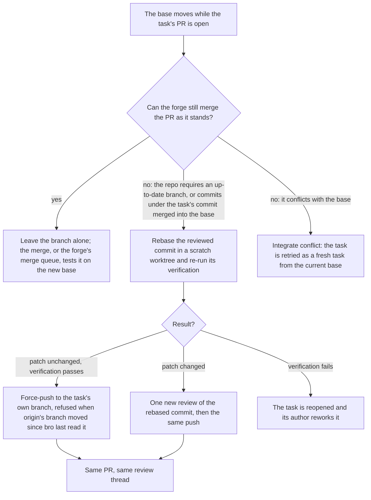
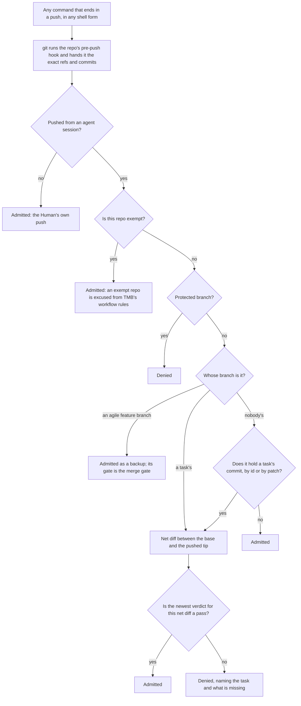
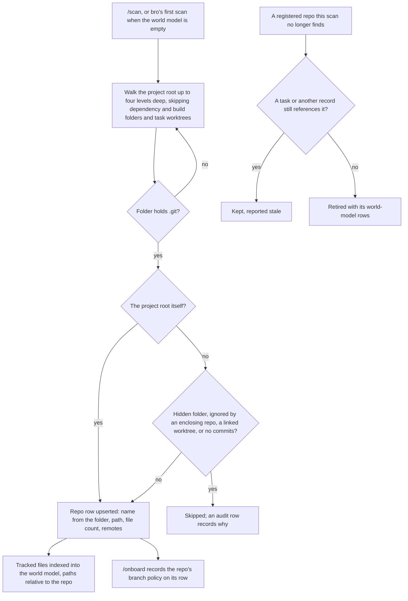

# Git workflow

Where each actor's git state lives at every stage of a TMB task, and how a workspace with several repos decides which repo an operation belongs to. [FLOWS.md](./FLOWS.md) shows the task chain this serves, from the Human's ask to the merge.

## Core principle: local is canonical, origin is downstream

Your local `<feature>` branch is the source of truth at every step of a task. swe's commits land directly on `<feature>`, since its worktree owns the branch, and the branch reaches origin only through bro's push. swe never pushes, so nothing reaches origin without passing bro's checks and the code-reviewer.

This is the standard developer flow: commit locally, push, open a PR. The TMB twist is that the commits happen in swe's worktree, attached to `<feature>`, so they advance the branch with no separate merge step. Integration into `<base>` happens on the remote when the PR merges. A repo with no remote has no push or PR: the branch stops ready after the review pass, and the Human merges it into `<base>` locally.

## Actors and stages

- **You and bro** work on the project's main checkout, which stays on `<base>` for the whole task.
- **swe** works only in a private worktree under the project, attached to `<feature>`.
- **Origin** is your remote; `<base>` is the repo's configured PR target.

| Actor | Idle | Task provisioned | swe working | swe committed | Bro pushes (PR opens) | After merge |
|---|---|---|---|---|---|---|
| **You + bro** | `<base>` | `<base>`; bro fetches `<base>`, cuts `<feature>` from it and attaches a worktree, without switching | `<base>` | `<base>` | `<base>`; bro pushes `<feature>` | `<base>`; merged local branch pruned |
| **swe** | not spawned | not spawned | worktree on `<feature>`, dirty | worktree on `<feature>`, commits advance it | done; worktree removed after the passing review, recreated on rework | — |
| **Origin** | `<base>` | `<base>` | same | same | `<feature>` updated | `<base>` advanced |

## Key handoffs

- **Bro provisions.** One step creates the task, fetches `<base>`, cuts `<feature>` and attaches a worktree (see [Keeping the base fresh](#keeping-the-base-fresh)). The main checkout never switches branches; swe never creates branches or worktrees.
- **No bro-side merge.** swe's commits are already on `<feature>`, so bro just pushes it.
- **Push gate.** A push is admitted only when every pushed task commit has a passing code-reviewer verdict.
- **A session inside a worktree adopts it.** A session that itself runs in a linked worktree uses that worktree for its task instead of getting a new one, and no other session may adopt it. A close keeps an adopted worktree.
- **Cleanup.** A passing review removes the task's worktree and returns the main checkout to `<base>`; reopening the task for rework recreates the worktree. A merge in the session also removes the merged local branch and prunes deleted remote branches.

## Why this design

A branch can be checked out in only one worktree at a time. swe's worktree owns `<feature>` while swe works, and the main checkout sits on `<base>` throughout, so there is never a second checkout to reconcile.

Routing swe's commits through your local branch, rather than letting swe push, keeps the usual mental model: you can inspect, rebase or drop anything before it reaches origin.

## Keeping the base fresh

Work always starts from the latest `<base>`, so a task never builds on stale code. Each entry point checks it:

- **Provisioning fetches first.** Provisioning, reopening and retrying a task each run an environment gate before anything is recorded: a bounded fetch of `<base>` from origin, then the branch, the worktree, setup and the world-model index. A failed stage refuses the call and removes what it created. The fetch is skipped only when the repo has no origin or origin has no such branch.
- **The cut takes the newer tip.** A new `<feature>` is cut from local `<base>` when it is a fast-forward ahead of `origin/<base>`, so unpushed local work is kept, else from `origin/<base>`. When the two have diverged, origin wins and bro is told why.
- **An existing branch is fast-forwarded or refused.** A `<feature>` already at or behind the base tip is fast-forwarded to it. One that has diverged is refused, so bro picks a fresh name or explicitly continues that branch.
- **A stale branch gets no worktree.** A guard denies attaching a worktree to a branch that is behind `origin/<base>`, after its own fetch.
- **Hand-made branches start from a current base.** A guard denies creating a branch in a main checkout that is not on `<base>`, or whose local `<base>` differs from origin after a fetch.
- **Integration resolves the base the same way.** The post-review rebase below fetches `<base>` and uses the newer of local and origin, as provisioning does.

## Git guards

Hooks hold the rest of this model in place, each enforcing the policy of the repo the command runs in:

- **Destructive commands.** Force-pushes to protected branches are denied, as are direct commits, merges and rebases on a shared base. Denying hard resets and forced cleans is planned (GH 3260).
- **The main checkout stays on `<base>`.** Checking out a branch that belongs to an open task is denied; the task's worktree is the place to work on it.
- **swe stays in its lane.** swe cannot push, create branches or worktrees, or touch files outside its worktree. A swe spawn waits until its task's branch exists, and its worktree is created if missing.
- **Pushes are reviewed.** See the push gate above.
- **Remote identity is the Human's.** An interactive forge login is denied in a repo with no remote, where it would hang, and a remote write that cites a local issue number under the wrong remote number is denied. Denying commands that change remote identity or create repos is planned (GH 3260).
- **The world model follows the refs.** A command that moves refs, such as a fetch, merge, rebase or reset, triggers a background re-index.

## Rebasing a reviewed task

swe never fetches, rebases or pulls. When `<base>` moves after a task passed review, bro rebases the reviewed commit in a scratch worktree, refuses when the rebased patch differs from the reviewed one or conflicts, and re-runs the task's verification on the result. Only on a pass do the branch and the task's recorded commit move to the rebased commit. Because the patch is unchanged, the review carries over, the way Gerrit carries a vote across a trivial rebase; any other new commit needs a fresh review. The push gate applies the same patch-identity rule to rebased commits no task records.

### When the base moves after the PR is open

Planned (GH 3227). The rebase above runs before the first push. Once the PR is open, a moved base is not by itself a reason to rebase: a rebase rewrites the commit, so the branch on origin can only be updated by a force-push. Today bro rebases an open PR's branch whenever the base moved, and the push gate then also checks the base's own commits between the old tip and the new one, so the force-push is denied.

- **Behind is not broken.** A PR whose branch is behind the base, with no conflict, is left alone unless the repo's rules require an up-to-date branch.
- **A stack is the common case.** A task cut on top of another branch has that branch's commits under its own. When they merge into the base, the task's commit is rebased onto the base and the commits already there drop out.
- **The force-push is narrow.** It goes only to the task's own branch, never to a protected one, and it is refused when origin's branch holds a commit bro has not seen, so nobody's push is overwritten.
- **The gate checks only what the push adds.** That is the commits reachable from the new tip and not from the base. A commit already on the base passed its own gate when it merged, and needs no new verification.
- **The PR is kept.** A rebase never opens a new branch or a new PR, so the review thread and history stay in one place.

## The push gate at git's own hook

Planned (GH 3281). A prototype proved the hook mechanism; the list under the bullets says what is still open. Today the push gate runs before a Bash command, reads its text to decide whether it is a push and what it sends, looks up each pushed commit on its own, and takes its policy from the working directory. Each of the three is a steady source of bugs: a shell form nobody foresaw, a commit whose id changed in a rebase or that two tasks share, and a command aimed at another repo. The design below removes the causes.

- **Git says what is pushed.** The hook receives each ref and commit the push sends, so the gate reads no command text and no shell form can hide a push from it. It runs inside the repo being pushed, so the policy is that repo's.
- **The text guard keeps one job.** It denies an agent's command that would skip, disable or replace TMB's hook, or strip the mark of an agent's shell. That is a short, closed list, where "every way to write a push" is an open one.
- **Every push checks the hook is live.** Before an agent's push, the guard asks git, in the worktree that pushes, which pre-push hooks it will run, and confirms TMB's is among them and enabled. Today's command-text judge steps aside only when that check passes, and stays on as the fallback otherwise.
- **The Human is not gated.** The hook acts only on a push from an agent session. The Human's own push from a terminal passes, as it does today. TMB marks an agent's shell itself, at session start, with a mark no terminal the Human opens carries; it does not rely on the host's own mark, which the Human's terminal may share.
- **The gate judges the branch, not each commit.** A review is recorded against the net diff between the base and the reviewed tip. A push is admitted when the newest verdict for the pushed tip's net diff is a pass.
  - A rebase that leaves the diff unchanged keeps its pass with no extra record.
  - Commits already on the base are never in the diff, so a moved base adds nothing to check.
  - A commit a retry inherited from the task it replaces is covered by the review of the whole diff.
- **An unchanged diff is necessary, not enough.** Integrate still re-runs the task's verification on the rebased commit and checks that the base's changes touch nothing the diff depends on. When they do, the commit gets one new review, recorded against the new tip.
- **Close follows integrate.** A task closes only once integrate succeeded, so a failed integrate always leaves an open task to rework or to review again. Today the task closes first, and a failed integrate leaves nothing to reopen (GH 3234).
- **The hook is named in the repo's local git config, not placed in a hooks folder.** Git runs a hook named there in addition to the project's own, so TMB never touches the project's hooks folder or its hooks path, wraps no other hook, and a tool that manages the project's hooks, such as husky, cannot unhook it. The config is shared by every worktree of the repo.
- **The hook script is a stable local file.** It sits in the repo's git folder, is never committed, and only hands the push to the installed TMB. Session start refreshes it, so a plugin update never leaves it pointing at a version that is gone. An exempt repo gets none.
- **A leftover hook never blocks anyone.** A hook whose script is missing fails every push, the Human's included, so the script always exists and admits the push when TMB is no longer installed. Removing the plugin runs no code, so the hook is then inert, and one cleanup command, named in [INSTALL.md](INSTALL.md), removes the config entry and the script. When TMB is installed and its judge fails to run, an agent's push is denied and the Human's passes.
- **It needs a git that runs hooks from config** (2.54 or newer). On an older git TMB installs nothing, keeps today's command-text judge, and says so once at session start. A plain hook file for an older git, only in a repo with no hooks path and no pre-push hook of its own, is a later slice.
- **The forge is the last line.** A protected branch's rules on the forge stay the Human's to set; TMB's hook does not replace them.

Proven by the prototype, on git 2.56: the hook runs beside a project's own hooks path and in linked worktrees, a deny stops the push, the mark set at session start reaches the hook, and the net diff of a 1,339-file branch takes 0.22 s. Still to prove: that the mark reaches a subagent's shell and survives a compacted or resumed session. Until a live session shows it, the command-text judge stays on.

## Agile feature branches

Shipped for the project review mode; a lane's feature branch is planned (GH 3025). In agile review mode a long-lived feature branch stands between the task branches and `<base>`. Each `<feature>` is cut from the feature branch's tip instead of `<base>`, and bro merges it back into the feature branch locally once the task closes, with no PR. bro pushes the feature branch as a backup and brings `<base>` into it at the milestone, or earlier in an optional periodic sync. Only the feature branch itself reaches `<base>`, as one PR after its review passes or the Human waives it. [AGILE.md](AGILE.md) covers every case.

## Multi-repo workspaces

A workspace can hold several inner git repos, siblings or submodules, under one trajectory DB. A scan discovers them and maps each one to a repo row in the DB:

TMB then resolves "which repo does this operation belong to" by **path**, never by a global default repo:

1. **Repos are identified by registration.** A repo takes part in TMB only once `/scan` has registered it. Registration is the same step that warms the world model, so the two stay aligned.
2. **Resolution is path-keyed.** An operation belongs to the registered repo whose path contains it: the command's git root for a hook, the task's repo for a task. World-model paths are stored relative to their repo.
3. **Branch policy is per repo.** Each repo's PR target, branching model and protected branches are recorded with its registration and nowhere else; there is no global fallback. The git guards enforce the policy of the repo the command runs in. Planned (GH 3281): the policy of the repo the command targets, so a repo named on the command line wins over the working directory, and a deny names the repo whose policy it applied.
4. **Single-repo fallback.** When an operation names no repo and exactly one is registered, it resolves to that repo, so single-repo projects need no repo argument anywhere. With several repos registered, an operation that names none and has no path is refused.
5. **Each repo has a mode.** Planned (GH 3281). A workspace holds repos that need different amounts of TMB: a product repo, and beside it a private test fixture that never ships. The repo's record says which, and the Human sets it.

   | Repo mode | What applies in the repo |
   |---|---|
   | Truest | The full flow: tasks, a review of every task before its push, the git guards |
   | Agile | The same, with the review deferred to the feature branch ([AGILE.md](AGILE.md)) |
   | Exempt | Indexed for the world model, and excused from the workflow rules: no task is required, no review, no git guard and no push gate |

   - **Onboarding asks one mode per repo.** /onboard lists every repo with the mode bro recommends and the reason, and the Human approves or changes the set in one round ([ONBOARD.md](ONBOARD.md)). bro weighs what the repo shows; these are signals, not thresholds:

     | What the repo shows | bro recommends |
     |---|---|
     | Empty, or no remote | Exempt |
     | One author, few commits, no release | Agile |
     | A protected branch, CI, several authors or releases | Truest |
     | Nothing clear | Agile, the default |

   - **A scan only indexes.** A repo a scan finds after onboarding is exempt until the Human answers, and bro asks at its first contact with that repo. bro never enforces a guessed policy. Today registration alone turns the guards on, with the repo's default branch as its PR target.
   - **A repo left on the project's mode takes it.** The Human can answer "the project's" for a repo, and it then follows the project's review mode, truest or agile, and agile when the project has none stored. The project's mode is never exempt, so one setting cannot switch the rules off in every repo. A lane's review mode still overrides both for a repo that is not exempt. Exempt is final: no lane and no project setting turns the rules back on.
   - **Two things stay on in an exempt repo.** Containment still keeps every write inside the project, and the trajectory still records what ran there. They protect the Human's machine and the record, not the repo's workflow.
   - **A task in an exempt repo is recorded, not gated.** Tasks are optional there. One that exists keeps its lifecycle events, its agent runs and its own checks, and it closes without a review: the close carries a cause naming the repo's mode, so the record says why no review ran.
   - **Its mode shows.** The repo list and the dashboard show each repo's mode, and a deny names the repo and the mode it applied.

A global default repo would force one repo to be "the" repo and make the guards guess what to enforce; it breaks as soon as a second repo joins. Path-keyed resolution lets sibling repos coexist with none privileged.
