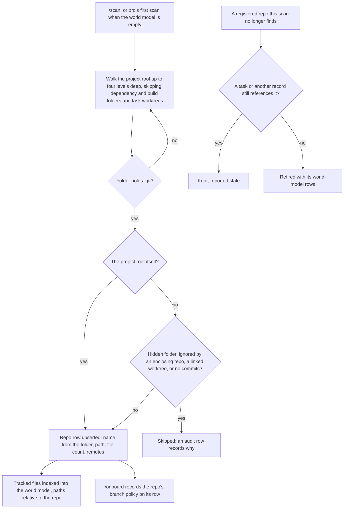

# Git workflow

Where each actor's git state lives at every stage of a TMB task, and how a workspace with several repos decides which repo an operation belongs to. [FLOWS.md](./FLOWS.md) shows the task chain this serves, from the Human's ask to the merge.

## Core principle: local is canonical, origin is downstream

Your local `<feature>` branch is the source of truth at every step of a task. swe's commits land directly on `<feature>`, since its worktree owns the branch, and the branch reaches origin only through bro's push. swe never pushes, so nothing reaches origin without passing bro's checks and the code-reviewer.

This is the standard developer flow: commit locally, push, open a PR. The TMB twist is that the commits happen in swe's worktree, attached to `<feature>`, so they advance the branch with no separate merge step. Integration into `<base>` happens on the remote when the PR merges.

## Actors and stages

- **You and bro** work on the project's main checkout, which stays on `<base>` for the whole task.
- **swe** works only in a private worktree under the project, attached to `<feature>`.
- **Origin** is your remote; `<base>` is the repo's configured PR target.

| Actor | Idle | Task provisioned | swe working | swe committed | Bro pushes (PR opens) | After merge |
|---|---|---|---|---|---|---|
| **You + bro** | `<base>` | `<base>`; bro fetches `<base>`, cuts `<feature>` from it and attaches a worktree, without switching | `<base>` | `<base>` | `<base>`; bro pushes `<feature>` | `<base>`; merged local branch pruned |
| **swe** | not spawned | not spawned | worktree on `<feature>`, dirty | worktree on `<feature>`, commits advance it | done; worktree removed after the passing review, recreated on rework | — |
| **Origin** | `<base>` | `<base>` | same | same | `<feature>` updated | `<base>` advanced |

## Key handoffs

- **Bro provisions.** One step creates the task, fetches `<base>`, cuts `<feature>` and attaches a worktree (see [Keeping the base fresh](#keeping-the-base-fresh)). The main checkout never switches branches; swe never creates branches or worktrees.
- **No bro-side merge.** swe's commits are already on `<feature>`, so bro just pushes it.
- **Push gate.** A push is admitted only when every pushed task commit has a passing code-reviewer verdict.
- **Cleanup.** A passing review removes the task's worktree and returns the main checkout to `<base>`; reopening the task for rework recreates the worktree. A merge in the session also removes the merged local branch and prunes deleted remote branches.

## Why this design

A branch can be checked out in only one worktree at a time. swe's worktree owns `<feature>` while swe works, and the main checkout sits on `<base>` throughout, so there is never a second checkout to reconcile.

Routing swe's commits through your local branch, rather than letting swe push, keeps the usual mental model: you can inspect, rebase or drop anything before it reaches origin.

## Keeping the base fresh

Work always starts from the latest `<base>`, so a task never builds on stale code. Each entry point checks it:

- **Provisioning fetches first.** Provisioning, reopening and retrying a task each run an environment gate before anything is recorded: a bounded fetch of `<base>` from origin, then the branch, the worktree, setup and the world-model index. A failed stage refuses the call and removes what it created. The fetch is skipped only when the repo has no origin or origin has no such branch.
- **The cut takes the newer tip.** A new `<feature>` is cut from local `<base>` when it is a fast-forward ahead of `origin/<base>`, so unpushed local work is kept, else from `origin/<base>`. When the two have diverged, origin wins and bro is told why.
- **An existing branch is fast-forwarded or refused.** A `<feature>` already at or behind the base tip is fast-forwarded to it. One that has diverged is refused, so bro picks a fresh name or explicitly continues that branch.
- **A stale branch gets no worktree.** A guard denies attaching a worktree to a branch that is behind `origin/<base>`, after its own fetch.
- **Hand-made branches start from a current base.** A guard denies creating a branch in a main checkout that is not on `<base>`, or whose local `<base>` differs from origin after a fetch.
- **Integration resolves the base the same way.** The post-review rebase below fetches `<base>` and uses the newer of local and origin, as provisioning does.

## Git guards

Hooks hold the rest of this model in place, each enforcing the policy of the repo the command runs in:

- **Destructive commands.** Hard resets, forced cleans and force-pushes to protected branches are denied, as are direct commits, merges and rebases on a shared base.
- **The main checkout stays on `<base>`.** Checking out a branch that belongs to an open task is denied; the task's worktree is the place to work on it.
- **swe stays in its lane.** swe cannot push, create branches or worktrees, or touch files outside its worktree. A swe spawn waits until its task's branch exists, and its worktree is created if missing.
- **Pushes are reviewed.** See the push gate above.
- **Remote identity is the Human's.** Forge logins and commands that change remote identity or create repos are denied.
- **The world model follows the refs.** A command that moves refs, such as a fetch, merge, rebase or reset, triggers a background re-index.

## Rebasing a reviewed task

swe never fetches, rebases or pulls. When `<base>` moves after a task passed review, bro rebases the reviewed commit in a scratch worktree, refuses when the rebased patch differs from the reviewed one or conflicts, and re-runs the task's verification on the result. Only on a pass do the branch and the task's recorded commit move to the rebased commit. Because the patch is unchanged, the review carries over, the way Gerrit carries a vote across a trivial rebase; any other new commit needs a fresh review. The push gate applies the same patch-identity rule to rebased commits no task records.

## Multi-repo workspaces

A workspace can hold several inner git repos, siblings or submodules, under one trajectory DB. A scan discovers them and maps each one to a repo row in the DB:

TMB then resolves "which repo does this operation belong to" by **path**, never by a global default repo:

1. **Repos are identified by registration.** A repo takes part in TMB only once `/scan` has registered it. Registration is the same step that warms the world model, so the two stay aligned.
2. **Resolution is path-keyed.** An operation belongs to the registered repo whose path contains it: the command's git root for a hook, the task's repo for a task. World-model paths are stored relative to their repo.
3. **Branch policy is per repo.** Each repo's PR target, branching model and protected branches are recorded with its registration and nowhere else; there is no global fallback. The git guards enforce the policy of the repo the command runs in.
4. **Single-repo fallback.** When an operation names no repo and exactly one is registered, it resolves to that repo, so single-repo projects need no repo argument anywhere.

A global default repo would force one repo to be "the" repo and make the guards guess what to enforce; it breaks as soon as a second repo joins. Path-keyed resolution lets sibling repos coexist with none privileged.
