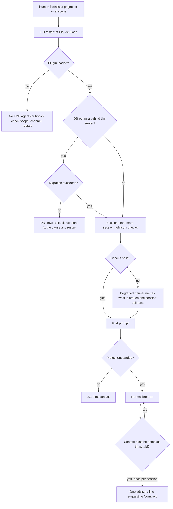

# Install, upgrade and session start

Every case of flow 1.1 in [FLOWS.md](FLOWS.md): how TMB gets into a project, how an upgrade lands, what each session start checks, and how to tell what broke.



## Recommended scope: project or local

TMB keeps its state inside the project, so it installs per project: **project** scope for a team (`.claude/settings.json`), **local** scope for one person and for the dev and rc channels (`.claude/settings.local.json`). User scope loads TMB's hooks into every project, and session start recommends `--scope project` once per session when it sees one.

`claude plugin install` defaults to user scope, so always pass `--scope`. From the project root, with `<scope>` set to `project` or `local`:

```bash
claude plugin marketplace add trustmybot/marketplace --scope <scope>
claude plugin install tmb@trustmybot --scope <scope>
claude plugin update tmb@trustmybot --scope <scope>
claude plugin marketplace update trustmybot   # no scope flag
```

Other channels: `trustmybot/marketplace-rc` with `tmb@trustmybot-rc`, or `trustmybot/marketplace-dev` with `tmb@trustmybot-dev`.

- **The Human installs and restarts.** Any plugin change applies only after a full quit and relaunch of Claude Code. Installing at both scopes is safe; the project install wins.
- **Node.js 22+ on PATH**, or session start prints `TMB DEGRADED: missing node …`.
- **One plugin loads together:** the swe and code-reviewer agents, the trajectory server and the hooks. Everything TMB writes stays under the project root ([CONTAINMENT.md](CONTAINMENT.md)).
- **bro's persona comes from hooks.** Claude Code never loads a plugin's own `CLAUDE.md`, so hooks deliver bro's persona at session start, resume, `/clear` and compaction, and on the first prompt of a session that started before the hooks loaded; after a compaction they bring back bro's state from the DB. TMB never writes to `<project>/CLAUDE.md`; a `<!-- tmb:persona start … -->` block an older `/onboard` copied there can be deleted.

## Operating systems

| OS | Claude Code workflow | Bash sandbox | `/onboard` sandbox default |
|---|---|---|---|
| macOS | Supported | Supported; the recorded network probe ran here | **Yes (Recommended)**, unless a repo remote uses SSH |
| Linux | Supported (CI runs the suite on Linux) | Not yet validated on a Linux host; the network probe is macOS-only | **No**; answering Yes still writes the block |
| Windows | WSL 2 only, which is the Linux case; native Windows is untested | None on native Windows | As Linux |

## Upgrade

An upgrade moves the plugin files, which Claude Code fetches when the plugin's version changes, and the trajectory DB, which the server migrates on its first boot after a full restart. Nothing short of a full restart applies either.

- **Version.** Session start prints `Plugin version:`; `claude plugin list` shows each install's version and scope. A newer cached version than the running one adds a "fully quit and relaunch" line.
- **Check now.** `claude plugin marketplace update <marketplace>` (`trustmybot`, `trustmybot-rc` or `trustmybot-dev`) skips the poll.
- **Switch channels.** Uninstall the current one and install the other, each with an explicit `--scope`. The DB is per project, so data carries over.
- **Prune or reset the cache.** `node --experimental-sqlite <plugin-source>/mcp/trajectory-server/dist/cli.js heal-mcp-cache [--dry-run] [--channel stable|rc|dev]` clears a per-project MCP disable flag, prunes old cached versions, and can wipe the channel's cache for a clean reinstall. It asks before each change.
- **DB migration.** When the DB's schema is behind the server's, the server takes the write lock, writes `<dbpath>.pre-v<TARGET>.<timestamp>.bak`, and runs every pending migration in one transaction that rolls back whole on failure. Rows are preserved. Migrations only go forward: to roll back, restore that backup and install a plugin version that targets the older schema; work since the upgrade is lost.

### Upgrading into v1.1.0 — remove leftover user-wide hooks

Before v1.1.0, `/onboard` wrote hook commands into `~/.claude/settings.json` (`$CLAUDE_CONFIG_DIR/settings.json` when set), stamped `"_tmb_managed": true` or running `resolve-hook.sh`. They fire in every project, so an old gate can deny what the current one allows. TMB reports them (a session start `Plugin:` line, `WARN  legacy-user-hooks` in the health check, with each object's line and the projects still below 1.1.0 to upgrade first) and never edits the file.

To remove them:

1. `cp ~/.claude/settings.json ~/.claude/settings.json.bak`.
2. Under `"hooks"`, delete each reported hook object, then any group or event key left empty.
3. `jq empty ~/.claude/settings.json` to check it still parses.
4. Delete `~/.claude/tmb-hooks/`.
5. Start a new session; the `Plugin:` line is gone.

## Session start

- **Advisory, never blocking.** Session start checks health, required tools, leftovers from older versions and the project inventory. When something is broken, a degraded banner names it and the session goes on.
- **One compact nudge.** Once per session, when bro's context passes a configurable token threshold (off when set to zero), bro gets one line suggesting /compact at the next natural break. The compaction restore brings back the issue, its tasks and the newest decision.
- **Which DB.** The session uses the project's trajectory DB; [MEMORY.md](MEMORY.md#where-the-trajectory-db-lives) gives the rule that finds it.

## Debugging

| Symptom | Cause | Fix |
|---|---|---|
| No TMB agents or persona after install | Claude Code was not fully restarted, or the plugin went to another scope or channel | Check `claude plugin list`, install at the right scope, fully restart |
| A degraded banner at session start | A required tool is missing, or the trajectory DB or server is unhealthy | The banner names which; fix it and restart |
| TMB gates fire in projects that never installed it | A user-scope install, or user-wide hooks from before v1.1.0 | Reinstall at project scope; [remove the leftover hooks](#upgrading-into-v110--remove-leftover-user-wide-hooks) |
| Some gates never fire; `WARN  duplicate-plugin` | Two channels enabled in one project | Disable the extra copy at its scope (the warning prints the command), then restart |
| trajectory-server dead in one project only | `disabledMcpServers` holds `plugin:tmb:trajectory-server` for the project in `~/.claude.json` | `heal-mcp-cache` step A, or set the array to `[]`, then restart |
| Every `mcp__plugin_tmb_*` tool missing after an update; `mcp-health.log` shows `"mcp_alive":false` | Claude Code bug: hooks load from the new cache but the MCP server does not | In order: `claude --plugin-dir <plugin-source>` once; uninstall, restart, reinstall; `heal-mcp-cache` step B, reinstall, restart |
| Gates deny with `BLOCKED: trajectory DB unavailable` | The DB resolved but could not be read: busy, corrupt or unreadable | See [Where the trajectory DB lives](MEMORY.md#where-the-trajectory-db-lives) |
| `stored schema_version N is newer than code's max M` | Plugin downgraded | Upgrade the plugin, or restore the `.pre-v<N>` backup |
| Migration failed | Full disk, or another session held the lock past 5 s | Fix the cause and restart; the DB stayed at its old version |
| `legacy_db_no_plugin_meta` in `mcp-server.log` | DB predates schema versioning; the server adopted it | Check your data if you did not expect it |
| `no such column` or `NOT NULL constraint failed` on first boot | DB shape the migration chain does not know | Restore the newest `.bak`, stay on that version, open an issue with `sqlite3 <dbpath> '.schema'` |
