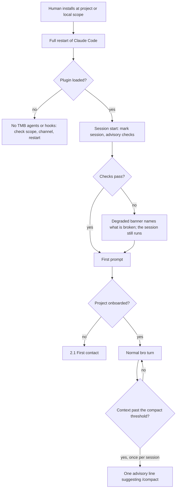

# Install and session start

Every case of flow 1.1 in [FLOWS.md](FLOWS.md): how TMB gets into a project, what each session start checks, and how to tell what broke.

## Install

- **Project or local scope, never user scope.** TMB keeps its state inside the project, so it installs per project: project scope for a team, local scope for one person and for the dev and rc channels. A user-scope install loads TMB into every project, and session start recommends project scope when it sees one.
- **The Human installs and restarts.** Any plugin change applies only after a full restart, so a mid-session install does nothing until then. Everything TMB writes stays under the project root ([CONTAINMENT.md](CONTAINMENT.md)).
- **One plugin loads together:** the swe and code-reviewer agents, the trajectory server and the hooks. Claude Code doesn't load a plugin's own persona file, so the hooks deliver bro's persona, and bring back bro's state after a compaction.

## Session start

- **Advisory, never blocking.** Session start checks health, required tools, leftovers from older versions and the project inventory. When something is broken, a degraded banner names it and the session goes on.
- **One compact nudge.** Once per session, when bro's context passes a configurable token threshold (off when set to zero), bro gets one line suggesting /compact at the next natural break. The compaction restore brings back the issue, its tasks and the newest decision.

## Debugging

| Symptom | Likely cause |
|---|---|
| No TMB agents or persona after install | Claude Code was not fully restarted, or the plugin went to another scope or channel |
| A degraded banner at session start | A required tool is missing, or the trajectory DB or server is unhealthy; the banner names which |
| TMB gates fire in projects that never installed it | Leftovers from an older version, or a user-scope install |
| Gates deny with the trajectory DB unavailable | The DB resolved but could not be read: busy, corrupt or unreadable |

The commands for each case, the supported operating systems, upgrade leftovers and how TMB locates its DB are in [the reference lookups](../reference/README.md).
