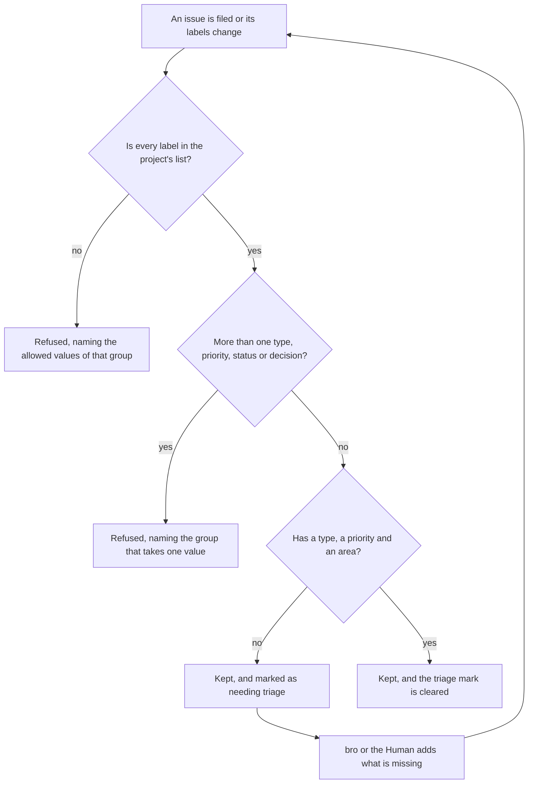

# Issue labels

How a project's issue board stays searchable when agents file most of its issues: six groups of labels, the rules for each, and how a project makes the scheme its own.

Planned (GH 3314). Today a project has three label lists, for type, priority and area, with an area inferred from the paths an issue names; a new issue needs one of each, and nothing else is enforced. [Shipped and planned](#shipped-and-planned) marks each piece.

## Why a scheme

An agent files an issue in seconds, so a board grows faster than one person can read it. The board is then found by search, by an agent or by the Human, and a search is only as good as the labels. Two things break it: a label an agent invented, and a label that means two things. So the scheme is a small, closed vocabulary with one meaning per label.

## The six groups

| Group | Answers | Per issue | Who sets it |
|---|---|---|---|
| Type | What kind of work is this? | Exactly one | Whoever files the issue |
| Priority | How soon? | Exactly one | Whoever files it; the Human can change it |
| Area | Which part of the project? | One or more | Whoever files it, or inferred from the paths the issue names |
| Status | Is it ready to be worked on? | At most one | TMB, when a required label is missing |
| Decision | Did bro decide something here for the Human? | At most one | bro |
| Theme | Which kind of problem is it, whatever the area? | Any number | Whoever files it |

- **Type, priority and area are required.** An issue without all three is not triaged, and its status says so until it has them.
- **Area says where, theme says what kind.** An area is a part of the project, such as its hooks or its dashboard. A theme cuts across areas: a design gap, a prompt problem, a guard that blocks valid work. One issue is no theme, so a project adds a theme only once several issues share it.
- **Decision is the Human's review queue.** When bro decides something on the Human's behalf in an issue or a PR, it marks the item as needing the Human and lists those decisions in one section of the body. When the Human has answered, bro marks it reviewed. One search then shows everything that waits on the Human, with no thread to read.

## How a label is written

- **Group, a slash, then the value, all in lower case with no spaces**, such as the bug type or the high priority. A name with a space must be quoted in every search and every command, and a quoting slip is the commonest way an agent's search goes wrong.
- **Every label has a description**, so an agent that reads the list knows what each one means without guessing from its name.
- **One meaning per label.** Two labels that could both fit are merged, not kept.

## How labels are applied

- **An agent picks from the list and never invents.** The project's list is the whole vocabulary. A label outside it is refused, which also keeps text an agent read in an issue from turning into a label.
- **Unsure means unset.** An agent that cannot tell the type or the area leaves it off, and the issue stays marked for triage. A wrong label hides an issue from every later search; a missing one is found.
- **A new theme or status needs the Human.** Those two groups are the ones that grow without limit, so bro proposes a new value and the Human approves it.

## One board, two authors

A person and bro both file issues, and they know different things. A person knows what they saw and how badly it blocks them. bro knows the part of the code, the versions, the steps and the exact output.

- **A form asks a person only what they know.** Each issue form requires its opening questions, written in plain words, and nothing that needs knowledge of the project's internals. Everything else is optional.
- **bro supplies the rest.** A report bro drafts fills every field, and the Human reviews it before it is filed. An issue a person files with fields left empty is completed at triage, by bro or the Human.
- **Both authors produce the same issue.** One field list serves the web form and bro's draft, so the two read the same and are triaged by the same rules.
- **An empty answer is honest.** A field a person cannot answer stays empty and the issue is marked for triage, by the same rule as a label: a wrong answer misleads every later reader, a missing one is filled in.

## A project makes it its own

- **A project starts with labels that work.** TMB ships a ready environment, and labels are part of it: with no knowledge of a project, bro cannot invent good ones. So every group has a shipped default, and a new project can file and find issues from its first session.
- **Four groups mean the same everywhere:** the types, the priorities, the triage status and the two decision values.
- **Themes start from a shipped list of four** problems common to software projects: a design gap, docs that have drifted from the code, a regression, and technical debt. The project drops what it does not use and adds its own.
- **Areas come from the project, once TMB knows it.** bro proposes areas only after the first scan, from the world model: the project's main parts, what their READMEs say they are, and the paths each one covers, so an area can later be inferred from the paths an issue names. The Human edits the list ([ONBOARD.md](ONBOARD.md)). In a repo with no code yet, bro proposes none and asks again when a scan first finds some.
- **Everything can be changed.** The Human can rename, add or drop any label, in any group, per project. The per-issue rules follow the project's own list.
- **A project that already has labels keeps them.** bro offers a mapping from the existing labels to the groups, and nothing on the forge is renamed, created or removed without the Human's yes. A label the mapping leaves out stays on its issues and is ignored by the rules.
- **The local record is the source.** Labels are kept in the trajectory DB and mirrored to the forge. When the forge does not let the user apply labels, the local record still holds them, and a search through TMB still finds the issue.

## What the scheme does not do

- **It does not carry state TMB already records.** A task's lifecycle and its review mode live in the trajectory DB, not in labels ([TASKS.md](TASKS.md), [AGILE.md](AGILE.md)).
- **It does not replace the forge's own fields.** A forge that has a native issue type or priority field enforces one value itself. Whether TMB should use those in place of the type and priority groups is open: their behaviour differs by account and by tool version, and it has not been checked.

## Shipped and planned

| Piece | State |
|---|---|
| A type, a priority and an area list per project, with one of each required on a new issue | Shipped |
| Area inferred from the paths an issue names | Shipped |
| Issue forms that require only their opening questions | Shipped |
| Status, decision and theme groups | Planned (GH 3314) |
| One value per group enforced for type, priority, status and decision; several areas allowed | Planned (GH 3314); today a new issue needs at least one type and priority and exactly one area |
| Lower-case names with a slash | Planned (GH 3314); today's defaults are capitalised, with a colon and a space |
| The onboarding question, the shipped themes, the areas proposed from the world model and the mapping of existing labels | Planned (GH 3314) |
| bro's procedure for choosing labels and for the decision group | Planned (GH 3314) |
