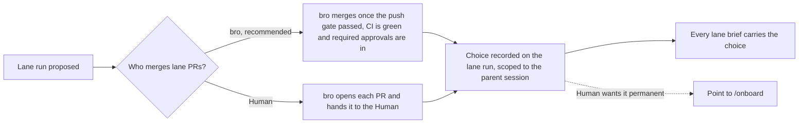
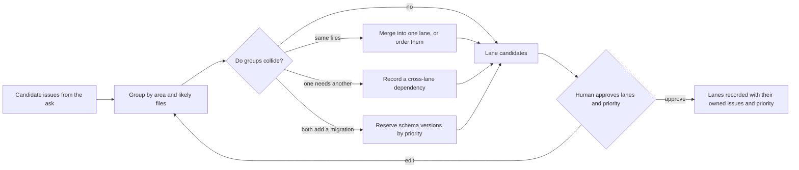
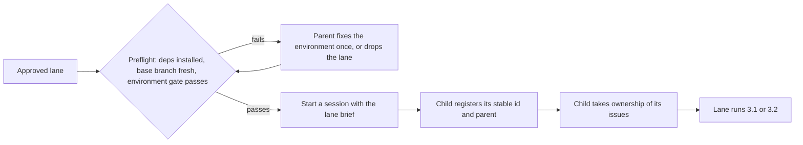
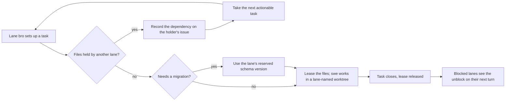
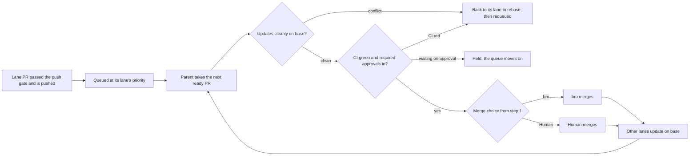
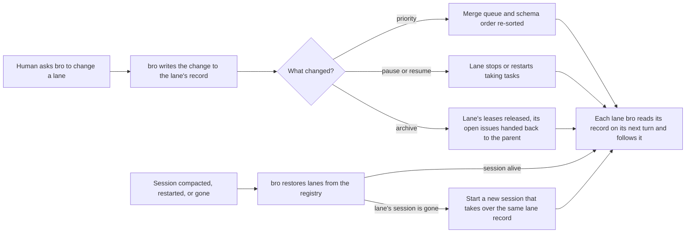

# Parallel lanes

Every case of flow 3.8 in [FLOWS.md](FLOWS.md): how TMB runs several independent streams of work as nested sessions, called lanes. Each lane runs its own bro, and a parent bro keeps the lanes from colliding and merges their PRs in order.

This whole flow is planned (epic GH 3024). Each step below names the issue that builds it.

## Scope

Claude Code and Desktop already start child sessions, carry messages between sessions, relay each child's end-of-turn report and list linked sessions. TMB uses those features as they are and doesn't redesign them. TMB adds only what its own model needs:

- a lane registry in the trajectory DB, the source of truth for every lane's state, so lanes can be recovered and changed at any time;
- who owns which issue, file and schema version;
- the gates every lane passes;
- the order in which lane PRs merge, and who merges them.

## When bro proposes lanes

The trigger is the shape of the work, not one phrase. Any of these signals leads bro to **propose** lanes; it never starts them unasked.

- The Human asks for parallelism: "do these in parallel", "split this up", "spin up sessions".
- The Human names a body of work: a milestone, an epic, a label or area, a list of issues, or a multi-part feature.
- bro sees two or more groups of open work that share no files and no blockers, each needing several tasks.
- A deadline, or "as fast as possible", on work that would take many turns one after another.

One change with independent parts stays in one session as parallel swe tasks (flow 3.1). Work that has to happen in order stays in one queue.

## 1. Who merges lane PRs

bro asks this first, before any planning, because a lane run ends with many PRs. The answer covers this lane run only. A permanent change to the project's merge policy still goes through `/onboard`. Under either answer, a PR whose gate requires a named GitHub approval, such as a prompt change, still waits for that approval.

- **The choice is the parent's.** It counts only in the parent session that recorded it, so a lane can't merge by citing it. Planned: GH 3148, enforced by the per-session approval gate in GH 3028.

## 2. Split, check conflicts, set priority

bro groups the candidate issues by area and by the files they will likely touch, using the world model. Groups that would collide are merged into one lane or ordered. The Human then approves the lanes and gives each one a priority.

- **One owner per issue.** Each issue belongs to exactly one lane. Planned: GH 3025.
- **Dependencies cross lanes.** An issue may be blocked by an issue another lane owns. Planned: GH 3026.
- **Schema versions are reserved up front**, in priority order, so two lanes never claim the same number. Planned: GH 3027.
- **Priority** is High, Medium or Low per lane, or a ranking when there are many lanes. It orders the merge queue and the schema reservations. Planned: GH 3025, or GH 3148 if GH 3025 ships without it.

## 3. Start the lanes

The parent checks the environment once before any lane starts, so every lane doesn't hit the same setup failure.

- **The brief** holds the lane's owned issues, its priority, the merge choice, its branch naming and any reviewer rule that applies to its PRs.
- **Registration survives compaction.** A lane restores its whole queue by its stable session id, not one issue. Planned: GH 3025, completing GH 3020.
- **Fresh worktrees install dependencies** before they build. Planned: GH 3146.
- **Lanes share notes** in the folder the host hands them. Planned: GH 1818.

## 4. Inside a lane

A lane is a normal 3.1 or 3.2 run, except that setting up a task respects other lanes' claims. A refusal becomes a recorded blocker, and the lane moves on to other work rather than negotiating over messages.

- **File leases** are taken when a task is set up and released when it closes. Planned: GH 3027.
- **Branch and worktree names carry the lane name**, so parallel lanes never collide. Planned: GH 3027.
- **The DB is the source of truth for an unblock.** A message between sessions is only a nudge. Planned: GH 3026.
- **Token use rolls up per lane.** Planned: GH 3027.

## 5. The merge queue

The parent takes lane PRs in priority order. A PR that conflicts or fails CI goes back to its lane. A PR waiting on a required approval is held, and the queue moves on to the next one that's ready.

- **The queue** records each lane PR with its lane, priority and state: queued, held, returned or merged. A returned PR keeps its priority. Planned: GH 3148.
- **A merge closes the PR's issues**, which unblocks their dependents in other lanes. Planned: GH 3026.
- **The queue is visible** on the dashboard's Lanes page, with lanes nested under their parent session. Planned: GH 3041 and GH 3028.

## 6. Change or recover a lane

Lanes live in the trajectory DB, not in any bro's memory. Each lane has one record: its parent, its session, its owned issues, its priority, its state (active, paused or archived) and the run's merge choice. Every change is written there first, with the request that caused it. A bro acts only on what the record says, so a change survives compaction, a restart, or a session the host no longer lists.

- **Any of the Human's sessions can change a lane.** The Human can raise a priority or archive a lane from the parent or from the lane itself. A lane bro never changes another lane on its own. Planned: GH 3025, with the per-session approval gate in GH 3028.
- **Records are kept.** An archived lane keeps its record and history, so it can be listed and reopened later. Archiving the Claude session itself is the host's feature, which bro may offer alongside.
- **Recovery uses the stable session id.** A new session that takes over a lane gets its brief rebuilt from the record, not from a message. Planned: GH 3025.
