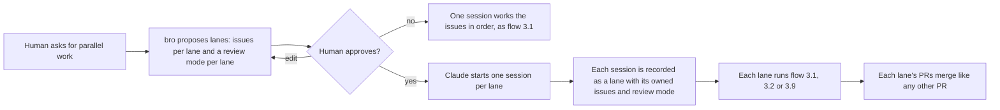

# Parallel lanes

Every case of flow 3.8 in [FLOWS.md](FLOWS.md): how TMB records several Claude sessions that work in parallel. A lane is a Claude session together with the issues it owns and its own review mode.

TMB builds no lane mechanism of its own. Claude Code and Desktop already start child sessions, carry messages between sessions, relay each child's end-of-turn report and list linked sessions. TMB uses those features as they are and adds two things:

- a record of each session as a lane, with the issues it owns, so a session finds its work again after a compaction or a restart;
- a review mode per lane, so a bug-fix lane can run truest while a prototype lane runs agile.

One piece has shipped (GH 3020): every session that records an intent, creates or adopts an issue, or provisions a task is recorded as a lane with the issues it touched, and the restore after a compaction lists them. Today an issue may sit in several lanes. Everything else below is planned (epic GH 3024), and each rule names the issue that builds it. Recording each session as its own record, with a start, an end and a parent, is planned in GH 3255 ([TRAJECTORY.md](TRAJECTORY.md)).

## What TMB leaves out

Each of these was planned once and is cut, because it would rebuild what Claude or the hosting service already does, or add work to every task.

- **No merge queue of TMB's own.** A lane's PR merges like any other PR. The Human merges it, and where the repo has a merge queue on its hosting service, that queue orders and tests the PRs ([GIT.md](GIT.md#rebasing-a-reviewed-task)).
- **No lane priority and no merge order.** A lane has no rank. The Human decides what merges first by merging it first.
- **No collision checks between lanes.** TMB keeps no file leases, reserves no schema versions and records no dependency between lanes. Two lanes that changed the same file meet as an ordinary merge conflict on the PR that merges second, and that PR goes back to its lane as rework (flow 3.4). Two lanes that each add a migration settle the version number the same way.
- **No hub and no supervision of lanes.** No session holds the state of the others. A session that starts another gets its reports through Claude's own relay. Finding a stalled session is part of the session record, not of lanes ([TRAJECTORY.md](TRAJECTORY.md)).
- **No token cap per lane.**

## When bro proposes lanes

The trigger is the shape of the work, not one phrase. Any of these signals leads bro to **propose** lanes; it never starts them unasked.

- The Human asks for parallelism: "do these in parallel", "split this up", "spin up sessions".
- The Human names a body of work: a milestone, an epic, a label or area, a list of issues, or a multi-part feature.
- bro sees two or more groups of open work that share no files and no blockers, each needing several tasks.
- A deadline, or "as fast as possible", on work that would take many turns one after another.

One change with independent parts stays in one session as parallel swe tasks (flow 3.1). Work that has to happen in order stays in one queue.

- **bro splits for the fewest conflicts.** With no collision checks, the split is the only guard against two lanes editing one file. bro reads each issue's likely files from the world model, keeps issues that touch the same files in one lane, and tells the Human which overlaps it could not remove. The procedure for this is not in bro's prompts yet (GH 3307).
- **The Human approves the split.** bro shows each lane's issues and the review mode it recommends, and starts nothing until the Human approves.

## 1. The lane record

A lane is recorded in the trajectory DB, not in any bro's memory, so it survives a compaction, a restart, or a session that has dropped off the host's list.

- **One owner per issue.** Each issue belongs to at most one lane. Ownership lapses when the owner's session has ended, so a finished lane frees its issues. An issue no lane owns is open to any session. A session that tries to take an issue another lane owns is refused, and it tells the Human. When single ownership ships, an open issue that already sits in several lanes goes to the lane whose session most recently ran work on it, and a closed issue keeps no owner. Planned: GH 3025.
- **An issue can be transferred.** The Human moves an issue from one lane to another; the record names both lanes and the request. A lane's bro never takes an issue on its own. Planned: GH 3025.
- **Lanes need a stable session id and one project.** A lane is looked up by an id that survives a rename, a clear and a compaction, which the desktop app gives each session. A lane's name is a label looked up by that id. A lane also shares its project folder and trajectory DB with the session that started it, so bro never proposes a cloud or remote-host lane. Planned: GH 3025.
- **Registration survives compaction.** A lane restores its whole list of issues by its stable session id, not one issue. Planned: GH 3025, completing GH 3020.
- **A lane lasts as long as its session.** The lane's start, end and parent are those of its session record. When the session is gone, its issues are free again and any session can take them. Planned: GH 3255.
- **Where a lane session runs.** Each lane session starts in the shared main checkout, which stays on the working branch. Only its tasks' worktrees hold changes, so lanes never switch the checkout under each other.
- **Nesting is the host's call.** TMB neither allows nor forbids a lane starting a session of its own: Claude Code decides, and asks the Human. A session started under a lane is recorded with its parent and is a lane of its own.
- **Lanes share notes** in the folder the host hands them. Planned: GH 1818.

## 2. Review mode per lane

- **Each lane takes its own review mode**, truest or agile, when it starts ([AGILE.md](AGILE.md)). It is stored on the lane's record and overrides the project's mode for that lane's tasks. A lane with no mode of its own follows the project's. Planned: GH 3025, with the lane lookup at the close and the lane's feature branch in GH 2225.
- **bro recommends, the Human approves.** The question opens with the default, such as "Default: truest (global review mode)". The lanes bro suggests for the other mode come already selected, each with a one-line reason: a prototype or MVP lane may go agile, while a bug-fix lane keeps truest. The Human accepts the set in one answer or edits it. One question offers at most four choices, so with more than four lanes bro splits them across up to four questions, or asks with a checklist in prose.
- **An agile lane builds on its own long-lived feature branch.** That branch becomes one PR once its review passes or the Human waives it.

## 3. Change a lane

- **Only the Human changes a lane.** The Human can change a lane's review mode or move an issue, from the lane's own session or from the session that started it. The change is written to the lane's record with the request that caused it, and the lane's bro follows the record on its next turn. A message between sessions approves nothing. Planned: GH 3025, with the per-session approval gate in GH 3028.
- **A new review mode applies from then on.** The lane's later closes use it; closed tasks keep theirs.
- **Lanes are visible** on the dashboard's Lanes page, nested under the session that started them. Planned: GH 3041 and GH 3028.
