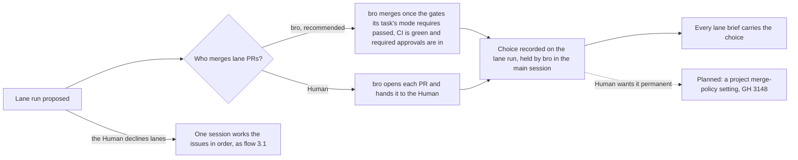
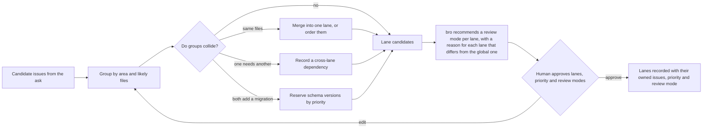
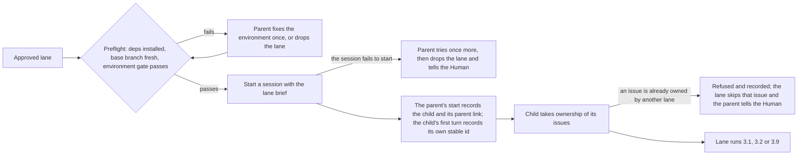
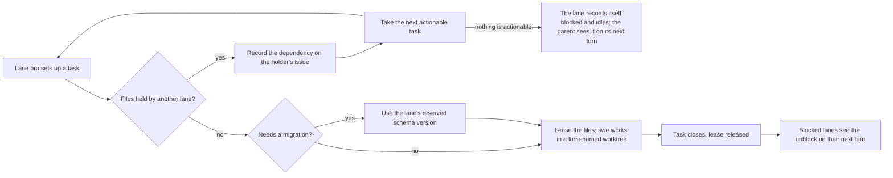
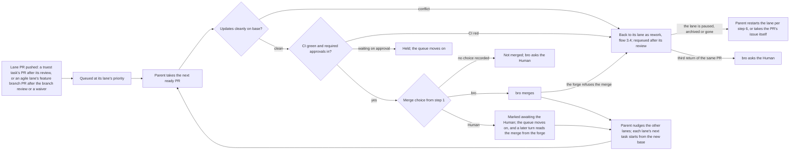
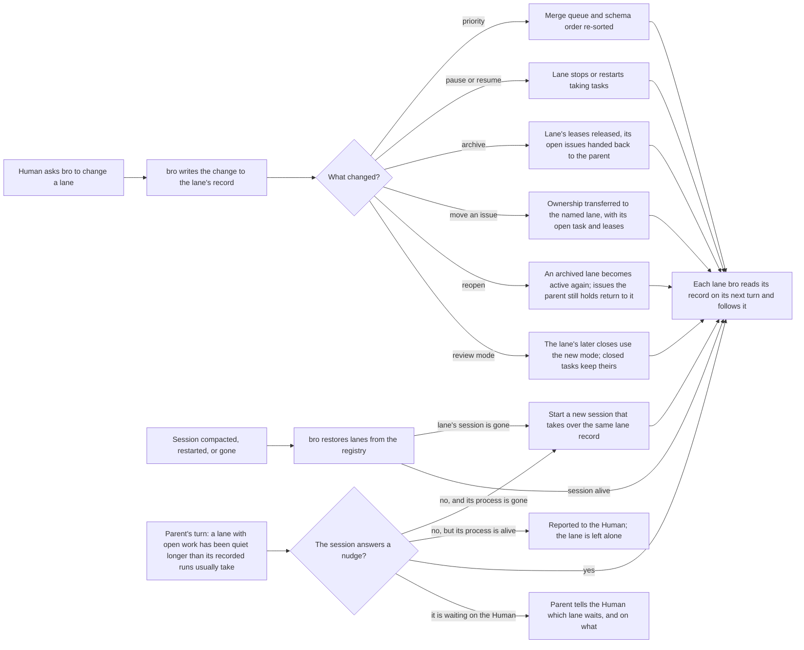

# Parallel lanes

Every case of flow 3.8 in [FLOWS.md](FLOWS.md): how TMB runs several independent streams of work as nested sessions, called lanes. Each lane runs its own bro, and a parent bro keeps the lanes from colliding and merges their PRs in order.

One piece has shipped (GH 3020): every session that records an intent, creates or adopts an issue, or provisions a task is recorded as a lane with the issues it touched, and the restore after a compaction lists them. Today an issue may sit in several lanes. Everything else below is planned (epic GH 3024), and each step names the issue that builds it. Recording each session as its own record, with a start, an end and a parent, is planned in GH 3255. A lane is then a session with owned issues and a priority.

## Scope

Claude Code and Desktop already start child sessions, carry messages between sessions, relay each child's end-of-turn report and list linked sessions. TMB uses those features as they are and doesn't redesign them. TMB adds only what its own model needs:

- a lane registry in the trajectory DB, the source of truth for every lane's state, so lanes can be recovered and changed at any time;
- who owns which issue, file and schema version;
- the gates every lane passes;
- the order in which lane PRs merge, and who merges them.

## When bro proposes lanes

The trigger is the shape of the work, not one phrase. Any of these signals leads bro to **propose** lanes; it never starts them unasked.

- The Human asks for parallelism: "do these in parallel", "split this up", "spin up sessions".
- The Human names a body of work: a milestone, an epic, a label or area, a list of issues, or a multi-part feature.
- bro sees two or more groups of open work that share no files and no blockers, each needing several tasks.
- A deadline, or "as fast as possible", on work that would take many turns one after another.

One change with independent parts stays in one session as parallel swe tasks (flow 3.1). Work that has to happen in order stays in one queue.

## 1. Who merges lane PRs

bro asks this first, before any planning, because a lane run ends with many PRs. The answer covers this lane run only. Making the choice permanent for the project is planned as a merge-policy setting the Human sets through /onboard (GH 3148); until it ships, the Human merges every PR outside a lane run. Under either answer, a PR whose gate requires a named GitHub approval, such as a prompt change, still waits for that approval.

- **No choice, no merge.** When a lane run has no recorded merge choice, its PRs are not merged, and bro asks the Human. Planned: GH 3148.
- **The choice is the parent's.** It counts only in the parent session that recorded it, so a lane can't merge by citing it. Planned: GH 3148, enforced by the per-session approval gate in GH 3028.

## 2. Split, check conflicts, set priority

bro groups the candidate issues by area and by the files they will likely touch, using the world model. Groups that would collide are merged into one lane or ordered. The Human then approves the lanes and gives each one a priority and a review mode.

- **One owner per issue.** Each issue belongs to at most one lane. Ownership always binds, and it lapses when the owner's lane is done or archived or its session has ended, so a frozen lane keeps its issues and a finished one frees them. An issue no lane owns is open to any session. When single ownership ships, an open issue that already sits in several lanes goes to the lane whose session most recently ran work on it, and a closed issue keeps no owner. Planned: GH 3025.
- **An issue can be transferred.** The Human moves an issue from one lane to another in the hub; the record names both lanes and the request, and the lane that gave up the issue keeps it in its history. A lane bro never takes an issue on its own.
- **Two lanes can be merged.** The Human can fold one lane into another: its issues, its open tasks and its queue entries move to the lane that stays, the folded lane is archived with the merge as the cause, and its session stops taking tasks. When the two lanes have different review modes, bro asks the Human which one the merged lane keeps.
- **Dependencies cross lanes.** An issue may be blocked by an issue another lane owns. A dependency that would make issues block each other in a circle is refused and goes to the Human. Planned: GH 3026.
- **Schema versions are reserved up front**, in priority order, so two lanes never claim the same number. A lane that needs a migration nobody foresaw takes the next free version when it needs one. A version already used in a commit never moves when priorities change. Planned: GH 3027.
- **Priority** is a tier, High, Medium or Low, plus an optional rank inside the tier when there are many lanes. The merge queue orders by tier, then rank, then the time a PR was queued. Priority also sets the order of the schema reservations. Planned: GH 3025, or GH 3148 if GH 3025 ships without it.
- **Review mode** is truest or agile per lane ([AGILE.md](AGILE.md)). The question opens with the default, such as "Default: truest (global review mode)". bro recommends a mode for each lane. In the question, the lanes it suggests for the other mode come already selected, each with a one-line reason: a prototype or MVP lane may go agile, while a bug-fix lane keeps truest. The Human accepts the set in one answer or edits it, and a lane left unselected takes the global mode. One question offers at most four choices, so with more than four lanes bro splits them across up to four questions, or asks with a checklist in prose. An agile lane builds on its own long-lived feature branch, and that branch enters the merge queue as one PR once its review passes or the Human waives it. Planned: GH 3025, with the lane lookup at the close and the lane's feature branch in GH 2225.

## 3. Start the lanes

The parent checks the environment once before any lane starts, so every lane doesn't hit the same setup failure.

- **The brief** holds the lane's owned issues, its priority, its review mode, its feature branch when the lane is agile, the merge choice, its branch naming and any reviewer rule that applies to its PRs.
- **Where a lane session runs.** Each lane session starts in the shared main checkout, which stays on the working branch. Only its tasks' worktrees hold changes, so lanes never switch the checkout under each other.
- **One hub.** The hub of a lane run is bro in a main session. A main session is any session started directly under the project's root, so the hub is not one particular session. It holds the merge choice and the one merge queue, and every lane reports to it, as nested sessions report to the session that started them. When the hub session is gone, the next main session under the root is the hub: it reads the run and its queue from the record and asks the Human for the merge choice once more, because an approval does not carry from one session to another, and showing what it restored tells the Human nothing was lost.
- **Nesting is the host's call.** TMB neither allows nor forbids a lane starting a session of its own: Claude Code decides, and asks the Human. A session started under a lane is recorded with its parent and works inside its parent's lane: it shares that lane's issues, review mode and priority, and its PRs still go to the hub's queue.
- **Lanes need a stable session id and the hub's project.** bro proposes lanes only where the host gives each session an id that survives a rename, a clear and a compaction, which the desktop app does. A lane's name is a label looked up by that id, so a rename shows everywhere the name is read. A lane also runs only where it shares the hub's project folder and trajectory DB, so bro never proposes a cloud or remote-host lane.
- **Lanes do not wait for file leases.** Until leases ship, the only guard against two lanes editing one file is how bro groups the issues, so bro arranges lanes for the fewest conflicts: it reads each issue's likely files from the world model, keeps issues that touch the same files in one lane, and tells the Human which overlaps it could not remove. The procedure for this is not in bro's prompts yet (GH 3307).
- **Registration survives compaction.** A lane restores its whole queue by its stable session id, not one issue. Planned: GH 3025, completing GH 3020.
- **Fresh worktrees install dependencies** before they build. Planned: GH 3146.
- **Lanes share notes** in the folder the host hands them. Planned: GH 1818.

## 4. Inside a lane

A lane runs flow 3.1, 3.2 or 3.9 as usual, with one difference: when it sets up a task, it respects what other lanes have claimed. When a claim blocks a task, the lane records the blocker and moves on to other work instead of negotiating over messages.

- **File leases** are taken when a task is set up and released when it closes. An edit to a file another lane holds is refused, whether or not the task declared the file. A lane that is taken over or archived releases its leases at once. Planned: GH 3027.
- **Branch and worktree names carry the lane name**, so parallel lanes never collide. Planned: GH 3027.
- **The DB is the source of truth for an unblock.** A message between sessions is only a nudge. Planned: GH 3026.
- **Token use rolls up per lane**, and a child's spend counts against its parent's cap. A lane that reaches its cap finishes its running task, takes no new one, and the parent tells the Human. Planned: GH 3027.

## 5. The merge queue

The parent takes lane PRs in priority order. A PR that conflicts or fails CI goes back to its lane. A PR waiting on a required approval is held, and the queue moves on to the next one that's ready.

- **The queue** records each lane PR with its lane, priority and state: queued, held, returned, awaiting the Human or merged. A returned PR keeps its priority. Planned: GH 3148.
- **A conflict is rework, not a rebase.** bro rebases a reviewed commit only when the patch stays the same ([GIT.md](GIT.md#rebasing-a-reviewed-task)). A PR that conflicts goes back to its lane as rework and is reviewed again.
- **This queue is TMB's.** It orders lane PRs before they merge. Where the repo also uses the merge queue of its hosting service, such as GitHub, that queue runs after this one.
- **One queue per repo.** A lane's issues may sit in several repos, and each repo's PRs are ordered on their own.
- **No remote, no queue entry.** In a repo with no remote, a lane's reviewed branch stays local and ready to merge. The Human merges it locally, and the queue records it as handed over.
- **A merge closes the PR's issues**, which unblocks their dependents in other lanes. Planned: GH 3026.
- **The queue is visible** on the dashboard's Lanes page, with lanes nested under their parent session. Planned: GH 3041 and GH 3028.

## 6. Change or recover a lane

Lanes live in the trajectory DB, not in any bro's memory. A lane run has one record: its parent session and its merge choice. Each lane has one record that points to its run: its parent, its session, its owned issues, its priority, its review mode and its state (active, paused, blocked, archived or done). Every change is written there first, with the request that caused it. A bro acts only on what the record says, so a change survives compaction, a restart, or a session that has dropped off the host's list.

- **Any of the Human's sessions can change a lane.** The Human can raise a priority, change a review mode or archive a lane from the parent or from the lane itself. A lane bro never changes another lane on its own. Planned: GH 3025, with the per-session approval gate in GH 3028.
- **A stuck lane is found, not waited on.** At each of its turns the parent lists the lanes that have open work and have been quiet longer than runs of that kind usually take, from the recorded run times the dashboard shows. No fixed limit decides it: the parent reads the lane's last events, judges whether it is working, waiting or stalled, and nudges the session. A busy session holds a message until its work finishes, so no answer is normal for a working lane. The parent takes a lane over only when its session's process is gone or the Human says so; a live, silent lane is reported to the Human. A lane records each question it is waiting on, since a message between sessions can approve nothing. The last recorded event comes from the session's own trajectory. Planned: GH 3255.
- **Archiving does not cut work off.** An archive waits for the lane's running task to close, unless the Human says to cancel it. A queued PR stays queued under the parent.
- **When a lane is done.** A lane is done when its issues are closed and its PRs merged. The run ends when every lane is done or archived, and its merge choice ends with it.
- **Records are kept.** An archived lane keeps its record and history, so it can be listed and reopened later. Archiving the Claude session itself is the host's feature, which bro may offer alongside.
- **A lane outlives its session.** A lane is its own record, held by one session at a time. When its session is gone, bro asks the Human, with a recommendation, whether a new session continues the lane or the lane ends there. A session that finds its lane now held by another stops taking tasks and tells the Human.
- **Recovery uses the stable session id.** A new session that takes over a lane gets its brief rebuilt from the record, not from a message. Planned: GH 3025.
