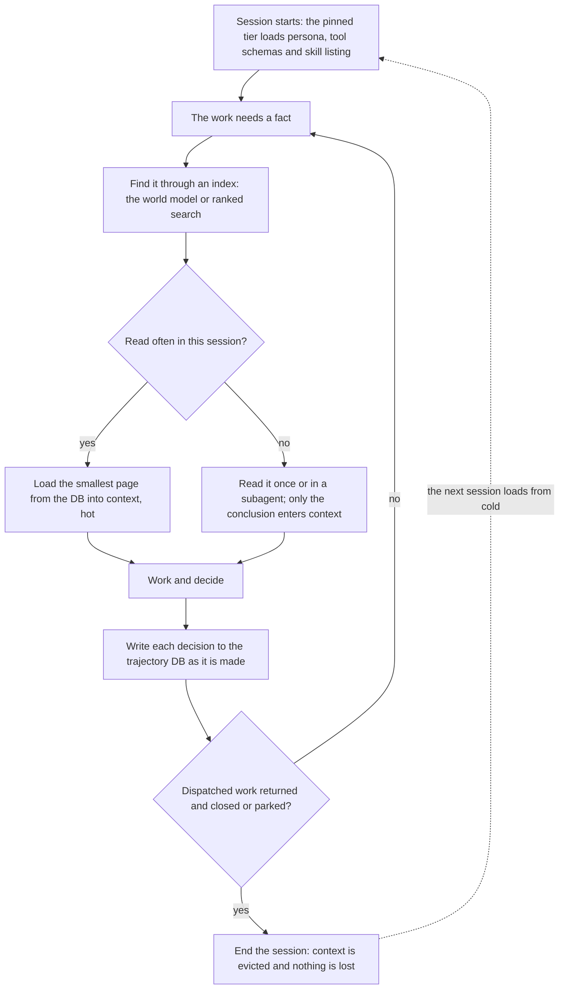

# Memory model

This is the key principle of TMB's memory system, for every agent. Any change to what an agent loads, keeps or stores follows it. How many tokens TMB saves depends on how well memory swaps from hot to cold, and loads from cold to hot when needed.

TMB's memory works like a computer's:

| Tier | Computer | TMB | Holds | Cost |
|---|---|---|---|---|
| Cold | Hard disk | Trajectory DB, world model included | Everything permanent: issues, decisions, specs, verdicts, the project map | Paid once per load |
| Hot | RAM | Session context | Only what the current work reads often | Paid on every call while it stays |
| Pinned | Kernel | Persona, tool schemas, skill listing | What every call needs to function | Paid on every call by every agent, never evicted |

**The DB is the only source of truth. Context is a disposable cache of it, written through and never the only copy. Every agent loads the smallest page it needs, and ends at a task boundary.**

One agent session moves memory between the tiers like this:

## Where the analogy breaks

These differences from real hardware are where the design decisions sit.

1. **Hot storage charges rent.** RAM costs nothing to hold, but context is re-read on every call, so an item costs its size times the calls left in the session. An item read once comes back as a conclusion and does not stay.
2. **No single item can be swapped out.** Context is append-only. The evictions that exist are ending the session, which is clean, and compaction, which is lossy and not ours to time. A subagent works like a separate process with its own address space: only its return value enters the caller's context. So most savings come from not loading an item and from ending sessions on time.
3. **Write through, never write back.** Context is volatile, so a decision reaches the DB when it is made. Evicting then loses nothing.
4. **Evict at boundaries.** A session ends when its dispatched work has returned and been closed or parked. The one timer that matters is prompt cache expiry: the next call then pays full price for the whole context, so a cold restart is usually cheaper.

Since nothing in hot storage can be evicted, a hook cuts the long output of bro's routine read-only shell commands to its head and tail before it enters context.

## Loading from cold

- **Pages, not the disk.** A read returns the smallest useful unit: a concise brief, a section, a limit and a cursor.
- **An index first.** The world model and ranked search snippets are the page table: they say where to read before anything is read.
- **The DB must be trustworthy.** A stale DB makes agents re-derive state or keep their own copies, which breaks the model. A memory file written to carry state between sessions signals a design flaw to fix.

## Where the trajectory DB lives

Cold storage is one DB per project, and one rule decides which `trajectory.db` the server and every hook open; each implements it once, and a lint fails on a third copy. `<plugin>` is the plugin's name (`tmb` when unset).

1. **`TRAJECTORY_DB_PATH`**, if set and the file exists.
2. **Walk up** from `CLAUDE_PROJECT_DIR`, else the working directory, collecting every ancestor `.claude/<plugin>/trajectory.db`. The walk never enters `$HOME` unless it started there, does not stop at `.git`, and skips a legacy DB that predates the current task schema. A `standalone` file beside a candidate ends the walk and wins; otherwise the **outermost** candidate wins, so a workspace of several repos shares one DB.
3. Otherwise **unresolved**; the server creates a fresh DB at `<CLAUDE_PROJECT_DIR or cwd>/.claude/<plugin>/trajectory.db`.

Under a test flag (`TMB_FORBID_LIVE_SYNC=1` or `TMB_TEST_RUN_ID`) the hooks never walk, and scripts never run the rule: they require an explicit `TRAJECTORY_DB_PATH`. The project root is the directory holding the resolved DB. Only the server migrates the DB; every other opener refuses an older schema. The doctor's `no_other_trajectory_dbs` warning lists other live DBs on the walk or up to four levels below the root, and `/onboard` offers to pick the workspace, make the session directory standalone, or remove empty strays.

| DB state | Meaning | Gates that can deny | Advisory hooks |
|---|---|---|---|
| unresolved | No DB anywhere (not onboarded), or no SQLite backend | Allow | Silent no-op |
| ok | The DB answers a read | Decide normally | Run normally |
| error | The DB resolved but the read failed: busy, corrupt, or unreadable | Deny with `BLOCKED: trajectory DB unavailable — <hook> could not read <path> …` | Allow, print one stderr line |

Failing closed on an unreadable DB keeps a gate from admitting what it cannot check; allowing when there is no DB keeps TMB out of projects that never onboarded.

## Every agent

| Agent | Keeps hot | Loads from cold when needed |
|---|---|---|
| bro | The Human's current ask and the work in flight | Issues, decisions, the project map; investigation goes to a subagent |
| swe | One task's spec and the files it edits | Its task brief, the world model |
| code-reviewer | One task's diff and its findings | Its task brief, validation history |
| consultant | One question | Discussions, the audit log, the world model |

## Design test

Ask these of any change that adds context, a tool result, a prompt line or a store:

1. Which tier does it live in, and is that the cheapest tier that works?
2. If it is hot or pinned, how many calls pay for it, and is it read often enough to earn that?
3. If it is hot, what evicts it, and is it already in the DB by then?
4. If it is loaded from cold, is that the smallest page, and can it be found through an index?
