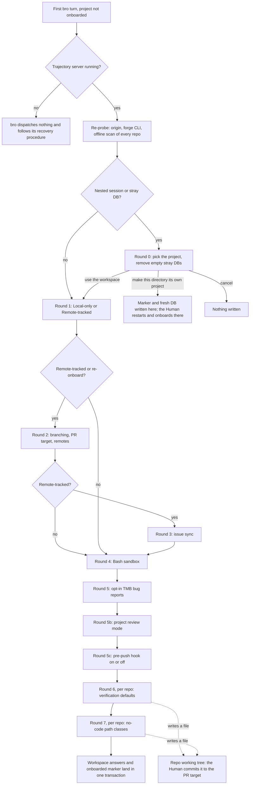

# First contact

Every case of flow 2.1 in [FLOWS.md](FLOWS.md): how `/onboard` learns a project's shape and policy, round by round.

The first bro turn on a project that isn't onboarded runs `/onboard` before any reply; the Human can re-run it any time.

| Round | Runs when | Asks | Leaves |
|---|---|---|---|
| 0 | The session is nested, or a stray trajectory DB exists | Which project to use (offered only when the session is nested); whether to remove empty stray DBs | the standalone choice, the stray DBs removed |
| 1 | Always | Project shape: Local-only or Remote-tracked | no value of its own: Remote-tracked keeps each repo's remotes and the sync choice, Local-only removes the recorded remotes and turns issue sync off |
| 2 | Remote shape, a re-onboard, or a workspace whose repos differ | Branching model and PR target (once, or per repo when they differ); then remotes | each repo's branching, PR target and remotes |
| 3 | Remote shape | Issue sync | the issue-sync setting |
| 4 | Always | Bash sandbox. Planned (GH 3360): the round is cut, and onboarding sets up no sandbox. Where TMB set one up before, the run asks once whether to keep it on or remove TMB's settings ([CONTAINMENT.md](CONTAINMENT.md)) | the sandbox setting |
| 5 | Always | Opt-in TMB bug reports (flow 5.1) | the consent, no by default |
| 5b | Always | The project review mode: truest, or agile on a long-lived feature branch ([AGILE.md](AGILE.md)); a stored mode is offered as Keep. Planned (GH 3281): bro recommends the project's mode, and the round then asks one mode per repo, truest, agile, exempt or the project's, each with bro's recommendation | the review mode, truest by default and untouched when the round is skipped; planned, agile by default, and each repo's mode |
| 5c | Always | Whether TMB's pre-push hook is on or off for the project ([INSTALL.md](INSTALL.md#session-start)); a stored setting is offered as Keep. Only the Human sets it, here; no agent tool can change it | the pre-push setting, on by default and untouched when the round is skipped |
| 6 | Per repo, when its PR target has no verification defaults and its environment profile names a lint, typecheck or test command | Which of the [environment profile](ENVIRONMENT.md)'s lint, typecheck and test commands every task runs | a verification-defaults file in the repo's working tree |
| 7 | Per repo, when bro finds docs or prompts files on its PR target | Which files are docs or prompts: let bro detect them, keep everything as code, or keep the current path classes. Every other file stays code | a path-classes file in the repo's working tree when the Human lets bro detect |

- **Fresh evidence each round.** bro checks the project again before each question and shows what it found beside the recommended option, which is listed first.
- **Re-runs keep what stands.** A re-run offers each current value first and changes a setting only when the Human picks a new one. A setting that is kept or not asked about keeps its stored value. The onboarded marker is the only record that a project is onboarded. No shape is stored, so switching from Local-only back to Remote-tracked detects the remotes again.
- **A Local-only first run asks no branching question.** Each repo gets GitHub Flow, with its default branch as the PR target.
- **Round 0 ends the run two ways.** Making the directory its own project writes the marker and a fresh DB there and stops, and the Human restarts and onboards in it. Cancel writes nothing. A stray DB is removed only if it is still empty when the answers land; a refusal is reported and the DB stays.
- **The marker lands last.** Round 2's branching and PR target are written per repo as each is answered. The workspace answers (remotes, issue sync, sandbox, bug reports, review mode, pre-push hook) land together with the marker. An interrupted run leaves the project not onboarded and keeps any repo policy already answered, which the re-run offers as the current value. The sandbox settings and the stray-DB removal are applied after that transaction; a failure there is reported and does not undo the marker.
- **Rounds 6 and 7 can skip a repo.** Each is skipped, with the reason shown, when the repo's PR target branch does not exist yet or its existing file is invalid. bro records the repo's environment profile before Round 6 when none exists. A skipped round is offered again on the next run.
- **Failures.** A failed step is reported word for word, retried once, and then the run stops. Picking Local-only on a project that pushes to GitHub or GitLab is questioned once, then accepted. Picking Remote-tracked when no repo has a remote onboards with a warning that nothing will sync.
- **The review-mode round recommends, the Human decides.** Planned (GH 3281). bro recommends a mode for the project and one per repo from what each shows, with the reason beside it ([GIT.md](GIT.md#multi-repo-workspaces)). The Human accepts the set in one answer or edits it. Agile is the fallback: it is what bro recommends when nothing is clear, and what applies when the round is skipped and no mode is stored. A re-run offers each stored mode as Keep and never changes one on its own.
- **Repos come from the scan.** First contact reads the repos the first scan found (flow 2.2). When no repo is known yet, bro runs the scan first.
- **Repo files stay the Human's to commit.** Rounds 6 and 7 apply on their own, outside that transaction. Each writes its file to the repo's working tree, never commits it, and never overwrites a different existing file. The file takes effect once the Human commits it to the PR target, because tasks read it from there.

## How a card is written

Each round asks through a card. A person who has never used TMB must be able to answer it from the card alone.

- **The feature comes first.** The question opens by saying what TMB does here, in one or two sentences, and then asks.
- **TMB's own names.** A card uses the name TMB uses everywhere, such as no-code task, path classes or review mode, and says what it means.
- **One option is recommended, with its reason.** The reason comes from what bro found in the project. A card that asks for consent recommends nothing.
- **Each option says its benefit and its risk or cost**, in one short line.
- **The card shows the actual values.** Paths, commands and branch names appear on the card, shortened with a count when the list is long.
- **Human language for what TMB works out.** An option that takes what bro found reads "Let bro detect".
- **Plain, short sentences.** Setting names and file formats stay off the card. Detail that does not help the choice goes in the lines bro prints above it.
- **A card only when the Human must choose.** A setting whose usual answer fits almost every project is applied without a card. The closing summary names each one, and a re-run of /onboard changes it. A card is shown only for a choice that is important and depends on the Human, with bro's recommendation as its first option. Two settings are applied without a card: every task runs each lint, typecheck and test command bro found in the repo, and bro finds each repo's docs and prompts files. The Human reviews them in the closing summary.
- **Repo modes get a card only in a workspace with more than one repo.** A project with one repo takes the project's mode and sees no repo-mode card.

Planned (GH 3327): today's cards ask without the opening sentence, most options carry no benefit or risk, and every round shows a card.
