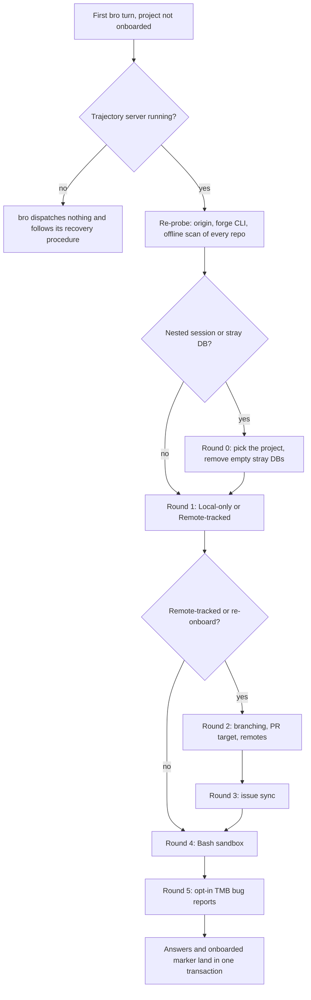

# First contact

Every case of flow 2.1 in [FLOWS.md](FLOWS.md): how `/onboard` learns a project's shape and policy, round by round.

The first bro turn on a project that isn't onboarded runs `/onboard` before any reply; the Human can re-run it any time.

| Round | Runs when | Asks | Leaves |
|---|---|---|---|
| 0 | The session is nested, or a stray trajectory DB exists | Which project to use; whether to remove empty stray DBs | the standalone choice, the stray DBs removed |
| 1 | Always | Project shape: Local-only or Remote-tracked | the shape |
| 2 | Remote shape, or a re-onboard | Branching model and PR target (once, or per repo when they differ); then remotes | each repo's branching, PR target and remotes |
| 3 | Remote shape | Issue sync | the issue-sync setting |
| 4 | Always | Bash sandbox | the sandbox setting |
| 5 | Always | Opt-in TMB bug reports (flow 5.1) | the consent, no by default |

- **Fresh evidence each round.** Each question shows the evidence behind its recommended option, listed first.
- **Re-runs keep what stands.** A re-run pre-selects the current values; identity is the onboarded marker alone.
- **All or nothing.** The answers land together with the marker, so an interrupted run leaves the project not onboarded.
- **Defaults from the repo.** With no verification defaults at the PR target, `/onboard` offers the [environment profile](ENVIRONMENT.md)'s lint, typecheck and test commands for the Human to commit.
