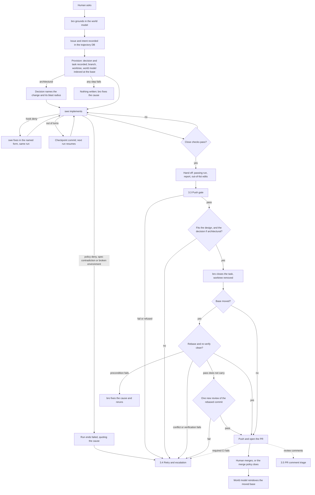
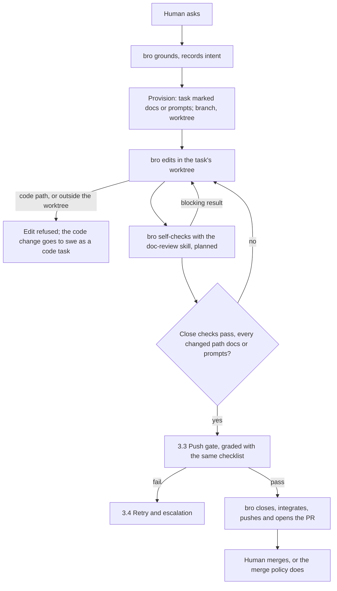

# Agent task handling

Every case of flows 3.1 to 3.5 in [FLOWS.md](FLOWS.md). A task is one of two kinds: a **code task**, which swe implements, and a **non-code task**, a docs or prompts change bro writes itself. Each kind's section lists its steps in handoff order: who owns each step, whether it is a deterministic check or a judgment, and what it guarantees to the next step. Both kinds end in the same push gate, retry paths and PR comment triage, and the [quality layers](#quality-layers) rules hold for every step. [GIT.md](GIT.md) covers where the task's work sits at each stage.

Every record a task leaves (issue, intent, decision, task, runs, verdicts and findings) lives in the trajectory DB, the cold store [MEMORY.md](MEMORY.md) describes; an agent reads it back from there, never from chat. When the world model reindexes, and why, is in [WORLD_MODEL.md](WORLD_MODEL.md#scan).

## 3.1 Code task

Any change that touches code. bro plans and gates, swe implements, code-reviewer reviews, and the Human merges. An architectural change (a new boundary or module, a schema or public API change, or an external side effect) is a code task with one more record: the decision bro writes at provision names the change and its blast radius, and bro's design judgment at task close weighs the change against it.

| Step | Owner | Method | What it guarantees and hands over |
|---|---|---|---|
| Ask | Human | judgment | intent: a requirement, pinned down with bro before anything is recorded when it is vague |
| Ground and intent | bro | judgment | bro starts each turn knowing its role and the open issue, and reads the world model before planning. The goal is saved in the trajectory DB before any branch exists: an issue, the Human's words as its intent, and the reuse-or-build call. bro picks the base itself, the PR target set at first contact or the unmerged branch the task stacks on, and names the branch automatically |
| Spec | bro | judgment | an actionable requirement: numbered success criteria, file list, verification commands and effort. bro's architecture judgment enters here. A spec too large for one swe run is split into linked tasks |
| Provision | bro | deterministic | a ready-to-work environment: one step records the decision and the task in the trajectory DB, fetches the base, cuts the branch and worktree, runs setup and indexes the world model there; any failure writes nothing. [GIT.md](./GIT.md#keeping-the-base-fresh) covers how the base is kept fresh |
| Implement | swe | deterministic | swe acts only after reading its brief, writes only in its worktree, and has each edit and commit checked as it lands. It does not rebuild the environment or rewrite the spec |
| Close | swe | deterministic | functionality-level quality: the task completes only when the changelog, stale-doc and leak checks, the verification commands (the repo's standing checks among them), every open finding's probe and the repo's close lints pass on the commit, with a report against every success criterion. A prompt-bearing task also passes the doc-review checklist of 3.2. A world-model check that no downstream caller breaks is planned (GH 3069) |
| Hand off | bro | deterministic | the commit goes to review only with a passing run and a report that covers it, plus the list of edits outside the file list |
| Review | code-reviewer | deterministic, then judgment | diff-level quality through 3.3: a recorded verdict for the commit, never read from reply text |
| Close task | bro | judgment | architecture-level quality: on a pass, bro judges fit to the design and the spec's intent, accepts or refuses out-of-scope edits, and closes the task. It re-runs no check and re-reviews no diff. The task worktree is removed at task close, before the merge |
| Integrate and push | bro | deterministic | a moved base is rebased and re-verified before the push. The review pass carries to the rebased commit only when the patch is unchanged, verification passes again and the base changes touch nothing the diff depends on. bro opens the PR |
| Merge | Human | judgment | the PR merges, unless the project's merge policy delegates it; an in-session merge closes the branch's tasks and the issues the PR closes |

- **A deny is a fix, not a stop.** It names the allowed form or what failed, and swe fixes it in the same run; a policy deny ends the run failed, quoting the deny.
- **Verification never fails open**, and only provisioning creates task branches and worktrees.
- **Every run is metered** (tokens, duration, why it stopped, what it resumed), and so is every deny and tool output. Overrun and silent-run advisories inform bro and stop nothing.

## 3.2 Non-code task

A change to docs or prompts only, which bro writes itself instead of sending to swe. bro marks the task docs or prompts when it provisions it; the task then runs 3.1's steps with bro in swe's place, and a doc review on both sides of the push gate.

| Step | Owner | Method | What it guarantees and hands over |
|---|---|---|---|
| Ask, ground and intent | Human → bro | judgment | as in 3.1 |
| Provision | bro | deterministic | as in 3.1, plus the task's kind, docs or prompts, which sets the paths bro may edit. The path kinds are read at the task's base commit, so the task cannot widen its own limits |
| Author | bro | deterministic | bro writes only inside the running task's worktree and only on paths of its kind; a code path, an edit in the main checkout or an unmarked task is refused, and the refusal names swe |
| Doc review | bro | judgment | planned (GH 3073): bro self-checks with the doc-review skill that swe and code-reviewer preload, so the change passes it before review: the rubric loaded at the base ref, each rubric criterion the change touches graded, each claim about the code checked against the source (another doc is not evidence), and the other prompt files scanned for contradictions, with one probe per claim and per rule in the report |
| Close | bro | deterministic | the same checks as swe's close in 3.1, recorded for the commit; every path the task changed since it left its PR target must be docs or prompts, and a code or mixed change is refused |
| Review | code-reviewer | judgment | through 3.3, graded with the same checklist loaded from the same base ref, so a change that passes the author's check passes review for the same reasons. The reviewer spot-checks only a claim the author recorded no probe for, or one it doubts, and fails only on a rubric fail, a false or unverifiable claim, or a contradiction; anything else is a nit |
| Close task, push, merge | bro, then Human | as in 3.1 | as in 3.1 |

Docs and prompts are the only non-code kinds today; other kinds will arrive as more review skills for code-reviewer, on the same steps. A swe task marked prompt-bearing stays a code task but runs the same checklist before it closes.

## 3.3 Push gate

The code-reviewer step of both task kinds, and the gate on every push. Each completed task gets its own reviewer, in parallel.

| Step | Owner | What it guarantees |
|---|---|---|
| Spawn | bro → code-reviewer | the reviewer gets anchors and a short note only, and starts only on a commit machines already vouch for: the right tip, a handoff for that commit, a passing run, a lint record current against the base. A conflict with the base does not refuse it and waits for the merge |
| Probe | code-reviewer | deterministic: reads the brief and the commit in a review worktree. A code task's diff is probed through the world model's dependents (a diff-level reviewer prompt is planned, GH 3059); a non-code task is graded with the doc-review checklist. It re-runs none of the author's checks, since the spawn already proved the lint record |
| Verdict | code-reviewer | judgment: a fail carries a blocking finding, a pass may carry nits and pre-existing findings; the reviewer's identity is observed, never claimed |
| Pass | bro | bro reads the verdict from its record and closes the task, integrates it if the base moved, pushes and opens the PR |
| Fail | bro | the fail has already reopened the task at high effort; bro surfaces it, holds the push and sends the task back to its author (swe, or bro itself on a non-code task) without asking the Human |

- **No push before review.** A push is denied unless each pushed task commit's newest verdict is a pass for that commit; a pass for an earlier commit, or one under a newer fail, does not count.
- **Append-only record.** Verdicts and findings are never rewritten; a repeated attempt is a new one, and the newest verdict decides.

## 3.4 Retry and escalation

| Cause | Path |
|---|---|
| Review fail | the task is already running at high effort; bro spawns a fresh swe or resumes the one that wrote the commit, or reworks a non-code task itself |
| Design misfit or other rework | bro amends the spec and reopens the task, recreating its worktree when missing |
| Wrong approach or integrate conflict | bro escalates the task and retries it as a fresh task, branch and worktree from the current base, carrying its open findings |
| Failed check after integrate, or a required CI check failing on the PR | bro reopens the same task naming the check, and its author reworks it; the check leaked, so it also moves into the step that owns it |
| Rebased commit whose review pass does not carry | one new code-reviewer pass on the rebased commit; the author reworks only if it fails |
| Broken environment | swe ends its run failed naming the environment rather than repairing it; bro fixes the environment, reopens the task and spawns swe again |
| Refused reviewer spawn | bro fixes the cause before any reviewer runs |

- **Rework is bounded.** Two fails since the last pass stop further swe runs until bro records a root-cause analysis and makes the change it names; no run count denies on its own. Design drift ends the task, and bro redesigns it as a new one. Nothing waits on the Human.
- **Long work hands back.** A swe out of turns commits and hands back a checkpoint instead of failing, and the next run resumes from what is left.

## 3.5 PR comment triage

- **Triggers.** A PR-activity notification, a CI-monitor event, the Human pointing at the PR, or bro's own check of a PR it opened.
- **Stored once.** bro fetches the comments and stores each once on the PR's linked issue; a per-PR cursor means a re-fetch returns only newer comments.
- **Dispatched without waiting.** bro groups the task-worthy comments and sends each group through 3.1, or 3.2 when it touches only docs or prompts: it reopens the closed task that owns the touched surface, on the same branch, or opens a new task on that issue.
- **Intent stays the Human's.** A comment that would change the issue's intent or scope is not dispatched; bro records it on the issue and asks the Human.
- **Unresolvable PRs are skipped.** When the PR or its issue cannot be resolved, bro records the gap and skips the PR.

## Quality layers

The rules behind every step table above. Each task is built on two axes. The first is a responsibility boundary: each step owns one level of quality (intent for the Human; environment, spec and architecture for bro; functionality for the author; the diff for code-reviewer) and hands the next a ready state. The second is method: deterministic or judgment. bro, swe and code-reviewer never overlap in responsibility or work, because overlap wastes resources: each check has exactly one owner, and no step redoes another step's check.

- **Gated handoffs.** Every handoff carries its typed contract, and a gate refuses the handoff when the artifact is missing.
- **Leaks point upstream.** When a later step or CI catches a cheap check, the fix is to move that check into the step that owns it, not to do more rework. The leak rate per step is the health metric (planned, GH 3053).
- **CI confirms; it does not discover.**
- **Failures return to their owner.** A failed check goes back to the author, a review finding goes back to the author at higher effort, and a design misfit goes back to bro's spec. None of these waits on the Human.

## Debugging a stuck task

| Symptom | Where to look |
|---|---|
| swe will not start | The spawn needs a provisioned task with a spec, at the task's effort; after two review fails it also needs a recorded root-cause analysis and the change it names |
| bro's edit is refused | The edit is outside a running non-code task's worktree, the task is unmarked, or the path is not of the task's kind at its base commit; a code path goes to swe |
| The task closed but did not complete | The close checks on the commit: the run's recorded failure names which one. A non-code task also fails when any changed path is code |
| The reviewer was refused | The commit is not the task's tip, has no handoff, has no passing run, or its lint record is missing, failing or stale against a moved base. A conflict with the base never refuses it |
| The push is denied | A pushed task commit lacks a passing verdict of its own, or a newer fail stands over it |
| A task keeps failing review | The open findings and their probes; after two fails, the root-cause analysis bro recorded |
