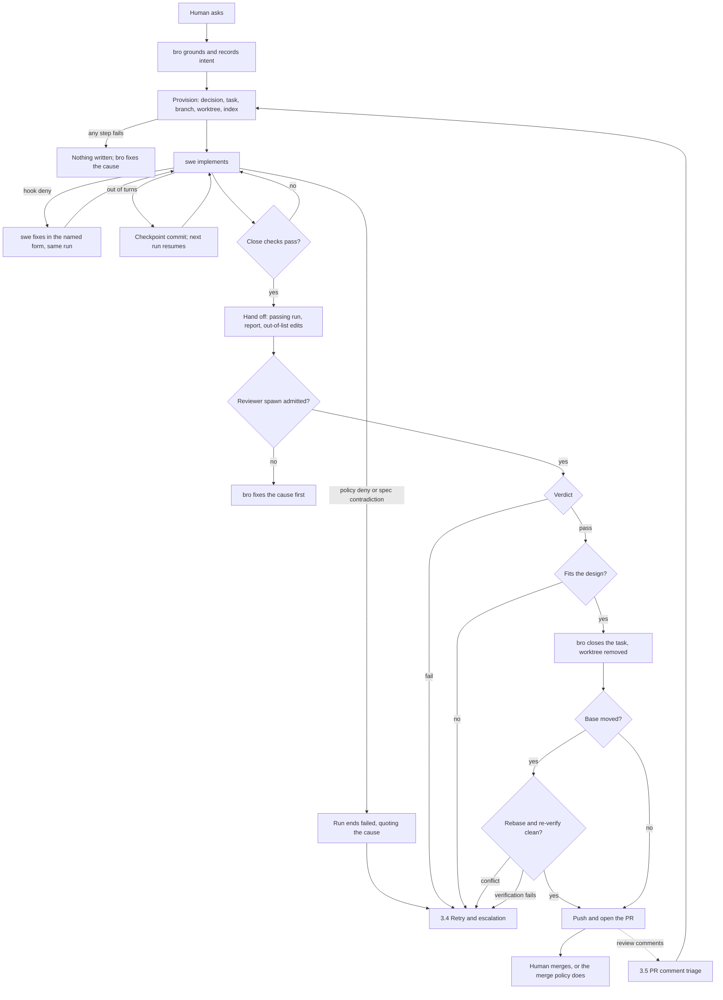

# Agent task handling

Every case of flows 3.1 to 3.5 in [FLOWS.md](FLOWS.md): the quality layers every task is built on, what each step of a task guarantees, where a task goes when a step fails, and how to tell why a task is stuck. [GIT.md](GIT.md) covers where the task's work sits at each stage.

## Quality layers

Every task is built on two axes. The first is a responsibility boundary: each layer owns one level of quality and hands the next a ready state. The second is method: deterministic or judgment. bro, swe and code-reviewer never overlap in responsibility or work, because overlap wastes resources: each check has exactly one owner, and no layer redoes another layer's check.

A change is reviewed as code or as non-code. Each kind has its own layers.

### Code review

| Layer, in handoff order | Owns | Method | Hands over (contract) |
|---|---|---|---|
| **Human** | intent. The Human is the outer layer and merges each PR, unless the project's merge policy delegates merging | judgment | a requirement |
| **bro (environment)** | a ready-to-work environment: a clean worktree cut from the latest base, a passing build, and a world model indexed at that base | deterministic | the worktree, the base commit and the world-model commit |
| **bro (spec)** | an actionable requirement: intent, files, checks and success criteria. bro's architecture judgment enters here | judgment | the spec |
| **swe** | functionality-level quality: every deterministic check in its scope passes (lint, word and size limits, type checks, unit tests, changelog fragment), and the world model shows no downstream caller breaks (planned, GH 3069). It does not rebuild the environment bro handed over or rewrite the spec | deterministic | ready-to-review: a passing check run recorded on the commit, plus a report against every success criterion |
| **code-reviewer (probes)** | diff-level quality: whether the diff breaks other behavior, probed through the world model's dependents of the diff (diff-level reviewer prompt planned, GH 3059). It does not re-run swe's checks | deterministic | the probes and their results |
| **code-reviewer (verdict)** | whether a behavior change the probes show is a bug | judgment | a recorded verdict with its findings and probes |
| **bro (architecture)** | architecture-level quality: whether the change fits the design and the spec's intent, judged at task close. It re-runs no checks and re-reviews no diff | judgment | a decision, then the push |

### Non-code review

A change to prompt or docs files, or a task marked prompt-bearing, also gets a doc review: one checklist that author and reviewer load from the same base ref, so a change that passes the author's check passes review for the same reasons. Docs are the only non-code kind today; other kinds will arrive as more review skills for code-reviewer, on the same layers.

| Layer, in handoff order | Owns | Method | Hands over (contract) |
|---|---|---|---|
| **author: bro or swe** | the change passes the checklist before review. bro authors its own specs and no-code changes; swe authors a prompt-bearing task. Each rubric criterion the change touches is graded, each claim about the code is checked against the source (another doc is not evidence), and the other prompt files hold no contradiction | deterministic | the checked change, with one probe per claim and per rule in the report |
| **code-reviewer** | the verdict on the author's results and its own probes; it spot-checks only a claim the author recorded no probe for, or one it doubts | judgment | a recorded verdict. It fails only on a rubric fail, a false or unverifiable claim, or a contradiction; anything else is a nit |

### Rules for both

- **Gated handoffs.** Every handoff carries its typed contract, and a gate refuses the handoff when the artifact is missing.
- **Leaks point upstream.** When a later layer or CI catches a cheap check, the fix is to move that check into the layer that owns it, not to do more rework. The leak rate per layer is the health metric (planned, GH 3053).
- **CI confirms; it does not discover.**
- **Failures return to their owner.** A failed check goes back to swe, a review finding goes back to swe at higher effort, and a design misfit goes back to bro's spec. None of these waits on the Human.

## 3.1 Code-touching task

| Step | Actor | What it guarantees |
|---|---|---|
| Ask and ground | Human → bro | bro starts each turn knowing its role and the open issue, and reads the world model before planning |
| Intent | bro ↔ Human | the Human confirms the base branch and branch name; the issue, its intent and the reuse-or-build call are recorded before any branch exists |
| Provision | bro | one step records the decision and a task with a spec (numbered success criteria, file list, verification commands, effort), then fetches the base, cuts the branch and worktree, runs setup and indexes the world model there; any failure writes nothing. A spec too large for one swe run is split into linked tasks |
| Implement | swe | swe acts only after reading its brief, writes only in its worktree, and has each edit and commit checked as it lands |
| Close | swe | the task completes only when the changelog, stale-doc and leak checks, the verification commands (the repo's standing checks among them), every open finding's probe and the repo's close lints pass on the commit, with a report against every success criterion |
| Hand off | bro | the commit goes to review only with a passing run and a report that covers it, plus the list of edits outside the file list |
| Review | code-reviewer | 3.3: a recorded verdict for the commit, never read from reply text |
| Close task | bro | on a pass, bro judges fit to the design, accepts or refuses out-of-scope edits, and closes the task; the task worktree is removed at task close, before the merge |
| Integrate and push | bro | a moved base is rebased and re-verified before the push; a push needs a passing review for every task commit; bro opens the PR |
| Merge | Human | the PR merges, unless the project's merge policy delegates it; an in-session merge closes the branch's tasks and the issues the PR closes |

- **A deny is a fix, not a stop.** It names the allowed form or what failed, and swe fixes it in the same run; a policy deny ends the run failed, quoting the deny.
- **Verification never fails open**, and only provisioning creates task branches and worktrees.
- **Every run is metered** (tokens, duration, why it stopped, what it resumed), and so is every deny and tool output. Overrun and silent-run advisories inform bro and stop nothing.

## 3.2 Architectural change

The task runs 3.1 unchanged; the difference is the decision bro records at provision, naming the change and its blast radius, and bro's design judgment at task close weighs the change against that decision.

## 3.3 Push gate

| Step | Actor | What it guarantees |
|---|---|---|
| Spawn | bro → code-reviewer | the reviewer gets anchors and a short note only, and starts only on a commit machines already vouch for: the right tip, a passing run, a current lint record; a conflict with the base waits for the merge |
| Probe | code-reviewer | deterministic: reads the brief and the commit and probes the diff's dependents through the world model in a review worktree; it runs no lints, since the spawn already proved swe's lint record |
| Verdict | code-reviewer | judgment: a fail carries a blocking finding, a pass may carry nits and pre-existing findings; the reviewer's identity is observed, never claimed |
| Pass | bro | bro reads the verdict from its record and closes the task, integrates it if the base moved, pushes and opens the PR |
| Fail | bro → swe | the fail has already reopened the task at high effort; bro surfaces it, holds the push and respawns swe without asking the Human |

- **No push before review.** A push is denied unless each pushed task commit's newest verdict is a pass for that commit; a pass for an earlier commit, or one under a newer fail, does not count.
- **Append-only record.** Verdicts and findings are never rewritten; a repeated attempt is a new one, and the newest verdict decides.

## 3.4 Retry and escalation

| Cause | Path |
|---|---|
| Review fail | the task is already running at high effort; bro spawns a fresh swe or resumes the one that wrote the commit |
| Design misfit or other rework | bro amends the spec and reopens the task, recreating its worktree when missing |
| Wrong approach or integrate conflict | bro escalates the task and retries it as a fresh task, branch and worktree from the current base, carrying its open findings |
| Refused reviewer spawn | bro fixes the cause before any reviewer runs |

- **Rework is bounded.** Two fails since the last pass stop further swe runs until bro records a root-cause analysis and makes the change it names; no run count denies on its own. Design drift ends the task, and bro redesigns it as a new one. Nothing waits on the Human.
- **Long work hands back.** A swe out of turns commits and hands back a checkpoint instead of failing, and the next run resumes from what is left.

## 3.5 PR comment triage

- **Triggers.** A PR-activity notification, a CI-monitor event, the Human pointing at the PR, or bro's own check of a PR it opened.
- **Stored once.** bro fetches the comments and stores each once on the PR's linked issue; a per-PR cursor means a re-fetch returns only newer comments.
- **Dispatched without waiting.** bro groups the task-worthy comments and sends each group to swe through 3.1: it reopens the closed task that owns the touched surface, on the same branch, or opens a new task on that issue.
- **Intent stays the Human's.** A comment that would change the issue's intent or scope is not dispatched; bro records it on the issue and asks the Human.
- **Unresolvable PRs are skipped.** When the PR or its issue cannot be resolved, bro records the gap and skips the PR.

## Debugging a stuck task

| Symptom | Where to look |
|---|---|
| swe will not start | The spawn needs a provisioned task with a spec; a third rework of the same approach also needs a recorded root-cause decision |
| swe closed but the task did not complete | The close checks on the commit: the run's recorded failure names which one |
| The reviewer was refused | The commit is not the task's tip, has no passing run or lint record, or conflicts with the base |
| The push is denied | A pushed task commit lacks a passing verdict of its own, or a newer fail stands over it |
| A task keeps failing review | The open findings and their probes; after two fails, the root-cause analysis bro recorded |
