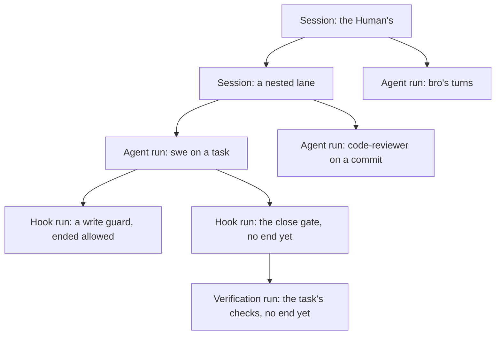
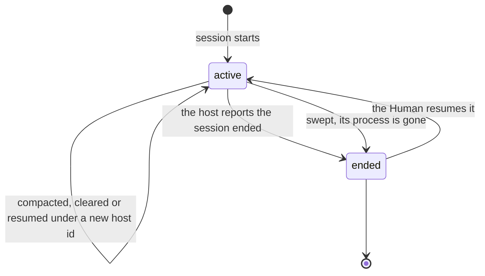
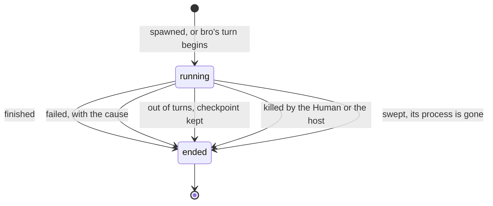
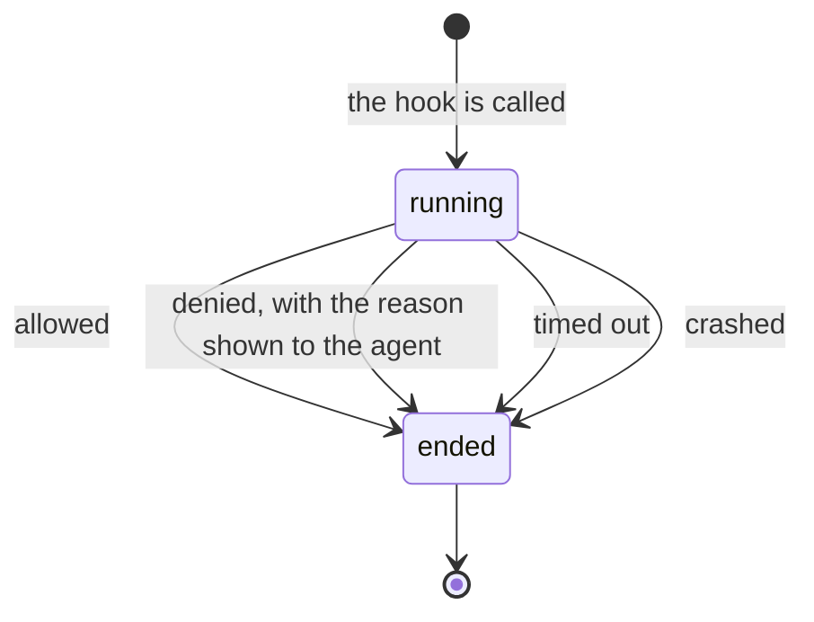
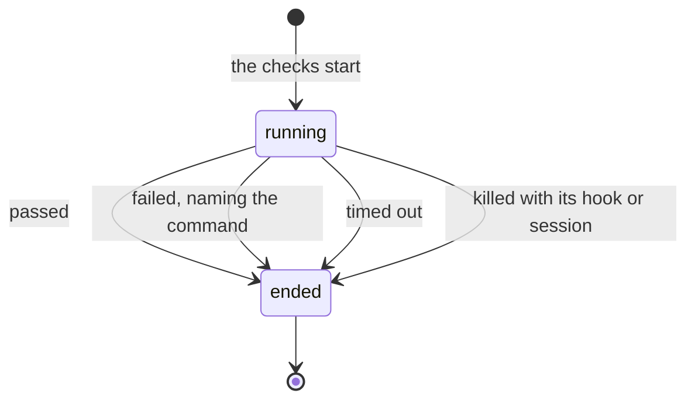
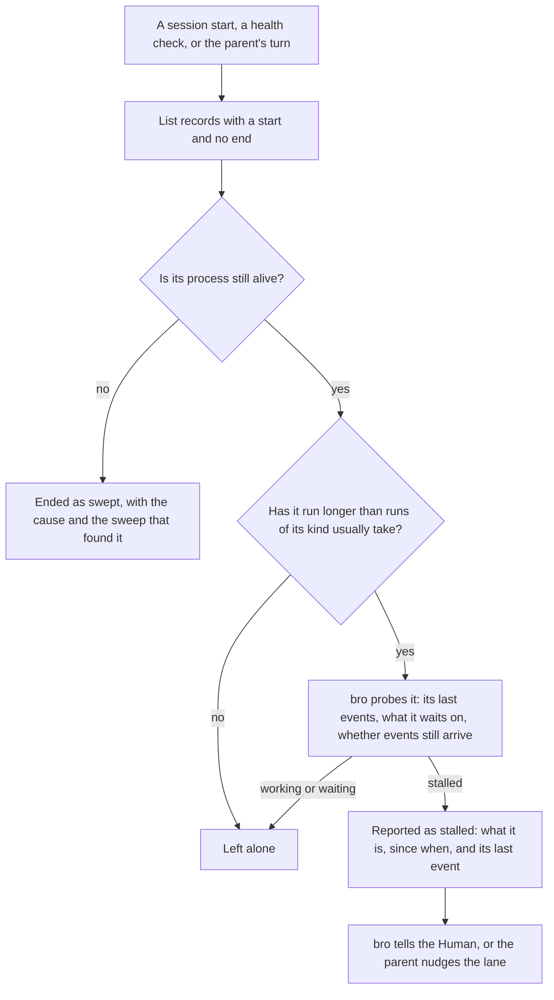

# Trajectories

How the trajectory DB records every long-running thing TMB starts, so that "why is this still running?" and "why did this stop?" are answered by reading records, not by guessing. A task's trajectory is in [TASKS.md](TASKS.md#task-lifecycle); this page covers the four things a task runs inside: sessions, agent runs, hook runs and verification runs.

Planned (GH 3255). Today an agent run and a verification run are each one record that is filled in when the run ends, a hook call is recorded only after it returns, and a session has no record of its own, so a hang leaves nothing behind and a dead run looks like a live one.

## The rule

- **Start is a fact.** Each of the four writes an event when it starts, before it does any work.
- **End is a second event.** It carries an outcome from a fixed list and, when the outcome is not a clean finish, a cause from a fixed list.
- **Each names its parent.** A nested session names the session that started it. An agent run names its session. A hook run or a verification run names the agent run or session it ran in.
- **Writes stay cheap.** SQLite takes one writer at a time, so a record on a hot path is one small insert, and the detail a record keeps is weighed against what the write costs the session.
- **Nothing is edited.** A start is never updated into an end. A record with a start and no end is still running, or was killed before it could say so.

The chart is one moment of a real tree. To find what is stuck, follow the records with no end downward: the lowest one is where the work stopped.

## Sessions

Every session is recorded, not only a lane. A lane is a session with owned issues and a priority ([LANES.md](LANES.md)).

- **One stable id.** A session keeps one id across a compaction, a clear and a resume, and each of those is an event that changes no state.
- **The parent link is written by the parent.** Starting a nested session records the child and its parent at once, so a child that never takes a turn is still on record.
- **Ended is not final.** A session the Human resumes becomes active again, and the resume is an event.

## Agent runs

One run is one spawn of swe, code-reviewer or a consultant, or one stretch of bro's own turns.

- **A resume is a new run** that names the run it resumes, so a chain of resumes reads as one line, like a chain of task retries.
- **A refused spawn is recorded too.** A spawn a gate refuses writes a start and an end with the refusal as its cause, so "why did swe never start?" has a record.
- **The task's story joins here.** A task event names the agent run that made the move, so a task that failed points at the run, and the run points at what it was doing.

## Hook runs

One run is one hook or gate answering one tool call or session event.

- **Every run is recorded, lightly.** An allowed run keeps only its two times and its outcome. A denied, timed-out or crashed run also keeps its detail: what it was guarding, the reason, and the error.
- **The start is written before the work.** It is the one write that may not be deferred, because a hook that hangs never reaches its end.
- **A fail-open is not silent.** A hook that times out or crashes and lets the call through writes that outcome, so "the gate did not run" is on record.
- **This replaces hook telemetry in the audit log.** The audit log keeps workflow events only; GH 3229 moves the hook rows here.

## Verification runs

One run is one execution of a task's checks or its close lints.

When a verification run outlives the hook that started it, the sweep ends it with the outcome killed, so a close that was killed never leaves a run that looks as if it is still going.

## Finding and ending what is stuck

- **Last activity needs no heartbeat.** It is the newest event under the record: a hook run under an agent run, an agent run under a session.
- **A sweep ends a record; it never deletes one.** The swept record keeps its start, and its end names the sweep.
- **Stalled is a judgment, not a limit.** No fixed time ends or flags a run. bro compares a run with the past month's run times of its kind, the same statistics the dashboard shows. Past the median bro makes a light probe: it reads the run's latest events without interrupting it. Past the 75th percentile it makes a deeper one: it asks the agent for its state and tells the Human. With no recorded runs of the kind, bro flags nothing on time alone. Today the recovery step still fails a running task after a fixed six hours with no open run; that window goes (GH 3260). A long test run and a hang look the same from outside, so bro reads the run's events before it calls it stalled.
- **Stalled is not dead.** A run whose process is alive is reported, never ended. Only the Human or the host kills it.
- **Waiting is a recorded state of mind.** An agent that is waiting on the Human or on another lane writes what it waits on, so a quiet session reads as waiting, not stuck.

## Nothing is skipped silently

A step that is skipped or runs degraded writes an event with its cause: a gate that allowed because it could not read its record, a sync that did not happen because no repo was named, a search that fell back because its model failed to load. The event is attached to the session or agent run it happened in.

## Debugging with it

| Question | Where the answer is |
|---|---|
| Why does this hook run forever? | The hook run with a start and no end: what it guards, and the verification run under it, if any |
| Why does this nested session never end? | Follow its records with no end downward; the lowest one is where it stopped |
| Is this run alive or dead? | Whether its process is gone, in the sweep's report; for a live one, its run time against the usual for its kind and its last event |
| Why did swe never start? | The agent run's end: a refused spawn names the gate and the reason |
| Why did the gate let this through? | The hook run's outcome: allowed, or timed out or crashed and failed open |
| Why three re-runs of this task? | The task's events, each naming its agent run and cause ([TASKS.md](TASKS.md#task-lifecycle)) |
