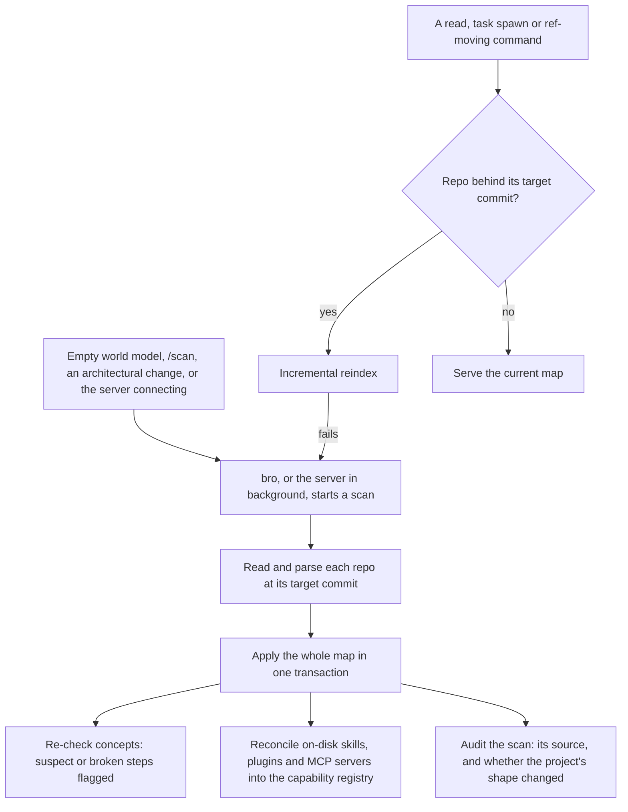

# World Model

Bro is the architect of every project it works on. The world model is the stable, queryable picture of the project bro reasons from: built by `/scan`, kept fresh on read, and consulted at every cold start. It is also the middle of the three knowledge layers TMB develops itself by ([README.md](README.md)): it holds the relationships these docs leave out and the code leaves implicit.

This page covers purpose, boundaries and the reasons behind the design. Its tables, tools and parsers are in the code; ask the world model itself where.

## Substrate

The world model lives in the trajectory DB, beside the workflow audit but with no link into it. It is a derived cache: every row can be rebuilt from git, so a scan can always start over.

| | World model | Workflow records |
|---|---|---|
| Content | The project's map: directories, files, symbols and concepts | Issues, tasks, discussions, validation, plugin metadata |
| Answers | "What does this project look like?", "Where does X live?", "Who calls X?" | "What did we decide?", "What's open?", "What did swe commit?" |

## Layers

- **Directories and files.** Each directory carries a summary: its README when it has one, else a structural summary built from its contents. Each file carries a one-line purpose from its header, or a structural fallback; a purpose written by the swe that built the file outranks extraction. Summaries come from file contents, so every read frames them as untrusted.
- **Symbols.** An index of each file's definitions and the edges between them: calls, imports, table reads and writes, hook order, test coverage and bundle sources. It answers "where is X" and "who calls X" without re-reading code.
- **Concepts.** Agent-written flows, subsystems and invariants, each an ordered list of steps anchored to symbols or files, plus claims checked against the index. Every scan re-checks them and marks a step whose code moved as suspect, or broken when its code is gone. Concepts are the bridge from a design page here to the code that carries it out.

## Design rationale

- **Own index, exact references from LSP.** TMB builds its own index because no off-the-shelf indexer covered this repo's shell and SQL. The index resolves many calls by name and says so in its answers; an edit that needs exact references, such as a rename, uses Claude Code's LSP tool.
- **Anchors are stable keys.** A concept step stores the symbol's identity (repo, path, kind and qualified name), not a row id, and resolves it at read time. A re-parse never orphans a step; a rename breaks the anchor by design, so the concept is flagged for review instead of silently following the wrong code.
- **swe proposes, review admits.** The swe that built a flow proposes its concepts in the completion report. A scan applies a proposal only once its task has a passing code-reviewer verdict and every anchor and claim checks out. Bro and consultants write concepts directly.
- **Indexed from git, never the working tree.** Each repo is indexed from its target commit, the fetched target branch or else `HEAD`, so every session and worktree reads the same map. Reads, spawns and commands that move refs bring the index forward incrementally; a full rebuild is the fallback.
- **One transaction per write.** A scan reads and parses first, then applies everything at once, so a reader sees the old map or the new one, never a mix.

## Scan

Every case of flow 2.2 in [FLOWS.md](FLOWS.md).

A capability added out of band shows up in the registry at the next scan, so the [cheatcode lifecycle](CHEATCODES.md) sees it.

## Consumers

Bro queries the world model directly on cold starts and "where does X live" questions; the plugin's `CLAUDE.md` says which query fits which question. The task brief resolves a task's scope against it and bundles the result with the task and its discussion, so swe gets one read instead of several. The dashboard reads the same map.
