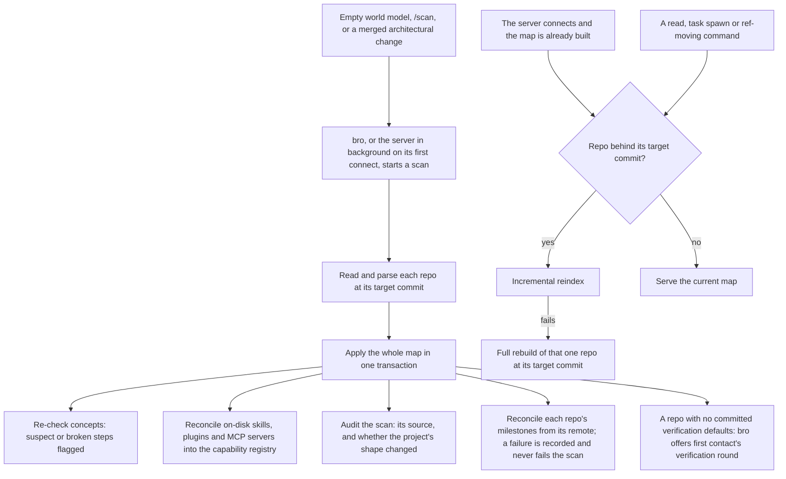
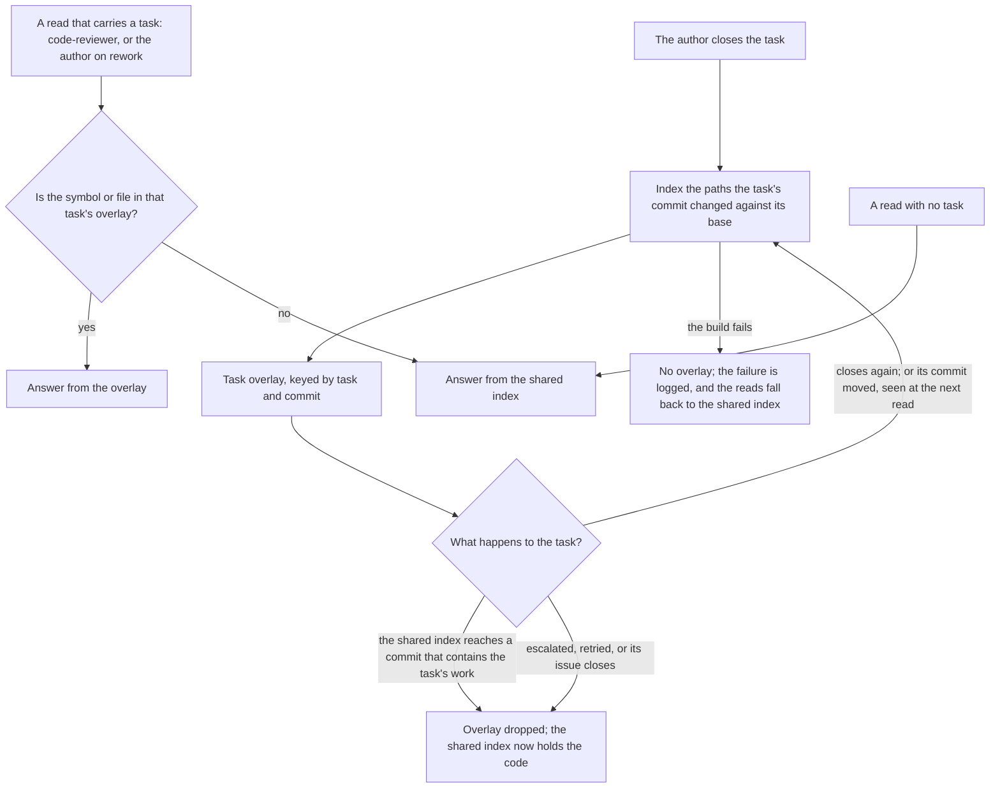

# World Model

Bro is the architect of every project it works on. The world model is the stable, queryable picture of the project bro reasons from: built by `/scan`, kept fresh on read, and consulted at every cold start. It is also the middle of the three knowledge layers TMB develops itself by ([README.md](README.md)): it holds the relationships these docs leave out and the code leaves implicit.

This page covers purpose, boundaries and the reasons behind the design. Its tables, tools and parsers are in the code; ask the world model itself where.

## Substrate

The world model lives in the trajectory DB, beside the workflow audit but with no link into it. Its index is a derived cache: every index row can be rebuilt from git, so a scan can always start over. Concepts are the one part agents write, and they cannot be rebuilt from git. Because the world model is not part of the trajectory, it moves to its own file beside the trajectory DB (planned, GH 3225). [ERD.md](ERD.md#planned-for-the-world-model-file) lists what moves.

- **Concepts live only in the world-model file.** The index is derived from git; concepts are written by agents and point only at files and symbols of the index, so nothing in the trajectory DB links to them and no copy is kept there. So a rebuild throws the index away, builds it again and keeps the concepts. It copies them into the new file and re-checks each one against the new index. A concept whose anchors are gone is marked broken and is never dropped. At the move out of the trajectory DB the existing concepts are copied the same way. Renaming a concept keeps its identity, and a concept is marked `retired` by a write, never deleted. A `retired` concept is left out of search and of every read that does not ask for it, so it never crowds a live answer.
- **Scans and reindexes are trajectory.** That a scan ran, when, why and how it ended is a fact about the work, so it is recorded in the trajectory DB. The world-model file keeps only the latest state per repo.
- **Two files, no shared transaction.** The commit a repo is indexed at, and the indexer version it was built with, are stored in the world-model file and written in the same transaction as the index, so an absent or emptied file always reads as never indexed. The trajectory DB keeps no copy a reader may trust for freshness.
- **A world model that cannot be read is not green.** When the world-model file is missing, unreadable or older, writes and workflow actions are denied, as they are when the trajectory DB is unreadable ([MEMORY.md](MEMORY.md#when-the-health-check-is-not-green)); the health check and the scan that repairs it stay allowed. On a version change the file's index is discarded and rebuilt from empty: a clean rebuild of a 4,200-file repo takes 16 to 32 seconds in the recorded daily checks, a figure that may leave out embeddings.

| | World model | Workflow records |
|---|---|---|
| Content | The project's map: directories, files, symbols and concepts | Issues, tasks, discussions, validation, plugin metadata |
| Answers | "What does this project look like?", "Where does X live?", "Who calls X?" | "What did we decide?", "What's open?", "What did swe commit?" |

## Layers

- **Directories and files.** Each directory carries a summary: its README when it has one, else a structural summary built from its contents. Each file carries a one-line purpose from its header, or a structural fallback. Summaries come from file contents, so every read presents them as untrusted.
- **Symbols.** An index of each file's definitions and the edges between them: calls, imports, table reads and writes, hook order, test coverage and bundle sources. It answers "where is X" and "who calls X" without re-reading code.
- **Concepts.** Agent-written flows, subsystems and invariants, each an ordered list of steps anchored to symbols or files, plus claims checked against the index. Every scan re-checks them and marks a step whose code moved as suspect, or broken when its code is gone. Concepts are the bridge from a design page here to the code that carries it out.

## Design rationale

- **Own index, exact references from LSP.** TMB builds its own index because no off-the-shelf indexer covered this repo's shell and SQL. The index links a reference to a definition only on proof: a resolved import, an explicit path, a definition that is the only one of its name, a known receiver type, or the same file. A bare-name match with no such proof stays unlinked, and an answer says which references it could not resolve, so the index never guesses. An edge whose target is never a symbol, such as a config key, is kept by name and marked as such, apart from both. An edit that needs exact references, such as a rename, uses Claude Code's LSP tool.
- **Anchors are stable keys.** A concept step stores the symbol's identity (repo, path, kind and qualified name), not a row id, and resolves it at read time. A re-parse never orphans a step; a rename breaks the anchor by design, so the concept is flagged for review instead of silently following the wrong code.
- **bro owns concepts.** For any work it closes, bro writes or updates the concepts that work changed, as part of its judgement at the close, beside its call on whether the commit follows the design. That covers agile and exempt work, where no task gets its own review. A swe may still propose concepts in its completion report; a proposal is accepted only when the review that covers its task passes and every anchor and claim checks out. That review is the task's own, or the review of the feature branch the task was folded into. A waived review accepts no proposal. Today a proposal needs the task's own pass, so in agile mode every proposal expires unapplied. Consultants write concepts directly.
- **Indexed from git, never the working tree.** Each repo is indexed from its target commit, which is the fetched target branch, or the local target branch when the repo has no remote. So every session and worktree reads the same map. Today a repo with no remote is indexed at whatever is checked out. Reads, spawns and commands that move refs bring the index forward incrementally; a full rebuild is the fallback. A task's own commit is indexed too, from git, into its [task overlay](#task-overlay).
- **One snapshot per repo, not history.** The index holds each repo at one commit, its target commit. On top of it sit overlays, each holding only what a branch adds: one per open feature branch, refreshed whenever that branch moves so a long-lived branch is tracked as it drifts, and one per open task on top of its base. A read through a task therefore sees the target, then its feature branch, then the task. The shared index never leaves the target commit: today setting up a task on another base moves it there and the next read moves it back, which drops the overlays of tasks already folded into the branch (planned, GH 3225). Every row can be traced to a commit: the repo's indexed commit, each file's last commit and content hash, each symbol's body hash, and each overlay's base and commit. A read compares the indexed commit with the target branch and brings the index forward first, so a node is never served stale. Git is the history store: what changed between two commits is a diff, and the index can be rebuilt at any commit. Keeping a graph per commit would multiply the file's size and its writes for a question git already answers.
- **One transaction per write.** A scan reads and parses first, then applies everything at once, so a reader sees the old map or the new one, never a mix.

## Scan

Every case of flow 2.2 in [FLOWS.md](FLOWS.md).

A capability or a repo added out of band shows up at the next full scan, so the [cheatcode lifecycle](CHEATCODES.md) sees it. A server reconnect on a built map only brings each known repo forward; it discovers nothing new.

- **One writer per repo.** A second full scan is refused while one runs. A read that arrives during another session's reindex is answered at once from the current map, with the changed paths marked stale. A task spawn waits for the reindex, up to a fixed limit.
- **A failed or killed scan changes nothing.** The old map stays. A full rebuild whose stage fails keeps the stages that succeeded and is never marked current, so the next read retries it (planned, GH 3260; today it is still marked current and nothing retries), where an incremental reindex rolls back whole. A scan that passes its time limit stops and releases its lock, a reindex killed midway is marked failed at the next server connect, and the next trigger retries.
- **Offline.** Each repo's target branch is fetched at most once in a fixed interval, and always when a task is provisioned. When the fetch fails, the last fetched commit is the target.
- **Full rebuild of one repo.** Besides a failed incremental reindex, a repo is rebuilt in full when its recorded commit is gone, when its index was built by an older indexer, or when the daily comparison against a clean rebuild finds a difference.
- **A renamed repo is recognized.** A repo directory renamed since the last scan is recorded as a rename, not registered as a new repo.

## Task overlay

The shared index holds only what has merged into the target branch, so a task's own code is invisible to it until the PR merges. The overlay makes the task's commit readable through the world model for the agents working on that task, without touching the shared index.

- **Built at the close, not at provision.** Provision brings the shared index forward at the task's base. The overlay is built when the author closes the task, from the commit, so it is indexed from git like everything else.
- **Sized by the diff.** Only the paths the commit changed are indexed, so the cost grows with the diff, not the repo.
- **Scoped to its task.** A symbol that exists only on one task's branch resolves for reads that carry that task and for no other task.
- **One overlay per task.** Each close replaces it with one for the new commit. A rebase that moves the task's commit rebuilds it at the next read that carries the task, not at the rebase.
- **Dropped at a reindex, not at the merge.** No step watches the PR. The overlay goes at the first reindex whose commit contains the task's work, and when the task is escalated, retried or closed with its issue.
- **A read finds its task from the agent's open run.** An agent with exactly one open run reads through that task's overlay. When two runs of the same agent kind are open, as in parallel lanes, the read is answered from the shared index and nothing says so. A read cannot yet name its task, which is an open gap.
- **Only a symbol read uses the overlay.** The map, search, concepts and the task brief answer from the shared index alone.
- **Both task kinds.** A non-code task's overlay holds its files, with no symbols. No read uses those file rows yet.
- **A failed build never blocks the close.** The reviewer then reads the diff from git, as it does today.
- **It is cache.** The overlay holds no link into the workflow records, so it moves with the rest of the world model and can be rebuilt from the task's commit.

## Consumers

Bro queries the world model directly on cold starts and "where does X live" questions; the plugin's `CLAUDE.md` says which query fits which question. The task brief resolves a task's scope against it and bundles the result with the task and its discussion, so swe gets one read instead of several. The dashboard reads the same map.
